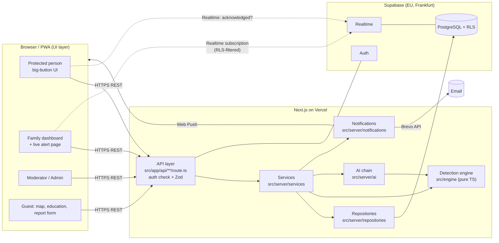
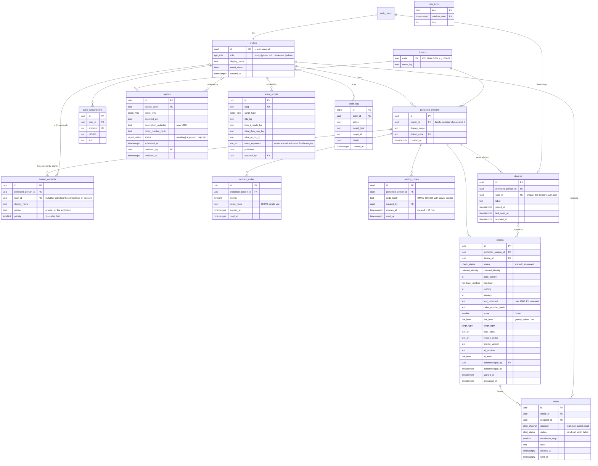

# Scamly: implementation and build plan

> Status: **v1.1**: Q1–Q3 decided by the team on 2 November 2026 (see section 8). Other questions still use the recommended defaults.
> Source of truth for *what* we build: [`PROJECT_BRIEF.md`](./PROJECT_BRIEF.md). This file covers *how* and *when*.
> Anything marked **(proposal)** changes a detail of the brief or fills a gap in it. Each one is listed again in section 8 so you can approve or reject it.

**Contents**

0. [Architecture at a glance](#0-architecture-at-a-glance)
1. [Folder structure](#1-folder-structure)
2. [Database schema and RLS](#2-database-schema-and-rls)
3. [API routes](#3-api-routes)
4. [Detection engine design](#4-detection-engine-design)
5. [Device pairing flow](#5-device-pairing-flow)
6. [Week-by-week tasks](#6-week-by-week-tasks)
7. [Risk register](#7-risk-register)
8. [Open questions and recommended defaults](#8-open-questions-and-recommended-defaults)

---

## 0. Architecture at a glance



Three rules that the whole codebase follows. We will repeat these in the defense:

1. **The browser never writes to the database directly.** Every write goes through our REST API, where Zod validates it and the service layer checks permissions. The browser *reads* through the API, plus Realtime subscriptions for live alerts.
2. **RLS is the second lock.** Even if our API code had a bug, PostgreSQL would still refuse to show user A the data of user B. API handlers use the *user's own* Supabase session wherever possible, so RLS applies to them too. The service-role key (which bypasses RLS) is used only in a short, listed set of server functions (section 2.4).
3. **The detection engine is a pure function.** `analyseCall(input) → verdict` has no database, no network and no clock. That makes it easy to test, easy to explain, and lets it also run on the phone as an offline fallback.

---

## 1. Folder structure

```text
scamly/
├── .github/
│   ├── workflows/            # CI (lint, types, tests, build), keep-alive cron, e2e
│   └── ISSUE_TEMPLATE/       # task template matching section 6 (owner, estimate, done-when)
├── docs/
│   ├── PROJECT_BRIEF.md      # the brief (what and why)
│   ├── BUILD_PLAN.md         # this file (how and when)
│   ├── decisions/            # ADRs: one file per architectural decision (D4–D7 first)
│   ├── learning/             # "what you need to understand" notes, one per week
│   ├── evidence/             # test reports, coverage, Lighthouse screenshots, usability notes
│   ├── security.md           # attack → protection → test that proves it (feeds the slide)
│   └── competition/          # 5-page documentation, leaflet, slides, demo script
├── public/
│   ├── geo/                  # simplified GeoJSON of the 28 districts (ODbL)
│   ├── icons/                # PWA icons (our own)
│   ├── manifest.webmanifest  # PWA manifest (name, icons, start_url)
│   └── sw.js                 # service worker: web push + offline "what to do" card
├── scripts/
│   ├── seed.ts               # `npm run seed`: demo accounts for all roles + sample data
│   └── prepare-geojson.ts    # one-off: simplify the district shapes, keep them small
├── supabase/
│   ├── config.toml           # local Supabase CLI config
│   ├── migrations/           # numbered SQL files: schema, functions, RLS, seed of districts
│   └── tests/                # pgTAP tests: one or more per RLS policy
├── src/
│   ├── app/                  # Next.js App Router: pages only, no business logic
│   │   ├── (public)/         # guest pages: landing, map, education, report, help, privacy
│   │   ├── (auth)/           # login, register, pairing (/svarzhi), invite redemption
│   │   ├── protected/        # older person's big-button UI (check flow, result)
│   │   ├── family/           # family dashboard + live alert page
│   │   ├── moderator/        # report queue, script library editor
│   │   ├── admin/            # users and roles, statistics, audit log
│   │   └── api/              # REST API route handlers (thin: auth → validate → service)
│   ├── components/
│   │   ├── ui/               # our design system: Button, Card, Verdict, BigChoice, Input...
│   │   └── features/         # feature components built from ui/ (CheckWizard, DistrictMap...)
│   ├── engine/               # detection engine Layer 1 + redactPersonalData (pure TS, no deps)
│   ├── i18n/
│   │   └── bg.ts             # EVERY user-visible Bulgarian string lives here
│   ├── lib/                  # small shared helpers: env check, logger, http errors, cn()
│   ├── schemas/              # Zod schemas shared by client forms and API handlers
│   ├── server/               # code that must never reach the browser ("server-only")
│   │   ├── auth/             # getActor(): who is calling, which role; requireRole()
│   │   ├── services/         # business logic: checks, alerts, pairing, reports, admin
│   │   ├── repositories/     # all SQL / Supabase queries, one file per table group
│   │   ├── ai/               # ScamClassifier interface, providers, ClassifierChain
│   │   ├── notifications/    # EmailProvider (Brevo/Resend/Noop), push sender
│   │   ├── security/         # rate limiter, origin check, hashing (HMAC) helpers
│   │   └── supabase/         # client factories: user-scoped, service-role
│   ├── hooks/                # React hooks (useRealtimeAlerts, useSpeechInput...)
│   ├── types/                # generated database types + shared domain types
│   └── middleware.ts         # session refresh, role-based route guards, CSP nonce
├── tests/
│   ├── e2e/                  # Playwright: one spec per role + the full alert flow
│   └── integration/          # Vitest against local Supabase: API + security tests
├── .env.example              # every variable we need, with comments, no real values
├── LICENSE                   # GPL-3.0
├── THIRD_PARTY_LICENSES.md   # every library, font, icon set and dataset with its licence
└── README.md                 # what it is, setup in ≤ 5 commands, demo-accounts table
```

Why `src/engine/` sits outside `src/server/`: the engine is pure, so the protected person's phone can import it for the offline fallback (section 4.9). Nothing in it touches secrets.

---

## 2. Database schema and RLS

### 2.1 ER diagram



### 2.2 Enums

| Enum | Values |
|---|---|
| `app_role` | `family`, `protected`, `moderator`, `admin` (guest = not logged in) |
| `claimed_identity` | `police`, `relative`, `official` (bank, electricity, НЗОК, НАП, НОИ), `courier`, `other` |
| `tri` | `yes`, `no`, `unsure` |
| `handover_method` | `courier_or_stranger`, `throw`, `bank_transfer`, `other` |
| `risk_level` | `green`, `yellow`, `red` |
| `script_type` | `police`, `relative_in_trouble`, `fake_official`, `courier`, `unknown` |
| `check_status` | `started`, `answered` |
| `alert_channel` | `realtime`, `push`, `email` |
| `alert_status` | `pending`, `sent`, `failed` |
| `report_status` | `pending`, `approved`, `rejected` |

### 2.3 Notes on columns, relations and indexes

- **`profiles`** is created by a database trigger when someone signs up (role `family` by default). **Nobody can change their own role**: column privileges allow `UPDATE (display_name, email_alerts)` only. Roles change through the admin API, which writes to `audit_log`.
- **`trusted_contacts`**: `unique (protected_person_id, priority)` and `unique (protected_person_id, user_id)`. When the owner creates a protected person, they become priority 1 automatically. The contact model supports D8 (escalation) from day one.
- **`pairing_codes`**: we store `HMAC-SHA256(code, PAIRING_PEPPER)`, not the code. A plain SHA-256 of a 6-digit code could be reversed by trying all 1,000,000 codes in under a second; with a secret pepper that lives only in Vercel env vars, a leaked database alone is useless. Partial unique index on `code_hash WHERE used_at IS NULL`.
- **`checks`** stores only `text_redacted`: we run `redactPersonalData()` *before* saving (data minimisation). `caller_number_hash` is also an HMAC, so it can find duplicates without revealing the number.
- **`reports`** contains no personal data about the reporter and no address, only the district. No IP address is stored. The rate limiter keeps an HMAC of the IP for at most 1 hour.
- **`districts`**: the 28 Bulgarian districts (`BG-01` … `BG-28`), seeded by migration.
- **Indexes:** `protected_persons(owner_id)`, `trusted_contacts(user_id)`, `devices(protected_person_id)`, `devices(user_id) unique`, `checks(protected_person_id, started_at desc)`, `alerts(recipient_id, created_at desc)`, `alerts(check_id)`, `reports(status, submitted_at)`, `reports(district_code, occurred_on) WHERE status = 'approved'`, `audit_log(created_at desc)`.
- **Realtime publication:** `checks` and `alerts` only. Supabase Realtime applies RLS to each subscriber, so a family member only receives events for people they are linked to.
- **Map statistics** come from a SQL function `get_map_stats(weeks int)`. It returns only `district_code, script_type, week, count` for **approved** reports. Guests get access to the function, not to the `reports` table.
- **Rate limiting** uses the `rate_limits` table and an atomic SQL function `hit_rate_limit(key, max_hits, window_seconds) → boolean`. This keeps us on free tiers, with no extra service such as Redis.

### 2.4 RLS helper functions and when the service role is used

Helper functions (`SECURITY DEFINER`, `STABLE`, `search_path = ''`, so policies don't call each other in loops):

| Function | Returns true when… |
|---|---|
| `app_role()` | returns the caller's role from `profiles` |
| `is_admin()` | caller's role is `admin` |
| `is_moderator()` | caller's role is `moderator` or `admin` |
| `is_owner_of(pid)` | caller created protected person `pid` |
| `has_family_access(pid)` | caller is the owner **or** a trusted contact with `user_id = auth.uid()` |
| `is_device_of(pid)` | caller is a non-revoked device paired to `pid` |

**The service role (bypasses RLS) is used only in these server functions**, each covered by tests:
1. `pairingService.redeem()`: creates the device's auth user and binds it.
2. `deviceService.revoke()`: deletes the device's auth user, which kills its refresh token.
3. `checkService.start()` / `checkService.submitAnswers()`: writes the check and its server-computed verdict. A phone must not be able to send its own verdict.
4. `alertService.fanOut()`: creates alert rows for *other* users and sends push/email.
4b. `checkService.acknowledge()`: the family member's „Обаждам ѝ се сега“ writes `acknowledged_by` on the check (no client UPDATE policy on `checks`).
5. `reportService.submit()`: guest reports. Guests have no `INSERT` policy, so a bot can't skip our rate limiter by calling the database directly.
6. `adminService.changeRole()` and `audit.log()`.
7. `rateLimiter.hit()`.
8. `GET /api/health` (keep-alive).

Every one of these first checks permission in code. Where the caller is logged in, it also loads the target with the **user-scoped** client, so RLS proves the caller may see it. That gives us two locks.

### 2.5 RLS policy table

Legend: ✅ allowed · ❌ denied (no policy) · 🔒 only own rows / only with the condition shown. "Client" here means a direct Supabase call with the user's JWT, which is what Realtime uses. Writes marked ❌ still happen through the API as described in 2.4.

| Table | Guest (anon) | Protected device | Family | Moderator | Admin |
|---|---|---|---|---|---|
| `profiles` | ❌ | SELECT 🔒 own | SELECT 🔒 own · UPDATE 🔒 own (`display_name`, `email_alerts` only) | same as family | SELECT ✅ all · role changes via API |
| `protected_persons` | ❌ | SELECT 🔒 `is_device_of(id)` | SELECT 🔒 `has_family_access(id)` · INSERT 🔒 `owner_id = auth.uid()` and role = family · UPDATE/DELETE 🔒 `is_owner_of(id)` | ❌ | SELECT ✅ |
| `trusted_contacts` | ❌ | SELECT 🔒 `is_device_of(pid)` (needed for the "call Ivan" button) | SELECT 🔒 `has_family_access(pid)` · INSERT/UPDATE/DELETE 🔒 `is_owner_of(pid)` | ❌ | SELECT ✅ |
| `contact_invites` | ❌ | ❌ | SELECT 🔒 `is_owner_of(pid)` | ❌ | ❌ |
| `pairing_codes` | ❌ | ❌ | ❌ (service role only) | ❌ | ❌ |
| `devices` | ❌ | SELECT 🔒 `user_id = auth.uid()` | SELECT 🔒 `has_family_access(pid)` | ❌ | SELECT ✅ |
| `checks` | ❌ | SELECT 🔒 `is_device_of(pid)` | SELECT 🔒 `has_family_access(pid)` | ❌ | SELECT ✅ (for statistics) |
| `alerts` | ❌ | ❌ | SELECT 🔒 `recipient_id = auth.uid()` | ❌ | SELECT ✅ |
| `push_subscriptions` | ❌ | SELECT/INSERT/DELETE 🔒 own | SELECT/INSERT/DELETE 🔒 own | same | same |
| `districts` | SELECT ✅ | SELECT ✅ | SELECT ✅ | SELECT ✅ | SELECT ✅ |
| `reports` | ❌ (aggregates only via `get_map_stats`) | ❌ | ❌ | SELECT ✅ · UPDATE ✅ (`status`, `reviewed_*`, `reject_reason`) | SELECT/UPDATE/DELETE ✅ |
| `scam_scripts` | SELECT 🔒 `published` | SELECT 🔒 `published` | SELECT 🔒 `published` | SELECT ✅ · INSERT/UPDATE ✅ | ✅ all |
| `audit_log` | ❌ | ❌ | ❌ | ❌ | SELECT ✅ (insert only via service role, no UPDATE/DELETE for anyone, so it's append-only) |
| `rate_limits` | ❌ | ❌ | ❌ | ❌ | ❌ |

**RLS tests** (`supabase/tests/*.test.sql`, pgTAP, run with `supabase test db`). For every table: each role sees exactly what the table above says. Every "🔒 own" row also has an **IDOR test**: family member B tries to read A's protected person, checks, devices and alerts, and gets zero rows. Other tests: a family member can't update their own role, and a revoked device can't read anything.

---

## 3. API routes

All routes live in `src/app/api/**/route.ts` and follow the same 4-step shape. It's easy to explain in the defense:

```ts
export async function POST(req: Request) {
  const actor = await requireRole(req, ["family"]);        // 1. who are you? (401/403)
  const input = CreatePersonSchema.parse(await req.json()); // 2. is the input valid? (400)
  const result = await personService.create(actor, input);  // 3. business logic + ownership check (403/404)
  return json(result, 201);                                 // 4. respond
}
```

Common to all routes: JSON only, errors as `{ error: { code, messageBg } }`, a same-origin check on every non-GET request (CSRF), and no stack traces in responses.

| # | Method | Path | Role | Input (Zod schema) | Purpose |
|---|---|---|---|---|---|
| **System** ||||||
| 1 | GET | `/api/health` | anyone | none | Touches the DB (`select 1 from districts`). Used for keep-alive and uptime pings |
| **Me / account** ||||||
| 2 | GET | `/api/me` | any logged in | none | Role, display name, linked protected person (for devices) |
| 3 | PATCH | `/api/me` | family, mod, admin | `UpdateMeSchema {displayName?, emailAlerts?}` | Update own profile |
| 4 | DELETE | `/api/me` | family | `DeleteMeSchema {confirm: "ИЗТРИЙ"}` | GDPR: delete account + owned protected persons + their data |
| 5 | GET | `/api/me/export` | family | none | GDPR: download my data as JSON |
| *(Sign up / login / logout use Supabase Auth from the browser through `@supabase/ssr`. Supabase applies its own rate limits to these.)* ||||||
| **Protected persons and contacts** ||||||
| 6 | GET | `/api/persons` | family | none | List people I have access to |
| 7 | POST | `/api/persons` | family | `CreatePersonSchema {displayName, districtCode}` | Create a protected person; I become contact #1 |
| 8 | GET | `/api/persons/:id` | family (access) | `IdParam` | Details + contacts + devices |
| 9 | PATCH | `/api/persons/:id` | family (owner) | `UpdatePersonSchema` | Rename, change district |
| 10 | DELETE | `/api/persons/:id` | family (owner) | `IdParam` | Delete the person and all their data; revoke devices |
| 11 | PUT | `/api/persons/:id/contacts` | family (owner) | `ContactsSchema [{id?, displayName, phone, priority}]` (1–5 items) | Replace the ordered contact list |
| 12 | POST | `/api/persons/:id/invites` | family (owner) | `CreateInviteSchema {displayName, priority}` | Invite another relative (link + code) |
| 13 | POST | `/api/invites/redeem` | family | `RedeemInviteSchema {token}` | Accept an invite, become a trusted contact |
| **Pairing and devices** ||||||
| 14 | POST | `/api/persons/:id/pairing-codes` | family (owner) | `IdParam` | New 6-digit code + QR payload, valid 10 min; old unused codes are cancelled |
| 15 | POST | `/api/pairing/redeem` | guest (rate-limited) | `RedeemCodeSchema {code: /^\d{6}$/, label?}` | Redeem the code, create the device session, set cookies |
| 16 | DELETE | `/api/devices/:id` | family (owner) | `IdParam` | Revoke: delete the binding + the device's auth user (signs it out) |
| **Checks (call check)** ||||||
| 17 | POST | `/api/checks` | protected | `StartCheckSchema {}` | Big button pressed: create the check and **alert family immediately** |
| 18 | PUT | `/api/checks/:id/answers` | protected (own) | `AnswersSchema {claimedIdentity, asksMoney, handover?, rushing, secrecy, text?(≤2000), callerNumber?}` | Run the engine, store the verdict, update the alerts, return the verdict |
| 19 | POST | `/api/checks/:id/ai-review` | protected (own) | `IdParam` | *(Week 3)* Layer 2 on the stored redacted text. May raise the level only |
| 20 | POST | `/api/checks/:id/acknowledge` | family (access) | `IdParam` | „Обаждам ѝ се сега“: the protected screen shows „Иван ще ви се обади веднага“ |
| 21 | GET | `/api/checks` | family | `ListChecksQuery {personId, cursor?}` | History of checks for one person |
| 22 | GET | `/api/checks/:id` | family (access), protected (own) | `IdParam` | One check with its verdict and reasons |
| **Notifications** ||||||
| 23 | POST | `/api/push/subscriptions` | any logged in | `PushSubscriptionSchema {endpoint, keys:{p256dh, auth}}` | Save a web-push subscription |
| 24 | DELETE | `/api/push/subscriptions` | any logged in | `{endpoint}` | Remove it |
| **Public: map, education, reports** ||||||
| 25 | GET | `/api/map/stats` | anyone | `MapStatsQuery {weeks: 1–12}` | Counts per district × script; "wave" flags |
| 26 | GET | `/api/scripts` | anyone | none | Published scam scripts (education pages) |
| 27 | POST | `/api/reports` | anyone (rate-limited, honeypot) | `ReportSchema {districtCode, scriptType, occurredOn, description?(≤1000), callerNumber?, website: "" }` | Anonymous report → moderation queue |
| **Moderator** ||||||
| 28 | GET | `/api/moderation/reports` | moderator | `ModQueueQuery {status, cursor?}` | Queue |
| 29 | PATCH | `/api/moderation/reports/:id` | moderator | `ModerateSchema {decision: approve\|reject, rejectReason?}` | Approve or reject (audited) |
| 30 | POST | `/api/scripts` | moderator | `ScriptSchema` | New script card |
| 31 | PATCH | `/api/scripts/:id` | moderator | `ScriptSchema.partial()` | Edit, publish/unpublish, extra keywords (audited) |
| **Admin** ||||||
| 32 | GET | `/api/admin/users` | admin | `UsersQuery {q?, role?, cursor?}` | List users |
| 33 | PATCH | `/api/admin/users/:id/role` | admin | `ChangeRoleSchema {role: family\|moderator\|admin}` | Change role (audited; can't demote yourself) |
| 34 | GET | `/api/admin/stats` | admin | `StatsQuery {days: 7–90}` | Checks per day, by script type, by risk level, reports per district |
| 35 | GET | `/api/admin/audit-log` | admin | `AuditQuery {cursor?}` | Audit log |
| **Cron (secret-protected)** ||||||
| 36 | POST | `/api/cron/escalate` | `CRON_SECRET` header | none | *(Week 3 stretch)* Escalate unacknowledged alerts to the next contact |

Status codes: 200/201 OK, 400 validation, 401 not logged in, 403 wrong role or not your resource, 404 not found (we return 404 rather than 403 for resources you can't see, so we don't reveal that they exist), 409 conflict, 429 rate-limited, 500 with a friendly Bulgarian message.

---

## 4. Detection engine design

Location: `src/engine/`. No imports from React, Next.js or Supabase. The only import from outside the folder is `src/i18n/bg.ts`, which is a plain object of strings.

```text
src/engine/
├── index.ts            # public API: analyseCall(), combineVerdicts(), redactPersonalData()
├── types.ts            # CallInput, Verdict, Reason, HardRuleId... (plain types)
├── normalise.ts        # lower-case, strip punctuation, Latin→Cyrillic, tokenise
├── transliterate.ts    # шльокавица rules (multi-letter first: sht, sh, ch, zh, ts, ya...)
├── fuzzy.ts            # Damerau-Levenshtein distance + stem matching
├── dictionary.ts       # signal categories → Bulgarian stems and phrases
├── signals.ts          # text → detected signals (with the matched words, for reasons)
├── scoring.ts          # weights + score calculation
├── hardRules.ts        # D10: each rule = id + condition + bg explanation key
├── verdict.ts          # score + hard rules → level, script type, reasons, wording
├── redact.ts           # redactPersonalData()
└── __tests__/          # Vitest, ≥ 25 cases in Week 1 (section 9 of the brief)
```

### 4.1 Input

```ts
// like a Python TypedDict / dataclass
export type CallInput = {
  claimedIdentity: "police" | "relative" | "official" | "courier" | "other" | null;
  asksMoney: "yes" | "no" | "unsure" | null;
  handover: "courier_or_stranger" | "throw" | "bank_transfer" | "other" | null; // only asked if asksMoney = yes
  rushing: "yes" | "no" | "unsure" | null;
  secrecy: "yes" | "no" | "unsure" | null;
  text: string;                 // what the caller said; may be "" (we cap it at 2000 chars)
  extraKeywords?: ExtraKeyword[]; // from the moderator script library, injected by the service
};
```

`null` means "not answered", for example when the person skipped a question or only typed text.

**(proposal)** The UI asks **4 questions + 1 conditional**, each a big tap target:
1. „Кой казва, че е?“ → Полиция · Роднина · Банка/ток/НЗОК · Куриер · Друг
2. „Искат ли пари или ценности?“ → Да · Не · Не знам
3. *(only if 2 = Да)* „Как искат да ги дадете?“ → На куриер/непознат · Да ги хвърля · По банков път · Друго
4. „Карат ли ви да бързате?“ → Да · Не · Не знам
5. „Казват ли ви да не казвате на никого?“ → Да · Не · Не знам

We split "rushing" from "secrecy" because hard rule HR3 (secrecy + money) needs secrecy on its own. Question 3 lets the "throw it from the balcony / give it to a courier" hard rule fire even when the person types nothing.

### 4.2 Output

```ts
export type Verdict = {
  score: number;                 // 0–100, integer
  level: "green" | "yellow" | "red";
  scriptType: "police" | "relative_in_trouble" | "fake_official" | "courier" | "unknown";
  hardRules: HardRuleId[];       // e.g. ["HR1_POLICE_ASKS_MONEY"]
  reasons: Reason[];             // [{ code, textBg, evidence? }] never empty for red/yellow
  headlineBg: string;            // „ТОВА Е ИЗМАМА.“ / „Внимание!“ / D9 wording for green
  adviceBg: string;              // „Затворете телефона. Полицията никога не иска пари.“
  engineVersion: string;         // "1.0.0", stored with each check
};
```

### 4.3 Normalisation pipeline (text)

| Step | What | Example |
|---|---|---|
| 1 | Cap at 2000 chars, Unicode NFC, lower-case | `ПОЛИЦИЯ` → `полиция` |
| 2 | Replace digits used as letters **only inside words** (`4`→ч, `6`→ш) | `ne ka6ete` → `ne kaшete` |
| 3 | **Latin → Cyrillic** per word with шльокавица rules, longest match first: `sht`→щ, `sh`→ш, `ch`→ч, `zh`→ж, `ts`→ц, `yu/iu`→ю, `ya/ia`→я, `q`→я, `w`→в, `x`→х, `h`→х, `j`→й, `y`→ъ/й (context), then single letters | `hvarlete parite ot terasata` → `хварлете парите от терасата` |
| 4 | Strip punctuation, collapse spaces, split into tokens | |
| 5 | Remove nothing else. Stop-words stay, because phrases like „не казвайте“ depend on „не“ | |

### 4.4 Matching: stems + typos

- The dictionary stores **stems**, not whole words: `хвърл` matches хвърлете, хвърли, хвърлям. This is "light stemming". It's easier to explain and test than a full Bulgarian stemmer, and it handles definite articles (-ът, -та, -то) and plural forms for free.
- **Typos and шльокавица ambiguity** (`a` for `ъ`, `i` for `й`): a token matches a stem when the **Damerau-Levenshtein distance** between the stem and the start of the token is within the tolerance below. Damerau-Levenshtein is edit distance that also counts swapped letters as one edit.
  - stem length ≤ 4 → 0 edits (short words get no typo slack, which avoids false hits)
  - 5–8 → 1 edit
  - ≥ 9 → 2 edits
  - Example: `хварлете` vs stem `хвърл` → 1 edit → match. `politsiya` → `полиция` → exact.
- **Phrases** are lists of stems that must appear **in order within a window of 6 tokens**. Example: `["не", "казв", "никог"]` matches „не казвайте на никого“ and „ne kazvaite na nikogo“.
- Every match records the original words it came from, so reasons can quote them: „Казаха ви: „хвърлете парите от терасата““.

### 4.5 Signal categories and weights

Each **category** contributes **once**, using the stronger of the answer and the text. If both say "money", we don't count money twice. Weights are constants in `scoring.ts`, so they're easy to tune and test.

| Category | From answers | From text (examples of stems) | Weight |
|---|---|---|---|
| Identity: police | `police` | полиц, полицай, инспектор, мвр, данс, прокурор, следовател | 25 |
| Identity: official | `official` | банк, евн, енерго, електро, нзок, нап, нои, пенси, служител | 15 |
| Identity: relative | `relative` | син, дъщер, внук, внучк, снах, зет, бабо, дядо, мамо | 10 |
| Identity: courier | `courier` | куриер, колет, пратк, доставк | 10 |
| Identity: other | `other` | none | 5 |
| Money / valuables | `yes` 35 · `unsure` 15 | пари, спестяван, лев, евро, злат, бижут, сума, налич, сейф | 30 |
| Urgency | `yes` 15 · `unsure` 5 | веднага, спешн, бързо, сега, няма време, до час | 15 |
| Secrecy | `yes` 20 · `unsure` 10 | не казв…никог, тайн, не се обажд, не затваря | 20 |
| Scenario: police | none | акция, залав, измамниц, помогнете…полиц, фалшив…банкнот, серийн…номер | 15 |
| Scenario: relative | none | катастроф, блъсн, болниц, операци, арест, задърж, гаранци | 15 |
| Scenario: official | none | надвзет, надплат, компенсац, връщане…пари, неплатен…сметк | 10 |
| Scenario: courier | none | мито, доплащ, такса…доставк | 10 |
| Bank transfer handover | `bank_transfer` 10 · `other` 5 | преведете, превод, сметк | 10 |

`score = min(100, sum of category contributions)`. Moderator-added keywords (`extraKeywords`) attach to an existing category, so they can't invent new weights.

### 4.6 Hard rules (D10): force red regardless of score

| Id | Name (bg) | Condition | Explanation shown (bg, lives in `bg.ts`) |
|---|---|---|---|
| HR1 | „Полиция иска пари“ | identity = police (answer or text) **and** money (answer `yes` or text) | „Полицията никога не иска пари или ценности по телефона.“ |
| HR2 | „Предаване на непознат“ | handover ∈ {courier_or_stranger, throw} **or** text phrase: хвърл…(пари\|торб\|плик\|балкон\|терас\|прозор), предайте/дайте…(куриер\|човек\|колег), оставете…(врат\|пощенск) | „Никой честен човек не иска да хвърляте пари или да ги давате на непознат.“ |
| HR3 | „Тайна + пари“ | secrecy (answer `yes` or text) **and** money | „Когато някой иска пари и ви казва да не казвате на никого, това е измама.“ |
| HR4 | „Искат кодове“ | text asks for ПИН, парола, код от SMS, CVV, номер на карта | „Банката никога не иска ПИН, пароли или кодове по телефона.“ |
| HR5 | „Сигурна сметка“ | text: (сигурн\|защитен\|безопасн)…сметк, or „прехвърлете…парите“ + identity official/police | „Няма „сигурна сметка“. Това е класическа измама.“ |
| HR6 | „Роднина в беда“ | identity = relative **and** money `yes` **and** (urgency **or** scenario: relative) | „Затворете и се обадете сами на роднината на номера, който знаете.“ |

Only firm evidence fires a hard rule: an answer of `yes` or a text match. `unsure` answers add score but never fire a hard rule.

### 4.7 From score to verdict

```
if hardRules not empty              → red
else if score ≥ 60                  → red
else if score ≥ 30                  → yellow
else if asksMoney == "yes"          → yellow   // "money floor": a request for money is never green
else                                → green    // wording = D9, never "safe"
```

**Script type** = the script with the most evidence: identity weight + scenario weight + the hard rule linked to it. Ties go to the identity answer. If there is no evidence, the type is `unknown`.

**Reasons**: one reason per hard rule and per contributing category, sorted by weight, top 4 shown to the protected person and all of them shown to family. A red or yellow verdict always has ≥ 1 reason (tested).

Worked examples (each becomes a test):

| Case | Calculation | Result |
|---|---|---|
| Police + money | HR1 | 🔴 red, police |
| Relative + money + rushing | 10 + 35 + 15 = 60, also HR6 | 🔴 red, relative_in_trouble |
| Relative + money, no rush (a real grandson borrowing) | 10 + 35 = 45 | 🟡 yellow: "call them back on the number you know" |
| Courier + money (cash on delivery is common in Bulgaria) | 10 + 35 = 45 | 🟡 yellow, not red |
| Bank reminder, asks for nothing | 15 | 🟢 green, D9 wording |
| Grandchild calls to chat | 10 | 🟢 green, D9 wording |
| Only "other", empty text | 5 | 🟢 green, D9 wording |
| Text only: „politsiyata, dayte parite na kuriera“ | HR1 + HR2 | 🔴 red, police |

### 4.8 `redactPersonalData(text, knownNames?)`

Runs before saving any text **and** before sending anything to AI. It replaces matches with `[ТЕЛЕФОН]`, `[ИМЕЙЛ]`, `[IBAN]`, `[КАРТА]`, `[ЕГН]`, `[ИМЕ]`:
- phones: `+359…`, `00359…`, `08x…`, with spaces/dashes/dots
- emails
- IBAN: `BG\d{2}[A-Z]{4}\d{6}[A-Z0-9]{8}` plus a generic IBAN shape, with spaces allowed
- card numbers: 13–19 digits that pass the Luhn check
- ЕГН (Bulgarian personal number): 10 digits
- `knownNames`: names of the protected person and their contacts (we know them, so we can remove them reliably)

### 4.9 Where it runs

- **Server (authoritative):** `PUT /api/checks/:id/answers` runs it and stores the result. This is the verdict family members see.
- **Phone (fallback) (proposal):** the check wizard imports the same engine. If the network request fails or takes longer than 4 s, the phone shows the locally computed verdict straight away and retries the upload in the background. The red "hang up" message never depends on Wi-Fi. This is a strong point for the defense.

### 4.10 Layer 2 (AI): how it plugs in (Week 3)

```ts
// like a Python Protocol / abstract base class
export interface ScamClassifier {
  name: string;
  classify(input: ClassifierInput, signal: AbortSignal): Promise<AiOpinion>;
}
export type ClassifierInput = { textRedacted: string; answers: Omit<CallInput, "text"> };
export type AiOpinion = {
  scriptType: ScriptType;
  level: RiskLevel;
  confidence: number;      // 0–1
  explanationBg: string;   // ≤ 300 chars
};
```

- Providers: `GeminiClassifier`, `GroqClassifier`, and `RuleBasedClassifier` (wraps Layer 1 and never throws). Alex's future multi-LLM router is just another `ScamClassifier`.
- `ClassifierChain(providers, { perProviderTimeoutMs: 3000, totalBudgetMs: 7000 })` tries each provider in turn. A provider fails if it times out, throws, hits a rate limit, or returns JSON that doesn't pass the `AiOpinionSchema` Zod check. On failure the chain moves to the next provider. The last provider is always the rule engine, so the chain **always** returns an answer.
- Prompt: a fixed system prompt that asks for strict JSON with enum values. The caller's text goes in a clearly marked data block. Because the model's output is limited to enums plus a short text that React escapes before display, prompt injection can't do anything harmful.
- `combineVerdicts(rule, ai)`:
  - AI is ignored if `confidence < 0.6`.
  - AI can **raise the level by at most one step** (green → yellow, yellow → red) **(proposal)**. That limits the damage from a single hallucination.
  - AI can **never lower** the level. A red from rules stays red. (The brief requires this, and it gets a dedicated test.)
- **UX timing:** the result screen shows the Layer 1 verdict immediately (< 1 s). The AI review runs afterwards. If it raises the level, the screen updates. This keeps the "< 5 seconds" promise even when every AI provider is slow.
- **Bulgarian quality (proposal):** AI-written text may contain grammar mistakes, and the jury scores Bulgarian. So the protected person only ever sees **our own curated wording** from `bg.ts`. The AI explanation appears only in the family history, labelled „Допълнителен анализ (ИИ)“.

---

## 5. Device pairing flow

**(proposal) Change from the brief's suggestion.** We recommend the brief's *fallback* option as the main design: **the server creates the device's login only after a correct code is redeemed**, instead of Supabase anonymous sign-in. Why:
- With anonymous sign-in, *anyone* who opens the page creates an auth user before entering a code. Bots could fill our user table, and we'd need CAPTCHA and cleanup jobs.
- With server-created device users, **nothing exists until the code is correct**. There's less to defend, and revoking the device just deletes that user.
- RLS policies don't need to handle a third kind of "anonymous but sort-of-bound" user.

The device user gets an internal email `device-<uuid>@devices.scamly.invalid` (the `.invalid` top-level domain is reserved and can never receive mail) and a random 32-byte password. The server uses the password once to sign in and then **forgets it**: it's never stored or shown. From then on, only the refresh token in an HttpOnly cookie keeps the phone logged in.

```mermaid
sequenceDiagram
  autonumber
  actor F as Family member (logged in)
  participant FB as Family browser
  participant API as Scamly API (Next.js)
  participant DB as PostgreSQL (RLS)
  participant AUTH as Supabase Auth
  actor O as Older person's phone

  F->>FB: „Свържи телефон“ on Баба Мария
  FB->>API: POST /api/persons/{id}/pairing-codes
  API->>DB: is_owner_of(id)? (user-scoped client, RLS)
  DB-->>API: yes
  API->>API: code = crypto random 6 digits<br/>hash = HMAC-SHA256(code, PAIRING_PEPPER)
  API->>DB: cancel old unused codes; insert {hash, expires_at = now + 10 min}
  API->>DB: audit_log "pairing_code_created"
  API-->>FB: {code: "482915", expiresAt}
  FB-->>F: shows 482 915 + QR (URL /svarzhi?kod=482915) + countdown

  F->>O: opens scamly…/svarzhi on grandma's phone (or scans QR)
  O->>API: POST /api/pairing/redeem {code}
  API->>DB: hit_rate_limit("pair:ip:" + HMAC(ip), 5 per 15 min)<br/>and ("pair:global", 100 per 15 min)
  alt over the limit
    API-->>O: 429 „Твърде много опити. Опитайте след малко.“
  end
  API->>DB: find code where hash matches AND used_at IS NULL AND expires_at > now()<br/>and mark used_at = now() in the same UPDATE … RETURNING (single use, no race)
  alt not found / expired / used
    API-->>O: 400 „Кодът е грешен или е изтекъл.“ (same message for all, so it reveals nothing)
  end
  API->>AUTH: admin.createUser(device-<uuid>@devices.scamly.invalid, random 32 B secret, email_confirm)
  API->>DB: profiles.role = 'protected'; insert devices {person_id, user_id, label}
  API->>AUTH: signInWithPassword (server side, once) → session
  API-->>O: Set-Cookie: session (HttpOnly, Secure, SameSite=Lax), 200
  API->>DB: audit_log "device_paired"
  O-->>O: redirect /protected → big button. Prompt „Добави на началния екран“

  Note over O,AUTH: From now on the refresh token renews the session silently.<br/>The older person never sees a login screen.

  F->>FB: Devices → „Премахни“ on a lost phone
  FB->>API: DELETE /api/devices/{deviceId}
  API->>DB: is_owner_of(device.person_id)?
  API->>AUTH: admin.deleteUser(device.user_id) → refresh token dies
  API->>DB: devices row cascades away; audit_log "device_revoked"
  Note over O: The next request from that phone gets 401 → shows<br/>„Този телефон вече не е свързан. Помолете близък да го свърже отново.“
```

Why a 6-digit code is enough: there are 1,000,000 combinations. A code lives for 10 minutes, and we allow at most 5 guesses per IP per 15 minutes and 100 guesses in total per 15 minutes. So the chance that an attacker hits a specific active code before it expires is about 100 / 1,000,000 = 0.01 %, and they'd also have to know a code is active right now. The ADR will include this calculation.

---

## 6. Week-by-week tasks

**Assumptions.** About **10–12 hours per person per week** next to school. Estimates are *your* time: reviewing, testing, understanding and defending the code, plus any coding you do yourselves. They don't count Claude's typing time. Each task = 1 GitHub issue. Owner = the person whose name is on the commits for that task and who must be able to explain it. The other person reads the commit on GitHub before the next task starts.

**Git workflow (decided, Q3 + Q16).** There is **one branch only: `main`**. No feature branches, no pull requests. Claude commits in the name of whoever is working (Alex or Roberta), with no co-author lines, and pushes to `main` only after that person says "push". Before every push, lint, type-check and tests must pass locally.

Legend: **A** = Alex, **R** = Roberta, **A+R** = shared. ✂ = may be cut (D12 order).

### Week 1 (2–8 Nov): foundations + engine v1

| ID | Task | Owner | h | Depends on | Done when |
|---|---|---|---|---|---|
| W1-01 | Scaffold: Next.js (current stable, pinned), TS strict, Tailwind, ESLint + Prettier, Vitest, Playwright, `LICENSE` (GPL-3.0), `README`, `.env.example`, `THIRD_PARTY_LICENSES.md`, issue template | A | 4 | none | `npm run lint && npm run typecheck && npm test && npm run build` all pass on a fresh clone |
| W1-02 | GitHub Actions CI: lint, typecheck, unit tests + coverage, build on every push to `main` | A | 2 | W1-01 | A commit on GitHub shows a green ✓. A deliberately broken test turns it red |
| W1-03 | ADRs: 0001 stack, 0002 device pairing (D4), 0003 email provider (D5), 0004 AI chain (D6), 0005 alert channels (D7) | A (0001, 0002, 0005), R (0003, 0004) | 3 | none | 5 files in `docs/decisions/`, each with context, options, decision, consequences |
| W1-04 | Supabase: cloud project (EU), local CLI, migration 0001 (enums, tables, indexes, districts seed), generated TS types | A | 5 | W1-01 | `supabase db reset` builds the schema from zero; `src/types/database.ts` generated |
| W1-05 | RLS: helper functions + all policies (table 2.5) + column privileges + pgTAP tests incl. IDOR tests | A | 6 | W1-04 | `supabase test db` green; ≥ 1 test per policy row; IDOR tests prove B can't see A's data |
| W1-06 | Auth for family/mod/admin: register, login, logout pages; profile trigger; `getActor()` / `requireRole()`; middleware route guards per role | A | 5 | W1-04 | Logging in as each role lands on its own dashboard; wrong role → 403 page; tests for `requireRole` |
| W1-07 | Device pairing: code endpoint, redeem endpoint, rate limiter (`hit_rate_limit`), device session, revoke, `/svarzhi` page (code input; QR scanning in W2) | A | 8 | W1-05, W1-06 | Integration tests: valid code pairs; reused/expired/wrong code → 400; 6th try → 429; revoked device → 401 |
| W1-08 | Engine part 1: `types.ts`, `normalise.ts`, `transliterate.ts`, `fuzzy.ts` with their own unit tests | R | 6 | W1-01 | `politsiya`→`полиция`, `hvarlete`≈`хвърл`, distance tests pass |
| W1-09 | Engine part 2: `dictionary.ts`, `signals.ts`, `scoring.ts`, `hardRules.ts`, `verdict.ts`, `analyseCall()` | R | 7 | W1-08 | All worked examples in 4.7 pass as tests |
| W1-10 | Engine tests to ≥ 25 (brief section 9) + `redactPersonalData()` with tests; engine coverage ≥ 90 % | R | 5 | W1-09 | `npm test` shows ≥ 25 engine tests; coverage report saved to `docs/evidence/` |
| W1-11 | Design system: colour tokens light/dark (WCAG AA checked), typography scale, `Button`, `Card`, `Verdict`, `BigChoice`, `ThemeToggle`; `bg.ts` skeleton; a `/dev/ui` preview page | R | 6 | W1-01 | Preview page shows every component in light + dark; contrast ratios listed in a comment |
| W1-12 | Seed script: demo accounts (family, moderator, admin), a protected person with a paired demo device, contacts, sample checks/reports | R | 3 | W1-05, W1-07 | `npm run seed` on an empty DB → README demo table logins all work |
| W1-13 | Vercel deploy (fra1), env vars, `/api/health`, GitHub Actions keep-alive cron (every 12 h) | A | 2 | W1-04 | Production URL live; health returns `{ok: true, db: true}`; cron run visible in Actions |
| W1-14 | `docs/learning/week-1.md` (TS for Python programmers, Supabase/RLS, Zod) | A+R | 2 | all | Both of us can explain every W1 file without notes (test each other) |

Week 1 totals: **A ≈ 33 h, R ≈ 28 h**. This is the heaviest week. If it overflows, W1-07 (pairing) and W1-12 (seed) move to Monday 9 Nov. They're Week 2's first dependencies, so no further.

### Week 2 (9–15 Nov): call check + family alert (the core of the demo)

| ID | Task | Owner | h | Depends on | Done when |
|---|---|---|---|---|---|
| W2-01 | Protected UI: home with the giant button, wizard (4 + 1 questions), optional text, result screen (red/yellow/green), `tel:` button to contact #1, start-after-call link | R | 8 | W1-11, W1-09 | Works on a cheap Android at 360 px; all text from `bg.ts`; base font ≥ 18 px, buttons ≥ 64 px |
| W2-02 | Checks API + service: `POST /api/checks`, `PUT /answers` (engine on server), `GET` endpoints; offline fallback in the wizard | A | 6 | W1-07, W1-09 | Integration tests: device can only touch own checks; verdict stored; network-off test shows local verdict |
| W2-03 | Alert fan-out + Realtime: alert rows on start + on verdict; family live page `/family/alerts` subscribed via Realtime with a 5 s polling fallback | A | 6 | W2-02 | Pressing the button on phone A shows the alert on browser B in < 3 s |
| W2-04 | Acknowledge: „Обаждам ѝ се сега“ → protected screen shows „Иван ще ви се обади веднага“ (Realtime on the check) | A | 3 | W2-03 | Round trip works in the e2e test W2-11 |
| W2-05 | Web push: VAPID keys, service worker, opt-in UI, send on alert, cleanup of dead subscriptions; iOS "add to home screen" hint | A | 6 | W2-03 | Push arrives on Android Chrome; on iOS after A2HS (manual test noted in evidence) |
| W2-06 | `EmailProvider` interface + `BrevoEmailProvider` + `NoopEmailProvider` (+ `ResendEmailProvider` stub); alert email template in Bulgarian | R | 4 | W1-01 | Switching `EMAIL_PROVIDER=noop` needs no code change; unit tests with a fake HTTP client |
| W2-07 | Family dashboard UI: people list, create person, contacts order (drag or ↑↓), pairing screen with QR, devices + revoke, check history | R | 8 | W1-07, W2-02 | All actions work through the API; empty/loading/error states in Bulgarian |
| W2-08 | Contacts + invite API: `PUT contacts`, invites create/redeem | A | 4 | W1-05 | A second family account receives alerts after redeeming an invite |
| W2-09 | PWA: manifest, icons, install prompt, offline "what to do" card | R | 3 | W2-01 | Lighthouse "installable" ✓; card shows in airplane mode |
| W2-10 | ✂ Voice input (Web Speech API, `bg-BG`), hidden where unsupported, typing always available | R | 3 | W2-01 | Works in Chrome Android; button absent in unsupported browsers; no errors |
| W2-11 | E2E: protected device presses the button → family context sees the alert → acknowledges → protected sees the message (2 Playwright contexts) | A+R | 4 | W2-04 | Green in CI against local Supabase |
| W2-12 | `docs/learning/week-2.md` (Realtime, service workers, React state) | A+R | 2 | all | Written |

Totals: **A ≈ 27 h, R ≈ 28 h** (+ shared).

### Week 3 (16–22 Nov): public side, admin, AI

| ID | Task | Owner | h | Depends on | Done when |
|---|---|---|---|---|---|
| W3-01 | Reports API: submit (Zod, honeypot, rate limit 3/h per IP, redaction), `get_map_stats` function | A | 4 | W1-05 | Integration tests: honeypot filled → silently dropped; 4th report → 429 |
| W3-02 | Report form UI (guest) | R | 2 | W3-01 | Form works without login, all text in Bulgarian |
| W3-03 | District map: simplify GeoJSON (< 300 KB), Leaflet choropleth, legend, "scam wave" texts, ODbL attribution | R | 7 | W3-01 | Map loads on 4G in < 3 s; attribution visible; entries added to `THIRD_PARTY_LICENSES.md` |
| W3-04 | Moderation: queue API + UI (approve/reject with reason), audited | A (API) + R (UI) | 4 | W3-01 | Approved report appears on the map; rejected never does |
| W3-05 | Education pages from `scam_scripts` + moderator script editor (incl. extra keywords fed to the engine) | R | 6 | W1-05 | 4 script cards seeded; editor change appears after publish |
| W3-06 | Admin: users + role change (audited, no self-demotion), stats charts, audit log view | A | 7 | W1-06 | Each admin action creates an audit row (tested) |
| W3-07 | ✂ AI layer: `ScamClassifier`, Gemini + Groq providers, `ClassifierChain`, `combineVerdicts`, `/ai-review` | A | 7 | W2-02 | Tests with fake providers: timeout → next; invalid JSON → next; all down → rules; AI never lowers red |
| W3-08 | „Помощ“ pages per role (user documentation, with screenshots) | R | 3 | W2-07 | One page per role, linked from each dashboard |
| W3-09 | ✂ Escalation: `pg_cron` every minute → `/api/cron/escalate`; contact #2 after N min; suggest 112 | A | 5 | W2-03 | Test: no acknowledgement in N min → alert to priority 2 |
| W3-10 | ✂ Printable fridge card (A5, large text, QR) | R | 2 | W2-07 | Prints cleanly from the browser |
| W3-11 | `docs/learning/week-3.md` | A+R | 2 | all | Written |

Totals: **A ≈ 25 h, R ≈ 22 h**. If behind on Sunday 22 Nov: drop W3-07 (AI) first, then W3-09 (escalation), per D12.

### Week 4 (23–29 Nov): harden, test, validate, register

| ID | Task | Owner | h | Depends on | Done when |
|---|---|---|---|---|---|
| W4-01 | Security hardening: CSP with nonce, security headers (HSTS, frame-ancestors, referrer, permissions), origin check, `npm audit`, secret scan; `docs/security.md` table | A | 6 | all | securityheaders.com grade A (screenshot in evidence) |
| W4-02 | Security tests, one per attack: SQLi string, XSS payload rendered as text, CSRF (foreign origin → 403), brute-force pairing → 429, IDOR → 404, spam → 429/honeypot | A | 4 | W4-01 | Each row of `docs/security.md` links to a passing test |
| W4-03 | E2E per role: guest (map, report), family (create person, pair, history), moderator (approve), admin (role change); axe accessibility checks | A+R | 8 | all | Playwright HTML report saved in `docs/evidence/` |
| W4-04 | Lighthouse (mobile, slow 4G) on landing, protected home, map; fix issues | R | 4 | all | Scores and screenshots in `docs/evidence/` |
| W4-05 | Usability test with 3–5 older relatives (script + consent + notes + fixes) | A+R | 5 | W2-01 | Notes in `docs/evidence/usability.md`, ≥ 3 issues found and fixed |
| W4-06 | Bulgarian proofreading of `bg.ts` + in-app help (ask a Bulgarian-language teacher to review) | R | 3 | all | Proofread version merged; teacher's name in acknowledgements |
| W4-07 | Privacy notice (bg), account deletion + export tested | A | 3 | W1-06 | Deleting a family account removes all its people, checks and devices (test) |
| W4-08 | Release: freeze `main`, tag `v1.0.0`, seed production demo accounts, verify every login | A+R | 2 | all | Demo table in README verified on production |
| W4-09 | **Register on the tournament site by 27.11** (2 days of buffer before the 29.11 deadline) | A+R | 1 | W4-08 | Confirmation email saved |

### Week 5 (30 Nov – 3 Dec): present

| ID | Task | Owner | h | Depends on | Done when |
|---|---|---|---|---|---|
| W5-01 | 5-page documentation (exact regulation structure, TNR 12, 1.5 spacing), file named `Scamly.docx`/`.pdf` | A+R (A: 4.4–4.6, R: 4.1–4.3, 4.7) | 8 | W4 | ≤ 5 pages, checked by our teacher |
| W5-02 | Promo leaflet (1 page, printed) | R | 3 | none | Printed copy |
| W5-03 | Slides (problem, demo plan, architecture, engine, security, tests, team) | A+R | 4 | none | ≤ 12 slides, rehearsed |
| W5-04 | Demo video of all flows + local build on a labelled flash drive (with offline instructions) | A | 3 | W4-08 | Video plays from the USB drive on another laptop |
| W5-05 | Rehearse the defense ×5 (timed), Q&A drill with section 14 questions | A+R | 6 | all | Last two runs ≤ 8 min demo, every question answered by either of us |

---

## 7. Risk register

Likelihood / impact: L = low, M = medium, H = high.

| # | Risk | L | I | Mitigation |
|---|---|---|---|---|
| R1 | **Supabase free project pauses** after ~7 days without activity, so the jury sees a dead site | M | H | GitHub Actions cron hits `/api/health` (which queries the DB) every 12 h. An external uptime monitor (free tier, e.g. UptimeRobot) pings every 5 min and emails us if it fails. Check the Supabase dashboard daily during 29.11–6.12 |
| R2 | **iOS web push** only works after "Add to Home Screen" on iOS 16.4+ | H | M | Realtime live page is the primary channel (D7) and works everywhere. Show an iOS-specific A2HS hint. Email as third channel. Our own backup phone in the demo |
| R3 | **Voice input** (Web Speech API) missing on Firefox and unreliable on iOS; needs internet | H | L | Feature-detect and hide the mic button when unsupported. Typing always available. Questions alone are enough for a verdict. First to cut after AI (D12) |
| R4 | **Brevo limits**: 300 emails/day; single-sender emails may land in spam | M | L | Email is the third channel. Send at most 1 email per alert per recipient. `NoopEmailProvider` if blocked. Ask testers to whitelist the sender |
| R5 | **Supabase built-in auth email is very limited** (a few emails per hour), so sign-up confirmation emails fail | H | M | Configure Supabase Auth to send through Brevo SMTP, or turn off email confirmation for the competition. Demo accounts are created already confirmed by the seed script |
| R6 | **Free-tier LLM rate limits / outages / terms change** (Gemini, Groq) | H | L | `ClassifierChain` timeouts → rules always answer. AI is first to cut. Only redacted text is ever sent (free tiers may use inputs for training) |
| R7 | **Timeline slip** (school, tests, illness) | H | H | D12 cut order. Weekly check every Sunday against this plan. Week 1 overflow allowed only into Monday. Register 2 days early. Both of us understand both halves, so one can cover for the other |
| R8 | **Venue Wi-Fi or the jury's phone fails** during the live demo | M | H | Our own mobile hotspot. Backup phone already logged in as family. Offline engine fallback still shows the red verdict. Demo video on the USB drive |
| R9 | **iOS Safari may log out the paired phone** if the site isn't opened for a long time (storage cleanup) | M | M | Session cookies set by the server, not by JavaScript. Installing to the home screen recommended. Re-pairing takes < 1 min. Android Chrome is the primary target |
| R10 | **False "green" on a real scam** (worst bug, D9) | M | H | D9 wording never says "safe". Money floor (money = yes → at least yellow). Hard rules. Test suite of known scripts. AI can only raise the level |
| R11 | **False red on legitimate calls** makes people stop trusting the app | M | M | Legitimate-call tests (grandchild, bank reminder, doctor, courier, cash on delivery → yellow, not red). Tune weights against usability-test transcripts |
| R12 | **Name "Scamly" is already used** by an existing scam-protection app (see Q1) | H | M | **Accepted by the team: we keep Scamly for now.** All branding stays in one constant + `bg.ts`, so a later rename is quick. In the defense, say clearly that we have no link to any company with a similar name |
| R13 | **Vercel Hobby limits**: cron jobs only once a day; functions time out (default ~10 s) | M | L | Use GitHub Actions / Supabase `pg_cron` for frequent jobs. AI budget 7 s < function timeout. No long-running work in requests |
| R14 | **Running local Supabase needs Docker** (CI and our laptops); Docker is not started automatically in the cloud session | L | M | Starting the Docker daemon in the cloud session works (checked 2 Nov). CI runs `supabase start` on GitHub's Ubuntu runners (Docker included). Locally: Docker Desktop |
| R15 | **Bulgarian language mistakes** cost points | M | M | Single `bg.ts` file, proofread by us + a Bulgarian teacher in W4-06. AI text never shown to the protected person |
| R16 | **Secrets leak** into git | L | H | `.env*` in `.gitignore`, GitHub secret scanning + push protection on, env vars validated at startup |
| R17 | **GeoJSON licence / size** (too big for slow phones, or wrong attribution) | L | M | Use an OSM-derived dataset with clear ODbL terms, simplify to < 300 KB, show the attribution on the map, list it in `THIRD_PARTY_LICENSES.md` |

---

## 8. Open questions and recommended defaults

If you're happy with a default, just reply "approve" (or "approve except Qx"). Defaults are designed so changing them later is cheap.

| # | Question | Recommended default |
|---|---|---|
| **Q1** | Is the name "Scamly" taken? Yes: a "Scamly – AI Scam Protection" iPhone app (Scamly Pty Ltd) and a small "Scamly Beta" Chrome extension exist. | ✅ **Decided: keep "Scamly" for now.** The name stays in one constant `APP_NAME` so a rename stays a one-line change. |
| **Q2** | Device pairing: anonymous sign-in vs server-created device user? | ✅ **Decided: server-created device user** (section 5). The ADR records both options. |
| **Q3** | Who pushes to GitHub? | ✅ **Decided: Alex and Roberta push everything themselves.** Claude prepares the changes and says when to push. Commits carry only the author's name (no co-author line), at the team's request. |
| **Q16** | Branches? | ✅ **Decided: only `main`.** No feature branches or pull requests. |
| **Q4** | The questions: 3 (brief) vs **4 + 1 conditional** (section 4.1)? | 4 + 1 conditional. The usability test in W4-05 will tell us whether it's too many. |
| **Q5** | AI may raise the verdict by **at most one level** and its text is shown **only to family** (4.10)? | Yes to both. |
| **Q6** | Offline engine fallback on the phone (4.9)? | Yes. It's cheap because the engine is pure, and it's a strong reliability argument. |
| **Q7** | How do other relatives join? | Owner invites them (W2-08) with a single-use link. Contacts without an account still appear in the `tel:` list and can get email alerts. |
| **Q8** | Email confirmation for family sign-ups (R5)? | Send confirmation through Brevo SMTP. If that's unreliable by 15 Nov, turn confirmation off. |
| **Q9** | Charts library for admin stats? | **Recharts** (MIT): small and well known. Styled with our own tokens so it still looks original. |
| **Q10** | What counts as a "scam wave" on the map? | ≥ 5 approved reports for the same script in a district in the last 7 days **and** at least 2× that district's weekly average over the previous 4 weeks. |
| **Q11** | Caller phone number: ask the older person? | **No.** It adds friction for them. Optional field only in the public report form and in the family history view, stored as an HMAC. |
| **Q12** | URL paths in Bulgarian? | Pages people type by hand get Bulgarian transliterated paths (`/svarzhi` for pairing). Everything else stays English (`/family`, `/admin`). Code stays English. |
| **Q13** | Domain? | **No domain for now** (D11). Use `*.vercel.app`. Revisit only if Brevo deliverability is bad. |
| **Q14** | Mentor (ръководител) details | Needed for the documentation by **29 Nov**. Please send name, phone, email, position. |
| **Q15** | School name + your phone numbers for section 2 (АВТОРИ) of the documentation | Needed by **29 Nov**. I'll keep them out of the public repo (docs folder template only, real values filled in the final `.docx`). |

---

*Next step after approval: Week 1 (section 6), committed straight to `main`, one task at a time, starting with W1-01 scaffold and W1-08 engine part 1 in parallel.*
