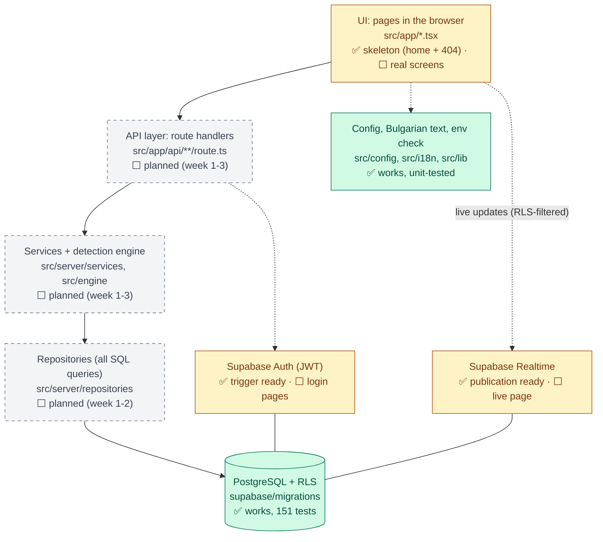

# Scamly: how it works

> **How to use this file**
>
> - This file explains **what works, how it works and why it works like that**, for every part of Scamly that exists in the code today. It is for us (Alex and Roberta), for the documentation and for the oral defense.
> - Start with [the big picture](#1-the-big-picture) and [the status table](#2-status-table). Then read the section of the part you need. Each section has the same four headings: **What it does · How it works · Why it works like that · How we know it works**.
> - It describes the **real code**, not the plan. Parts that don't exist yet are marked **Planned (week N)** with a pointer to [`BUILD_PLAN.md`](./BUILD_PLAN.md).
> - "Why X instead of Y?" questions (why Next.js, why Supabase, why Vitest...) are answered in [`WHY_WE_CHOSE.md`](./WHY_WE_CHOSE.md).
>
> **The rule (decision D19):** every time anything is used, added, changed or removed, **this file is updated in the same commit**, and a line is added to the [change history](#9-change-history).

Last updated: **2026-11-03**

**Contents**

1. [The big picture](#1-the-big-picture)
2. [Status table](#2-status-table)
3. [The app (Next.js)](#3-the-app-nextjs)
4. [Code quality, tests and CI](#4-code-quality-tests-and-ci)
5. [The database](#5-the-database)
6. [The database tests](#6-the-database-tests)
7. [Data flow examples](#7-data-flow-examples)
8. [Where the code differs from the plan](#8-where-the-code-differs-from-the-plan) · [Glossary](#glossary)
9. [Change history](#9-change-history)

---

## 1. The big picture

Scamly is a web app. An older person's phone shows one big button; when a suspicious call comes in, they answer a few questions, get a red/yellow/green verdict, and their family is alerted at once. Guests can see a public map of scam reports by district.

The system has **layers**, and each layer only talks to the one below it: the **UI** (pages in the browser) calls our **REST API** (Next.js route handlers), which calls **services** (business logic, including the detection engine), which call **repositories** (all database queries), which talk to **PostgreSQL** on Supabase. PostgreSQL itself enforces **Row Level Security (RLS)**: even if our API had a bug, the database would still refuse to show family A the data of family B. Supabase also gives us **Auth** (logins, JWTs) and **Realtime** (live updates for the family's alert page).

**Today (end of the Week 1 foundations)** the bottom and the top of this stack exist: a Bulgarian Next.js skeleton with tests and CI, and the complete database with all tables, triggers, RLS policies and 151 database tests. The middle layers (API, services, repositories, detection engine) and the real screens are planned.



Green = works now, yellow = partly built, grey dashed = planned.

---

## 2. Status table

✅ works (in the code and tested) · ⬜ planned (week N, task ID from [`BUILD_PLAN.md`](./BUILD_PLAN.md) section 6)

| Part | Status | Where in the code | Proven by |
|---|---|---|---|
| App skeleton (layout, home page, 404 page) | ✅ | `src/app/layout.tsx`, `page.tsx`, `not-found.tsx`, `globals.css` | `tests/e2e/home.spec.ts`; CI jobs *checks* (build) and *e2e* |
| App name constant | ✅ | `src/config/app.ts` | `src/i18n/bg.test.ts` |
| Feature switches | ✅ (not yet used by any page) | `src/config/features.ts` | `src/config/features.test.ts` |
| Bulgarian text file | ✅ | `src/i18n/bg.ts` | `src/i18n/bg.test.ts`, `tests/e2e/home.spec.ts` |
| Environment variable check | ✅ (not yet called by app code) | `src/lib/env.ts`, `.env.example` | `src/lib/env.test.ts` |
| Code quality tools (ESLint, Prettier, strict TypeScript) | ✅ | `eslint.config.mjs`, `.prettierrc`, `tsconfig.json`, `package.json` | CI job *checks* |
| Unit tests (Vitest) | ✅ 15 tests | `vitest.config.mts`, `src/**/*.test.ts` | `npm test`; CI job *checks* |
| End-to-end tests (Playwright, desktop + Pixel 5) | ✅ 3 tests × 2 screens | `playwright.config.ts`, `tests/e2e/` | `npm run e2e`; CI job *e2e* |
| CI (3 jobs) | ✅ | `.github/workflows/ci.yml` | green ✓ on GitHub |
| Agent rules files (shared rules for Claude Code and Codex) | ✅ | `AGENTS.md`, `CLAUDE.md` | section 4.5; `next dev` leaves our rules in place |
| Database tables (14) + enums (10) + 28 districts | ✅ | `supabase/migrations/20261102000001_schema.sql` | `supabase/tests/01_schema.test.sql` |
| Triggers (2): new profile, owner as contact #1 | ✅ | `..._000002_triggers.sql` | `02_profiles`, `03_persons_contacts` |
| RLS helper functions (6) | ✅ | `..._000003_rls_helpers.sql` | `08_functions` (+ every policy test) |
| RLS policies + column privileges | ✅ | `..._000004_rls_policies.sql` | `02` to `07` test files |
| Append-only audit log | ✅ (DB part) | `..._000004_rls_policies.sql` | `07_admin_audit` |
| Map statistics function `get_map_stats` | ✅ (DB part) | `..._000005_functions.sql` | `06_public_reports_scripts` |
| Rate limiter `hit_rate_limit` | ✅ (DB part) | `..._000005_functions.sql` | `08_functions` |
| Realtime publication (checks, alerts) | ✅ (DB part) | `..._000006_realtime.sql` | `01_schema` |
| Pairing codes and devices tables (HMAC hash column) | ✅ (DB part) | `..._000001_schema.sql`, `..._000004_rls_policies.sql` | `04_devices_pairing` |
| Database tests (pgTAP, 151 assertions) | ✅ | `supabase/tests/`, `scripts/db/` | CI job *database*; `npm run test:db` |
| Generated TypeScript types for the database | ⬜ planned (week 1, W1-04) | `src/types/database.ts` (not there yet) | |
| ADRs (decision records) | 🔄 0005 alert channels written; 0001–0004 pending Alex | `docs/decisions/0005-alert-channels.md` | Records D7; delivery remains planned |
| Login, register, roles in the API (`getActor`, `requireRole`, route guards) | ⬜ planned (week 1, W1-06) | `src/server/auth/`, `src/proxy.ts` | |
| Device pairing (code + redeem endpoints, `/svarzhi` page, revoke) | ⬜ planned (week 1, W1-07) | `src/app/api/...`, `src/server/services/` | |
| Design system (colours, Button, Card, Verdict, BigChoice, ThemeToggle) | ✅ (W1-11) | `src/components/ui/`, `src/app/globals.css`, `/dev/ui` | Section 3.7; npm run check and all 6 browser runs pass |
| Detection engine: types and constants (section 3.6) | ✅ (no logic yet) | `src/engine/types.ts` | `src/engine/types.test.ts` |
| Engine dictionary and scenario data | ✅ data prepared; detection execution pending | `src/engine/dictionary.ts`, `src/engine/__tests__/scenarios.ts` | Type check and `src/engine/data.test.ts`; section 3.8 |
| Detection engine logic v1 + `redactPersonalData()` | ⬜ planned (week 1, W1-08 to W1-10) | `src/engine/` | |
| Seed script with demo accounts | ⬜ planned (week 1, W1-12, Roberta, D20) | `scripts/seed.ts` | |
| Deploy to Vercel, `/api/health`, keep-alive | ⬜ planned (W1-13, Mon 9 Nov, D20) | | |
| Call check UI (big button, questions, result) | ⬜ planned (week 2, W2-01) | `src/app/protected/` | |
| Checks API + server-side verdict | ⬜ planned (week 2, W2-02) | | |
| Family alerts: fan-out + live page via Realtime | ⬜ planned (week 2, W2-03, W2-04) | | |
| Web push | ⬜ planned (week 2, W2-05) | | |
| Email (`EmailProvider`, Brevo) | ⬜ planned (week 2, W2-06) | | |
| Family dashboard, contacts, invites | ⬜ planned (week 2, W2-07, W2-08) | | |
| PWA (install, offline card), voice input | ⬜ planned (week 2, W2-09, W2-10) | | |
| Public reports + scam map | ⬜ planned (week 3, W3-01 to W3-03) | | |
| Moderation, education pages | ⬜ planned (week 3, W3-04, W3-05) | | |
| Admin (users, roles, stats, audit log view) | ⬜ planned (week 3, W3-06) | | |
| AI second opinion (Gemini / Groq chain) | ⬜ planned (week 3, W3-07), first to cut (D12) | | |
| Escalation chain | ⬜ planned (week 3, W3-09), may be cut (D12) | | |
| Security hardening (CSP, headers, attack tests) | ⬜ planned (week 4, W4-01, W4-02) | | |

---

## 3. The app (Next.js)

### 3.1 App skeleton and request flow

#### What it does

Shows a temporary Bulgarian home page at `/` (the name Scamly, the tagline „Обаждат ли ви се за пари? Проверете за 30 секунди.“ and a "coming soon" line) and a Bulgarian 404 page for any address that doesn't exist.

#### How it works

Next.js **App Router** turns folders and files in `src/app/` into web addresses ("file-system routing"): the folder is the URL, a file named `page.tsx` is the page for that URL. Special file names have fixed jobs.

| File | Job |
|---|---|
| `src/app/page.tsx` | The page for `/`. Exports a function `HomePage()` that returns the page as JSX (HTML-like code). |
| `src/app/layout.tsx` | The **root layout**: the `<html>` and `<body>` around *every* page. Sets `lang="bg"` and exports `metadata` (tab title and description). |
| `src/app/not-found.tsx` | The root not-found page. Next.js shows it, with HTTP status 404, for every URL that matches no page. |
| `src/app/globals.css` | Global styles: loads Tailwind CSS and defines the design system's light/dark colour tokens, typography, focus styles and large controls. |

Step by step, when someone opens `/`:

1. The browser asks the Next.js server for `/`.
2. App Router finds `src/app/page.tsx` for that URL and the layout above it (`src/app/layout.tsx`).
3. It calls `RootLayout({ children: <HomePage /> })`. The page is put where the layout writes `{children}`.
4. Both are **server components**, so React turns their static content into HTML on the server. Interactive components such as the design system's theme control use `"use client"` and add the browser code needed for their behaviour.
5. Because `next.config.ts` turns on `cacheComponents: true` and the home page uses no request data, Next.js **pre-renders it once at build time**. After `npm run build` you can see the result as `.next/server/app/index.html`. Every visitor gets that ready-made HTML.
6. The text comes from `bg` (the Bulgarian text file), for example `{bg.app.tagline}`.

```tsx
// src/app/layout.tsx (shortened)
export const metadata: Metadata = {
  title: bg.app.metaTitle,
  description: bg.app.description,
};
export default function RootLayout({ children }: { children: ReactNode }) {
  return (
    <html lang="bg" className="h-full antialiased">
      <body className="flex min-h-full flex-col font-sans">{children}</body>
    </html>
  );
}
```

Other settings in `next.config.ts`: `partialPrefetching: true` (the Next.js 16 docs say to turn it on together with `cacheComponents`), and Tailwind CSS is processed by the `@tailwindcss/turbopack` loader for every `*.css` file. The 404 page uses Next's `<Link>` component for the „Към началната страница“ link, which navigates without reloading the whole page.

Note: this is **Next.js 16.4**. Some names differ from older tutorials (see `AGENTS.md`). For example, the file that runs before every request is now called `proxy.ts` (it used to be `middleware.ts`).

#### Why it works like that

- **`lang="bg"`**: screen readers then read the page with Bulgarian pronunciation, and browsers offer the right spell-check and translation. The jury scores accessibility and correct Bulgarian.
- **Server components by default**: less JavaScript sent to cheap Android phones, so pages load faster on slow 4G. We use `"use client"` only where a component needs interaction or browser APIs.
- **Pre-rendering**: a static page can't break at request time and is very fast.
- **Pages contain no text and no logic**: text lives in `bg.ts`; logic will live in `src/server/` and `src/engine/`. This keeps the UI separate from business logic (a scored criterion).
- **Shared design tokens** in `globals.css` give screens consistent colours, type sizes and focus styles (section 3.7).
- Why Next.js and Tailwind at all: see [`WHY_WE_CHOSE.md`](./WHY_WE_CHOSE.md).

#### How we know it works

- `tests/e2e/home.spec.ts` opens `/` in a real browser and checks: `<html lang="bg">`, the `<h1>` is the app name, the tagline is visible, and the tab title is `bg.app.metaTitle`. It runs on a desktop and on a phone screen (section 4.3).
- `npm run build` in CI proves the app compiles and pre-renders.
- The 404 page has no automated test yet. Check by hand: `npm run dev`, open `http://localhost:3000/nothing-here`.

### 3.2 App name: `src/config/app.ts`

#### What it does

Holds the one constant `APP_NAME = "Scamly"`.

#### How it works

`bg.ts` builds every string that contains the name from this constant (`` `${APP_NAME} – защита от телефонни измами` ``). Pages show `bg.app.name`, never the word "Scamly" typed directly.

#### Why it works like that

Decision D15: another scam-protection app is also called "Scamly". We keep the name for now, but if we must rename, it is a one-line change.

#### How we know it works

`src/i18n/bg.test.ts` checks that `bg.app.name` equals `APP_NAME` and that the title contains it.

### 3.3 Feature switches: `src/config/features.ts`

#### What it does

Gives every optional feature an on/off switch that is read from an environment variable, so we can turn a feature off on Vercel without changing code.

| Switch | Variable | Default | Why this default |
|---|---|---|---|
| `ai` | `FEATURE_AI` | off | AI layer doesn't exist until Week 3, and it is first to cut |
| `voice` | `FEATURE_VOICE` | on | |
| `escalation` | `FEATURE_ESCALATION` | off | stretch goal (D8) |
| `push` | `FEATURE_PUSH` | on | |
| `email` | `FEATURE_EMAIL` | on | |

#### How it works

1. `parseBoolean(value, defaultValue)` turns the text of a variable into `true`/`false`: `"true"` or `"1"` (any case, spaces ignored) → `true`; any other text → `false`; missing or empty → the default.
2. `getFeatures(env = process.env)` returns an object of type `Features` (like a Python dataclass with five `bool` fields).
3. Tests pass their own `env` object; the app will use the real `process.env`. The switches are read on the server and passed to components as normal props.

```ts
export function parseBoolean(value: string | undefined, defaultValue: boolean): boolean {
  if (value === undefined || value.trim() === "") {
    return defaultValue;
  }
  const cleaned = value.trim().toLowerCase();
  return cleaned === "true" || cleaned === "1";
}
```

No page or API uses a switch yet; the first users come with push/email in Week 2.

#### Why it works like that

- **D12 cut order**: if we run late, we cut AI → voice input → escalation → Telegram/Viber. Cutting then means flipping a switch, not deleting code in a panic. `push` and `email` have switches too, so a broken outside service (for example Brevo blocking us) can be turned off during the demo.
- **Unknown text means off**: `"yes"` or a typo turns a feature *off*, not on. A feature appearing by accident is worse than one missing.
- **`env` as a parameter**: the function is easy to test without touching the real environment.

#### How we know it works

`src/config/features.test.ts`, 5 tests: on values, off values, defaults for missing/empty, all defaults together, and every switch changed by its variable. Run: `npm test`.

### 3.4 Bulgarian text: `src/i18n/bg.ts`

#### What it does

Holds **every piece of Bulgarian text a user can see**, in one object `bg` with groups (`bg.app.*`, `bg.common.*`).

#### How it works

Screens import `bg` and write `{bg.app.tagline}` instead of typing text. The object ends with `as const`, which makes it read-only (like a frozen Python dict) and lets TypeScript know the exact keys, so a typo like `bg.app.tagLine` is a type error. Current keys: `app.name`, `app.metaTitle`, `app.tagline`, `app.description`, `app.comingSoon`, `common.loading`, `common.errorGeneric`, `common.notFoundTitle`, `common.notFoundText`, `common.backHome`.

#### Why it works like that

The jury scores correct literary Bulgarian. With all text in one file, one person (or a Bulgarian teacher, W4-06) can proofread everything without reading code. It also makes a second language (`tr.ts`) possible later. Code, comments and docs stay in English.

#### How we know it works

`src/i18n/bg.test.ts` (2 tests: the name comes from `APP_NAME`; the tagline is exactly the agreed sentence) and `tests/e2e/home.spec.ts` (the strings really appear on the page).

### 3.5 Environment variable check: `src/lib/env.ts`

#### What it does

Checks that the server's settings and secrets (Supabase keys, peppers, email settings...) are present and valid, and returns them with the right types. The full list with explanations is in `.env.example`.

#### How it works

1. `serverEnvSchema` is a **Zod** schema (like a Pydantic model): for example `NEXT_PUBLIC_SUPABASE_URL: z.url()`, `PAIRING_PEPPER: z.string().min(32, ...)`, `EMAIL_PROVIDER: z.enum(["brevo", "resend", "noop"]).default("noop")`. Keys for later features (VAPID, Gemini, Groq, `CRON_SECRET`) are `.optional()`.
2. `dropEmptyValues(env)` removes empty values, so a line `HASH_PEPPER=` in `.env.local` counts as missing (not as a valid empty string).
3. `getServerEnv(env = process.env)` runs `safeParse`. If something is wrong it throws one error listing **every** problem as `- NAME: rule message`.
4. The type `ServerEnv` is worked out from the schema with `z.infer` (no type written twice).

```ts
export function getServerEnv(env: Env = process.env): ServerEnv {
  const result = serverEnvSchema.safeParse(dropEmptyValues(env));
  if (!result.success) {
    const problems = result.error.issues.map(
      (issue) => `  - ${issue.path.join(".")}: ${issue.message}`,
    );
    throw new Error(`Invalid environment variables (see .env.example):\n${problems.join("\n")}`);
  }
  return result.data;
}
```

#### Why it works like that

- **Lazy validation**: the check runs only when `getServerEnv()` is called, not when the file is imported. So `next build` and CI work on a machine with no `.env.local`, and each server function checks the settings at the moment it needs them.
- **Never prints secrets**: the error names the variable and the broken rule (`issue.path`, `issue.message`), never its value, so a log or a screenshot of the error can't leak a key.
- **Fail early and loudly**: a missing pepper should stop the server with a clear message, not cause a strange bug later.
- **Peppers ≥ 32 characters**: short secrets can be guessed (section 5.13 explains what the pepper protects).
- **Server only**: this file returns secret keys, so only server code may import it. Variables starting with `NEXT_PUBLIC_` are the exception: Next.js copies them into the browser code, so only public values (the Supabase URL and the anon key, which RLS makes safe) get that prefix. `SUPABASE_SERVICE_ROLE_KEY` never does.
- Real values live in `.env.local` (ignored by git through `.env*` in `.gitignore`) and in Vercel's settings.

#### How we know it works

`src/lib/env.test.ts`, 4 tests with fake values only: a valid set passes and gets `EMAIL_PROVIDER = "noop"`; an empty set names the missing `SUPABASE_SERVICE_ROLE_KEY`; an empty `HASH_PEPPER` counts as missing; `EMAIL_PROVIDER=gmail` is rejected.

### 3.6 Detection engine: types (`src/engine/types.ts`)

The rest of the engine (normalising, transliteration, fuzzy matching, signals, scoring, hard rules, verdict, `redactPersonalData`) is **Planned (week 1, W1-08 to W1-10)**, see [`BUILD_PLAN.md`](./BUILD_PLAN.md) section 4. The dictionary and scenario data now use these shared shapes (section 3.8); the execution runner still awaits the engine logic.

#### What it does

Describes the shape of everything the engine reads and returns, and holds the engine's constants. It has **no logic and no imports**.

| Name | What it is |
|---|---|
| `CallInput` | The answers + text (BUILD_PLAN 4.1). `null` = not answered. Optional `extraKeywords` |
| `Verdict`, `Reason`, `ReasonCode` | The result (4.2). A reason's `code` is a hard rule id or a signal category; `evidence` holds the original words that matched |
| `ClaimedIdentity`, `TriAnswer`, `HandoverMethod`, `RiskLevel`, `ScriptType` | Answer and result values, the same as the database enums |
| `HardRuleId` | `HR1_POLICE_ASKS_MONEY` ... `HR6_RELATIVE_IN_TROUBLE` (4.6) |
| `SignalCategory` | 17 ids: the 13 rows of the 4.5 table, plus `handover`, `credentials`, `safe_account`, `move_money` (no weight; they let HR2, HR4, HR5 fire from text alone) |
| `DictionaryEntry`, `ExtraKeyword` | The shape of Roberta's `dictionary.ts` (stems, phrases, an example sentence) and of a moderator-added stem |
| `EngineScenario`, `ScenarioExpectation` | The shape of Roberta's test cases in `__tests__/scenarios.ts` |
| `EMPTY_INPUT` | A `CallInput` with nothing answered, to copy in tests: `{ ...EMPTY_INPUT, asksMoney: "yes" }` |
| `ENGINE_VERSION`, `RISK_THRESHOLDS`, `MAX_TEXT_LENGTH`, `PHRASE_WINDOW` | `"1.0.0"`, `{ red: 60, yellow: 30 }`, `2000`, `6` |

#### How it works

- Each value list is written **once**, as a read-only array, and the type is worked out from it:

  ```ts
  export const RISK_LEVELS = ["green", "yellow", "red"] as const; // like a Python tuple of Literal values
  export type RiskLevel = (typeof RISK_LEVELS)[number]; // "green" | "yellow" | "red", like Literal[...]
  ```

  So the code has a list to loop over or check against (tests, a future Zod schema), and the type can never drift from that list.
- `type X = { ... }` only describes a shape (like a Python `TypedDict`); it disappears when the code runs.
- A dictionary **stem** is a word beginning in Cyrillic lower case (`хвърл` matches хвърлете, хвърли). A **phrase** is a list of stems that must appear in order within `PHRASE_WINDOW` (6) words. Latin-script spellings may be added as extra stems. Every entry has a real `example` sentence.
- A scenario's `expect` is checked field by field by Alex's runner (Session H step 8): `level` exactly; `scriptType` and `hardRules` (exact set, order ignored) only if given; `minScore`/`maxScore` as inclusive limits; `mustNotBeRed` marks legitimate calls that must never be red.

#### Why it works like that

- **No imports** (no React, Next.js, Supabase or Node): the same engine runs on the server and on the phone (BUILD_PLAN 4.9).
- **One place for the values**: the API, the engine, the dictionary and the tests all use the same names, and TypeScript turns a typo like `"polise"` into an error before the code runs. Why `as const` lists instead of TypeScript `enum`s: [`WHY_WE_CHOSE.md`](./WHY_WE_CHOSE.md) section 7.
- **Types first**: Roberta's dictionary and test cases can be written (and type-checked) before the engine logic exists.

#### How we know it works

`src/engine/types.test.ts`, 4 tests: the constants have the planned values (and `MAX_TEXT_LENGTH` equals the `text_redacted` limit in the SQL); the five value lists **read from the schema SQL file** are exactly `claimed_identity`, `tri`, `handover_method`, `risk_level`, `script_type`; there are six hard rules `HR1_` to `HR6_` in order; the signal category ids are unique and snake_case. `npm run typecheck` checks that every use of these types is correct.

---

### 3.7 Design system (W1-11)

#### What it does

Provides reusable `Button`, `Card`, `Verdict`, `BigChoice` and `ThemeToggle` components. The `/dev/ui` page shows interactive examples in both light and dark themes. This is a component preview, not the finished call-check flow.

#### How it works

- CSS variables in `src/app/globals.css` hold semantic colours for backgrounds, text, controls and the three verdict levels. The stylesheet lists the checked contrast ratios in a comment, uses a base font of at least 18 px and gives buttons at least 64 px of height.
- Components receive **props**: named inputs such as children, disabled state or the selected answer. Think of props as Python function keyword arguments; React uses them to produce the HTML.
- `Button` uses a native button, `Card` groups content, and `BigChoice` uses a fieldset with native radio inputs. Browser keyboard behaviour and form semantics remain available instead of being recreated with clickable divs.
- `Verdict` displays a written level and explanation alongside its colour. Its green wording follows D9: no typical signs were found, but the person should hang up and call a familiar number if in doubt. All visible Bulgarian strings come from `src/i18n/bg.ts`.
- `ThemeToggle` offers system, light and dark choices. It remembers the preference in `localStorage`, follows device-theme changes in system mode and continues to work if browser storage is denied. It is a client component because it needs browser settings and interaction; the static page content can remain server-rendered.

#### Why it works like that

Large controls and readable text support older people using small phones. Shared tokens keep both themes consistent. Native controls provide established keyboard and screen-reader behaviour. Words as well as colours communicate the verdict, and D9 avoids promising that an unfamiliar call is safe. The theme setting contains only a display preference, no personal or account data.

#### How we know it works

`npm run check` passes (lint, types, formatting and 15 unit tests). WCAG sRGB contrast calculations confirm the documented text pairs exceed 4.5:1. All six production browser runs pass: home, saved theme and device changes, keyboard answers, 360 px layout and 64 px buttons on desktop and phone profiles. The theme select uses an explicit label/for association so its label excludes option text. No database files change in this task.

---

### 3.8 Engine dictionary and scenario data (Roberta, Session D)

#### What it does

`src/engine/dictionary.ts` exports `DICTIONARY`: Bulgarian stems and ordered phrases for the 16 text-detectable signal categories. `identity_other` is an answer only and has no keywords. `src/engine/__tests__/scenarios.ts` exports `SCENARIOS`: plain typed inputs with expected verdicts for Alex's future runner.

#### How it works

Each dictionary entry has a category, stems and/or phrases, and an example. Ordinary word endings are handled by prefix matching; common Latin-script ambiguities and typo variants are included as data. The planned engine normalises and transliterates before matching. High-risk handover, safe-account and money-movement evidence uses phrases rather than a lone word such as courier or account. A phrase is ordered within six tokens; it is not a full sentence-understanding system.

Scenarios start from `EMPTY_INPUT`, using object spread like Python `{**EMPTY_INPUT, "text": "..."}`. They cover scam scripts, all six hard rules, legitimate calls, answers-only, text-only, mixed input, Latin spelling, typos and edge cases. Expected results follow BUILD_PLAN 4.5–4.7. A legitimate request for money may still be yellow; it must not be labelled automatically red without further evidence.

#### Why it works like that

Data stays independent of scoring and database code, so Roberta can improve wording while Alex implements matching. Explicit negative cases guard against frightening users on everyday calls. The four standard answers alone cannot distinguish every official or courier scam from a legitimate payment: scenarios retain the planned yellow result when evidence is insufficient.

#### How we know it works

TypeScript checks the data against the shared engine types. `src/engine/data.test.ts` checks category coverage, phrase shape, contextual high-risk entries, scenario uniqueness and hard-rule expectation coverage. These are data-contract checks, **not executed verdict tests**. Alex's Session H runner, redaction tests and engine coverage evidence remain required before W1-10 is complete. No matcher is duplicated here just to make expected results pass.

---
### 3.9 Decision record and Week 1 study material

#### What it does

`docs/decisions/0005-alert-channels.md` records the already accepted D7: the family live page via Realtime is primary, with push/email as additional channels and a logged-in backup phone for the demo. `docs/learning/week-1.md` explains the implemented foundations using Python comparisons and gives practice questions.

#### How it works

The ADR records context, alternatives, decision and consequences. It distinguishes database readiness from the future fan-out, acknowledgement, delivery and reconnect implementation. The learning note explains erased TypeScript types versus runtime Zod checks, React props/state/ref, the API and RLS as separate access checks, and the difference between scenario data and executed engine tests.

#### Why it works like that

A decision record explains the reason for a choice without pretending that a planned feature exists. Study material prepares the students to explain the implementation in the defense. Neither a document nor an automated check can certify human understanding.

#### How we know it works

The documents were checked against D7, the current code and the Week 1/2 task list. Alex still owns ADRs 0001–0004. The learning note is written; the joint Sunday explanation/check-in and updates after remaining Week 1 work are still pending.

---

## 4. Code quality, tests and CI

### 4.1 Code quality tools and npm scripts

#### What it does

Finds bugs, type errors and messy formatting before code reaches `main`.

#### How it works

| Tool | File | What it checks |
|---|---|---|
| TypeScript, strict | `tsconfig.json` | `strict: true` (no hidden `any`, `null` must be handled), `noUncheckedIndexedAccess: true` (`list[i]` may be `undefined`, like Python's `dict.get()` may return `None`). `@/…` means `src/…`. |
| ESLint | `eslint.config.mjs` | Next.js + React rules (Core Web Vitals problems are errors) and typescript-eslint rules. `eslint-config-prettier` comes last and switches off style rules that would fight Prettier. Generated folders are ignored. |
| Prettier | `.prettierrc`, `.prettierignore` | Formatting: semicolons, double quotes, trailing commas, 100 characters per line. `docs/` is formatted by hand. |
| EditorConfig | `.editorconfig` | UTF-8, LF line endings, 2 spaces. |
| Node version | `.nvmrc` (22), `package.json` `engines` | Everyone and CI use Node 22. |
| Exact versions | `.npmrc` (`save-exact=true`), `package-lock.json` | `npm install x` saves `16.4.4`, not `^16.4.4`, so a library can't change under us. |

npm scripts (`package.json`):

| Script | Runs |
|---|---|
| `npm run dev` / `build` / `start` | Next.js in development / production build / production server |
| `npm run lint` | `eslint .` |
| `npm run typecheck` | `next typegen && tsc --noEmit`: first Next.js writes type files for our routes into `.next/types`, then TypeScript checks everything without producing files |
| `npm test` / `test:watch` / `test:coverage` | Vitest once / on every change / with a coverage report |
| `npm run e2e` | Playwright (builds and starts the app itself) |
| `npm run test:db` | `scripts/db/test-local.sh` (database tests without Docker, section 6.4) |
| `npm run format` / `format:check` | Prettier write / check only |
| **`npm run check`** | **`lint` → `typecheck` → `format:check` → `test`**, stopping at the first failure |

`npm run check` is what we run before every push. It does **not** run the build, the e2e tests or the database tests; CI runs those.

#### Why it works like that

The jury scores code quality, standards and valid code. Machines check formatting and types, so our reviews of each other's commits can focus on logic. "Never push red" (IMPLEMENTATION_PLAN section 1) is only possible if one command tells us what red means. Tool comparisons: [`WHY_WE_CHOSE.md`](./WHY_WE_CHOSE.md).

#### How we know it works

CI job *checks* runs every one of these on each push. Try it: add `const x: number = "a";` to a file and run `npm run typecheck`.

### 4.2 Unit tests (Vitest)

#### What it does

Tests small pieces of code (one function at a time) in milliseconds.

#### How it works

- `vitest.config.mts`: tests run in plain Node.js (no browser), files are `src/**/*.test.ts(x)` and live **next to the code** they test. The `@` shortcut is set up the same way as in `tsconfig.json`.
- A test looks like pytest with different words: `describe` groups tests, `it` is one test, `expect(a).toBe(b)` is `assert a == b`, `expect(() => f()).toThrow(/NAME/)` is `pytest.raises`.
- Coverage (`npm run test:coverage`) uses the V8 engine's built-in counters and writes `coverage/` (text, HTML and a JSON summary). There is no minimum percentage yet; the engine will have a ≥ 90 % goal (W1-10).

Current tests: 4 files, **15 tests** (`features.test.ts` 5, `bg.test.ts` 2, `env.test.ts` 4, `engine/types.test.ts` 4).

#### Why it works like that

Unit tests are fast enough to run on every save, and the detection engine (planned) will be a pure function that is ideal for them. Tests next to the code are easy to find and keep up to date.

#### How we know it works

`npm test` → `Test Files 4 passed, Tests 15 passed`. CI uploads the coverage report as an artifact named `coverage`.

### 4.3 End-to-end tests (Playwright)

#### What it does

Opens the real app in a real browser and checks what a user would see.

#### How it works

- `playwright.config.ts` → `webServer` runs `npm run build && npm run start -- --port 3000`, so the tests hit the **production build**, exactly as it will run on Vercel. Locally an app already running on port 3000 is reused.
- Every test runs **twice**: project `desktop-chromium` (Desktop Chrome) and project `android-phone` (Pixel 5: a 393 × 851 touch screen, like a cheap Android phone).
- On CI: a leftover `test.only` fails the run (`forbidOnly`), a failed test is retried once, and a trace (a recording) is saved on the retry. An HTML report goes to `playwright-report/`.
- `tests/e2e/home.spec.ts` is the only test so far (section 3.1).

First time on your own computer: `npx playwright install chromium`, then `npm run e2e`. In the Codex Windows sandbox, Turbopack worker loopback connections can fail with EACCES, misleadingly reported as a CSS worker exiting with code 0. Run build/browser checks with approved execution outside the sandbox; the normal production build succeeds without framework changes.

#### Why it works like that

The older person will use a cheap Android phone, so every screen must be tested at phone size from day one. Testing the production build catches problems that only appear after `next build`. The plan adds one e2e test per role and the full alert flow (W2-11, W4-03).

#### How we know it works

CI job *e2e* (2 passing runs: desktop + phone). The report is uploaded as the artifact `playwright-report`.

### 4.4 CI (GitHub Actions)

#### What it does

On every push to `main`, every pull request and on a manual start (Actions tab → *Run workflow*), GitHub runs all our checks on fresh machines and shows ✓ or ✗ next to the commit.

#### How it works

`.github/workflows/ci.yml` has **3 jobs**. They run at the same time, each on its own clean Ubuntu machine:

| Job | Steps | Proves |
|---|---|---|
| **checks** ("Lint, types, unit tests, build") | checkout → Node from `.nvmrc` → `npm ci` → lint → typecheck → format:check → `test:coverage` → `build` → upload coverage | Code is clean, typed, formatted, unit tests pass, the app builds |
| **e2e** ("End-to-end tests (Playwright)") | checkout → Node → `npm ci` → install Chromium → `npm run e2e` → upload report | The real app works in a browser on desktop and phone |
| **database** ("Database and RLS tests (pgTAP)") | checkout → install Supabase CLI → `supabase db start` → `supabase test db` | All migrations apply on a real Supabase database and all 151 RLS/schema tests pass |

Other settings: a newer push to the same branch cancels the older run (`concurrency`), and the workflow can only read the repo (`permissions: contents: read`). `npm ci` installs exactly what `package-lock.json` says.

**What a red ✗ means:** at least one step in one job failed, so that commit is broken (or a test caught a real problem). Click the ✗ → the failed job → the red step to see the error. Download the `coverage` or `playwright-report` artifact for details. Fix it before pushing anything else; per our rules, `main` should never stay red.

#### Why it works like that

- "It works on my laptop" isn't proof. A fresh machine for every run proves that the repo alone is enough (also for the jury, who must be able to install it).
- Separate jobs show *which* part broke and finish faster in parallel.
- A green history is evidence for "use of version control" and "automated testing", which the jury scores.

#### How we know it works

The green ✓ on GitHub. BUILD_PLAN W1-02 also asks for a deliberately broken test to turn it red once; do that and note it in `docs/evidence/` when we collect evidence.

Note: the Supabase CLI is installed with `version: latest`, so a new CLI release could change behaviour without a change in our repo.

### 4.5 Agent rules files: `AGENTS.md` and `CLAUDE.md`

#### What it does

Tells every AI coding agent the project rules before it does anything: who is working, git rules, which docs to update, who owns what, code style and safety. Alex uses Claude Code in the cloud, Roberta uses OpenAI Codex on her computer (D21), and both must follow the **same** rules.

#### How it works

- **`AGENTS.md`** holds all the rules. Codex reads it automatically.
- At the top of `AGENTS.md` is a block between `<!-- BEGIN:nextjs-agent-rules -->` and `<!-- END:nextjs-agent-rules -->`. **Next.js writes it** (`next dev`, code in `node_modules/next/dist/server/lib/generate-agent-files.js`): it replaces only the text between the two markers and keeps everything before and after. Our rules sit below the block, so `next dev` never deletes them. We don't edit inside the markers.
- **`CLAUDE.md`** is short. Its line `@AGENTS.md` makes Claude Code import `AGENTS.md`, like `import` in Python, so Claude Code reads the same rules. It adds only one Claude-specific note (ignore the cloud hook that asks to add AI attribution to commits).

#### Why it works like that

Two different AI tools look for two different file names. Copying the rules into both files would let them drift apart; one shared file means a rule changed once is changed for both of us. Comparison with the alternatives: [`WHY_WE_CHOSE.md`](./WHY_WE_CHOSE.md) section 10.

#### How we know it works

Running Next.js's own block writer on our `AGENTS.md` reports `unchanged` (checked on 2026-11-03), so `next dev` keeps the file as it is. `npx prettier --check .` also leaves the block untouched. In a new session, each tool should start by asking "Alex or Roberta?", which shows it read the rules.

---

## 5. The database

Everything in this section is SQL in `supabase/migrations/`, applied in file-name order:

| File | Contents |
|---|---|
| `20261102000001_schema.sql` | 10 enums, 14 tables, constraints, indexes, the 28 districts |
| `20261102000002_triggers.sql` | 2 triggers |
| `20261102000003_rls_helpers.sql` | 6 helper functions for the policies |
| `20261102000004_rls_policies.sql` | RLS on, privileges, all policies |
| `20261102000005_functions.sql` | `get_map_stats`, `hit_rate_limit` |
| `20261102000006_realtime.sql` | Realtime publication |

A **migration** is a numbered SQL file that changes the database one step. We never edit an old migration; a change is a new file. `supabase db reset` (with Docker) or the CI job rebuild the whole database from zero by running them in order.

### 5.1 Tables

#### What it does

Stores everything Scamly needs: people and who may see them, paired phones, call checks, alerts, public reports and education cards.

#### How it works

All tables live in the schema `public`. Every `id` is a random UUID (`gen_random_uuid()`), except `audit_log` (a growing number) and the two reference/counter tables.

**People and access**

| Table | Purpose | Important columns and constraints |
|---|---|---|
| `profiles` | One row per login (1:1 with Supabase's `auth.users`); holds the **app role** | `id` = `auth.users.id` (deleting the login deletes the profile); `role app_role` default `'family'`; `display_name` 1–60 chars; `email_alerts` default true |
| `protected_persons` | An older person whom a family member protects | `owner_id` → profiles (cascade: deleting the owner deletes their people and all their data, GDPR); `display_name` 1–60; `district_code` → districts. Index on `owner_id` |
| `trusted_contacts` | The **ordered** list of people to call/alert for one protected person (supports the escalation chain D8) | `priority` 1–5; `unique (protected_person_id, priority)` **deferrable** (one UPDATE can swap 1 ↔ 2); `unique (protected_person_id, user_id)`; `user_id` is set only when the contact has an account, otherwise phone-only (`phone` 3–30 chars) |
| `contact_invites` | Single-use invite for another relative | `token_hash` (an HMAC, never the token itself) unique; `expires_at`, `used_at`; `display_name`, `priority` 1–5 |

**Devices and pairing**

| Table | Purpose | Important columns and constraints |
|---|---|---|
| `pairing_codes` | 6-digit codes that pair an older person's phone | `code_hash` (HMAC, section 5.13); `expires_at`, `used_at`; partial unique index `pairing_codes_unused_code_hash_key` on `code_hash where used_at is null` (among unused codes a hash appears at most once) |
| `devices` | A paired phone; each has its own login | `user_id` unique → `auth.users` (cascade: deleting the device login deletes the row = revoking); `revoked_at` (extra safety net); `label`, `paired_at`, `last_seen_at` |

**Call checks and alerts**

| Table | Purpose | Important columns and constraints |
|---|---|---|
| `checks` | One "someone is calling me for money" check | `status` `'started'` → `'answered'`; the answers (`claimed_identity`, `asks_money`, `handover`, `rushing`, `secrecy`); `text_redacted` ≤ 2000 chars (personal data removed *before* saving); `caller_number_hash`; the verdict (`score` 0–100, `risk_level`, `script_type`, `hard_rules[]`, `reason_codes[]`, `engine_version`, `ai_provider`, `ai_level`); `acknowledged_by/at` („Обаждам ѝ се сега“). Constraint `checks_answered_has_verdict`: an answered check must have a score and a risk level. `checks_answered_after_started`. `device_id` is set null when the phone is unpaired, so history survives. Index `(protected_person_id, started_at desc)` |
| `alerts` | One row per (check, family member, channel) | `channel` realtime/push/email; `status` pending/sent/failed; `escalation_step` ≥ 0; `error` ≤ 500. Indexes on `(recipient_id, created_at desc)` and `check_id` |
| `push_subscriptions` | Web-push addresses of a user's browsers | `endpoint` unique, ≤ 1000; `p256dh`, `auth` (browser keys). Index on `user_id` |

**Public side**

| Table | Purpose | Important columns and constraints |
|---|---|---|
| `districts` | The 28 Bulgarian districts | `code` primary key, must match `^BG-[0-9]{2}$`; `name_bg` unique |
| `reports` | Anonymous scam reports for the map | Only `district_code`, `script_type`, `occurred_on`, `description_redacted` (≤ 1000), `caller_number_hash`. **No reporter data, no address, no IP.** `status` pending/approved/rejected, `reject_reason`, `reviewed_by/at`. Indexes: `(status, submitted_at)` for the moderation queue; partial `(district_code, occurred_on) where status = 'approved'` for the map |
| `scam_scripts` | Education cards („Как работи измамата“) | `slug` unique, `^[a-z0-9-]{1,60}$`; Bulgarian texts; `extra_keywords[]` (stems a moderator adds for the engine); `published` default false. Note: `updated_at` is only set on insert; nothing updates it automatically yet |

**System**

| Table | Purpose | Important columns and constraints |
|---|---|---|
| `audit_log` | Append-only log of important actions | `id bigint generated always as identity`; `actor_id` (set null if the account is deleted: the line stays); `action` 1–100 chars; `target_type`, `target_id`, `details jsonb`. Index `created_at desc` |
| `rate_limits` | Counters for the rate limiter | Primary key `(key, window_start)`; `hits` ≥ 0. Index on `window_start` for the clean-up |

**Deleting things (`on delete`)**: *cascade* when a child makes no sense without its parent (a check without its person); *set null* when the child should survive (a report stays when the moderator who reviewed it is deleted). So deleting one family login removes their profile → their protected persons → those people's contacts, invites, codes, devices, checks → those checks' alerts.

#### Why it works like that

- **CHECK constraints and enums** make the database reject bad data itself (a score of 101, a 61-character name, `'polise'`), even if our code forgets to validate.
- **Data minimisation (GDPR)**: we store only redacted text, hashed phone numbers, and districts instead of addresses.
- **The trusted-contact order exists from day one**, so escalation (D8) needs no table change later.
- **Indexes** match the queries we will run most (a person's history newest first, a user's alerts, the moderation queue, the map).
- **Districts are seeded in the migration** (not the seed script) because they are reference data that must exist in every database, including production.

#### How we know it works

`supabase/tests/01_schema.test.sql`: exactly these 14 tables and 10 enums exist, the important indexes exist, and 9 CHECK/foreign-key tests (61-char name, empty name, score 101, 2001-char text, answered without verdict, priority 6, 1001-char description, unknown district).

### 5.2 Enums

An **enum** is a fixed list of allowed values (like Python's `enum.Enum`).

| Enum | Values |
|---|---|
| `app_role` | `family`, `protected`, `moderator`, `admin` (a guest is "not logged in", so not here) |
| `claimed_identity` | `police`, `relative`, `official`, `courier`, `other` |
| `tri` | `yes`, `no`, `unsure` |
| `handover_method` | `courier_or_stranger`, `throw`, `bank_transfer`, `other` |
| `risk_level` | `green`, `yellow`, `red` |
| `script_type` | `police`, `relative_in_trouble`, `fake_official`, `courier`, `unknown` |
| `check_status` | `started`, `answered` |
| `alert_channel` | `realtime`, `push`, `email` |
| `alert_status` | `pending`, `sent`, `failed` |
| `report_status` | `pending`, `approved`, `rejected` |

Proven by `01_schema` (`enums_are`, `enum_has_labels`).

### 5.3 The 28 districts

`BG-01` Благоевград … `BG-22` София (столица), `BG-23` София (област) … `BG-28` Ямбол: the ISO 3166-2:BG codes, inserted at the end of the schema migration. Protected persons and reports point to them; the map will colour them. Proven by `01_schema` (exactly 28 rows, codes exactly `BG-01`…`BG-28`, 5 names spot-checked) and `06_public_reports_scripts` (guests can read all 28).

### 5.4 The two triggers

#### What it does

A **trigger** is code the database runs automatically when a row is inserted (like a callback or a Django signal). We have two, in `20261102000002_triggers.sql`:

| Trigger | When | Function | Does |
|---|---|---|---|
| `on_auth_user_created` | after insert on `auth.users` | `handle_new_user()` | Creates the `profiles` row with role **`family`** |
| `on_protected_person_created` | after insert on `public.protected_persons` | `add_owner_as_first_contact()` | Adds the owner as trusted contact **#1** |

#### How it works

`handle_new_user()` picks the display name: the `display_name` typed at sign-up; if empty, the part of the email before `@`; if there is no email, `'Потребител'`. It cuts it to 60 characters to fit the CHECK constraint.

```sql
v_name := coalesce(
  nullif(btrim(new.raw_user_meta_data ->> 'display_name'), ''),
  nullif(btrim(split_part(new.email, '@', 1)), ''),
  'Потребител'
);
insert into public.profiles (id, role, display_name)
values (new.id, 'family', left(v_name, 60));
```

`add_owner_as_first_contact()` copies the owner's id and display name from `profiles` into `trusted_contacts` with `priority = 1` and no phone (the owner adds it later).

Both functions are `SECURITY DEFINER` with `set search_path = ''` (section 5.5), and `execute` is revoked from `public`, `anon` and `authenticated`, so they can't be called through the API as `/rpc/...`.

#### Why it works like that

- **The role is ALWAYS `family`.** The sign-up data (`raw_user_meta_data`) is written by the person signing up, so an attacker could send `"role": "admin"`. We never read a role from it. Device users get `protected` from the server during pairing; moderators and admins get their role from an admin (audited).
- **The database can't forget.** If profile creation were in our API, a bug or a crash between two steps could leave a login without a profile. A trigger runs in the same transaction as the insert.
- **SECURITY DEFINER is required**: Supabase Auth inserts into `auth.users` as its own internal user, which has no rights on our tables. And the second trigger must set `trusted_contacts.user_id`, a column the browser may not write (section 5.8).

#### How we know it works

`02_profiles`: profile created with role `family` and the typed name; email fallback (`boris`); `"role": "admin"` in sign-up data is ignored; 70 characters cut to 60; deleting the login deletes the profile. `03_persons_contacts`: the owner is contact #1 (name from profile, no phone), and exactly one automatic contact is created.

### 5.5 The six RLS helper functions

#### What it does

Small yes/no questions about **the person who is calling**, used inside the RLS policies (`20261102000003_rls_helpers.sql`):

| Function | Answers |
|---|---|
| `app_role()` | The caller's role from `profiles`, or null for a guest |
| `is_admin()` | Is the caller an admin? |
| `is_moderator()` | Is the caller a moderator **or** an admin? |
| `is_owner_of(pid)` | Did the caller create protected person `pid`? |
| `has_family_access(pid)` | Is the caller the owner, or a trusted contact with `user_id = auth.uid()`? |
| `is_device_of(pid)` | Is the caller a paired, **not revoked** phone of `pid`? |

#### How it works

Each is one SQL query using `auth.uid()` (the logged-in user's id, section 5.6). For a guest `auth.uid()` is null, so every function answers false (or null).

```sql
create function public.is_device_of(pid uuid)
returns boolean language sql stable security definer set search_path = ''
as $$
  select exists (
    select 1 from public.devices as d
    where d.protected_person_id = pid and d.user_id = auth.uid() and d.revoked_at is null
  );
$$;
```

`execute` is revoked from `public` and `anon` and granted only to `authenticated` (guests never need them).

#### Why it works like that

- **One place per rule**, with a readable name. A policy says `using (public.has_family_access(protected_person_id))` instead of repeating a join everywhere.
- **`SECURITY DEFINER`** = the function runs with the rights of its owner (like `sudo`), so RLS doesn't apply *inside* it. Without this, the policy on `protected_persons` would read `trusted_contacts`, whose policy reads `protected_persons`, and PostgreSQL would stop with "infinite recursion detected in policy".
- **`set search_path = ''`** = every name must be written in full (`public.devices`, `auth.uid()`). A SECURITY DEFINER function runs with high rights; if it looked up an unqualified name like `devices` through a search path, someone who could create a fake `devices` table in another schema could trick it. With an empty path there is nothing to trick.
- **`STABLE`**: the answer doesn't change during one statement, so PostgreSQL can reuse it instead of recomputing it for every row.

#### How we know it works

`08_functions`: moderator → `is_moderator` true, `is_admin` false; admin → both true; owner → `is_owner_of` and `has_family_access` true, `is_device_of` false; stranger → no access; guests can't execute `is_admin()`; and **every SECURITY DEFINER function in `public` has `search_path = ''`** (checked from the system catalog, so a future function that forgets it fails the test). Every policy test in files 02–07 also uses them indirectly.

### 5.6 RLS explained for a beginner

#### What it does

**Row Level Security** makes PostgreSQL itself decide, for every query, **which rows** the caller may see or change. It is like a `WHERE` clause that the database adds to every query automatically, and that the caller can't remove.

#### How it works

**Who is calling? The JWT.** When a user logs in, Supabase Auth gives the browser a **JWT** (JSON Web Token): a small JSON object like `{"sub": "<user id>", "role": "authenticated", "exp": ...}` with a **signature** made with Supabase's secret key. Every request to Supabase carries this token. Supabase's API checks the signature (a changed token fails), then, for that one request:

1. switches to the PostgreSQL role named in the token: `anon` (guest) or `authenticated` (any logged-in user), with `set role`;
2. stores the token's claims in the setting `request.jwt.claims`;
3. runs our query. Inside it, `auth.uid()` reads `sub` from that setting.

So a user can't pretend to be someone else: they would need a token with another `sub`, and they can't sign one without the secret key. A third role, **`service_role`**, belongs to our own server and **bypasses RLS**; its key exists only in server environment variables.

**What is a policy?** A rule attached to a table, for one command, for some roles:

```sql
create policy "Family can read checks of persons they have access to"
  on public.checks for select
  to authenticated
  using (public.has_family_access(protected_person_id));
```

- `using (...)` is checked for each **existing** row: rows where it is false are invisible (SELECT) or untouchable (UPDATE/DELETE).
- `with check (...)` is checked for each **new or changed** row (INSERT/UPDATE): if false, the statement fails.
- Several policies for the same command are combined with **OR**: a row is visible if *any* SELECT policy allows it.
- **No policy for a command = nobody may do it** (except `service_role` and the table owner).

**What the caller notices.** Two different kinds of "no":

| Situation | What happens |
|---|---|
| No privilege for the command or column (section 5.8), or a `with check` fails | An **error** `42501` (insufficient privilege / "new row violates row-level security policy") |
| The row exists but RLS hides it | **No error, 0 rows.** A SELECT returns nothing, an UPDATE/DELETE changes nothing |

The second case is good for security: family B can't even find out that grandma A's row exists.

**The two locks.** We protect data twice:

1. **Lock 1, our API (planned, W1-06 onward)**: each route checks the role and ownership in TypeScript before doing anything (BUILD_PLAN section 3).
2. **Lock 2, the database (works now)**: RLS policies plus privileges. API handlers will use the *user's own* session wherever possible, so lock 2 also applies to our own code. Even a bug in lock 1 can't leak another family's data.

Inside lock 2 there are again two layers (top of `20261102000004_rls_policies.sql`): **privileges** (`grant`/`revoke`) decide which *commands and columns* a role may use at all; **policies** decide which *rows*. Supabase normally grants everything to `anon` and `authenticated` and relies on RLS alone. We first `revoke all` on every table and grant back only what is needed. This also blocks `TRUNCATE`, which RLS doesn't cover.

**"No client write policy" = only our server can write.** These tables have **no** INSERT/UPDATE policy (and mostly no grant) for browsers:

| Table | Why only the server writes |
|---|---|
| `checks` | The verdict must be computed by **our** engine on the server. A phone must not be able to send "green" for a scam |
| `alerts` | Otherwise anyone could create alerts for other users (spam) |
| `reports` | Guests must go through our API's rate limiter and honeypot; a bot calling the database directly would skip them |
| `devices` | A phone may be paired only after a correct pairing code |
| `pairing_codes` | Not even readable by browsers: only the server creates and redeems codes |
| `audit_log` | Only the server records what happened; nobody may write fake history |
| `rate_limits` | Only through `hit_rate_limit()`, which only the server may call |

The server writes these with the `service_role` key, after checking permissions in code (BUILD_PLAN 2.4 lists exactly which server functions may do this).

**Who may read what (summary of the policies):**

| Table | Guest | Protected device | Family | Moderator | Admin |
|---|---|---|---|---|---|
| `districts` | read | read | read | read | read |
| `profiles` | none | own | own, update name/email setting | own, update | all |
| `protected_persons` | none | own person (if not revoked) | owned or contact of; create (role family); owner updates/deletes | none | all |
| `trusted_contacts` | none | of own person | read if access; owner adds/edits/deletes | none | all |
| `contact_invites` | none | none | owner only | none | none |
| `pairing_codes` | none | none | none | none | none |
| `devices` | none | own row, only if not revoked | of people they have access to | none | all |
| `checks` | none | of own person | of people they have access to | none | all |
| `alerts` | none | none | addressed to them | addressed to them | all |
| `push_subscriptions` | none | own: read/add/delete | own | own | own |
| `reports` | none (only `get_map_stats`) | none | none | read all, review | read, review, delete |
| `scam_scripts` | published | published | published | all; create, edit | all; also delete |
| `audit_log` | none | none | none | none | read only |
| `rate_limits` | none | none | none | none | none |

#### Why it works like that

- **Defense in depth**: the jury will ask "what if your API has a bug?". The answer: the database still refuses.
- **The anon key can be public** (`NEXT_PUBLIC_SUPABASE_ANON_KEY`): it only lets you act as a guest, and guests can read districts, published cards and map counts, nothing else.
- **Realtime uses the same rules** (section 5.12), so live updates can't leak either.
- **IDOR protection** (Insecure Direct Object Reference: changing an id in a URL to see someone else's data) is built into the database: guessing grandma A's id gives family B 0 rows.
- **Policy names are sentences** ("Owners can read their protected persons"), so a failing test is easy to understand.
- One detail: `protected_persons` has a separate policy `owner_id = auth.uid()` besides `has_family_access(id)`. When the owner creates a person with `INSERT ... RETURNING`, the new row must pass a SELECT policy, and a STABLE helper function can't yet see a row inserted by the same statement.

#### How we know it works

Files `02` to `07` test each role against each table, including IDOR tests (section 6.2).

### 5.7 Protected device rules

A paired phone is a normal `authenticated` login whose `profiles.role` is `protected` and which has a `devices` row. It can read its own profile, its person, the contact list (for the „Обади се на Иван“ button), its person's checks and its own push subscriptions. It can't edit its profile, create people, write checks or see alerts. **A revoked device** (`revoked_at` set) sees nothing at all, not even its own device row, because `is_device_of()` and the device-row policy both require `revoked_at is null`. Real revoking (planned, W1-07) deletes the device's login, which cascades the `devices` row away. Proven by `04_devices_pairing` and `05_checks_alerts`.

### 5.8 Column privileges: why nobody can change their own role

#### What it does

PostgreSQL can grant UPDATE or INSERT on **some columns only**. We use this where a policy alone would allow too much.

#### How it works

| Table | Browsers may write only | So nobody can… |
|---|---|---|
| `profiles` | `update (display_name, email_alerts)` | change `role` (not even an admin through the database), `id` or `created_at` |
| `protected_persons` | `insert (owner_id, display_name, district_code)`, `update (display_name, district_code)` | change `owner_id` later ("give the person away" to another account) |
| `trusted_contacts` | `insert (protected_person_id, display_name, phone, priority)`, `update (display_name, phone, priority)` | set `user_id`, i.e. attach a stranger's account as a contact without their agreement (only the invite flow and the trigger may) |
| `reports` | `update (status, reviewed_by, reviewed_at, reject_reason)` | rewrite a report's content (moderators and admins can only judge it) |

```sql
grant select on public.profiles to authenticated;
grant update (display_name, email_alerts) on public.profiles to authenticated;
```

Trying `update profiles set role = 'admin' ...` fails with error `42501` before any policy is even checked.

#### Why it works like that

An RLS policy decides *which rows* you may update, not *which columns*. The policy "you may update your own profile" would, alone, also let you update your own `role` to `admin`. The column privilege closes that hole. Role changes will happen only through the admin API (planned, W3-06): server code, `service_role`, a line in `audit_log`, and no self-demotion.

#### How we know it works

`02_profiles` ("family can't change their own role", "even an admin can't change roles directly"), `03_persons_contacts` ("owner can't give the person away", "can't attach another user's account as a contact"), `06_public_reports_scripts` ("a moderator can change only the moderation columns").

### 5.9 The append-only audit log

#### What it does

`audit_log` records important actions (role changes, report approvals, pairing, revoking). Once a line is written, **nobody can change or delete it**.

#### How it works

- Only admins may read it (`"Admins can read the audit log"`, the only policy on the table).
- No INSERT policy for browsers: only the server (`service_role`) adds lines.
- No UPDATE/DELETE policies, and additionally:

```sql
revoke update, delete, truncate on public.audit_log from service_role;
```

  `service_role` bypasses RLS, so policies alone wouldn't stop it. Taking away the privileges does.
- If the actor's account is deleted, `actor_id` becomes null but the line stays.

#### Why it works like that

An audit log is only worth something if it can't be rewritten, not even by a bug in our own server code or by an admin covering their tracks. GDPR thinking: we keep *what* happened but forget *who* when their account is deleted.

#### How we know it works

`07_admin_audit` (12 tests): only the one SELECT policy exists; the server can insert but not update or delete; an admin can read but not update or delete; moderators and family see 0 rows; family can't insert; guests are refused; the line survives the actor's deletion. Writing to it from the API is planned (W1-07, W3-04, W3-06).

### 5.10 `get_map_stats(weeks)`: the public map's only window

#### What it does

Returns how many **approved** reports there were per district, per scam script and per week over the last `weeks` weeks. It is the only way guests can get information out of `reports`.

#### How it works

```sql
select r.district_code, r.script_type,
       date_trunc('week', r.occurred_on::timestamp)::date as week_start,
       count(*) as report_count
from public.reports as r
where r.status = 'approved'
  and r.occurred_on <= current_date
  and r.occurred_on > current_date - 7 * least(greatest(coalesce(weeks, 4), 1), 12)
group by r.district_code, r.script_type, week_start
```

- Output columns: `district_code`, `script_type`, `week_start` (the Monday of that week), `report_count`.
- `weeks` is **clamped** to 1–12 (0 → 1, 50 → 12, null → 4).
- `SECURITY DEFINER`, empty `search_path`, executable by `anon`, `authenticated` and `service_role`.

#### Why it works like that

Guests have no SELECT on `reports` at all. The function reads the table with its owner's rights but hands out **only counts**: no descriptions, no single report's date, no caller hashes. The clamp stops anyone from downloading the whole history in one call. Pending and rejected reports never count, so spam can't reach the map before a moderator sees it. "Scam wave" detection (Q10) and the API route `/api/map/stats` are planned (week 3, W3-01).

#### How we know it works

`06_public_reports_scripts`: a guest gets exactly the approved reports of the last 4 weeks (pending, rejected and a 20-week-old report are left out); `weeks = 1` counts only the last 7 days; 1000 is clamped to 12; 0 to 1; `week_start` is a Monday. `08_functions`: guests may execute it.

### 5.11 `hit_rate_limit(...)`: the rate limiter

#### What it does

`hit_rate_limit(p_key, p_max_hits, p_window_seconds)` counts one attempt for a key and returns **true** (allowed) or **false** (over the limit). Example: `hit_rate_limit('pair:ip:<hmac>', 5, 900)` allows 5 pairing attempts per 15 minutes; the 6th returns false and the API will answer 429.

#### How it works

1. Rejects nonsense arguments (empty key, `max_hits < 1`, window outside 1–3600 seconds) with error `22023`, instead of silently allowing everything.
2. **Fixed window**: cuts time into blocks of `p_window_seconds` (for 900 s: :00, :15, :30, :45) by rounding "seconds since 1970" down.
3. Counts the hit in one atomic statement:

```sql
insert into public.rate_limits as rl (key, window_start, hits)
values (p_key, v_window_start, 1)
on conflict (key, window_start)
do update set hits = rl.hits + 1
returning rl.hits into v_hits;
```

4. Deletes windows that started more than 1 hour ago.
5. Returns `v_hits <= p_max_hits`. A blocked attempt is still counted, so hammering keeps you blocked until the window ends.

Only `service_role` may execute it.

#### Why it works like that

- **Atomic**: `INSERT ... ON CONFLICT DO UPDATE` locks the row, so two requests at the same moment can't both read "4" and both write "5".
- **In PostgreSQL**, not in a separate service like Redis: stays on free tiers (D11) and survives server restarts (Vercel functions keep no memory between requests).
- **Clean-up after 1 hour**: keys will contain an HMAC of the IP address; we never keep it much longer than an hour (privacy).
- **Server only**: if browsers could call it, they could fill the table with junk or use up someone else's limit.
- Known limit of a fixed window: someone can do 5 attempts at 10:14:59 and 5 more at 10:15:00. That is acceptable for us; the global limit (100 per 15 min, planned) still holds.
- The TypeScript wrapper and its use in pairing and reports are planned (week 1, W1-07; week 3, W3-01).

#### How we know it works

`08_functions`: calls 1–3 of 3 allowed, call 4 blocked; another key has its own counter; `max_hits = 0` is rejected; the blocked call was still counted (4 hits); windows older than 1 hour are deleted; logged-in users and guests can't call it.

### 5.12 Realtime publication

#### What it does

Supabase Realtime sends live database changes to subscribed browsers. Only `checks` and `alerts` are sent.

#### How it works

`20261102000006_realtime.sql` adds the two tables to the publication `supabase_realtime` (created by Supabase; the `if exists` guard only matters on plain PostgreSQL). Realtime applies the same RLS policies to every subscriber.

#### Why it works like that

The family's live alert page (D7, primary channel) needs new alerts and check updates instantly, and the older person's phone needs to see when a family member acknowledges („Иван ще ви се обади веднага“). Because RLS filters what each subscriber gets, a family member only receives events for people they are linked to. Fewer published tables = less that could leak. The browser side is planned (week 2, W2-03 and W2-04).

#### How we know it works

`01_schema`: exactly `alerts` and `checks` are in the publication. Live delivery will be proven by the e2e test W2-11.

### 5.13 HMAC-hashed pairing codes

#### What it does

The database never stores a pairing code (like `482915`), only `HMAC-SHA256(code, PAIRING_PEPPER)` in `pairing_codes.code_hash`. The same idea is used for `contact_invites.token_hash` and the `caller_number_hash` columns (with `HASH_PEPPER`).

#### How it works

- **Now (database)**: the `code_hash` column, the partial unique index on unused hashes, `expires_at`/`used_at`, and no browser access at all (no grants, no policies). `src/lib/env.ts` requires `PAIRING_PEPPER` and `HASH_PEPPER` to be at least 32 characters.
- **Planned (week 1, W1-07)**: the server makes a random 6-digit code, computes the HMAC with the pepper, stores the hash with `expires_at = now + 10 min`, and on redeem finds the row by hash with `used_at is null and expires_at > now()` and marks it used in the same UPDATE. In Python the hash would be `hmac.new(pepper, code, hashlib.sha256).hexdigest()`. Flow: BUILD_PLAN section 5.

#### Why it works like that

A 6-digit code has only **1,000,000** possible values. If we stored a plain SHA-256 of it, anyone who saw the database could compute the hash of all 1,000,000 codes in under a second and read every code back. An **HMAC** mixes in a secret **pepper** that lives only in Vercel's environment variables, never in the database. Without the pepper, the hashes are useless, so a leaked database alone reveals nothing. Together with the 10-minute expiry, single use and the rate limit (5 tries per IP and 100 in total per 15 minutes), the chance of guessing an active code is about 100 / 1,000,000 = 0.01 %.

#### How we know it works

`04_devices_pairing`: even the owner and an admin can't read `pairing_codes`; a guest can't insert one. `01_schema`: the partial unique index exists. Redeem, expiry, reuse and the 6th-try → 429 tests are planned with W1-07.

---

## 6. The database tests

### 6.1 How a pgTAP test pretends to be a user

#### What it does

**pgTAP** is a unit-test framework for PostgreSQL (like pytest, but the tests are SQL). Our tests log in as different fake users and check exactly what each one can see and do.

#### How it works

Every file in `supabase/tests/` has the same shape:

```sql
begin;
select plan(17);                      -- this file must run exactly 17 assertions
delete from auth.users;               -- clean start (cascades); undone by the rollback
insert into auth.users (id, email) values (...);   -- test users, as the superuser
set local role authenticated;
set local request.jwt.claims = '{"sub": "a0000000-...-000000000001", "role": "authenticated"}';
select is((select count(*)::int from public.profiles), 1, 'family sees only their own profile');
select * from finish();
rollback;                             -- nothing is kept
```

- `set local role authenticated` + `set local request.jwt.claims = '{"sub": ...}'` do **exactly what Supabase's API does** for a real request with a JWT (section 5.6). From then on `auth.uid()` returns that `sub`, and every policy applies. Changing the claims switches to another user; `set local role anon` is a guest; `reset role` goes back to the superuser.
- `local` means "only until the end of this transaction".
- Assertions: `is(got, expected, name)`, `results_eq(query, expected rows)`, `throws_ok(sql, '42501', ...)` (must fail with that error), `lives_ok(sql)` (must not fail), and schema checks like `tables_are`, `has_index`, `policies_are`.
- For "silent 0 rows" cases (section 5.6), the test runs the forbidden UPDATE/DELETE as the user, then `reset role` and checks **as the superuser** that the row really didn't change.
- `plan(N)` + `finish()`: if a test is skipped or the file stops early, the count is wrong and the file fails.
- Everything runs inside `begin; ... rollback;`, so tests never leave data behind and can run on a database that has demo data.

#### Why it works like that

A policy is only proven by trying it as each role. Pretending exactly the way Supabase does it means the tests check the same thing a real browser request would hit.

#### How we know it works

All 8 files pass (151 assertions), locally and in CI.

### 6.2 What each test file proves

| File | Assertions | What it proves |
|---|---|---|
| `01_schema.test.sql` | 21 | Exactly 14 tables and 10 enums; RLS on for **every** table; 28 districts with correct codes and names; key indexes exist; only `checks` and `alerts` in Realtime; CHECK and foreign-key constraints reject bad values |
| `02_profiles.test.sql` | 17 | Sign-up trigger: role `family`, name fallbacks, `"role": "admin"` ignored, cut to 60; each user sees only their own profile, admin sees all; family can update name/email setting but **not their role**; nobody can insert profiles; a device can't edit its profile; guests refused; IDOR (can't read or rename another user) |
| `03_persons_contacts.test.sql` | 29 | Owner auto-added as contact #1; owner, trusted contact, device, moderator, admin and guest each see exactly the right people, contacts and invites; only the owner changes a person or its contacts; owner can't give a person away or attach someone's account; family can't create a person for someone else; a device can't create people; IDOR (A can't read, add to, rename or delete B's person) |
| `04_devices_pairing.test.sql` | 13 | A device sees only its own row; a **revoked device sees nothing**; nobody can change devices or create them from the browser; nobody (not owner, not admin, not guest) can read or create pairing codes; deleting a device login deletes the device but keeps the check history; IDOR (B can't see A's devices; a device can't read another family's person) |
| `05_checks_alerts.test.sql` | 19 | Family, contacts and devices see only their person's checks; each family member sees only their own alerts; **a device can't write its own verdict** or insert checks; family can't create checks or alerts; moderator sees none, admin sees all; push subscriptions only your own; IDOR (A can't read B's checks; B can't read alerts about A's person) |
| `06_public_reports_scripts.test.sql` | 22 | Guests read districts and published scripts, can't read or insert reports, can call `get_map_stats` (counting rules, clamping, Monday weeks); family can't see or approve reports; moderator approves but can't rewrite or delete reports, manages scripts; admin deletes reports and scripts |
| `07_admin_audit.test.sql` | 12 | The audit log is append-only and admin-only, even against `service_role`; the line survives the actor's deletion |
| `08_functions.test.sql` | 18 | `hit_rate_limit` behaviour and permissions; who may execute which function; helper functions answer correctly per role; every SECURITY DEFINER function pins `search_path` |

**IDOR tests.** Every "only own rows" rule has a test where user B (or another device) tries to reach user A's data by its id: profile, protected person, contacts, adding a contact, renaming/deleting the person, devices, checks, alerts. Each one must give 0 rows or an error, and the superuser check afterwards confirms nothing changed. In the test files they are named `IDOR: ...`.

**Mutation check (done once, by hand).** To prove the tests really catch mistakes (and don't just always pass), two policies were deliberately broken during Week 1 and the suite was run: **13 tests failed**. The policies were then restored. This is not automated and not in the repo. To repeat it before the defense: change one `using (...)` in `20261102000004_rls_policies.sql` to `using (true)`, run `npm run test:db`, watch tests go red, then undo with `git checkout`.

### 6.3 Running the tests in CI on real Supabase

The CI job *database* installs the Supabase CLI, runs `supabase db start` (starts the real Supabase PostgreSQL in Docker, version 17 from `supabase/config.toml`, and applies every migration), then `supabase test db` (runs every `supabase/tests/*.test.sql` with pgTAP). This is the authoritative check, because it uses the real Supabase roles, `auth` schema and extensions.

With Docker on your own computer you can do the same: `supabase db start` then `supabase test db`.

### 6.4 Running the tests locally without Docker: `test-local.sh` and the shim

#### What it does

`npm run test:db` runs `scripts/db/test-local.sh`, which runs the same migrations and tests on a throwaway plain PostgreSQL, with no Docker.

#### How it works

1. Finds the newest installed PostgreSQL (or `PG_BIN`), creates a temporary cluster in a temp folder, and starts it on a unix socket only (no TCP port, so it can't clash with anything). As root it runs the server as the `postgres` OS user, because PostgreSQL refuses to run as root.
2. Creates the database `scamly_test` and runs `scripts/db/supabase-shim.sql`.
3. Applies every `supabase/migrations/*.sql` in name order.
4. Runs every `supabase/tests/*.test.sql` with `pg_prove` (the standard pgTAP runner, also used by `supabase test db`). Without `pg_prove`, it runs each file with `psql` and counts `ok` / `not ok` lines against the plan itself.
5. Prints a summary, stops the server and deletes the folder (also on failure, via `trap cleanup EXIT`, which then prints the last lines of the PostgreSQL log).

**The shim** (`supabase-shim.sql`) is a tiny fake of the parts of Supabase our migrations need, which plain PostgreSQL doesn't have: the roles `anon`, `authenticated` and `service_role` (with `bypassrls`), the `auth` schema with a minimal `auth.users` table, `auth.uid()` / `auth.role()` / `auth.jwt()` reading `request.jwt.claims` the same way Supabase does, Supabase's default privileges (which our migration then revokes), an empty `supabase_realtime` publication, and the pgTAP extension. **It must never run on real Supabase.**

#### Why it works like that

The cloud sandbox we build in has no Docker, but we still want to run the database tests before every push. The shim recreates only what our SQL uses, written the same way as Supabase, so a pass locally is a good sign. It is not the final word: real Supabase has more (for example a much bigger `auth.users`), so CI on real Supabase is the proof. Note: the local runner currently uses PostgreSQL 16 (what is installed in the sandbox), while CI and our hosted project use 17.

#### How we know it works

`npm run test:db` → `Files=8, Tests=151 ... Result: PASS` (checked on 2026-11-03).

---

## 7. Data flow examples

### 7.1 A new family member signs up

1. **Planned (week 1, W1-06):** the register page calls Supabase Auth with email, password and a `display_name`. An attacker could add `"role": "admin"` to the same sign-up data.
2. Supabase Auth inserts a row into `auth.users` (its own table) with that data in `raw_user_meta_data`.
3. In the same transaction, the trigger `on_auth_user_created` runs `handle_new_user()`.
4. The function inserts `profiles (id, role = 'family', display_name)`. It never reads `role` from the sign-up data, so the attacker is a normal family member.
5. Later the user may update their `display_name` and `email_alerts`. `update profiles set role = 'admin'` fails with error `42501` (column privilege).

Proven by `02_profiles` ("a role in the sign-up data is ignored", "family can't change their own role").

### 7.2 A family member creates a protected person

1. **Planned (week 2, W2-07):** Anna fills in „Баба Мария, Бургас“; the browser sends `POST /api/persons`; the API checks she is logged in with role `family` and validates the input with Zod.
2. The API inserts with Anna's own session (so RLS applies): `insert into protected_persons (owner_id, display_name, district_code) values (<Anna>, 'Баба Мария', 'BG-02') returning id`.
3. PostgreSQL checks the **privilege**: these three columns may be inserted by `authenticated`. ✔
4. It checks the **policy** "Family can create protected persons they own": `owner_id = auth.uid()` ✔ and `app_role() = 'family'` ✔. (With someone else's `owner_id`, or as a device, it fails with `42501`.)
5. It checks the **constraints**: name 1–60 characters, `BG-02` exists in `districts`. ✔
6. The row is inserted, then the trigger `on_protected_person_created` runs `add_owner_as_first_contact()`: Anna becomes trusted contact #1 (with her `user_id`, which the browser itself may not set).
7. `returning id` must pass a SELECT policy: "Owners can read their protected persons" (`owner_id = auth.uid()`). ✔
8. The transaction commits; the API answers 201 (planned).

Proven by `03_persons_contacts` ("family can create a protected person they own", "the owner is added automatically as trusted contact #1", "family can't create a protected person owned by somebody else", "a device can't create protected persons").

### 7.3 Family B tries to read family A's grandma

1. **Planned (week 2):** Boris changes the id in the address to Баба Мария's id and the browser calls `GET /api/persons/<id>`. The API's own ownership check (lock 1) would already refuse.
2. Suppose lock 1 had a bug. The query `select * from protected_persons where id = <Мария>` runs with Boris's session.
3. RLS combines the four SELECT policies with OR: `owner_id = auth.uid()`? no. `has_family_access(id)`? no (not owner, not a contact). `is_device_of(id)`? no. `is_admin()`? no.
4. The row is invisible: **0 rows, no error**. The same happens for her contacts, devices, checks and alerts.
5. **Planned:** the API turns 0 rows into **404 Not Found** (not 403), so Boris can't even learn that this id exists.

Proven by the `IDOR:` tests in `03`, `04` and `05`.

### 7.4 A phone tries to send its own "green" verdict

1. A paired phone (role `protected`) runs `update checks set score = 0, risk_level = 'green' where id = <its check>`.
2. `authenticated` has only SELECT on `checks`: error `42501`. The verdict can only come from our server's engine (planned, W2-02).

Proven by `05_checks_alerts` ("a device can't write its own verdict").

---

## 8. Where the code differs from the plan

Short notes where the code is not exactly what [`BUILD_PLAN.md`](./BUILD_PLAN.md) or [`IMPLEMENTATION_PLAN.md`](./IMPLEMENTATION_PLAN.md) say. This file describes the code; update the plan or the code if one of these should change.

| # | Plan says | Code does |
|---|---|---|
| 1 | One schema migration "0001" (W1-04); IMPLEMENTATION_PLAN Session C lists 3 migrations | 6 migration files (schema, triggers, helpers, policies, functions, realtime) |
| 2 | `get_map_stats` returns `district_code, script_type, week, count` (2.3) | Returns `district_code, script_type, week_start, report_count` |
| 3 | W1-04 done when `src/types/database.ts` is generated; status board marks W1-04 ✅ | No generated database types yet |
| 4 | Device reads its own row when `user_id = auth.uid()` (2.5) | Also requires `revoked_at is null` (stricter) |
| 5 | Not in the plan | Extra protections: `owner_id` not updatable; `trusted_contacts.user_id` not writable by browsers; `audit_log` UPDATE/DELETE/TRUNCATE revoked even from `service_role`; extra indexes `push_subscriptions(user_id)`, `rate_limits(window_start)` |
| 6 | Not in the ER diagram | Extra columns: `contact_invites.display_name`, `reports.reject_reason` (mentioned in 2.5), `scam_scripts.created_at/updated_at` |
| 7 | W1-02: CI with lint, types, tests, build on push to `main` | Also runs on pull requests and by hand, and has two more jobs (e2e, database). The Supabase CLI version is `latest`, not pinned |
| 8 | `supabase/config.toml` and CI use PostgreSQL 17 | `npm run test:db` (local) uses whatever is installed, currently 16 |
| 9 | Folder plan has `src/middleware.ts` | In Next.js 16 this file is called `proxy.ts` |
| 10 | 4.5 lists 13 signal categories | `types.ts` has 17: four more without a weight (`handover`, `credentials`, `safe_account`, `move_money`) so hard rules HR2, HR4 and HR5 can fire from the text alone (section 3.6). Also an extra constant `EMPTY_INPUT` for tests |

---

## Glossary

| Term | Meaning |
|---|---|
| **App Router** | Next.js's way of turning folders in `src/app/` into URLs; `page.tsx` = a page, `layout.tsx` = the frame around pages. Like Flask routes, but defined by folders instead of decorators. |
| **Server component** | A React component that runs only on the server and sends HTML; like a Jinja template rendered by Flask. All our components are server components so far. |
| **Client component** | A component marked `"use client"` that also runs in the browser (for clicks, live updates). Examples: ThemeToggle, BigChoice and the UI preview. |
| **Route handler** | A `route.ts` file that answers HTTP requests (GET, POST...) with JSON: our REST API. Like a Flask view function. Planned. |
| **Proxy** (`proxy.ts`) | Next.js 16's name for code that runs before every request (session refresh, route guards). Called "middleware" in older versions. Planned. |
| **Pre-rendering** | Building a page's HTML once at build time instead of on every request. |
| **Environment variable** | A setting given to the program from outside (`process.env.X` in Node, `os.environ["X"]` in Python). Secrets live here, never in git. |
| **Feature switch** | An on/off setting for an optional feature, read from an environment variable (`src/config/features.ts`). |
| **Zod** | A library that checks data against a schema and gives typed results; like Pydantic. |
| **`as const`** | TypeScript: make an object read-only and keep its exact values; like a frozen dict. |
| **Unit test** | A test of one small function in isolation (Vitest; like pytest). |
| **e2e test** | End-to-end test: a real browser clicks through the real app (Playwright; like Selenium). |
| **Coverage** | The share of code lines that the tests actually ran. |
| **CI** | Continuous integration: GitHub runs all checks on a fresh machine for every push and shows ✓ or ✗. |
| **Migration** | A numbered SQL file that changes the database one step; like Alembic or Django migrations. Never edit an old one. |
| **Enum** | A type with a fixed list of allowed values; like Python's `enum.Enum`. |
| **CHECK constraint** | A rule on a column the database enforces, e.g. `score between 0 and 100`. |
| **Trigger** | SQL code the database runs automatically on insert/update/delete; like a Django signal. |
| **RLS** (Row Level Security) | PostgreSQL decides per row who may see or change it; like an automatic `WHERE` added to every query. |
| **Policy** | One RLS rule: table + command + roles + condition (`using` for existing rows, `with check` for new ones). |
| **Privilege / grant** | Permission for a role to run a command on a table or on certain columns. Checked before policies. |
| **`auth.uid()`** | Supabase function: the id of the logged-in user, taken from the JWT; null for guests. |
| **JWT** | JSON Web Token: a signed JSON object (user id, role, expiry) that proves who you are; like a signed dict that can't be changed without the secret key. |
| **anon / authenticated / service_role** | PostgreSQL roles: guest, any logged-in user, our server (bypasses RLS). |
| **SECURITY DEFINER** | A function that runs with its owner's rights, not the caller's; like `sudo` for one well-defined action. Always used with `search_path = ''`. |
| **`search_path`** | The list of schemas PostgreSQL searches for unqualified names. Empty = every name must be written in full. |
| **IDOR** | Insecure Direct Object Reference: reading someone else's data by changing an id. Blocked by RLS and tested. |
| **HMAC** | A hash mixed with a secret key; in Python `hmac.new(key, msg, hashlib.sha256)`. Without the key you can't compute or check it. |
| **Pepper** | The secret key used in our HMACs (`PAIRING_PEPPER`, `HASH_PEPPER`); kept in environment variables, never in the database. |
| **Rate limiting** | Allowing only N attempts per time window (e.g. 5 pairing tries per 15 minutes). |
| **pgTAP** | A unit-test framework for PostgreSQL; tests are SQL files. |
| **Realtime** | Supabase service that pushes database changes to browsers live, filtered by RLS. |
| **PWA** | Progressive Web App: a website that can be installed on the home screen and work partly offline. Planned (W2-09). |
| **Shim** | A small fake of something missing (our `supabase-shim.sql` fakes the parts of Supabase plain PostgreSQL lacks). |

### The live database (Supabase cloud project)

**What:** the real Supabase project (region Frankfurt) that the deployed app will use. Set up on 3 Nov 2026.

**How it was set up:** all 6 files in `supabase/migrations/` were joined into one SQL script and run **once** in the Supabase dashboard → SQL Editor. Checked afterwards with the public key: guests see the 28 districts, guests get "permission denied" on `reports`, `get_map_stats` answers, and the server key reaches all 14 tables.

**Why this way:** it needed no database password and no extra tools in the cloud session (the Supabase CLI download is blocked there).

**Important for later:** because the SQL Editor was used, Supabase's migration history (`supabase_migrations.schema_migrations`) is empty. **New migrations must also be run once in the SQL Editor** (only the new file), or, if we switch to `supabase db push`, first mark the 6 existing ones as applied with `supabase migration repair --status applied <version>` so they are not run twice.

**Where the keys live:** see `docs/IMPLEMENTATION_PLAN.md` section 4. Never in git.

---

## 9. Change history

One line per update of this file, newest last. Format: `date · what changed`.

- 2026-11-03 · created, covers Week 1 foundations (scaffold, CI, database, RLS, DB tests)
- 2026-11-03 · added section 4.5 and a status row: agent rules files (`AGENTS.md` shared by Claude Code and Codex, `CLAUDE.md` imports it, D21); seed (W1-12) and deploy (W1-13) rows updated for D20
- 2026-11-03 · added "The live database": cloud Supabase project set up with the 6 migrations via the SQL Editor; how to apply future migrations
- 2026-11-03 · added W1-11 design tokens, reusable components, persistent system/light/dark choice and `/dev/ui` preview; static checks pass, browser verification blocked by the local Turbopack CSS worker crash. Repaired the npm lockfile's missing optional Oxide WebAssembly entry with `npm install` so clean dependency installation can proceed.
- 2026-11-03 · added section 3.6 (detection engine types, `src/engine/types.ts`), status rows split into "types ✅" and "logic ⬜", test count 15, difference #10

- 2026-11-03 · completed W1-11 browser verification: installed Chromium, diagnosed sandbox loopback restrictions, and fixed the theme selector label association. Production build and all six desktop/phone browser runs pass.

- 2026-11-03 · added Roberta’s typed scam dictionary, scenario data and data-contract checks (section 3.8); verdict execution remains pending Alex’s engine runner.

- 2026-11-03 · added ADR 0005 for the existing D7 alert-channel choice and the Week 1 study note; delivery implementation, other ADRs and human check-in remain pending.
