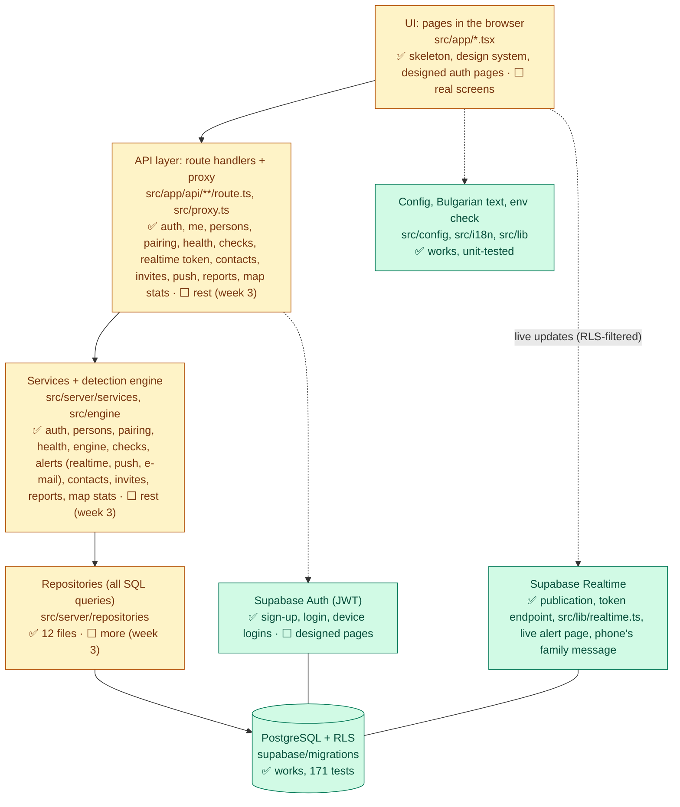

# Scamly: how it works

> **How to use this file**
>
> - This file explains **what works, how it works and why it works like that**, for every part of Scamly that exists in the code today. It is for us (Alex and Roberta), for the documentation and for the oral defense.
> - Start with [the big picture](#1-the-big-picture) and [the status table](#2-status-table). Then read the section of the part you need. Each section has the same four headings: **What it does · How it works · Why it works like that · How we know it works**.
> - It describes the **real code**, not the plan. Parts that don't exist yet are marked **Planned (week N)** with a pointer to [`BUILD_PLAN.md`](./BUILD_PLAN.md).
> - "Why X instead of Y?" questions (why Next.js, why Supabase, why Vitest...) are answered in [`WHY_WE_CHOSE.md`](./WHY_WE_CHOSE.md).
>
> **The rule (decision D19):** every time anything is used, added, changed or removed, **this file is updated in the same commit**, and a line is added to the [change history](#9-change-history).

Last updated: **2026-11-10**

**Contents**

1. [The big picture](#1-the-big-picture)
2. [Status table](#2-status-table)
3. [The app (Next.js)](#3-the-app-nextjs)
4. [Code quality, tests and CI](#4-code-quality-tests-and-ci)
5. [The database](#5-the-database)
6. [The database tests](#6-the-database-tests)
7. [Data flow examples](#7-data-flow-examples)
8. [Where the code differs from the plan](#8-where-the-code-differs-from-the-plan) · [Glossary](#glossary)
9. [Change history](#9-change-history)

---

## 1. The big picture

Scamly is a web app. An older person's phone shows one big button; when a suspicious call comes in, they answer a few questions, get a red/yellow/green verdict, and their family is alerted at once. Guests can see a public map of scam reports by district.

The system has **layers**, and each layer only talks to the one below it: the **UI** (pages in the browser) calls our **REST API** (Next.js route handlers), which calls **services** (business logic, including the detection engine), which call **repositories** (all database queries), which talk to **PostgreSQL** on Supabase. PostgreSQL itself enforces **Row Level Security (RLS)**: even if our API had a bug, the database would still refuse to show family A the data of family B. Supabase also gives us **Auth** (logins, JWTs) and **Realtime** (live updates for the family's alert page).

**Today (Week 1, 3 Nov)** the database is complete (all tables, triggers, RLS policies, 151 database tests), and the first slice through every layer works: sign-up, login, roles and device pairing go from designed auth pages through the API, services and repositories down to PostgreSQL (sections 3.8–3.17). The detection engine (Layer 1, section 3.21) works and is tested: `analyseCall()` turns answers + text into a red/yellow/green verdict with reasons, and `redactPersonalData()` removes personal data. `/api/health` and the keep-alive workflow are ready for the first deploy (section 3.22).

**Week 2 backend (4 Nov, ahead of plan):** the call-check API runs the engine on the server and stores only redacted text (3.23); the family is alerted through `alerts` rows and Supabase Realtime, with a 5 s polling fallback (3.24, 3.25); „Обаждам ѝ се сега“ works end to end (3.23); persons, the contact list and invites are complete (3.26–3.28, 5.14). Web push (3.29) and e-mail (3.30) are two more alert channels, each behind its feature switch; a real phone and a real Brevo e-mail are still to be tested. 171 database tests, 449 unit tests. Roberta's Week 2 screens that use them are still to come.

**Week 2 frontend (6 Nov, Alex):** the family's live alert page `/family/alerts` with „Обаждам ѝ се сега“ (3.34, header link „Сигнали“), the push opt-in card with the iPhone hint (3.35) and voice input on grandma's text step (3.36). Realtime got a reliability fix: a 10 s safety poll keeps running while connected (3.25). Live: 5/5 round trips, alert on the family page 2.3–3.9 s after the big button, the name on grandma's phone 0.8–1.3 s after the family member's tap. 521 unit tests, 58 e2e tests × 2 screens.

**Week 3 backend (9 Nov, Alex):** the public reports API (3.39). A guest can report a scam call with `POST /api/reports` (rate-limited, honeypot, redacted text, hashed number, stored as `pending`), and `GET /api/map/stats` gives the map its counts of approved reports for all 28 districts plus "scam wave" flags. The report form (W3-02), the map (W3-03) and moderation (W3-04) are still to come. 558 unit tests.

**Week 3 frontend + admin (10 Nov, Alex):** the public report form `/signal` (3.41), linked from the home page and the footer, and the admin area `/admin` (3.42): users and audited role changes, statistics with hand-made bar charts, and the audit log. 637 unit tests, 103 e2e tests × 2 screens.

**Week 3 map + moderation API (10 Nov, Roberta):** moderators list the reports and approve or reject them through `GET`/`PATCH /api/moderation/reports` (3.43; the screen is Alex's W3-04 UI), and anyone can see the public scam map `/karta` (3.44): the 28 districts coloured by approved reports, the current scam waves, a panel and a table per district. Only an approved report reaches the map. 661 unit tests, 111 e2e tests × 2 screens.

**Week 3 moderation screen (10 Nov, Alex):** moderators work through the report queue on `/moderator/reports` (3.45): tabs „Чакащи“ / „Одобрени“ / „Отхвърлени“, „Одобри“ with one click, „Отхвърли“ with a required reason (quick picks), a count-only badge for repeat numbers, and a clear message when another moderator was faster (409). The hub card shows the pending count and the moderator's header has „Сигнали“. Live: one report approved and one rejected through the screen, the map counted the approved one. 673 unit tests, 121 e2e tests × 2 screens.



Green = works now, yellow = partly built, grey dashed = planned.

---

## 2. Status table

✅ works (in the code and tested) · ⬜ planned (week N, task ID from [`BUILD_PLAN.md`](./BUILD_PLAN.md) section 6)

| Part | Status | Where in the code | Proven by |
|---|---|---|---|
| App skeleton (layout, home page, 404 page) | ✅ | `src/app/layout.tsx`, `page.tsx`, `not-found.tsx`, `globals.css` | `tests/e2e/home.spec.ts`; CI jobs *checks* (build) and *e2e* |
| Site layout: header, menu (family and moderator: + „Сигнали“), compact theme switch, footer + real home page (3.31) | ✅ (W2-13, D22) | `src/components/layout/`, `src/components/ui/ThemeToggle.tsx`, `src/app/layout.tsx`, `src/app/page.tsx` | `tests/e2e/layout.spec.ts` (7 tests), `src/components/layout/accountLinks.test.ts`, `home.spec.ts`, `ui.spec.ts` |
| App name constant | ✅ | `src/config/app.ts` | `src/i18n/bg.test.ts` |
| Feature switches | ✅ (`push`, `email` used by the alert channels; `voice` by the call check, 3.36) | `src/config/features.ts` | `src/config/features.test.ts` |
| Bulgarian text file | ✅ | `src/i18n/bg.ts` | `src/i18n/bg.test.ts`, `tests/e2e/home.spec.ts` |
| Environment variable check | ✅ | `src/lib/env.ts` (server), `src/lib/publicEnv.ts` (public keys), `.env.example` | `src/lib/env.test.ts` |
| Code quality tools (ESLint, Prettier, strict TypeScript) | ✅ | `eslint.config.mjs`, `.prettierrc`, `tsconfig.json`, `package.json` | CI job *checks* |
| Unit tests (Vitest) | ✅ 661 tests in 72 files | `vitest.config.mts`, `src/**/*.test.ts`, `scripts/seed.test.ts` | `npm test`; CI job *checks* |
| End-to-end tests (Playwright, desktop + Pixel 5) | ✅ 111 tests × 2 screens | `playwright.config.ts`, `tests/e2e/` | `npm run e2e`; CI job *e2e* |
| CI (3 jobs) + keep-alive schedule | ✅ CI · 🔄 keep-alive waits for `HEALTH_URL` | `.github/workflows/ci.yml`, `.github/workflows/keep-alive.yml` | green ✓ on GitHub |
| Agent rules files (shared rules for Claude Code and Codex) | ✅ | `AGENTS.md`, `CLAUDE.md` | section 4.5; `next dev` leaves our rules in place |
| Database tables (14) + enums (10) + 28 districts | ✅ | `supabase/migrations/20261102000001_schema.sql` | `supabase/tests/01_schema.test.sql` |
| Triggers (2): new profile, owner as contact #1 | ✅ | `..._000002_triggers.sql` | `02_profiles`, `03_persons_contacts` |
| RLS helper functions (6) | ✅ | `..._000003_rls_helpers.sql` | `08_functions` (+ every policy test) |
| RLS policies + column privileges | ✅ | `..._000004_rls_policies.sql` | `02` to `07` test files |
| Append-only audit log | ✅ (written by pairing, checks, persons, invites, scripts, role changes; read in `/admin`, 3.42) | `..._000004_rls_policies.sql` | `07_admin_audit` |
| Map statistics function `get_map_stats` | ✅ (DB part; used by `GET /api/map/stats`, 3.39) | `..._000005_functions.sql` | `06_public_reports_scripts` |
| Rate limiter `hit_rate_limit` + TypeScript wrapper | ✅ (login, register, pairing, invites, checks, push subscriptions, public reports) | `..._000005_functions.sql`, `src/server/security/rateLimit.ts` | `08_functions`, `rateLimit.test.ts` |
| Realtime publication (checks, alerts) | ✅ (DB part; browser side: 3.25) | `..._000006_realtime.sql` | `01_schema` |
| Contact list function `replace_trusted_contacts` (5.14) | ✅ tested · ✅ applied in the live project (4 Nov) | `20261104000002_replace_contacts.sql` | `11_replace_contacts` |
| Pairing codes and devices tables (HMAC hash column) | ✅ | `..._000001_schema.sql`, `..._000004_rls_policies.sql` | `04_devices_pairing` |
| Database tests (pgTAP, 180 assertions) | ✅ | `supabase/tests/`, `scripts/db/` | CI job *database*; `npm run test:db` |
| ADRs (decision records) | ✅ 0001–0005 written (stack, device pairing, e-mail provider, AI chain, alert channels) | `docs/decisions/0001`–`0005` | Records D4–D7; AI chain still planned (Week 3) |
| Generated TypeScript types for the database | ✅ (postgres-meta, section 3.8) | `src/types/database.ts` | `npm run typecheck` |
| Supabase clients (user, admin, browser, Realtime) + HttpOnly cookie settings | ✅ | `src/server/supabase/`, `src/lib/supabase/browser.ts`, `src/lib/realtime.ts` | section 3.9; live smoke test |
| Proxy: session refresh + login guards | ✅ | `src/proxy.ts`, `src/config/routes.ts` | `routes.test.ts`, `tests/e2e/auth-guards.spec.ts` |
| Login, register, logout, roles (`getActor`, `requireRole`, `requirePageRole`) | ✅ backend (W1-06) · designed pages; live demo-role check pending | `src/app/api/auth/`, `src/server/auth/`, `src/server/services/authService.ts` | `authService.test.ts`, `requireRole.test.ts` |
| API basics: error shape, same-origin check (CSRF), JSON body, client IP, HMAC | ✅ | `src/server/http/`, `src/server/security/`, `src/schemas/` | `errors`, `request`, `origin`, `hash`, `schemas` tests |
| `/api/me`, `/api/persons` (list, create, details, rename, delete) | ✅ (details/rename/delete: W2-08, 3.26) | `src/app/api/me/`, `src/app/api/persons/`, `src/server/services/personService.ts` | `personService.test.ts`; live smoke test; RLS: `03_persons_contacts` |
| Device pairing (create code, redeem, revoke) | ✅ backend (W1-07) · designed `/svarzhi`; live browser pairing check pending | `src/app/api/persons/[id]/pairing-codes/`, `src/app/api/pairing/redeem/`, `src/app/api/devices/[id]/`, `src/server/services/pairingService.ts` | `pairingService.test.ts` (18 tests); live smoke test |
| Auth pages: `/vhod`, `/registratsia`, `/svarzhi`, `/403`, area layouts | ✅ designed auth pages; area contents remain temporary, except `/family` (W2-07, 3.32) and `/protected` (W2-01, 3.33) | `src/app/{vhod,registratsia,svarzhi,403,family,moderator,admin,protected}/`, `src/app/_auth-placeholders/` | `tests/e2e/auth-guards.spec.ts` |
| Design system (colours, Button, Card, Verdict, BigChoice, ThemeToggle) | ✅ (W1-11) | `src/components/ui/`, `src/app/globals.css`, `/dev/ui` | Section 3.7; npm run check and all 6 browser runs pass |
| Detection engine: types and constants (section 3.6) | ✅ | `src/engine/types.ts` | `src/engine/types.test.ts` |
| Engine dictionary and scenario data | ✅ all 51 scenarios run and pass (section 3.21) | `src/engine/dictionary.ts`, `src/engine/__tests__/scenarios.ts` | Type check and `src/engine/data.test.ts`; section 3.18 |
| Detection engine logic v1 + `redactPersonalData()` (section 3.21) | ✅ (W1-08 to W1-10) | `src/engine/` (`index.ts` is the public API) | 170 engine tests incl. 51/51 scenarios; 100 % line coverage (`docs/evidence/engine-coverage-2026-11-04.md`) |
| Seed script with demo accounts | 🔄 tooling ready; approved empty DB execution pending | `scripts/seed*.ts`, `scripts/tsconfig.seed.json` | Five offline tests and npm run seed preview; section 3.20 |
| `/api/health`, keep-alive workflow, Vercel region (section 3.22) | 🔄 code ready, live check against Supabase OK; Vercel project + `HEALTH_URL` secret pending (W1-13, Mon 9 Nov) | `src/app/api/health/`, `src/server/services/healthService.ts`, `src/server/repositories/districtsRepository.ts`, `.github/workflows/keep-alive.yml`, `vercel.json` | `healthService.test.ts`, `tests/e2e/health.spec.ts`; local live check |
| Call check UI: big button, one question per screen, optional text, verdict with praise and `tel:` button, live family message, offline engine fallback (3.33) | ✅ (W2-01, Roberta) | `src/app/protected/`, `src/components/protected/`, `src/components/ui/{BigChoice,Verdict}.tsx`, `/dev/protected` preview | `tests/e2e/protected.spec.ts` (6 tests × 2 screens), `questions`, `upload`, `acknowledgement` unit tests; live check with a throwaway pairing |
| Checks API + server-side verdict + acknowledge (3.23) | ✅ backend (W2-02, W2-04) · acknowledge button: 3.34 | `src/app/api/checks/`, `src/server/services/checkService.ts`, `src/schemas/checks.ts` | `checkService.test.ts` (24), `schemas/checks.test.ts`; live smoke test 38/38 |
| Family alerts: fan-out + Realtime token + live-watch helper with safety poll (3.24, 3.25) | ✅ (W2-03) · live alert page: 3.34 | `src/server/services/alertService.ts`, `realtimeService.ts`, `src/app/api/realtime/token/`, `src/lib/realtime.ts` | `alertService`, `realtimeService`, `realtime` (10), `origin` tests; live: alert via Realtime in 111 ms; 5/5 round trips on 6 Nov |
| Web push (3.29) | ✅ backend (W2-05) · ✅ opt-in card + iOS hint (3.35) · real-phone test pending | `src/app/api/push/`, `src/server/services/pushSubscriptionService.ts`, `src/server/notifications/push{Channel,Sender}.ts`, `src/schemas/push.ts`, `src/lib/push.ts`, `public/sw.js` | `pushChannel` (19), `pushSender` (4), `pushSubscriptionService` (7), `schemas/push` (7), `lib/push` (12); live smoke test 22/22 |
| Email (`EmailProvider`, Brevo) (3.30) | ✅ backend (W2-06) · ✅ wording proofread (Roberta, 6 Nov) · real Brevo e-mail pending (no account yet, Alex) | `src/server/notifications/email/`, `src/server/notifications/siteUrl.ts` | `emailProviders` (10), `alertEmail` (9), `emailChannel` (8), `siteUrl` (3); fakes only |
| Contacts + invites API (3.27, 3.28) | ✅ backend (W2-08) · migration applied 4 Nov; live smoke test 44/44 | `src/app/api/persons/[id]/{contacts,invites}/`, `src/app/api/invites/redeem/`, `contactService.ts`, `inviteService.ts` | `contactService` (12), `inviteService` (17), `11_replace_contacts`; live 35/44 |
| Family dashboard UI: people, create person, contacts order, invite, pairing with QR, devices + revoke, check history (3.32) | ✅ (W2-07, Roberta) · live alert page: 3.34 | `src/app/family/`, `src/components/family/`, `src/components/ui/{ConfirmDialog,VerdictBadge}.tsx`, `/dev/family` previews | `tests/e2e/family.spec.ts` (10 tests × 2 screens), `format`, `qr`, `districts` unit tests; live check with the demo account |
| Live alert page `/family/alerts` + „Обаждам ѝ се сега“ (3.34) | ✅ (W2-03, W2-04, Alex) | `src/app/family/alerts/`, `src/components/family/{AlertsPage.tsx,alerts.ts,alertSound.ts}`, `/dev/family/alerts` preview | `tests/e2e/alerts.spec.ts` (8 tests × 2 screens), `alerts` (9), `accountLinks` tests; live 5/5 round trips |
| Push opt-in card + iPhone hint, unsubscribe on logout (3.35) | ✅ (W2-05 UI, Alex) · real-phone delivery untested | `src/components/family/{PushOptIn.tsx,pushState.ts}`, `FamilyHome.tsx`, `src/lib/push.ts`, `src/components/auth/forms.tsx` | `tests/e2e/push-optin.spec.ts` (7 tests × 2 screens), `pushState` (10), `lib/push` (12) |
| Voice input „Говорете“ (3.36) | ✅ (W2-10, Alex) · real Bulgarian recognition on a phone untested | `src/components/protected/{VoiceInput.tsx,voice.ts,CallCheckPage.tsx}`, `CallerText.tsx` | `tests/e2e/voice.spec.ts` (4 tests × 2 screens), `voice` (9) |
| Invite page `/pokana` + safe `next` after login (3.37) | ✅ (W2-14, Roberta) | `src/app/pokana/`, `src/components/auth/InviteAccept.tsx`, `src/config/routes.ts` (`safeNextPath`, `withNext`), `src/components/auth/forms.tsx`, `next.config.ts` (headers) | `tests/e2e/invite.spec.ts` (13 tests × 2 screens), `routes.test.ts` (`safeNextPath`, `withNext`) |
| PWA: manifest + own icons, „Инсталирай Scamly“ card, offline card (3.38) | ✅ (W2-09, Roberta) · real install on a phone untested | `src/app/manifest.ts`, `src/config/pwa.ts`, `public/icons/`, `scripts/icons/`, `src/components/pwa/`, `src/lib/{install,offlinePage}.ts`, `src/app/offline/route.ts`, `public/sw.js`, `src/app/layout.tsx` | `tests/e2e/pwa.spec.ts` (7 tests × 2 screens), `offlinePage` (3) |
| Public reports + scam map (3.39) | ✅ API (W3-01, Alex): `POST /api/reports`, `GET /api/map/stats` with wave flags · ✅ report form (W3-02, 3.41) · ✅ map (W3-03, 3.44) · ✅ moderation API (W3-04, 3.43) | `src/app/api/reports/`, `src/app/api/map/stats/`, `src/schemas/reports.ts`, `src/server/services/{reportService,mapStatsService}.ts`, `src/server/repositories/reportsRepository.ts`, `src/server/supabase/publicClient.ts` | `schemas/reports` (13), `reportService` (8), `mapStatsService` (8); live smoke test |
| Scam-script library, education pages „Как работи измамата“, moderator script editor, moderator keywords in the engine (3.40) | ✅ (W3-05, Roberta) · all four starter cards verified on the live project 11 Nov | `src/app/api/scripts/`, `src/schemas/scripts.ts`, `src/server/services/{scriptService,educationService,moderatorKeywords}.ts`, `src/server/repositories/scriptsRepository.ts`, `src/app/kak-raboti/`, `src/components/education/`, `src/app/moderator/`, `src/components/moderator/`, `supabase/migrations/20261109000001_seed_scam_scripts.sql` | `schemas/scripts` (12), `scriptService` (10), `educationService` (5), `moderatorKeywords` (4), `checkService` (+2), `text` (4), `scriptForm` (3); `12_scam_scripts_seed` (9); `tests/e2e/scripts.spec.ts` (10 tests × 2 screens) |
| Moderation API: queue + approve/reject, audited (3.43) | ✅ API (W3-04, Roberta) · ✅ moderation screen `/moderator/reports` + hub card + header link (W3-04 UI, Alex, 3.45) | `src/app/api/moderation/reports/`, `src/schemas/moderation.ts`, `src/server/services/moderationService.ts`, `src/server/repositories/moderationRepository.ts`, `src/app/moderator/reports/`, `src/components/moderator/{ReportQueue,RejectDialog,PendingReportsCard,reportQueue}.tsx?` | `moderationService` (16), `reportQueue` (11), `accountLinks` (+1), `tests/e2e/moderation.spec.ts` (11 × 2 screens); live checks with the demo moderator (API and screen) |
| Scam map `/karta`: choropleth, waves, district panel, table, links (3.44) | ✅ (W3-03, Roberta) | `src/app/karta/`, `src/components/map/`, `public/geo/bg-districts.json`, `scripts/geo/`, `src/app/page.tsx`, `SiteFooter.tsx`, `ReportForm.tsx` (success link) | `mapData` (5), `districtsGeo` (3), `tests/e2e/map.spec.ts` (7 tests × 2 screens); live check |
| Public report form `/signal`, home card + footer link (3.41) | ✅ (W3-02, Alex) | `src/app/signal/`, `src/components/report/`, `src/components/ui/BigChoice.tsx` (`describedBy`), `src/app/page.tsx`, `src/components/layout/SiteFooter.tsx` | `reportForm` (9), `tests/e2e/report.spec.ts` (8 tests × 2 screens); live: one real report stored as `pending`, then deleted |
| Admin area `/admin`: users + audited role change, statistics with hand-made charts, audit log (3.42) | ✅ (W3-06, Alex) | `src/app/api/admin/`, `src/schemas/admin.ts`, `src/server/services/{adminService,adminStats,auditSummary}.ts`, `src/server/repositories/adminRepository.ts`, `profilesRepository.ts` (`changeProfileRole`), `authUsersRepository.ts` (`listAuthEmails`), `src/components/admin/`, `src/app/admin/`, `/dev/admin` preview | `adminService` (17), `adminStats` (5), `auditSummary` (5), `adminFormat` (3), `tests/e2e/admin.spec.ts` (7 tests × 2 screens); live check with throwaway accounts |
| AI second opinion (Gemini / Groq chain) | ⬜ planned (week 3, W3-07), first to cut (D12) | | |
| Escalation chain | ⬜ planned (week 3, W3-09), may be cut (D12) | | |
| Security hardening (CSP, headers, attack tests) | ⬜ planned (week 4, W4-01, W4-02) | | |

---

## 3. The app (Next.js)

### 3.1 App skeleton and request flow

#### What it does

Shows the Bulgarian home page at `/` (the tagline „Обаждат ли ви се за пари? Проверете за 30 секунди.“ as the main heading, the 3 steps and the start buttons; details in section 3.31) and a Bulgarian 404 page for any address that doesn't exist. Every page sits inside the shared frame of the root layout: header with logo, menu and theme switch, and footer (section 3.31).

#### How it works

Next.js **App Router** turns folders and files in `src/app/` into web addresses ("file-system routing"): the folder is the URL, a file named `page.tsx` is the page for that URL. Special file names have fixed jobs.

| File | Job |
|---|---|
| `src/app/page.tsx` | The page for `/`. Exports a function `HomePage()` that returns the page as JSX (HTML-like code). |
| `src/app/layout.tsx` | The **root layout**: the `<html>` and `<body>` around *every* page, with the shared header and footer (section 3.31). Sets `lang="bg"` and exports `metadata` (tab title and description). |
| `src/app/not-found.tsx` | The root not-found page. Next.js shows it, with HTTP status 404, for every URL that matches no page. |
| `src/app/globals.css` | Global styles: loads Tailwind CSS and defines the design system's light/dark colour tokens, typography, focus styles and large controls. |

Step by step, when someone opens `/`:

1. The browser asks the Next.js server for `/`.
2. App Router finds `src/app/page.tsx` for that URL and the layout above it (`src/app/layout.tsx`).
3. It calls `RootLayout({ children: <HomePage /> })`. The page is put where the layout writes `{children}`.
4. Both are **server components**, so React turns their static content into HTML on the server. Interactive components such as the design system's theme control use `"use client"` and add the browser code needed for their behaviour.
5. Because `next.config.ts` turns on `cacheComponents: true` and the home page uses no request data, Next.js **pre-renders it once at build time**. After `npm run build` you can see the result as `.next/server/app/index.html`. Every visitor gets that ready-made HTML. Only the header's menu is filled in per request: it depends on who is logged in, so it sits inside `<Suspense>` and streams in after the ready-made part (section 3.31). This is why `next build` marks the pages ◐ (Partial Prerender).
6. The text comes from `bg` (the Bulgarian text file), for example `{bg.app.tagline}`.

```tsx
// src/app/layout.tsx (shortened)
export const metadata: Metadata = {
  title: bg.app.metaTitle,
  description: bg.app.description,
};
export default function RootLayout({ children }: { children: ReactNode }) {
  return (
    <html lang="bg" className="h-full antialiased">
      <body className="flex min-h-full flex-col font-sans">
        <SiteHeader />
        <div id="content" className="site-content">{children}</div>
        <SiteFooter />
      </body>
    </html>
  );
}
```

Other settings in `next.config.ts`: `partialPrefetching: true` (the Next.js 16 docs say to turn it on together with `cacheComponents`), and Tailwind CSS is processed by the `@tailwindcss/turbopack` loader for every `*.css` file. The 404 page uses Next's `<Link>` component for the „Към началната страница“ link, which navigates without reloading the whole page.

Note: this is **Next.js 16.4**. Some names differ from older tutorials (see `AGENTS.md`). For example, the file that runs before every request is now called `proxy.ts` (it used to be `middleware.ts`).

#### Why it works like that

- **`lang="bg"`**: screen readers then read the page with Bulgarian pronunciation, and browsers offer the right spell-check and translation. The jury scores accessibility and correct Bulgarian.
- **Server components by default**: less JavaScript sent to cheap Android phones, so pages load faster on slow 4G. We use `"use client"` only where a component needs interaction or browser APIs.
- **Pre-rendering**: a static page can't break at request time and is very fast.
- **Pages contain no text and no logic**: text lives in `bg.ts`; logic will live in `src/server/` and `src/engine/`. This keeps the UI separate from business logic (a scored criterion).
- **Shared design tokens** in `globals.css` give screens consistent colours, type sizes and focus styles (section 3.7).
- Why Next.js and Tailwind at all: see [`WHY_WE_CHOSE.md`](./WHY_WE_CHOSE.md).

#### How we know it works

- `tests/e2e/home.spec.ts` opens `/` in a real browser and checks: `<html lang="bg">`, the `<h1>` is the tagline, the app name is in the header, and the tab title is `bg.app.metaTitle`. It runs on a desktop and on a phone screen (section 4.3).
- `npm run build` in CI proves the app compiles and pre-renders.
- The 404 page has no automated test yet. Check by hand: `npm run dev`, open `http://localhost:3000/nothing-here`.

### 3.2 App name: `src/config/app.ts`

#### What it does

Holds the one constant `APP_NAME = "Scamly"`.

#### How it works

`bg.ts` builds every string that contains the name from this constant (`` `${APP_NAME} – защита от телефонни измами` ``). Pages show `bg.app.name`, never the word "Scamly" typed directly.

#### Why it works like that

Decision D15: another scam-protection app is also called "Scamly". We keep the name for now, but if we must rename, it is a one-line change.

#### How we know it works

`src/i18n/bg.test.ts` checks that `bg.app.name` equals `APP_NAME` and that the title contains it.

### 3.3 Feature switches: `src/config/features.ts`

#### What it does

Gives every optional feature an on/off switch that is read from an environment variable, so we can turn a feature off on Vercel without changing code.

| Switch | Variable | Default | Why this default |
|---|---|---|---|
| `ai` | `FEATURE_AI` | off | AI layer doesn't exist until Week 3, and it is first to cut |
| `voice` | `FEATURE_VOICE` | on | |
| `escalation` | `FEATURE_ESCALATION` | off | stretch goal (D8) |
| `push` | `FEATURE_PUSH` | on | |
| `email` | `FEATURE_EMAIL` | on | |

#### How it works

1. `parseBoolean(value, defaultValue)` turns the text of a variable into `true`/`false`: `"true"` or `"1"` (any case, spaces ignored) → `true`; any other text → `false`; missing or empty → the default.
2. `getFeatures(env = process.env)` returns an object of type `Features` (like a Python dataclass with five `bool` fields).
3. Tests pass their own `env` object; the app will use the real `process.env`. The switches are read on the server and passed to components as normal props.

```ts
export function parseBoolean(value: string | undefined, defaultValue: boolean): boolean {
  if (value === undefined || value.trim() === "") {
    return defaultValue;
  }
  const cleaned = value.trim().toLowerCase();
  return cleaned === "true" || cleaned === "1";
}
```

The first users are the alert channels (3.24): `email` adds the e-mail channel (3.30), and `push` adds the push channel **only if the VAPID keys are valid too** (3.29); `GET /api/push/public-key` answers `enabled: false` when either is missing. `voice` is read at request time by `CallCheckPage.tsx` and shows or hides „Говорете“ (3.36).

#### Why it works like that

- **D12 cut order**: if we run late, we cut AI → voice input → escalation → Telegram/Viber. Cutting then means flipping a switch, not deleting code in a panic. `push` and `email` have switches too, so a broken outside service (for example Brevo blocking us) can be turned off during the demo.
- **Unknown text means off**: `"yes"` or a typo turns a feature *off*, not on. A feature appearing by accident is worse than one missing.
- **`env` as a parameter**: the function is easy to test without touching the real environment.

#### How we know it works

`src/config/features.test.ts`, 5 tests: on values, off values, defaults for missing/empty, all defaults together, and every switch changed by its variable. Run: `npm test`.

### 3.4 Bulgarian text: `src/i18n/bg.ts`

#### What it does

Holds **every piece of Bulgarian text a user can see**, in one object `bg` with groups (`bg.app.*`, `bg.common.*`).

#### How it works

Screens import `bg` and write `{bg.app.tagline}` instead of typing text. The object ends with `as const`, which makes it read-only (like a frozen Python dict) and lets TypeScript know the exact keys, so a typo like `bg.app.tagLine` is a type error. Groups so far: `app`, `common`, the design-system groups, and (Session E) `errors` (API error messages), `auth`, `pairing`, `persons` and `areas` (temporary area pages); Week 2 added `alertEmail` (3.30) and `push` (3.29), proofread by Roberta on 6 Nov (W2-06 wording: no more draft markers), and `invitePage` (3.37).

#### Why it works like that

The jury scores correct literary Bulgarian. With all text in one file, one person (or a Bulgarian teacher, W4-06) can proofread everything without reading code. It also makes a second language (`tr.ts`) possible later. Code, comments and docs stay in English.

#### How we know it works

`src/i18n/bg.test.ts` (2 tests: the name comes from `APP_NAME`; the tagline is exactly the agreed sentence) and `tests/e2e/home.spec.ts` (the strings really appear on the page).

### 3.5 Environment variable check: `src/lib/env.ts`

#### What it does

Checks that the server's settings and secrets (Supabase keys, peppers, email settings...) are present and valid, and returns them with the right types. The full list with explanations is in `.env.example`.

#### How it works

1. `serverEnvSchema` is a **Zod** schema (like a Pydantic model): for example `NEXT_PUBLIC_SUPABASE_URL: z.url()`, `PAIRING_PEPPER: z.string().min(32, ...)`, `EMAIL_PROVIDER: z.enum(["brevo", "resend", "noop"]).default("noop")`. Keys for later features (VAPID, Gemini, Groq, `CRON_SECRET`) are `.optional()`.
2. **Optional extras never take the server down.** `EMAIL_PROVIDER`, `EMAIL_FROM`, `SITE_URL` and `VAPID_SUBJECT` end with `.catch(() => fallback(NAME, safeValue))`: a wrong value (e.g. `EMAIL_PROVIDER=gmail`) logs `[env] EMAIL_PROVIDER has an invalid value and is ignored; using the safe default.` (the name, never the value) and uses the safe value (`noop`, nothing, the default subject). That extra is then off; the rest of the server works. Required values (Supabase keys, peppers) still fail loudly. `VERCEL_PROJECT_PRODUCTION_URL` (set by Vercel itself) is read for `getSiteUrl()` (3.30).
3. `dropEmptyValues(env)` removes empty values, so a line `HASH_PEPPER=` in `.env.local` counts as missing (not as a valid empty string).
4. `getServerEnv(env = process.env)` runs `safeParse`. If something is wrong it throws one error listing **every** problem as `- NAME: rule message`.
5. The type `ServerEnv` is worked out from the schema with `z.infer` (no type written twice).

```ts
export function getServerEnv(env: Env = process.env): ServerEnv {
  const result = serverEnvSchema.safeParse(dropEmptyValues(env));
  if (!result.success) {
    const problems = result.error.issues.map(
      (issue) => `  - ${issue.path.join(".")}: ${issue.message}`,
    );
    throw new Error(`Invalid environment variables (see .env.example):\n${problems.join("\n")}`);
  }
  return result.data;
}
```

#### Why it works like that

- **Lazy validation**: the check runs only when `getServerEnv()` is called, not when the file is imported. So `next build` and CI work on a machine with no `.env.local`, and each server function checks the settings at the moment it needs them.
- **Never prints secrets**: the error names the variable and the broken rule (`issue.path`, `issue.message`), never its value, so a log or a screenshot of the error can't leak a key.
- **Fail early and loudly** for what every route needs: a missing pepper should stop the server with a clear message, not cause a strange bug later.
- **But not for extras**: `getServerEnv()` runs in almost every API route (the admin client and the rate limiter call it), so without the fallback one typo in `EMAIL_FROM` would make those routes answer 500, including the big button. An e-mail setting must at most switch e-mail off. Comparison: [`WHY_WE_CHOSE.md`](./WHY_WE_CHOSE.md) "`.catch()` fallback for optional environment variables".
- **Peppers ≥ 32 characters**: short secrets can be guessed (section 5.13 explains what the pepper protects).
- **Server only**: this file returns secret keys, so only server code may import it. Code that runs in the browser or the proxy reads the two public values through `src/lib/publicEnv.ts` instead (section 3.9). Variables starting with `NEXT_PUBLIC_` are the exception: Next.js copies them into the browser code, so only public values (the Supabase URL and the anon key, which RLS makes safe) get that prefix. `SUPABASE_SERVICE_ROLE_KEY` never does.
- Real values live in `.env.local` (ignored by git through `.env*` in `.gitignore`) and in Vercel's settings.

#### How we know it works

`src/lib/env.test.ts`, 7 tests with fake values only: a valid set passes and gets `EMAIL_PROVIDER = "noop"`; an empty set names the missing `SUPABASE_SERVICE_ROLE_KEY`; an empty `HASH_PEPPER` counts as missing; `EMAIL_PROVIDER=gmail` falls back to `noop`; a bad `EMAIL_FROM` is ignored; a bad `SITE_URL` and `VAPID_SUBJECT` are ignored (default subject); a valid `EMAIL_FROM` is kept.

### 3.6 Detection engine: types (`src/engine/types.ts`)

The rest of the engine (normalising, transliteration, fuzzy matching, signals, scoring, hard rules, verdict, `redactPersonalData`) is section 3.21. The dictionary and scenario data use these shared shapes (section 3.18).

#### What it does

Describes the shape of everything the engine reads and returns, and holds the engine's constants. It has **no logic and no imports**.

| Name | What it is |
|---|---|
| `CallInput` | The answers + text (BUILD_PLAN 4.1). `null` = not answered. Optional `extraKeywords` |
| `Verdict`, `Reason`, `ReasonCode` | The result (4.2). A reason's `code` is a hard rule id or a signal category; `evidence` holds the original words that matched |
| `ClaimedIdentity`, `TriAnswer`, `HandoverMethod`, `RiskLevel`, `ScriptType` | Answer and result values, the same as the database enums |
| `HardRuleId` | `HR1_POLICE_ASKS_MONEY` ... `HR6_RELATIVE_IN_TROUBLE` (4.6) |
| `SignalCategory` | 17 ids: the 13 rows of the 4.5 table, plus `handover`, `credentials`, `safe_account`, `move_money` (no weight; they let HR2, HR4, HR5 fire from text alone) |
| `DictionaryEntry`, `ExtraKeyword` | The shape of Roberta's `dictionary.ts` (stems, phrases, an example sentence) and of a moderator-added stem |
| `EngineScenario`, `ScenarioExpectation` | The shape of Roberta's test cases in `__tests__/scenarios.ts` |
| `EMPTY_INPUT` | A `CallInput` with nothing answered, to copy in tests: `{ ...EMPTY_INPUT, asksMoney: "yes" }` |
| `ENGINE_VERSION`, `RISK_THRESHOLDS`, `MAX_TEXT_LENGTH`, `PHRASE_WINDOW` | `"1.0.0"`, `{ red: 60, yellow: 30 }`, `2000`, `6` |

#### How it works

- Each value list is written **once**, as a read-only array, and the type is worked out from it:

  ```ts
  export const RISK_LEVELS = ["green", "yellow", "red"] as const; // like a Python tuple of Literal values
  export type RiskLevel = (typeof RISK_LEVELS)[number]; // "green" | "yellow" | "red", like Literal[...]
  ```

  So the code has a list to loop over or check against (tests, a future Zod schema), and the type can never drift from that list.
- `type X = { ... }` only describes a shape (like a Python `TypedDict`); it disappears when the code runs.
- A dictionary **stem** is a word beginning in Cyrillic lower case (`хвърл` matches хвърлете, хвърли). A **phrase** is a list of stems that must appear in order within `PHRASE_WINDOW` (6) words. Latin-script spellings may be added as extra stems. Every entry has a real `example` sentence.
- A scenario's `expect` is checked field by field by Alex's runner (Session H step 8): `level` exactly; `scriptType` and `hardRules` (exact set, order ignored) only if given; `minScore`/`maxScore` as inclusive limits; `mustNotBeRed` marks legitimate calls that must never be red.

#### Why it works like that

- **No imports** (no React, Next.js, Supabase or Node): the same engine runs on the server and on the phone (BUILD_PLAN 4.9).
- **One place for the values**: the API, the engine, the dictionary and the tests all use the same names, and TypeScript turns a typo like `"polise"` into an error before the code runs. Why `as const` lists instead of TypeScript `enum`s: [`WHY_WE_CHOSE.md`](./WHY_WE_CHOSE.md) section 7.
- **Types first**: Roberta's dictionary and test cases can be written (and type-checked) before the engine logic exists.

#### How we know it works

`src/engine/types.test.ts`, 4 tests: the constants have the planned values (and `MAX_TEXT_LENGTH` equals the `text_redacted` limit in the SQL); the five value lists **read from the schema SQL file** are exactly `claimed_identity`, `tri`, `handover_method`, `risk_level`, `script_type`; there are six hard rules `HR1_` to `HR6_` in order; the signal category ids are unique and snake_case. `npm run typecheck` checks that every use of these types is correct.

---

### 3.7 Design system (W1-11)

#### What it does

Provides reusable `Button`, `Card`, `Verdict`, `BigChoice` and `ThemeToggle` components. The `/dev/ui` page shows interactive examples in both light and dark themes. This is a component preview, not the finished call-check flow.

#### How it works

- CSS variables in `src/app/globals.css` hold semantic colours for backgrounds, text, controls and the three verdict levels. The stylesheet lists the checked contrast ratios in a comment, uses a base font of at least 18 px and gives buttons at least 64 px of height.
- Components receive **props**: named inputs such as children, disabled state or the selected answer. Think of props as Python function keyword arguments; React uses them to produce the HTML.
- `Button` uses a native button, `Card` groups content, and `BigChoice` uses a fieldset with native radio inputs. Browser keyboard behaviour and form semantics remain available instead of being recreated with clickable divs.
- `Verdict` displays a written level and explanation alongside its colour. Its green wording follows D9: no typical signs were found, but the person should hang up and call a familiar number if in doubt. All visible Bulgarian strings come from `src/i18n/bg.ts`.
- `ThemeToggle` offers system, light and dark choices. Since W2-13 it is a compact control in the site header: three small picture buttons (native radio buttons in a group named „Изглед“), not a full-width select above the page (section 3.31). It remembers the preference in `localStorage`, follows device-theme changes in system mode and continues to work if browser storage is denied. It is a client component because it needs browser settings and interaction; the static page content can remain server-rendered.

#### Why it works like that

Large controls and readable text support older people using small phones. Shared tokens keep both themes consistent. Native controls provide established keyboard and screen-reader behaviour. Words as well as colours communicate the verdict, and D9 avoids promising that an unfamiliar call is safe. The theme setting contains only a display preference, no personal or account data.

#### How we know it works

`npm run check` passes (lint, types, formatting and 15 unit tests). WCAG sRGB contrast calculations confirm the documented text pairs exceed 4.5:1. All six production browser runs pass: home, saved theme and device changes, keyboard answers, 360 px layout and 64 px buttons on desktop and phone profiles. The theme select uses an explicit label/for association so its label excludes option text. No database files change in this task.

### 3.8 Generated database types: `src/types/database.ts`

#### What it does

Gives TypeScript the exact shape of every table, enum and SQL function in our 6 migrations. A misspelled column (`.select("rol")`) or a wrong enum value is a type error before the code runs.

#### How it works

- The file is **generated, not hand-written**. Normally `supabase gen types typescript` makes it, but the Supabase CLI can't be downloaded in the cloud session. So on 3 Nov we ran the generator the CLI itself uses inside its Docker image, `@supabase/postgres-meta` 0.100.0, against a local PostgreSQL 16 with our 6 migrations applied (`PG_META_GENERATE_TYPES=typescript`, schema `public`, PostgREST 14.18 like the live project). The output has the same format as the CLI's. The file's header comment records all of this.
- Reading it: `Database["public"]["Tables"]["profiles"]["Row"]` is one row of `profiles` (like a Python `TypedDict`); `Insert` makes fields with a default optional; `Update` makes every field optional; `Database["public"]["Enums"]["app_role"]` is `"family" | "protected" | "moderator" | "admin"`.
- Every client is created with it (`createServerClient<Database>(...)`, `createClient<Database>(...)`). `DbClient = SupabaseClient<Database>` (in `userClient.ts`) is the type every repository function takes. `AppRole` (`src/config/routes.ts`), `ProfileRow` and `PersonRow` (repositories) are taken from this file, never written again.
- When a migration changes, regenerate it, e.g. `npx supabase gen types typescript --local > src/types/database.ts` on a computer where the CLI works.

#### Why it works like that

Types copied by hand would drift from the SQL. Generated types make the database the single source of truth (W1-04). Comparison: [`WHY_WE_CHOSE.md`](./WHY_WE_CHOSE.md) section 2.

#### How we know it works

`npm run typecheck` passes with every query in `src/server/repositories/` typed against this file. Nothing checks automatically that the file matches the migrations: after a new migration we must regenerate it ourselves.

### 3.9 Supabase clients and login cookies

#### What it does

Several ways to talk to Supabase, each for one job, and one shared setting for the login cookies.

| File | Function | Key | RLS | Used for |
|---|---|---|---|---|
| `src/server/supabase/userClient.ts` | `createUserClient()` | publishable key + the caller's cookies | applies (as the caller) | almost everything on the server |
| `src/server/supabase/adminClient.ts` | `createAdminClient()` | secret service-role key | **bypassed** | only the uses listed in its header (BUILD_PLAN 2.4) |
| `src/server/supabase/publicClient.ts` | `createPublicClient()` | publishable key, **no cookies** | applies (always as a guest) | public data that is the same for everybody: `GET /api/map/stats` (3.39) |
| `src/lib/supabase/browser.ts` | `createBrowserSupabaseClient()` | publishable key | applies (as a guest) | not used yet; **not** for Realtime (see 3.25) |
| `src/lib/realtime.ts` | its own `createClient(…, { accessToken })` | publishable key + the user's access token from `GET /api/realtime/token` | applies (as the user) | Realtime subscriptions only (3.25) |

#### How it works

1. `src/lib/publicEnv.ts`: `readPublicEnv()` checks `NEXT_PUBLIC_SUPABASE_URL` and `NEXT_PUBLIC_SUPABASE_ANON_KEY` with Zod and returns `null` when they are missing (CI); `getPublicEnv()` throws instead. The names are written out in full because Next.js copies a `NEXT_PUBLIC_` value into browser code only when it sees the exact name.
2. `createUserClient()` calls `createServerClient` from `@supabase/ssr` with the request's cookie store (`cookies()` from `next/headers`): `getAll()` hands over the request's cookies, `setAll()` writes new ones after login, logout or a token refresh. Pages (Server Components) may not set cookies, so there the error is caught and ignored; the proxy has already refreshed the session (3.10). A new client is made for every request.
3. `createAdminClient()` calls `createClient` from `@supabase/supabase-js` with `SUPABASE_SERVICE_ROLE_KEY` from `getServerEnv()` and keeps no session. `import "server-only"` makes the build fail if a browser component ever imports it, so the secret key can't reach a phone.
4. `src/server/supabase/cookieOptions.ts` is used by the user client **and** the proxy, so both write the cookies the same way:

   ```ts
   export const AUTH_COOKIE_OPTIONS: CookieOptionsWithName = {
     httpOnly: true, // browser JavaScript can't read the tokens
     secure: process.env.NODE_ENV === "production", // HTTPS only (off on http://localhost)
     sameSite: "lax", // not sent with requests other sites start (except link clicks)
     path: "/",
   };
   ```

   It has no `server-only` import because the proxy can't load that package.
5. Because the cookies are HttpOnly, the browser client can't see the session. For Realtime the page asks `GET /api/realtime/token` for the short-lived access token, and `src/lib/realtime.ts` gives it to its own client through an `accessToken` function (3.25). `setAuth(token)` on the normal browser client would not work: its heartbeat would replace the token with the publishable key.

#### Why it works like that

- **User client by default**: queries run with the caller's JWT, so RLS checks our own server code too (the second lock). The admin client is only for what RLS must not allow a browser: creating and deleting auth users, `pairing_codes`, `audit_log`, `hit_rate_limit()`, writing `checks` and `alerts` (3.23, 3.24), invites and `trusted_contacts.user_id` (3.28).
- **HttpOnly**: an XSS bug can't steal a session (BUILD_PLAN R9). `@supabase/ssr`'s default cookies are readable by JavaScript (so its browser client can use them); we override that and accept the Realtime step above.
- **SameSite=Lax** is the first CSRF layer; the same-origin check (3.12) is the second.

#### How we know it works

The client factories need a real Supabase, so unit tests don't call them; they were used by every call of the live smoke test (3.16). `npm run build` proves no browser bundle imports the admin client (`server-only`).

### 3.10 The proxy: session refresh and login guards (`src/proxy.ts`, `src/config/routes.ts`)

#### What it does

Runs on the server before every page and API request (not for Next.js's own files and images). It (1) refreshes the login session, so a paired phone stays logged in without ever seeing a login screen, and (2) sends logged-out visitors away from private areas: `/family`, `/moderator`, `/admin` → `/vhod` (login), `/protected` → `/svarzhi` (pairing). It does **not** check roles.

#### How it works

1. `readPublicEnv()`; without Supabase settings (CI) nobody can be logged in, public pages still work.
2. It creates a `createServerClient` with `AUTH_COOKIE_OPTIONS`. Its `setAll` puts new tokens on the **request** (so the page rendered now already sees them) and on the **response** (so the browser stores them), plus the "don't cache" headers.
3. `supabase.auth.getClaims()` checks the access token's signature locally and, if it has expired, swaps the refresh token for a new pair. It does not query our database.
4. `loginPageFor(pathname)` in `src/config/routes.ts` answers where a logged-out visitor must go, or `null` for public pages and the API. `isInside(pathname, area)` matches `/family` and `/family/alerts`, not `/familyx`.
5. Logged out + private area → redirect, keeping any cookie changes (e.g. a cleared expired session).

```ts
const { data } = await supabase.auth.getClaims();
loggedIn = Boolean(data?.claims);
// ...
const loginPage = loginPageFor(request.nextUrl.pathname);
if (loginPage !== null && !loggedIn) {
  const redirect = NextResponse.redirect(new URL(loginPage, request.url));
```

`routes.ts` also holds `ROUTES` (all page paths) and `homePathForRole(role)`, the start page opened after login or pairing. Page names are Bulgarian in Latin letters (`/vhod` = „вход“, `/registratsia`, `/svarzhi` = „свържи“).

#### Why it works like that

- The proxy runs on **every** request, prefetches included. A database lookup per request would be slow, and the Next.js docs say real authorization belongs in server code next to the data. `getClaims()` costs no database call.
- So the real role check is in `requirePageRole()` / `requireRole()` (3.11), which use `auth.getUser()`. A revoked phone's access token (about 1 hour) can still pass the proxy until it expires, but the layout and every API route reject it at once.
- A phone goes to `/svarzhi`, not `/vhod`, because the older person never has a password.

#### How we know it works

`src/config/routes.test.ts`, 6 tests (area matching, both login pages, public pages and `/api` left alone, start page per role). `tests/e2e/auth-guards.spec.ts`, 3 tests on desktop and phone: a guest on `/family` and `/admin` lands on `/vhod`, an unpaired phone on `/protected` lands on `/svarzhi`.

### 3.11 Who is calling: `getActor()`, `requireRole()`, `requirePageRole()`

#### What it does

Answers "who is this, and may they be here?" for every API route and private page.

#### How it works

1. `getActor(client?)` (`src/server/auth/actor.ts`) returns `Actor = { userId, role, profile, device }`, or `null` for a guest. It runs `loadActor(supabaseActorReader(client))`:
   - `getUserId()` = `client.auth.getUser()`: a call to the Supabase Auth server, so a **deleted** account (a revoked phone) is refused even while its token is still valid.
   - `getProfile()` = `findProfileById()` with the user client (RLS: own profile only). No profile → `null`.
   - For role `protected` only: `getOwnDevice()` = `findOwnDevice()` (`devices` row with `revoked_at is null`). No row → `null`, the phone counts as logged out.
2. `checkRole(actor, allowedRoles)` (`src/server/auth/requireRole.ts`) is the rule itself:

   ```ts
   if (actor === null) {
     throw unauthorized(); // 401 „Моля, влезте в профила си.“
   }
   if (!allowedRoles.includes(actor.role)) {
     throw forbidden(); // 403 „Нямате достъп до тази страница.“
   }
   return actor;
   ```

3. `requireRole(allowedRoles, client?)`: step 1 of every protected API route; throws the errors above.
4. `requirePageRole(allowedRoles, loginPage)`: for page layouts. It calls `await connection()` first (this check reads cookies and the clock, so Next.js must never prerender it), then a guest is `redirect()`ed to `loginPage` and a wrong role to `/403`.
5. Area roles (in each `layout.tsx`): `/family` family; `/moderator` moderator + admin; `/admin` admin; `/protected` protected.

#### Why it works like that

- **`getUser()` here, `getClaims()` in the proxy**: one Auth call per real request is fine; per proxy hit it would not be.
- `ActorReader` is three small async functions (like a Python `Protocol`), so `loadActor` and `checkRole` are tested with fakes, no Supabase (section 4.2).
- 401 vs 403 follows BUILD_PLAN section 3.

#### How we know it works

`src/server/auth/requireRole.test.ts`, 8 tests: allowed role, guest → 401, wrong role → 403; guest, missing profile, family member, paired phone, revoked phone (no device row → `null`). `pairingService.test.ts` also checks that a revoked phone gets `null` from `getActor` and 401.

### 3.12 The API's shared parts: route shape, errors, same-origin check

#### What it does

Every route handler in `src/app/api/` follows the same steps, checks that the request comes from our own site, and answers errors in one JSON shape: `{ "error": { "code": "invalid_code", "messageBg": "Кодът е грешен или е изтекъл." } }` (validation errors add `fields`).

#### How it works

```ts
// src/app/api/persons/route.ts, POST (shortened)
try {
  assertSameOrigin(request); // 0. from our own site? (CSRF)
  const actor = await requireRole(["family"], client); // 1. who are you? (401/403)
  const input = CreatePersonSchema.parse(await readJsonBody(request)); // 2. valid input? (400)
  const person = await createPerson(client, actor, input); // 3. business logic
  return json({ person }, 201); // 4. respond
} catch (error) {
  return handleApiError(error);
}
```

- **`src/server/http/errors.ts`**: `ApiError(status, code, messageBg)` (like FastAPI's `raise HTTPException`) and shortcuts `badRequest`, `unauthorized`, `forbidden`, `notFound`, `conflict`, `tooManyRequests`. `json(data, status)` adds `Cache-Control: no-store`. `handleApiError(error)`:
  1. `unstable_rethrow(error)`: Next.js's own signals (redirect, "stop prerendering here") are thrown on, not turned into a 500.
  2. `ApiError` → its status and body.
  3. `ZodError` → 400 `validation`, with the first problem's Bulgarian message and the field names.
  4. Anything else → logs only `name: message` and answers 500 `internal` „Нещо се обърка. Опитайте отново.“ No stack trace ever reaches the browser.
- **`src/server/http/request.ts`**: `readJsonBody()` (not JSON → 400 `invalid_json`); `getClientIp()` (`x-real-ip`, else the first address of `x-forwarded-for`, else `"unknown"`).
- **`src/server/security/origin.ts`**: `isSameOrigin(request)`. GET/HEAD/OPTIONS pass. Otherwise, in the same order as Go's `net/http` `CrossOriginProtection`: (1) if `Sec-Fetch-Site` is present, only `same-origin` or `none` pass; (2) else if `Origin` is present, its host must equal the `Host` header; (3) neither header → not a browser (curl, a script), allowed. `assertSameOrigin()` throws 403 `bad_origin`. It is step 0 of every non-GET route. `assertSameOriginRead()` applies rules (1)–(3) to a GET too; it is used only by `GET /api/realtime/token`, whose answer is itself a secret (3.25).
- **`src/schemas/`** (`auth.ts`, `pairing.ts`, `persons.ts`; since W2-02/W2-08 also `checks.ts`, `contacts.ts`, `invites.ts`, sections 3.23–3.28): Zod schemas whose messages come from `bg.ts`. E-mail ≤ 254; register password 10–72 characters (72 is the most bcrypt uses); names trimmed, 1–60; code `^\d{6}$`; optional phone label 1–60; district `BG-01` … `BG-28`; URL ids `z.guid()` (a bad id answers 404, like an unknown one).
- Personal GET routes (`/api/me`, `GET /api/persons`, `/api/persons/:id`, `/api/checks`, `/api/realtime/token`) call `await connection()`, so `next build` never prerenders them.

#### Why it works like that

- **One error shape**: the forms can always show `messageBg`; `code` stays stable English for programs and tests.
- **No stack traces**: they reveal file paths and library versions.
- **Same-origin check instead of CSRF tokens**: browsers set `Sec-Fetch-Site` and `Origin` themselves and page JavaScript can't fake them, so there is no token to put into every form. CSRF needs a browser carrying the victim's cookies; requests with neither header aren't that. `SameSite=Lax` cookies are a second layer. Comparison in [`WHY_WE_CHOSE.md`](./WHY_WE_CHOSE.md) section 3.
- **`x-real-ip` first**: on Vercel it is set by Vercel, so a caller can't fake it. Locally it is missing and all requests share the bucket `"unknown"`.

#### How we know it works

`errors.test.ts` 5 tests (no-store, ApiError, shortcuts → 401/403/404/429, Zod → 400 with fields, 500 without stack), `request.test.ts` 5, `origin.test.ts` 9 (GET never blocked, own page allowed, foreign site blocked, `Sec-Fetch-Site` beats `Origin`, curl allowed, 403 `bad_origin`; `assertSameOriginRead`: own GET allowed, foreign GET blocked), `schemas.test.ts` 9.

### 3.13 Rate limiter wrapper and HMAC helper (`src/server/security/`)

#### What it does

`rateLimit.ts` allows at most N attempts per time window for login, registration, pairing, invite links, call checks, push subscriptions and public reports; `hash.ts` makes keyed fingerprints (HMAC-SHA256) of codes and IP addresses.

#### How it works

- `hmacSha256(value, pepper)` = `createHmac("sha256", pepper).update(value, "utf8").digest("hex")`, in Python `hmac.new(pepper, value, hashlib.sha256).hexdigest()`.
- `RATE_LIMITS`:

  | Rule | Counter key | Limit |
  |---|---|---|
  | `loginPerIp` | `login:ip:<HMAC of IP>` | 10 per 15 min |
  | `registerPerIp` | `register:ip:<HMAC of IP>` | 5 per hour |
  | `pairPerIp` | `pair:ip:<HMAC of IP>` | 5 per 15 min |
  | `pairGlobal` | `pair:global` | 100 per 15 min (everybody together) |
  | `inviteRedeemPerIp` | `invite:ip:<HMAC of IP>` | 10 per 15 min (3.28) |
  | `checkPerDevice` | `check:device:<device id>` | 10 per hour per phone (3.23; a device id is not personal data, so no HMAC) |
  | `pushPerUser` | `push:user:<user id>` | 20 per hour per account (3.29; counted after the body is valid) |
  | `reportPerIp` | `report:ip:<HMAC of IP>` | 3 per hour (3.39; counted after the body is valid, honeypot hits too) |
  | `reportGlobal` | `report:global` | 100 **stored** reports per hour (everybody together; honeypot hits don't count) |

- `ipKey(rule, ip, HASH_PEPPER)` builds the key, so the database never stores a real IP.
- `HitCounter` is a function type (like Python's `Callable[[str, int, int], Awaitable[bool]]`). The real one, `databaseHitCounter(admin)`, calls `admin.rpc("hit_rate_limit", …)` (section 5.11). If the call fails it throws: the limiter **fails closed** (no counting → no attempt).
- `enforceRateLimit()` throws 429 `rate_limited` „Твърде много опити. Опитайте след малко.“; `enforceIpRateLimit(rule, ip)` is the shortcut the auth routes use.
- The auth and pairing routes count the attempt **before** reading the input, so invalid attempts count too. Push and reports count only valid bodies (a typo in the report form shouldn't use up one of the 3 reports).

#### Why it works like that

- The atomic SQL counter is shared by every Vercel function instance; an in-memory counter would not be.
- Failing closed: a database outage must not open the door to guessing.
- Our own login limit matters because the server calls Supabase Auth, so Supabase's per-IP limits see only our server's address (3.14).
- Alternatives (Redis/Upstash, in-memory): [`WHY_WE_CHOSE.md`](./WHY_WE_CHOSE.md) section 3.

#### How we know it works

`rateLimit.test.ts` 7 tests (no real IP in the key, different IPs → different keys, 6th pairing try blocked, keys counted separately, 429, pairing limits match BUILD_PLAN 5, windows within 1–3600 s). `hash.test.ts` 3 tests, including the official RFC 4231 test vector. The SQL function itself: `08_functions`.

### 3.14 Sign-up, login and logout: `/api/auth/*`

#### What it does

Family members create an account, log in and log out through **our** API. The server talks to Supabase Auth and sets the HttpOnly session cookies; the browser never handles a token.

#### How it works

- **`POST /api/auth/register`** `{ email, password, displayName }` → same-origin → `enforceIpRateLimit(registerPerIp)` → `RegisterSchema` → `register(supabaseAuthGateway(client), input)` (`src/server/services/authService.ts`) → 201 `{ role: "family", displayName, needsEmailConfirmation }`. `signUp` passes `display_name` as metadata; the trigger `handle_new_user()` creates the profile with role `family` (section 5.4). Supabase error codes become ours: `user_already_exists`/`email_exists` → 409 `email_taken`; `weak_password`, `email_address_invalid` → 400; `over_request_rate_limit`/`over_email_send_rate_limit` → 429; anything else → 500.
- "Confirm email" is **off** in the live Supabase project (risk R5), so `signUp` returns a session, the cookies are set and the form opens `/family`. If it is turned on, the answer is `needsEmailConfirmation: true` and the form shows „Изпратихме ви писмо…“.
- **`POST /api/auth/login`** `{ email, password }` → same-origin → `loginPerIp` → `LoginSchema` → `login()` (`signInWithPassword`, cookies written through `setAll`) → the now logged-in client reads its own profile → 200 `{ role, displayName }`. `invalid_credentials` → 401 „Грешен имейл или парола.“, the same for an unknown e-mail and a wrong password. `email_not_confirmed` → 403 (Supabase says it only after a correct password).
- **`POST /api/auth/logout`** → same-origin → `signOut({ scope: "local" })` (only this browser; the person's other devices stay logged in) → 200 `{ ok: true }`. A guest logging out is not an error.
- The service gets Supabase through a small `AuthGateway` (`signUp`, `signIn`), so tests pass a fake one.

#### Why it works like that

The plan had sign-up and login in the browser. Through our API, the cookies are HttpOnly and written by the server, our rate limiter runs first, and every message is Bulgarian. Trade-off: Supabase sees every login coming from our server's IP. Comparison: [`WHY_WE_CHOSE.md`](./WHY_WE_CHOSE.md) section 3.

#### How we know it works

`authService.test.ts`, 9 tests: logged in at once with confirmation off; "confirm your e-mail" without a session; 409 for a used e-mail; 400 weak password; 429 on Supabase's own limit; unknown codes → plain error (500); correct login; the same message for a wrong e-mail or password; e-mail not confirmed. Plus the live smoke test (3.16).

### 3.15 `/api/me` and `/api/persons`

#### What it does

`GET /api/me`: who am I. `GET /api/persons` / `POST /api/persons`: list and create protected persons. This was the minimum pairing needed; details, renaming and deleting are in 3.26, contacts and invites in 3.27–3.28 (W2-08).

#### How it works

- `/api/me` → `getActor()`; `null` → 401; else 200 `{ userId, role, displayName, emailAlerts, deviceId, protectedPersonId }` (the last two only for a paired phone).
- `GET /api/persons` → `requireRole(["family"])` → `listPersonsForActor()` → `listPersons()` with the **user client**, so RLS returns only people the caller owns or is a contact of. Each row becomes `{ id, displayName, districtCode, createdAt, isOwner }`.
- `POST /api/persons` `{ displayName, districtCode }` → same-origin → family → `CreatePersonSchema` → `createPerson()` → `insertPerson()` with the user client. Privilege, policy, constraints and the "owner becomes contact #1" trigger do the rest (walkthrough 7.2). 201 `{ person }`.
- `src/server/services/personService.ts` never uses the admin client.

#### Why it works like that

A person must exist before a phone can be paired to it. Using only the user client means the database itself proves ownership.

#### How we know it works

`schemas.test.ts` (names, the 28 districts, ids); the RLS rules behind it: `03_persons_contacts`; the live smoke test (3.16). The service has no unit test of its own (it only maps rows).

### 3.16 Device pairing: create code, redeem, revoke (`src/server/services/pairingService.ts`)

#### What it does

D14 and BUILD_PLAN section 5: the **owner** of a protected person gets a 6-digit code valid for 10 minutes; the code is typed on grandma's phone at `/svarzhi`; the server creates a login for that phone and signs it in. The owner can later remove (revoke) the phone. Walkthrough: 7.6.

#### How it works

**`createPairingCode(deps, actor, personId)`**, route `POST /api/persons/:id/pairing-codes` (same-origin, family, `IdParamSchema`):

1. `findPersonForCaller()` with the user client. `null` (RLS hides it) **or** `owner_id !== actor.userId` (a trusted contact who isn't the owner) → 404.
2. `deleteUnusedCodes()` removes the person's older unused codes (admin client: browsers have no access to `pairing_codes`).
3. `generatePairingCode()` = `randomInt(0, 1_000_000).toString().padStart(6, "0")` (the OS's secure random source, unlike `Math.random`).
4. Stores `hmacSha256(code, PAIRING_PEPPER)` with `expires_at = now + 10 min`. If the partial unique index refuses it (`23505`: the same 6 digits are active for someone else), it draws again, up to 5 times.
5. Audit line `pairing_code_created`; answers 201 `{ code, expiresAt }`. The code is shown once and never stored.

**`redeemPairingCode(deps, body, ip)`**, route `POST /api/pairing/redeem` (guest, same-origin):

1. Rate limits first: `pair:ip:<HMAC>` (5 per 15 min), then `pair:global` (100 per 15 min).
2. `RedeemCodeSchema.parse(body)`.
3. `consumePairingCode(admin, hash, now)` finds the code **and** marks it used in one UPDATE (time from the server's clock):

   ```ts
   .from("pairing_codes")
   .update({ used_at: nowIso })
   .eq("code_hash", codeHash)
   .is("used_at", null)
   .gt("expires_at", nowIso)
   .select("id, protected_person_id, created_by")
   .maybeSingle();
   ```

   No row → 400 `invalid_code` „Кодът е грешен или е изтекъл.“, the same for wrong, expired and used codes.
4. The phone's account: e-mail `device-<randomUUID()>@devices.scamly.invalid`, password `randomBytes(32).toString("base64url")`. `createConfirmedUser()` (`auth.admin.createUser` with `email_confirm: true`, display name = the person's name). The trigger gives it role `family` at first.
5. In a `try`: `setRoleProtected()` (admin: users can't change `role`, section 5.8), `insertDevice()` (admin: no INSERT policy on `devices`), `signInDevice()` = `signInWithPassword` on the **user** client, which writes the session cookies on this response. If any step fails, `deleteAuthUser()` removes the half-made account and the error is thrown on.
6. Audit line `device_paired`, with `actor_id` = `created_by` of the code (the family member who allowed it).
7. 200 `{ role: "protected", deviceId, protectedPersonId, displayName }`. The password is not stored, logged or returned; from now on only the refresh token in the HttpOnly cookie keeps the phone logged in.

**`revokeDevice(deps, actor, deviceId)`**, route `DELETE /api/devices/:id` (same-origin, family):

1. `findDeviceForCaller()` (user client, RLS) and then the owner check on its person; otherwise 404.
2. `deleteAuthUser(device.user_id)` (admin). Its refresh token dies, and the database deletes its profile and `devices` row (`on delete cascade`).
3. Audit line `device_revoked`; 200 `{ ok: true }`. The phone's next request gets 401 (API) or is sent to `/svarzhi` (pages).

Everything the service needs from outside comes in one `PairingDeps` object (clock, code generator, peppers, hit counter, repository calls). `createPairingDeps(user, admin)` builds the real one from the repositories in `src/server/repositories/` (`pairingCodesRepository.ts`, `devicesRepository.ts`, `authUsersRepository.ts`, `profilesRepository.ts`, `personsRepository.ts`, `auditRepository.ts`). **No new migration**: it uses only the tables and functions from Session C.

#### Why it works like that

- **Nothing exists until a code is right** (no anonymous sign-in), so bots can't fill our user table.
- **Owner only, and 404 for everyone else**: a stranger can't learn that a person exists.
- **Old unused codes deleted**: at most one code per person can be redeemed; used codes stay as history.
- **One atomic UPDATE**: if two phones send the same code at once, PostgreSQL locks the row and the second UPDATE finds `used_at` already set. A code can never be used twice.
- **The same 400 for every bad code**, and limits counted before parsing: guessing gets no hints. The 0.01 % calculation is in section 5.13.
- **`.invalid` e-mail**: a reserved top-level domain (RFC 2606) that can never receive mail or belong to a person. The live Supabase project accepts it (checked 3 Nov).
- **Clean-up on failure**: no stray accounts with the wrong role.
- **Audit actor = code creator**: the phone is a guest when it redeems, and the family member is the one who allowed the pairing.
- Comparisons: [`WHY_WE_CHOSE.md`](./WHY_WE_CHOSE.md) section 3.

#### How we know it works

`pairingService.test.ts`, 18 tests on an in-memory fake world (section 4.2). Create: 6-digit code expiring in 10 min; only the HMAC stored; 404 for a stranger and for a non-owner trusted contact; the older unused code is cancelled; a new code is drawn on a duplicate. Redeem: valid code → protected account, device row, session; wrong, expired and used codes → the same 400 with nothing created; 6th try from one IP → 429 even with the right code; 101st try from many IPs → 429; invalid input counted and answered with a format message; the half-made account is deleted when a later step fails. Revoke: the owner removes the phone; 404 for a stranger and a trusted contact (phone kept); 404 for an unknown device; the revoked phone gets `null` from `getActor()` and 401.

**Live smoke test (once, 3 Nov):** a script called the new endpoints against the real Supabase project: 33/33 checks passed. All test accounts and rows were deleted afterwards; its `audit_log` lines remain with `actor_id` null, because the log is append-only by design (5.9). The script is not in the repo.

### 3.17 Designed auth and pairing pages (Session F)

#### What it does

`/vhod`, `/registratsia`, `/svarzhi` and `/403` use the shared light/dark design system. Login, registration and pairing call the existing API; the logged-in area pages remain placeholders for Week 2. The area role checks are preserved.

#### How it works

`src/components/auth/AuthPage.tsx` provides the server-rendered Card frame. Client forms in `src/components/auth/forms.tsx` reuse the API Zod schemas, labelled native fields, autocomplete, at least 18 px text and 64 px controls. Bulgarian validation identifies the invalid field and focuses an alert summary; confirmation uses a status message. Inputs and submit controls are disabled while a request is pending, with an immediate ref guard against duplicate requests. Network/API failures keep the visitor on the form.

Login accepts only a known role before choosing its destination. Registration either shows the email-confirmation message or opens the family area when the API explicitly returns family with no confirmation required. Logout opens the home page `/` only after success (since the header logout, 3.31). Session cookies remain server-managed and HttpOnly.

Pairing keeps the code as a six-character string so leading zeroes survive. A valid `/svarzhi?kod=001234` link prefills the field without submitting; malformed query values are ignored. `useSearchParams` is inside Suspense, following the installed Next.js guide. Wrong/expired/reused codes retain the backend generic error and rate-limit messages are shown clearly. No client code bypasses the API guards.

`RoleGate.tsx` still checks the role server-side inside Suspense; the name and the logout control moved to the site header (3.31). The obsolete temporary forms module was removed. Bulgarian fixture wording is prepared in `bg.seed` for the local seed script.

#### Why it works like that

Native inputs work with keyboards, password managers and phone autofill. Shared schemas keep browser feedback aligned with API rules; server validation remains authoritative. Generic pairing errors avoid revealing whether a code once existed. The QR link saves typing while preserving an explicit human action before pairing.

#### How we know it works

The production build and 30 desktop/phone browser runs pass. Nine new form cases per profile cover validation without requests, pending duplicate protection, login destinations for three roles, registration confirmation, leading-zero QR codes, malformed codes, 400/429 errors and 360 px layout. Existing route-guard and theme tests still pass. Mobile light pairing and dark registration screenshots were visually reviewed. These tests use controlled API responses rather than a live database; real demo-role login and browser pairing remain a manual check after the approved demo database is seeded.

---
### 3.18 Engine dictionary and scenario data (Roberta, Session D)

#### What it does

`src/engine/dictionary.ts` exports `DICTIONARY`: Bulgarian stems and ordered phrases for the 16 text-detectable signal categories. `identity_other` is an answer only and has no keywords. `src/engine/__tests__/scenarios.ts` exports `SCENARIOS`: plain typed inputs with expected verdicts for Alex's future runner.

#### How it works

Each dictionary entry has a category, stems and/or phrases, and an example. Ordinary word endings are handled by prefix matching; common Latin-script ambiguities and typo variants are included as data. The planned engine normalises and transliterates before matching. High-risk handover, safe-account and money-movement evidence uses phrases rather than a lone word such as courier or account. A phrase is ordered within six tokens; it is not a full sentence-understanding system.

Scenarios start from `EMPTY_INPUT`, using object spread like Python `{**EMPTY_INPUT, "text": "..."}`. They cover scam scripts, all six hard rules, legitimate calls, answers-only, text-only, mixed input, Latin spelling, typos and edge cases. Expected results follow BUILD_PLAN 4.5–4.7. A legitimate request for money may still be yellow; it must not be labelled automatically red without further evidence.

#### Why it works like that

Data stays independent of scoring and database code, so Roberta can improve wording while Alex implements matching. Explicit negative cases guard against frightening users on everyday calls. The four standard answers alone cannot distinguish every official or courier scam from a legitimate payment: scenarios retain the planned yellow result when evidence is insufficient.

#### How we know it works

TypeScript checks the data against the shared engine types. `src/engine/data.test.ts` checks category coverage, phrase shape, contextual high-risk entries, scenario uniqueness and hard-rule expectation coverage. These are data-contract checks. Since Session H the scenarios are also **executed**: `src/engine/scenarios.test.ts` runs every one through `analyseCall()` and all 51 pass without changing a scenario (section 3.21).

---
### 3.19 Decision record and Week 1 study material

#### What it does

`docs/decisions/0005-alert-channels.md` records the already accepted D7: the family live page via Realtime is primary, with push/email as additional channels and a logged-in backup phone for the demo. `docs/learning/week-1.md` explains the implemented foundations using Python comparisons and gives practice questions.

#### How it works

The ADR records context, alternatives, decision and consequences. It distinguishes database readiness from the future fan-out, acknowledgement, delivery and reconnect implementation. The learning note explains erased TypeScript types versus runtime Zod checks, React props/state/ref, the API and RLS as separate access checks, and the difference between scenario data and executed engine tests.

#### Why it works like that

A decision record explains the reason for a choice without pretending that a planned feature exists. Study material prepares the students to explain the implementation in the defense. Neither a document nor an automated check can certify human understanding.

#### How we know it works

The documents were checked against D7, the current code and the Week 1/2 task list. Alex still owns ADRs 0001–0004. The learning note is written; the joint Sunday explanation/check-in and updates after remaining Week 1 work are still pending.

---

### 3.20 Local demo seed (W1-12)

#### What it does

`npm run seed` previews four confirmed human accounts, a protected person, two contacts, a paired device, two sample checks and two reports without connecting to a database. The explicit apply command in README performs initial setup only on a confirmed empty demo database.

#### How it works

`scripts/seed.ts` parses flags; `seed-core.ts` checks the approved origin against the configured Supabase URL and requires a local demo password. `seed-supabase.ts` refuses nonempty Auth or user-data tables before any write. The static district data must already exist from migrations. Accounts are confirmed with the Admin API; each human login and role is verified. The protected person uses the existing person service and an authenticated family client; the existing trigger adds owner contact #1. The second linked family account is contact #2.

The seed calls Alex's `createPairingCode` and `redeemPairingCode` with real dependencies, so it reuses code consumption, protected account creation and auditing rather than copying pairing rules. The CLI device session is temporary and cannot set a human browser cookie; the actual phone must redeem a fresh code via `/svarzhi`. Device credentials and codes are never printed or persisted.

Sample checks are explicitly synthetic (`engine_version = demo-fixture-1`), not claimed engine output. All Bulgarian fixture text comes from `bg.seed`. The script has no automatic deletion or reset. A failure may leave partial fixtures; inspect the approved database before any retry.

The pinned development runner `tsx` resolves the existing TypeScript imports. `scripts/tsconfig.seed.json` maps `server-only` to its empty module only for the computer-only CLI, as Vitest does. The browser/app config is unchanged. Loading the React server condition globally would break the Next navigation import in the reused service graph, so the CLI uses its scoped config and normal React. Keys remain local environment values.

#### Why it works like that

Default preview makes the action reviewable before any database changes. Matching the origin and refusing existing data prevent accidental replacement of shared data. Reusing the real service keeps demo pairing consistent with production logic. Synthetic fixtures let UI work proceed while the real detection engine is incomplete.

#### How we know it works

Five offline tests cover flag parsing, target/password validation, failed preflight with no writes, fixture orchestration and role failure. The CLI preview and real adapter import smoke test pass without a database. `npm run check` passes with 100 executable tests. No live apply has run: the approved empty project and local environment settings are still needed. The live seed and every README demo login remain completion checks for W1-12.

---

### 3.21 Detection engine logic: `analyseCall()` and `redactPersonalData()` (Session H, W1-08 to W1-10)

This is Scamly's main "algorithm" for the defense (brief 5.2 C, BUILD_PLAN 4). Types: section 3.6. Roberta's dictionary and scenarios: section 3.18.

#### What it does

`analyseCall(input)` (`src/engine/index.ts`) takes the answers to the questions and the caller's words (`CallInput`) and returns a `Verdict`: a score 0–100, red/yellow/green, the scam script it looks like, the hard rules that fired and a list of Bulgarian reasons that quote the caller's own words. `redactPersonalData(text, knownNames?)` (`redact.ts`) replaces phone numbers, e-mails, IBANs, card numbers, ЕГН and known names with labels like `[ТЕЛЕФОН]` before text is stored or sent to an AI. Both are **pure functions**: no database, no network, no clock, no randomness, no React/Next.js/Supabase. The only import from outside `src/engine/` is the strings file `@/i18n/bg`.

| File | Job |
|---|---|
| `transliterate.ts` | шльокавица → Cyrillic, longest rule first (`sht`→щ before `sh`→ш), `y` → й next to a vowel, otherwise ъ |
| `normalise.ts` | cap at 2000 chars, NFC, split into words, lower-case, `4`/`6` inside a word → ч/ш, Latin words → Cyrillic; each token keeps its **original** spelling |
| `fuzzy.ts` | Damerau-Levenshtein distance, `matchesStem()` with the 4.4 tolerances, `findPhrase()` (stems in order within 6 tokens) |
| `signals.ts` | answers + text → one `Signal` per category: the answer strength (`firm` = yes / a chosen option, `weak` = unsure) and the text evidence words |
| `scoring.ts` | the one weights table (`WEIGHTS`, BUILD_PLAN 4.5); each category counts once as max(answer, text); sum capped at 100 |
| `hardRules.ts` | HR1–HR6 as six small data objects: id, Bulgarian explanation, evidence categories, linked script, a one-line `fires()` condition |
| `verdict.ts` | level (4.7 incl. the money floor), script type, reasons, headline and advice from `bg.verdict` |
| `redact.ts` | regular expressions + the Luhn check, in a fixed order |

#### How it works

The four steps of `analyseCall`, with the worked example „politsiyata, dayte parite na kuriera“ (text only, nothing answered):

1. **Normalise the text.** Split into words and clean them: `politsiyata`→`полицията`, `dayte`→`дайте` (y after a vowel = й), `parite`→`парите`, `na`→`на`, `kuriera`→`куриера`. Each token remembers the original word.
2. **Detect signals.** Every dictionary stem is tried on every token, every phrase on the token list. A stem is a word *beginning*: `полиц` matches `полицията`. Stems of 5–8 letters allow 1 typo, ≥ 9 letters 2 typos (Damerau-Levenshtein, where a swap of two letters is one edit), compared with the token's beginning of the same length ±1. Short stems are stricter (see "Why"). Found: identity_police [politsiyata], money [parite], identity_courier [kuriera], handover (phrase `дайте … куриер`) [dayte, kuriera]. The dictionary stems go through the same normalisation, so Roberta's Latin stems (`politsiya`, `pari`) work too; a moderator's `extraKeywords` are added to their existing category the same way.
3. **Score and hard rules.** Each category adds its weight once, the stronger of answer and text: police 25 + money 30 + courier 10 = **65**. Hard rules use only *firm* evidence (an answer "yes"/a chosen option, or a text match; "unsure" never fires a rule): HR1 (police + money) and HR2 (handover to a stranger) fire.
4. **Build the verdict.** Level: a hard rule fired → **red** (else score ≥ 60 red, ≥ 30 yellow, "money: yes" at least yellow, else green with the D9 wording). Script type: police 25 + 20 (bonus for its linked rule HR1) = 45 beats courier 10 → **police**. Reasons: the two hard rules first, then money, police identity, courier identity (strongest first), each with the caller's words as `evidence`. Headline and advice: `bg.verdict.red` („ТОВА Е ИЗМАМА.“…), the same texts the `Verdict` component shows.

`redactPersonalData` runs its patterns in an order that keeps look-alikes apart: e-mails → IBANs (BG shape, then any upper-case IBAN shape, spaces allowed) → `+359`/`00359` phones → card numbers (13–19 digits, kept only if the Luhn check passes) → Bulgarian mobiles `08x/09x` (spaces, dashes, dots) and landlines `02–07` (spaces, dashes) → any other 10 digits as ЕГН → known names, full name first, then each part, case-insensitive, whole words only. A mobile must start with three digits written together, which is how `08.11.2026` stays a date.

#### Why it works like that

- **Explainable and testable:** every point of the score comes from a named category in one table; every red without enough points comes from a named hard rule. No training data exists for Bulgarian scam calls, so a learned model is not an option (`WHY_WE_CHOSE.md` section 7).
- **Max per category, not a sum:** repeating „пари, пари, пари“ or saying it *and* answering "yes" must not count money twice.
- **Transliterate first, then fuzzy-match one Cyrillic dictionary:** one list of words to maintain; the remaining шльокавица ambiguity (`a` for ъ in `hvarlete`) is exactly one edit, which fuzzy matching absorbs.
- **Short stems are stricter than the plan's "prefix with 0 edits"** (difference #18 in section 8): a stem of 3–4 letters must be the whole word or the word plus an article/plural ending (`пари`→`парите`, `евро`→`еврото`, `час`→`часа`); 1–2 letters (`не`, `до`) must be the whole word. Otherwise `нап` (НАП) matched „Напомняме“ in the doctor-reminder scenario, `евро` „европейски“ and `не` „нещо“. Roberta's dictionary was written for exactly this rule (its header: short stems match exactly, inflected forms are listed).
- **Hard rules as data objects:** each rule reads like its row in the 4.6 table and can be tested on its own.
- **Deterministic:** the server's verdict (the one the family sees) and the phone's offline fallback (4.9) are always the same for the same input.
- **Redaction errs on the side of removing:** a removed 10-digit number that wasn't an ЕГН costs nothing; a leaked phone number is a privacy breach.

#### How we know it works

170 engine tests in 11 files, all green; engine line coverage 100 % (`docs/evidence/engine-coverage-2026-11-04.md`):
- `scenarios.test.ts`: **all 51 of Roberta's scenarios** (every script from answers / text / both, every hard rule, legitimate calls that must not be red, шльокавица, typos, empty/long/mixed text, the score cap, moderator keywords). It checks each `expect` field as `types.ts` documents, plus the output shape (integer 0–100, reasons for red/yellow). **No scenario and no dictionary entry had to be changed.**
- `verdict.test.ts`: every worked example of BUILD_PLAN 4.7, thresholds 60/30 at the edges, the money floor, script-type ties, reason order, D9 wording exact for green and no „безопасн…“ anywhere, determinism, input not modified.
- `hardRules.test.ts`: each of HR1–HR6 fires from answers and/or text, and does not fire on "unsure", on half of its condition or on look-alike harmless sentences.
- `fuzzy`, `transliterate`, `normalise`, `signals`, `scoring`: the building blocks one by one (`politsiya`→`полиция`, `хварлете` ≈ `хвърл`, swaps count as one edit, short stems never fuzzy, phrase window of 6, weights equal to 4.5).
- `redact.test.ts`: every kind of personal data, several in one text, and no false positives on „100 лева“, dates, times and short numbers.

**Known limits** (honest answers for the defense): stem matching does not understand negation in general (only through phrases like `не казвай … никого`). The 1-typo tolerance of 5–8 letter stems (BUILD_PLAN 4.4) also creates rare false matches such as „политиката“ ≈ `полиц`, „колегата“ ≈ `колет`, „песни“ ≈ `пенси`; they add points but are not covered by a scenario, so tuning them is a later decision for both of us. Phrases may cross sentence boundaries. Names are redacted only in the exact known form (not the vocative „Иване“).

### 3.22 Health check, keep-alive and the Vercel region (W1-13)

#### What it does

- **`GET /api/health`** answers "is the app running **and** can it reach the database?". `200 {"ok":true,"db":true,"time":"<ISO time>"}` when a real query worked, `503 {"ok":false,"db":false}` when it didn't. Open to anyone, no login.
- **`.github/workflows/keep-alive.yml`** calls it every 12 hours, so our **free Supabase project is never paused** for inactivity (BUILD_PLAN risk R1: a paused project means a dead site for the jury).
- **`vercel.json`** pins our server functions to Vercel's **`fra1`** region (Frankfurt).

#### How it works

- **Route** `src/app/api/health/route.ts` → `checkHealth()` in `src/server/services/healthService.ts` → `pingDistricts()` in `src/server/repositories/districtsRepository.ts`, the usual layers (section 1).
- **The query:** `select code from districts limit 1`. `districts` is public (RLS policy "Anyone can read districts", migration 4), so it runs with the **user client and no login cookie**, i.e. as a guest with only the publishable key. **No secret key is used.** One tiny row: the cheapest real query we have.
- **Timeout:** the query carries `AbortSignal.timeout(5000)`, so a broken or paused database gives a 503 after 5 seconds instead of keeping the request open until Vercel stops the function.
- **Errors:** `checkHealth()` catches everything (also "Supabase settings missing", because creating the client happens inside the check). The reason goes only to the server log (`[health] database check failed: …`, visible in Vercel → Logs); the answer is always just `{ok:false, db:false}`, so it can't reveal hosts or settings.
- **Never cached:** the route first calls `await connection()`, which tells Next.js to wait for a real request (with Cache Components on, a GET route without it could be built once at `next build` and then served forever). The build output marks it `ƒ /api/health` (dynamic). Our `json()` helper adds `Cache-Control: no-store`, so no browser or CDN keeps an old answer either.
- **Dependency injection** as in the other services: `checkHealth({ pingDatabase, now })` gets the query and the clock from outside, so the unit test passes fakes.
- **Keep-alive workflow:** `schedule: cron "17 */12 * * *"` (00:17 and 12:17 UTC; minute 17 because GitHub is busiest at minute 0) and `workflow_dispatch` (Actions → Keep-alive → *Run workflow*). It reads the repository secret **`HEALTH_URL`** (the full production URL of `/api/health`). Secret empty → it prints a notice and exits green, so the job isn't red before the first deploy. Otherwise `curl --fail --silent --show-error --max-time 30 --retry 3 --retry-delay 10 "$HEALTH_URL"` prints the JSON; a 503 (after the retries) turns the run red. Permissions: `contents: read` only.
- **Region:** `vercel.json` = `{"$schema": …, "regions": ["fra1"]}`. A JSON file can't have comments, so the explanation lives here. Next.js's own way (`export const preferredRegion` in a route) is **deprecated** in Next.js 16 (`node_modules/next/dist/docs/.../preferredRegion.md`) and on Vercel only accepts `auto`/`global`/`home`; the project-wide `regions` setting in `vercel.json` is Vercel's way. On the Hobby plan functions run in **one** region, which is exactly what we set.
- **Deploy steps** for Alex (Vercel project, 5 env vars, `HEALTH_URL`, Supabase Site URL): README → "Deployment (Vercel)".

#### Why it works like that

- **A real database query, not just "the server answers":** Supabase pauses a free project when the *database* sees no activity. A route that only returns `{ok:true}` would keep Vercel busy but let the database fall asleep.
- **Publishable key instead of the service-role key:** the health check is public and called by machines. With the secret key, any bug in it could read or change everything (RLS bypassed). With the publishable key, the worst a bug could do is read the 28 district names, which are public anyway. This is why it was taken off BUILD_PLAN 2.4's admin-client list (difference #22). Comparison: [`WHY_WE_CHOSE.md`](./WHY_WE_CHOSE.md) "Health check".
- **GitHub Actions instead of a Vercel cron job:** Vercel Hobby runs cron jobs at most once a day (risk R13) and gives no history we can show; GitHub's schedule is free, every run is listed in the Actions tab (evidence for the jury) and it runs outside Vercel, so it also notices when the whole deployment is down.
- **Every 12 hours** is far more often than the ~7-day pause limit, so even several missed runs (GitHub delays or skips scheduled runs when busy) are harmless.
- **`fra1`:** Frankfurt is the Vercel region closest to Bulgaria and to our Supabase project, so each API call travels a short distance to the database. Without it, new Vercel projects default to Washington, D.C. (`iad1`), and every query would cross the Atlantic twice.

#### How we know it works

- `src/server/services/healthService.test.ts`, 6 tests: ok with the time; exactly one query; database error → `{ok:false, db:false}`; the error text never appears in the answer but does reach the log; missing settings → 503 shape; a thrown non-Error value.
- `tests/e2e/health.spec.ts` (× 2 screens): status is 200 or 503, `application/json`, `Cache-Control: no-store`, and the body has the right shape for that status. CI has no Supabase keys, so there it checks the 503 shape.
- **Live check (4 Nov, cloud session, `npm run build` + `next start -p 3200`):** against the live Supabase project → `200 {"ok":true,"db":true,"time":"2026-11-04T20:10:13.208Z"}`, a new time on each call, `cache-control: no-store`. With the database unreachable → `503 {"ok":false,"db":false}` after 5.06 s, with the reason (`TimeoutError`) only in the server log.
- **Still to do (Alex, Session I steps 2–3):** create the Vercel project, call the production `/api/health`, set the `HEALTH_URL` secret and see a green Keep-alive run in Actions.

### 3.23 Call checks API: `/api/checks` (W2-02, W2-04 backend)

#### What it does

The heart of the demo. Grandma's paired phone presses the big button, the family is alerted at once, she answers the questions, and **our server** computes the verdict. A family member can press „Обаждам ѝ се сега“, and grandma's phone then shows „Анна ще ви се обади веднага.“ Walkthrough: 7.7. The screens (wizard, result, alert page, button) are Roberta's (W2-01, W2-03/W2-04 UI).

| Endpoint | Who | Answer |
|---|---|---|
| `POST /api/checks` (no body) | phone (`protected`) | 201 `{ checkId }`; 429 after 10 checks per phone per hour |
| `PUT /api/checks/:id/answers` | phone, **own** check, **once** | 200 `{ checkId, verdict, callContact }`; 404 not my check, 409 already answered, 400 bad answers |
| `GET /api/checks/:id` | family with access, or the phone that started it | 200 `{ check }` |
| `GET /api/checks?personId=…&cursor=…` | family with access | 200 `{ checks, nextCursor }`, newest first, 20 per page |
| `POST /api/checks/:id/acknowledge` | family with access | 200 `{ checkId, first, acknowledgement }` |

Anything the caller may not see answers **404**, as everywhere (7.3).

#### How it works

Routes in `src/app/api/checks/**`, logic in `src/server/services/checkService.ts`, queries in `src/server/repositories/checksRepository.ts`, input rules and answer types in `src/schemas/checks.ts` (no server-only code, so Roberta's pages and `src/lib/realtime.ts` import the same types). Like pairing, the service gets the outside world as one `CheckDeps` object (fakes in tests).

**The two locks in every endpoint.** (1) The check is first loaded with the caller's **user** client, so RLS proves the caller may see it. (2) Then the stricter rules in code: `loadOwnCheck()` answers 404 unless `check.device_id` is **this** phone (a check of the same person started on another phone is also 404); answers only while `status = 'started'`. Only then do the writes use the **admin** client, because `checks` has no INSERT/UPDATE policy at all (BUILD_PLAN 2.4, uses 3 and 4b).

- **`startCheck()`**: the phone's device comes from `getActor()` (never from the request). Rate limit `check:device:<deviceId>`, 10 per hour (a device id is not personal data, so no HMAC). `insertCheck()` (admin) with `protected_person_id` from the phone's pairing, `status 'started'`. Then `fanOut()` (3.24). If the fan-out throws, `[checks] alert fan-out failed: …` is logged and the phone still gets its 201: grandma must always reach the questions.
- **`submitAnswers()`**:
  1. `AnswersSchema` (route): each answer is one of the engine's lists or `null` (skipped); `handover` only when `asksMoney = "yes"`; text trimmed, ≤ 2000 characters. Unknown keys (e.g. a `riskLevel` from a hacked phone) are dropped.
  2. `loadOwnCheck()`; `status !== 'started'` → 409 `already_answered` „На тази проверка вече е отговорено.“
  3. Known names = the person's name + every contact's name (user client).
  4. `analyseCall()` on the **original** text, exactly like the phone's offline fallback (BUILD_PLAN 4.9), so both show the same verdict. The original text stays only in memory.
  5. Stored text = `redactPersonalData(text, knownNames).slice(0, 2000)`: a label can be longer than what it replaces („Ив“ → „[ИМЕ]“), so it is cut to the column's limit. Empty text → `null`.
  6. `saveCheckAnswers()` (admin), **one atomic UPDATE**: `update checks set …, status = 'answered' where id = $1 and status = 'started'`. Two answers at the same moment: PostgreSQL runs them one after the other, the second finds `answered` and changes nothing → 409. Stored: the answers, `score`, `risk_level`, `script_type`, `hard_rules`, `reason_codes` (codes only), `engine_version`, `answered_at`.
  7. `notifyVerdict()` (3.24); errors only logged.
  8. Answer: the full verdict (reasons **with** the caller's matched words) and `callContact` = the **first contact in calling order who has a phone** (`firstCallContact()`), for the `tel:` button. Contact #1 is often the owner, who may have no phone in the list.
- **`getCheck()`**: a phone → `loadOwnCheck()`; family → RLS. **Reasons are rebuilt from the stored codes** through `bg.ts` (`bg.engine.hardRules[id].explanation`, `bg.engine.reasons[category]`; unknown codes are skipped). The matched words are not stored, so `evidence` exists only in the answer to step 8. Headline and advice: `bg.verdict[level]`. While `started`, `verdict` is `null`.
- **`listChecks()`**: `findPersonForCaller()` (RLS, else 404), then 20 checks `order by started_at desc`. **Cursor = `started_at`** of the page's last check; the next page asks `started_at < cursor`. `nextCursor` is `null` when the page wasn't full.
- **`acknowledge()`**: RLS read (else 404), then `acknowledgeCheck()` (admin), **one atomic UPDATE**: `update checks set acknowledged_by = $me, acknowledged_at = now where id = $1 and acknowledged_by is null`. The winner gets `first: true`, an audit line `check_acknowledged` and the message `bg.checks.acknowledgedBy` with the name grandma knows (the name in **her contact list**, else the profile name). Everybody else (or the same person pressing twice) re-reads the check: `first` is true only for the winner, and `acknowledgement` names who it was. If the acknowledger is no longer in the list, the text is „Ваш близък ще ви се обади веднага.“

**Not built yet:** `callerNumber` (BUILD_PLAN #18, the HMAC'd caller number) and the moderators' `extraKeywords` (the engine accepts them; the service doesn't load them yet, W3-05).

#### Why it works like that

- **The verdict is computed on the server only.** If the phone sent its verdict, a modified phone (or a scammer guiding grandma) could store "green". The phone sends only answers; Zod drops anything else; the database refuses browser writes on `checks` (7.4). A database trigger computing the verdict was rejected because the engine is TypeScript (and must also run offline on the phone). Comparison: [`WHY_WE_CHOSE.md`](./WHY_WE_CHOSE.md) "Server-side verdict".
- **Redact before storing:** the family and later the AI see the text without phone numbers, IBANs or names; the original is never written anywhere.
- **Atomic UPDATE with a condition** instead of "read, check, write": between a read and a write another request can slip in; one conditional UPDATE can't be split.
- **Codes, not texts, in the database:** fewer bytes, and a better Bulgarian wording in `bg.ts` shows up in old checks too.
- **Fan-out errors never block the phone:** the family page also sees the check row itself through Realtime.
- **Rate limit per phone:** a broken or hacked phone can't flood the family with alerts.
- **Cursor on `started_at`** instead of page numbers: a new check arriving while scrolling doesn't shift the pages. Known limit: two checks of one person started in the very same microsecond on a page boundary could skip one; not realistic for one older person.

#### How we know it works

`checkService.test.ts`, 24 tests: start (only a phone, 10 per hour then 429, check returned even when the fan-out fails); answers (police + money → red with HR1 stored by the server, `tel:` contact = first with a phone, personal data removed **before** the repository, another phone of the same person → 404, a phone of another person → 404, a family member → 403, second answer → 409, two at once → only one passes); get (stored verdict with Bulgarian reasons, 404 without access, `started` has no verdict); list (newest first, 20 per page, cursor, 404 without access); acknowledge (first wins and the second learns who, pressing twice, 404 without access and nothing changed, the phone reads „Анна ще ви се обади веднага.“, general text without a name). `schemas/checks.test.ts`, 8 tests (skipped answers, own verdict dropped, handover only with money, 2000 characters, cursor format). RLS behind it: `05_checks_alerts`.

**Live smoke test (4 Nov, not in the repo):** the checks and alerts script against the live Supabase project, **38/38 steps passed**. The alert arrived through Realtime **111 ms** after the API answered; a whole button press took ≈ 2.4 s through the cloud sandbox's proxy. Test rows were deleted afterwards (their audit lines stay, 5.9).

### 3.24 Family alerts: `alertService.ts` and the `AlertChannel` interface (W2-03 backend)

#### What it does

When the button is pressed, every trusted contact **with a Scamly account** gets an alert on every switched-on channel (realtime always; push 3.29 and e-mail 3.30 when on), and each real delivery attempt is written as one row of `alerts` (who, which channel, `sent`/`failed`, error). Contacts without an account (phone only) get no alert; they are only in the „Обади се на …“ list. When the answers arrive, the channels hear about the verdict too.

#### How it works

- **`AlertChannel`** = `{ name, send(recipient, payload) }` (like a Python `Protocol` with one method). `send()` throws when delivery fails, and may answer **`"skipped"`** when it has nothing to send to this person: no push subscription, e-mail alerts off, no real address, a verdict that is not red, or `EMAIL_PROVIDER=noop`. Then **no row** is written for that channel. `AlertPayload` = `{ kind: "started" | "verdict", checkId, protectedPersonId, personName, riskLevel }`.
- **`realtimeChannel`'s `send()` does nothing:** the `alerts` row we insert (and the `checks` row the check service updates) **is** the message. Supabase Realtime sees the change and delivers it to the open page, filtered by RLS (3.25).
- **`fanOut(deps, checkId)`**: loads the check, the person's name and the contacts (admin client), keeps only contacts with `user_id` (`recipientsFrom()`), starts `deliver()` for every (recipient, channel) pair and waits for **all of them at once** with `Promise.all` (like `asyncio.gather`; results keep their order). A channel that throws → that row is `failed` with the error text (cut to 500 characters, no stack); `"skipped"` → no row; the others go on. **All rows in one INSERT** (`insertAlerts()` in `alertsRepository.ts`): one trip to the database, and every family member's page rings at the same moment. A missing check → nothing.
- **`notifyVerdict(deps, checkId)`**: calls the channels again with `kind: "verdict"`, also all in parallel, but writes **no new rows** (there is one row per check, member and channel); failures are only logged. Push and e-mail send a follow-up only when the verdict is red.
- `createAlertDeps(admin)` builds the real deps; `alertChannels(admin)` makes the list: `realtimeChannel` always, `createRealEmailChannel()` when `FEATURE_EMAIL` is on, `createRealPushChannel()` when `FEATURE_PUSH` is on **and** both VAPID keys are valid (otherwise it returns `null` and push is not in the list at all). Adding them changed only this list, `deliver()` and the `"skipped"` answer.
- Service role (BUILD_PLAN 2.4, use 4): the rows belong to **other** users, which no RLS policy lets a phone write. `fanOut()` is called only by the check service, after its checks.

#### Why it works like that

- **One interface for every channel** (D7 and ADR 0005): adding push or e-mail is a new object, not a change of the fan-out. Tests pass fake channels that fail on purpose.
- **A failed channel never stops the others:** an expired push subscription must not keep Anna's sister from getting the alert.
- **Parallel sends:** Brevo and the push services may each take up to 5 s (their timeouts). One after the other, 2 members × 2 slow channels could hold the phone's answer for 20 s; in parallel the slowest one decides. Comparison: [`WHY_WE_CHOSE.md`](./WHY_WE_CHOSE.md) "`Promise.all` for the alert sends".
- **`"skipped"` writes no row:** the table then says only what really went out (or really failed). A `sent` e-mail row with `noop` would be a lie in our evidence. Comparison: [`WHY_WE_CHOSE.md`](./WHY_WE_CHOSE.md) "No `alerts` row when nothing was sent".
- **The row is the message** for Realtime: nothing to send twice, and the row is also the record of who was alerted.
- Comparison: [`WHY_WE_CHOSE.md`](./WHY_WE_CHOSE.md) "`AlertChannel` interface".

#### How we know it works

`alertService.test.ts`, 8 tests: only contacts with an account; one `sent` realtime row per such contact; every channel gets the same payload; a failing channel → `failed` and everybody else still alerted; a `"skipped"` channel writes no row; nothing for a missing check; the verdict goes to every channel with no new rows; a failing verdict channel is logged. The push and e-mail channels inside a real `fanOut()`: 3.29, 3.30. Live: 3.23.

### 3.25 Realtime in the browser: `GET /api/realtime/token` and `src/lib/realtime.ts` (W2-03 backend)

#### What it does

Gives the pages three functions that keep checks up to date live:

- `watchCheck(checkId, onCheck)`: grandma's phone after the verdict (waiting for „Анна ще ви се обади веднага.“, 3.33).
- `watchChecksOfPersons(personIds, onChecks, { onError, onLive })`: the family's alert page `/family/alerts` (3.34): everybody the family member looks after, on **one** Realtime channel. Each load asks `GET /api/checks?personId=…` once per person, all at the same time (`Promise.all`), and `newestFirst()` merges the lists (newest first, a check never twice).
- `watchPersonChecks(personId, onChecks)`: one person; it is `watchChecksOfPersons([personId], …)`.

All return `stop()` (call it in the cleanup of `useEffect`).

#### How it works

1. **Realtime is only a doorbell.** The channel listens to `postgres_changes`: `watchCheck` to `UPDATE` on `checks` with `id=eq.<checkId>`; `watchChecksOfPersons` to every change on `checks` with `protected_person_id=eq.<personId>` for each person **and** `INSERT` on `alerts` with `recipient_id=eq.<my user id>`. On any event the page fetches the fresh data **from our API** (`GET /api/checks/:id` or `GET /api/checks?personId=…`), so it always gets the same `CheckDto` shape with Bulgarian reasons and names. RLS decides whether a subscriber receives an event at all.
2. **When the page loads (`startLiveWatch()`).** The rules since the fix of 6 Nov:
   - load at once, then poll our API **every 5 s** (`POLL_INTERVAL_MS`) until Realtime says `SUBSCRIBED`;
   - load once more **right after `SUBSCRIBED`** (a change made while joining sent us no event);
   - while `SUBSCRIBED`, a **safety poll every 10 s** (`SAFETY_POLL_INTERVAL_MS`): one timer ticks every 5 s and loads only when the last load started at least 10 s ago;
   - load again when the page **wakes up** (`browserWakeListener()`: the tab becomes visible, e.g. a phone back from the lock screen, or the network comes back, `online`);
   - **one load at a time:** a doorbell during a load sets a flag and starts exactly **one** more load after it, so an older answer can never overwrite a newer one;
   - the channel drops (`TIMED_OUT`, `CLOSED`, `CHANNEL_ERROR`) → back to every 5 s; Realtime can't start at all (no token, WebSockets blocked) → the 5 s polling simply goes on. It is **not** retried: if the first token request fails, the page stays on polling until it is reloaded (difference #49);
   - `onLive(true / false)` tells the page whether Realtime is connected right now (the alert page shows „Връзка на живо…“ or „…на всеки 5 секунди.“).

   **The fix.** In the W2-01 live check (5 Nov, 3.33) the family's answer once did not reach grandma's phone within 15 s. The cause: polling **stopped** at `SUBSCRIBED`, so an event lost after that (e.g. one sent while the database side of the subscription was still starting) was never re-checked. The safety poll now brings such a change within about 10 s, and the wake-up load covers a phone that slept.
3. **The token.** Realtime needs the user's access token so RLS knows who is listening, but our session cookies are HttpOnly (3.9). So the page asks **`GET /api/realtime/token`**: `assertSameOriginRead()` (403 if another site started the request, although GET routes are otherwise never checked), `requireRole([...all four roles])` (→ `getUser()`, so a deleted account is refused), then `auth.getSession()` from the cookies. `issueRealtimeToken()` (`src/server/services/realtimeService.ts`) answers 401 unless the session exists, **belongs to the same account** and has an expiry; else 200 `{ userId, accessToken, expiresAt }` with `Cache-Control: no-store`.
4. **Its own Supabase client.** `realtime.ts` creates one client per page with `createClient(url, publishableKey, { accessToken: async () => (await getToken()).accessToken })`. supabase-js asks this function for the token again on every heartbeat (about every 25 s). `getToken()` keeps the token in a module variable and fetches a new one **60 s before `expiresAt`** (`tokenNeedsRefresh()`). Before joining a channel it calls `realtime.setAuth()` once, so the first join already carries the token.
5. **Why not `setAuth(token)` on the normal browser client?** That client has no session (HttpOnly cookies), so on the next heartbeat it would hand Realtime the **publishable key** instead and replace our token; RLS would then see a guest. The header of `src/lib/supabase/browser.ts` now says it is not used for Realtime.
6. The Realtime client only listens; every read and write still goes through our API (BUILD_PLAN section 0).

#### Why it works like that

- **Doorbell + our API:** one place builds the answer (Bulgarian reasons from codes, names, the acknowledgement message); Realtime payloads would be raw database rows.
- **Polling fallback:** pressing the button must reach the family even on a network that blocks WebSockets (D7). 5 s is fast enough for a phone call and cheap for the server.
- **Safety poll while connected:** `SUBSCRIBED` does not promise that every event arrives. One extra request every 10 s per open page is cheap and limits the worst case to about 10 s. Comparison: [`WHY_WE_CHOSE.md`](./WHY_WE_CHOSE.md) "Safety poll every 10 s even while Realtime is connected".
- **One channel for all people** on the alert page: one WebSocket subscription and one place for the connected / not connected state, instead of one channel per person. Comparison: [`WHY_WE_CHOSE.md`](./WHY_WE_CHOSE.md) "One Realtime channel for all the family's people".
- **Trade-off of the token endpoint:** page JavaScript now sees the short-lived **access** token (about 1 hour). The **refresh** token, which keeps a session alive for weeks, stays in the HttpOnly cookie and never reaches the page. The alternative, readable session cookies (`@supabase/ssr`'s default), would expose both tokens to any XSS bug. Comparison: [`WHY_WE_CHOSE.md`](./WHY_WE_CHOSE.md) "Realtime token endpoint".
- **Same-origin check on a GET:** the answer itself is a secret, so another site must not even try to fetch it with the victim's cookies.

#### How we know it works

`realtime.test.ts`, 10 tests (fake timers): a token is fetched when there is none and kept until one minute before it expires (2); loads at once and polls every 5 s until connected; keeps a safety poll every 10 s while connected (a lost event still arrives); loads again when the page wakes up; polls again when Realtime drops; keeps polling when Realtime can't start; one load at a time, and exactly one more for a doorbell during a load; `stop()` ends polling and closes the channel; `newestFirst()` merges several people's lists newest first without duplicates. `realtimeService.test.ts`, 3 tests: token of the same account; 401 without a session or for another account; 401 without an expiry. `origin.test.ts`: 2 new tests for `assertSameOriginRead()`. Live: the alert arrived through Realtime 111 ms after the API answer (3.23). **Live on 6 Nov** (real Supabase project, grandma's phone and the family page in two browsers, after the fix): **5/5 round trips**; the alert was on the family page **2.3–3.9 s** after the big button (this includes the server creating the check and the fan-out), and the name appeared on the phone **0.8–1.3 s** after „Обаждам ѝ се сега“.

### 3.26 One protected person: `GET`/`PATCH`/`DELETE /api/persons/:id` (W2-08 backend)

#### What it does

- `GET` (owner or trusted contact): `{ person, contacts, devices }`: the person, the contact list (place 1 first) and the paired phones.
- `PATCH` (owner): rename and/or change the district → `{ person }`.
- `DELETE` (owner): delete the person and **all** their data, and sign out every paired phone → `{ ok: true, devicesRevoked }`.

A trusted contact who isn't the owner gets 404 for `PATCH`/`DELETE`, a stranger 404 for all three.

#### How it works

- `personService.ts` (`getPersonDetails`, `updatePerson`, `deletePerson`) with `PersonDeps` (user client) and, only for delete, `PersonAdminDeps` (service role). `UpdatePersonSchema` needs at least one field („Променете поне името или областта.“).
- **Nothing secret goes out:** a contact is `{ id, displayName, phone, priority, hasAccount, isOwner }` and a device `{ id, label, pairedAt, revoked }`; the account ids (`user_id`) are never sent.
- `updatePerson()`: RLS + owner check, then an UPDATE with the user client (policy: owner only; column privileges: only `display_name`, `district_code`).
- **`deletePerson()`** in this order: (1) owner check; (2) for every device of the person: `deleteAuthUser()` (service role, like revoking one phone, 3.16) and an audit line `device_revoked` with `reason: "person_deleted"`; (3) delete the person with the **user** client (RLS: owner only); the database deletes contacts, invites, pairing codes, devices, checks and alerts with it (`on delete cascade`); (4) audit line `person_deleted` with only the number of phones, **no name** (GDPR).

#### Why it works like that

- **Phones first:** the cascade would delete the `devices` rows, and with them the only record of which auth accounts to delete. Those phones would stay logged in to an empty account.
- The delete itself uses the user client, so RLS is a second lock even in the one place that needs the service role.

#### How we know it works

`personService.test.ts`, 10 tests on the in-memory fake world `src/server/services/__tests__/familyWorld.ts` (shared with the contact and invite tests): details for the owner and for a trusted contact (marked not owner), no `user_id` in the answer, 404 for a stranger; rename and district change, 404 for a non-owner contact and a stranger, an empty change refused; delete signs out every phone first, then deletes everything; audit lines per phone and one for the person without names; 404 and nothing deleted for a non-owner and a stranger. `schemas.test.ts`: the update schema.

### 3.27 The contact list: `PUT /api/persons/:id/contacts` (W2-08 backend)

#### What it does

The owner saves the whole ordered list of people to call at once (1 to 5): rename, change phones, swap places, add and remove. Body: a **bare JSON array** `[{ id?, displayName, phone?, priority }, …]` (no `id` = new contact; contacts left out are deleted). Answer: `{ contacts }`, place 1 first.

#### How it works

1. `ContactsSchema` (`src/schemas/contacts.ts`): 1–5 items, places 1–5 each used once, no contact twice, names 1–60. Phones become **E.164** with `normalizePhone()`: „0888 123 456“, „00359…“, „+359 (88) 812-3456“ → `+359888123456`; Bulgarian numbers need 8–9 digits after `+359`; other countries `+` and 8–15 digits. Empty or missing phone = `null`. Any other key (e.g. a `userId`) is dropped.
2. `contactService.replaceContacts()` with the **user client only**: owner check (else 404); every `id` must be a contact of **this** person (400 `unknown_contact`); the owner's own row must stay (400 `owner_required`); a contact **without an account** needs a phone (400 `phone_required`); contacts with an account (e.g. the owner) may have none, they get alerts in the app.
3. One call: `rpc("replace_trusted_contacts", { p_person_id, p_contacts })`, the SQL function of 5.14, in **one transaction**. If the database refuses because the list changed in between (another tab), codes `23505`/`22023`/`23514` → 409 `contacts_changed` „Списъкът е бил променен междувременно…“.
4. The saved list is read again and returned.

#### Why it works like that

- **One function call = all or nothing**, and it can **swap places even with all 5 places full**: the unique rule "one contact per place" is checked at the end of the statement, and the function moves every remaining row in one UPDATE.
- **`user_id` can never come from the browser:** the schema drops it, `ContactWrite` has no field for it, and inside the SECURITY INVOKER function the column privileges still forbid writing it. An account is attached only by redeeming an invite (3.28).
- Rejected alternatives: several REST calls in a safe order (a half-saved list on failure; still clashes on swaps), an upsert by `id` (needs INSERT rights on `id`, which browsers don't have), more column rights, SECURITY DEFINER (would bypass RLS). Comparison: [`WHY_WE_CHOSE.md`](./WHY_WE_CHOSE.md) "Contact list through one SQL function".

#### How we know it works

`contactService.test.ts`, 12 tests: 404 for a non-owner contact and a stranger (list unchanged); swap keeps every account; left-out contacts deleted, new ones without an account; a browser-sent account id ignored; 400 without the owner's row, for another person's contact id, for a contact without account and phone; contacts with an account may have no phone; 409 when the database refuses; same place twice and same contact twice refused. `schemas/contacts.test.ts`, 11 tests (phone spellings, abroad, 1–5, places, dropped account id, plus invite token and person update). The SQL function: `11_replace_contacts` (5.14).

### 3.28 Invites: `POST /api/persons/:id/invites` and `POST /api/invites/redeem` (W2-08 backend)

#### What it does

How a second relative (e.g. Иван) joins Баба Мария's contact list **with his own account**, so he sees her checks and gets alerts. The owner creates a link `/pokana?t=<token>` (`ROUTES.invite`), valid **7 days, single use**; Иван logs in (or registers) and opens it; the page sends the token to the API.

#### How it works

**`createInvite()`** (family, owner only, `CreateInviteSchema { displayName, priority }`): RLS + owner check (else 404) → `generateInviteToken()` = 32 random bytes as 43 URL-safe characters (256 bits) → stores only `hmacSha256(token, PAIRING_PEPPER)` with `expires_at = now + 7 days` (admin: browsers have no INSERT right on `contact_invites`) → audit `invite_created` → 201 `{ inviteId, invitePath: "/pokana?t=<token>", expiresAt }`. The token is shown once and never stored.

**`redeemInvite()`** (any logged-in family member):

1. Rate limit **first**: `invite:ip:<HMAC of IP>`, 10 per 15 min.
2. `RedeemInviteSchema`: exactly 43 base64url characters; anything else gets the same message as a wrong token.
3. `findOpenInvite()` by hash, `used_at is null`, `expires_at > now`. Wrong, expired and used → the **same** 400 `invalid_invite` „Поканата е грешна, изтекла или вече е използвана.“
4. **Checks before the invite is used up**, so a refusal doesn't burn the link: own invite → 409 `own_invite`; already in the list → 409 `already_linked`; `choosePlacement()`: if the owner already added this relative by phone (a row **without account** at the invite's place with the **same name**, case-insensitive) the account is **linked** to that row; otherwise the first free place from the invite's place up to 5; none → 409 `no_free_place`.
5. `consumeInvite()`: **one atomic UPDATE** `set used_at = now where id = $1 and used_at is null and expires_at > now`. Lost the race → the same 400.
6. Add or link with the service role (only the server may set `trusted_contacts.user_id`): `insertLinkedContact()` or `linkContact()` (`… where user_id is null`). If that fails or the place was taken at the same moment (`23505`), `releaseInvite()` gives the invite back (`used_at = null`, only if it still carries **our** timestamp) → 409 `contacts_changed` or the error.
7. Audit `invite_redeemed` (contact id, invite id, place, whether an existing row was linked) → 200 `{ protectedPersonId, personName, priority }`.

#### Why it works like that

- **Same ideas as pairing** (3.16, 5.13): token shown once, only its HMAC stored, single use through one UPDATE, the same answer for every bad token, rate limit counted before parsing, audit lines.
- **256-bit token, 7 days:** unlike a 6-digit code it can't be guessed even without the rate limit, so it may live long enough for a relative to open it from a message. `PAIRING_PEPPER` is reused: it is the secret for "codes that let someone join a protected person", and no new environment variable is needed.
- **Refusals don't burn the link;** a failed add gives it back. The owner tapping their own link by mistake doesn't cost a new invite.
- **Linking the same-name phone-only row:** Иван is not in the list twice.
- **Risk for the page:** the token is in the `/pokana` URL, so it can end up in the browser history or a `Referer` header. The page (3.37, W2-14) POSTs it at once, removes it from the address bar and sets `Referrer-Policy: no-referrer`.
- Comparison: [`WHY_WE_CHOSE.md`](./WHY_WE_CHOSE.md) "Invite tokens" and "Refusals don't burn invites".

#### How we know it works

`inviteService.test.ts`, 17 tests: 43 URL-safe characters, different every time; 7-day `/pokana` link, only the HMAC stored; 404 for a non-owner and a stranger; joins at the invite's place with the account; only once (second person → 400); expired and wrong → the same 400; already listed / own invite → 409 and the invite **not** used up; next free place; 409 when places up to 5 are full; links the same-name phone-only row; doesn't link a different name or a row with an account; gives the invite back on a race and on a database error; 11th try from one IP → 429 even with a valid token.

**Live smoke test (4 Nov, not in the repo):** persons, contacts and invites, first run **35 of 44 steps passed**: all 9 failures came from `replace_trusted_contacts` missing before its migration was applied. After Alex applied it (4 Nov), the re-run passed **44 of 44** (see "The live database").

### 3.29 Web push: `/api/push/*`, `pushChannel.ts`, `public/sw.js` (W2-05 backend)

#### What it does

A family member who switched notifications on gets a notification on their phone or computer **even when Scamly is not open**: „Мария: съмнително обаждане“ when the button is pressed, and, only if the verdict is red, „Внимание! Мария: признаци на измама“, which **replaces** the first. Tapping it opens `/family/alerts?check=<id>`. It fills the gap of the Realtime page (3.25), which works only while the page is open.

| Endpoint | Who | Answer |
|---|---|---|
| `GET /api/push/public-key` | anyone | 200 `{ enabled, publicKey }`; `enabled: false, publicKey: null` when `FEATURE_PUSH` is off or the VAPID keys are missing/malformed |
| `POST /api/push/subscriptions` `{ endpoint, keys: { p256dh, auth } }` | any logged-in role | 201 `{ ok: true }`; 400 bad subscription; 409 `push_endpoint_taken`; 429 after 20 changes per hour |
| `DELETE /api/push/subscriptions` `{ endpoint }` | any logged-in role | 200 `{ ok: true, removed }` (only the caller's own row) |

The „Включи известията“ button and the iPhone hint are the „Известия на телефона“ card (3.35); `src/lib/push.ts` gives it the functions.

#### How it works

1. **Keys.** One VAPID key pair, made once with `npx web-push generate-vapid-keys`: `VAPID_PUBLIC_KEY` (public), `VAPID_PRIVATE_KEY` (secret), and optional `VAPID_SUBJECT` (`mailto:…` or `https://…`, default `mailto:scamly-demo@example.invalid`). `getPushConfig(env, features)` (`pushChannel.ts`) returns `null` (push off) when `FEATURE_PUSH` is off, a key is missing, or a key has the wrong shape (87 / 43 base64url characters; the warning names the variables, never the values).
2. **Subscribing in the browser** (`src/lib/push.ts`). `subscribeToPush()` must be called **directly in the tap handler** (Safari asks for permission only in answer to a tap). In order: iPhone/iPad outside the home-screen app → `"ios_home_screen"` (an iPad says "Macintosh", so "Macintosh" + touch screen counts as iPad); no service worker / `PushManager` / `Notification` → `"unsupported"`; `Notification.requestPermission()` (no → `"denied"`); register `/sw.js` with scope `/` and `updateViaCache: "none"`; fetch the public key (`null` → `"disabled"`); reuse this browser's subscription unless it was made for another key; else `pushManager.subscribe({ userVisibleOnly: true, applicationServerKey })`; POST `subscription.toJSON()`. On **409** it unsubscribes, makes a **fresh** subscription (new endpoint) and tries **once** more. Other helpers: `isPushEnabledOnServer()`, `isPushSupported()`, `isIosNeedsHomeScreen()`, `getPushPermission()`, `isSubscribedToPush()`, and `unsubscribeFromPush()` (server DELETE first, then the browser). `unsubscribeFromPushBeforeLogout()` wraps it for „Изход“ (3.35): it never fails and waits at most 1.5 s.
3. **Saving on the server.** Route: same-origin check, `requireRole([all four roles])`, `PushSubscriptionSchema` (`src/schemas/push.ts`): the endpoint must be `https`, port 443, no user/password, ≤ 1000 characters, on an **allowlisted host** or a sub-domain of it (`fcm.googleapis.com`, `push.services.mozilla.com`, `push.apple.com`, `notify.windows.com`); `p256dh` 43–200 and `auth` 16–100 base64url characters; other keys (`expirationTime`) dropped. `saveSubscription()` (`pushSubscriptionService.ts`): rate limit `push:user:<user id>` (3.13); then an **upsert without an UPDATE right**: `deleteOwn(userId, endpoint)`, then `insertOwn()`, both with the **user** client (RLS: `user_id = auth.uid()`). `user_id` always comes from the session. If the insert hits the unique endpoint (`23505`), the endpoint belongs to **another** account, whose row RLS hides → 409 `push_endpoint_taken`. `removeSubscription()` deletes only the caller's row and always answers 200.
4. **Sending** (`pushChannel.ts`, an `AlertChannel` named `push`, 3.24). `buildPushMessage(payload)` → `{ title, body, url, tag }` from `bg.push` (name, or „Ваш близък“ when it is empty); `url` = `/family/alerts?check=<id>`, `tag` = `check-<id>`; a verdict that is not red → `null` → `"skipped"`. `listSubscriptions(userId)` (admin client, use 4); none → `"skipped"`. Each of the member's browsers in turn gets `createWebPushSender(config)` (`pushSender.ts`) → `webpush.sendNotification(target, JSON, { TTL: 600, urgency: "high", timeout: 5000, vapidDetails })`. HTTP **404/410** → `"gone"` → the row is deleted at once (a failed delete is only logged). Another status → an error with **only the status code** (the body could echo the endpoint). At least one browser reached → `sent` row; none → the channel throws (`"all N push subscription(s) expired and were removed"` or `"push failed for N subscription(s): …"`) → `failed` row; the fan-out goes on.
5. **The service worker** `public/sw.js` (plain JavaScript; the browser loads it from `/sw.js` without our build). `next.config.ts` gives `/sw.js` the headers `Content-Type: application/javascript`, `Cache-Control: no-cache, no-store, must-revalidate` and its own CSP `default-src 'self'; script-src 'self'`. `install` → save the offline card, then `skipWaiting()`; `activate` → delete old caches, `clients.claim()` (a fix reaches phones at once). `push` → `readMessage()` (anything malformed becomes a general „Scamly“ alert; `url` must be a path of our own site, `/` but not `//`) → `showNotification()` with the same `tag`, `renotify: true`, `requireInteraction: true`. `notificationclick` → focus an open Scamly tab and navigate it, else open a new one. Since W2-09 the worker also shows the offline "what to do" card on failed page loads and is registered for every visitor (3.38); the push and `notificationclick` handlers are unchanged.

#### Why it works like that

- **Secondary channel (D7):** push needs permission, and on iPhone only works from the home-screen app on iOS 16.4+ (risk R2). Realtime stays primary; push covers the closed page.
- **iPhone needs the installed PWA with a manifest (3.38):** Safari offers web push only to a site that was added to the home screen **and** has a web app manifest with `display: "standalone"`, opened from that icon. Without a manifest, „Добави към началния екран“ is only a bookmark that opens Safari, and `PushManager` stays missing. This is why Alex's iPhone got no notification before W2-09, although the push service accepted our messages.
- **The `web-push` library** (3.6.7, MPL-2.0, compatible with GPL-3.0, `THIRD_PARTY_LICENSES.md`) does the message encryption and the VAPID signature; we don't write crypto ourselves, and no Firebase project is needed.
- **Public key from a route, not `NEXT_PUBLIC_VAPID_PUBLIC_KEY`:** `NEXT_PUBLIC_` values are copied into the JavaScript at build time, so turning push off or changing the key would need a rebuild and the key would live in two variables. The route reads it at request time, and its `enabled` flag also tells the page whether to show the button. The public key is public by design.
- **Endpoint allowlist (SSRF):** the server POSTs to whatever endpoint is stored. Without the allowlist any logged-in user could make our server send requests to any address, including internal ones.
- **Delete + insert:** `push_subscriptions` has only SELECT/INSERT/DELETE grants for logged-in users (`…_rls_policies.sql`); we didn't add a migration and an UPDATE right for one refresh case. The fresh-subscription retry on 409 means a shared browser moves to the new account instead of failing.
- **Same tag per check, TTL 10 min, urgency high:** one notification per check (the red one replaces the first and rings again); an alert about a call happening now is useless an hour later; "high" wakes a phone in battery saving.
- **Only fixed texts, a name and an id:** a lock screen can be read by anyone nearby. Wording proofread by Roberta (6 Nov).
- Comparisons: [`WHY_WE_CHOSE.md`](./WHY_WE_CHOSE.md) "Web Push with VAPID through `web-push`", "VAPID public key from a route", "Push endpoint allowlist", "Push subscription upsert = delete + insert".

#### How we know it works

`pushChannel.test.ts`, 19 tests: when push is on (switch, both keys, subject, malformed key warns without the value, no channel at all when off); the message (who, link and tag of this check, second message only for red, „Ваш близък“, no free text); sending (every browser of the recipient and nobody else, 404/410 deleted and still `sent`, all gone → throws, nobody reached → throws without the endpoint, `"skipped"`, a failed delete is only logged); inside a real `fanOut()` (only linked contacts, `sent`/`failed` per member, no row without a subscription, red follow-up). `pushSender.test.ts`, 4 (TTL, urgency and VAPID keys; 404/410 → gone; other status → status only; network errors passed on). `pushSubscriptionService.test.ts`, 7 (stored for the caller with the rate limit, own endpoint refreshed, 409 leaves the other account's row, 429; delete own, someone else's endpoint untouched but 200, 429). `schemas/push.test.ts`, 7 (the four push services; other and look-alike hosts, `http`, odd ports and garbage refused; `toJSON()` accepted with unknown keys dropped; Bulgarian message; length; keys). `lib/push.test.ts`, 12 (support detection, iPhone/iPad detection, hint only outside the home screen, base64url decoding, an 87-character key → 65 bytes starting `0x04`, `sameBytes`; logout: waits for a quick unsubscribe, never fails when it throws, gives up after the timeout).

**Live smoke test (4 Nov, not in the repo): 22/22 steps passed.** **Not yet tested:** delivery to a real phone (needs a real Android phone with Chrome; on iPhone only after "Add to Home Screen"), which is W2-05's "done when" in BUILD_PLAN.

### 3.30 E-mail alerts: `EmailProvider`, Brevo and the e-mail channel (W2-06 backend)

#### What it does

A family member in the contact list **with an account**, with `profiles.email_alerts` on (default true) and a real address, gets **one e-mail when the check starts** and a **short follow-up only when the verdict is red**. The e-mail says only the person's display name, the time (Bulgarian time), the risk level so far and a link to `/family/alerts?check=<id>`. Which service sends it is chosen by one variable, `EMAIL_PROVIDER` (ADR 0003, D5).

#### How it works

1. **The interface** (`email/emailProvider.ts`): `EmailProvider` = `{ name, send(message) }`, `EmailMessage` = `{ to, subject, text, html? }` (like a Python `Protocol` and `TypedDict`). `send()` throws when the e-mail was not accepted.
2. **Choosing** (`createEmailProvider(env)`): `noop` (default) logs `[email] email skipped (noop)` and sends nothing; `brevo` with `BREVO_API_KEY` **and** `EMAIL_FROM` → Brevo, with one missing → a warning naming the variables and `noop`; `resend` → a stub that always throws `RESEND_NOT_CONFIGURED` (it needs our own domain), so those rows are `failed` and the other channels still work.
3. **Brevo** (`brevoEmailProvider.ts`): one built-in `fetch` POST to `https://api.brevo.com/v3/smtp/email` with header `api-key` and body `{ sender: { name: APP_NAME, email: EMAIL_FROM }, to, subject, textContent, htmlContent }`, `AbortSignal.timeout(5000)`. 201 = accepted. Anything else throws `Brevo answered HTTP <status> (<code>)`, keeping only Brevo's short error code (`^[a-z_]{1,40}$`); no answer in 5 s → `Brevo did not answer within 5000 ms`; network error → only the error's name. The key, the address and the text never appear in an error (errors go into `alerts.error` and logs).
4. **The channel** (`email/emailChannel.ts`, an `AlertChannel` named `email`, 3.24), in order: verdict not red → `"skipped"`; empty person name (deleted meanwhile) → `"skipped"`; `findRecipient(userId)`: `findProfileById()` (admin); `email_alerts` off → `"skipped"` **without** reading the address; else `findAuthUserEmail()` (new in `authUsersRepository.ts`, `auth.admin.getUserById`, use 4); no address, no `@`, or an address ending in `.invalid` (device accounts) → `"skipped"`. Then `buildAlertEmail()` and `provider.send()`. With the `noop` provider the answer is `"skipped"` too, so no `sent` row claims an e-mail that never went out.
5. **The content** (`email/alertEmail.ts`, texts in `bg.alertEmail`): `fillTemplate()` fills `{name}`, `{time}`, `{link}` in **one pass** (a name containing `{time}` is not filled again); `cleanName()` turns control characters into spaces (no fake extra lines in the subject); `formatBulgarianTime()` gives „9 ноември в 12:05 ч.“ in `Europe/Sofia` whatever the server's zone; the risk line is „още не е известно…“ while started, and for green „ниско – няма типични признаци на измама“ (never "safe", D9); simple HTML with inline styles and one button link, **every value through `escapeHtml()`**. Plain text and HTML always both.
6. **The link's address** (`siteUrl.ts`, `getSiteUrl(env)`): `SITE_URL` if set → else `https://` + `VERCEL_PROJECT_PRODUCTION_URL` (Vercel sets it on every deployment) → else `http://localhost:3000`; slashes at the end removed.

#### Why it works like that

- **Brevo free tier behind an interface** (ADR 0003, D5): sends from one verified address with no domain of our own; `EMAIL_PROVIDER=noop` switches it off without code, also during the demo; `FEATURE_EMAIL=false` removes the channel entirely.
- **Plain `fetch` instead of Brevo's SDK:** one HTTPS request; no extra dependency or licence to check; the tests pass a fake `fetch`.
- **Resend only as a stub:** without our own domain a real Resend sender can't work or be tested.
- **Content kept minimal:** an e-mail can be forwarded, printed or read by someone else, so no phone numbers or call details. The display name is typed by a user, so it is escaped against HTML injection.
- **Errors without secrets:** `alerts.error` is readable by the recipient (RLS), and logs can end up in screenshots.
- **Site URL fallback:** links work on Vercel without setting anything; `SITE_URL` is only needed for a custom address.
- **Wording proofread by Roberta (W2-06, 6 Nov):** formal „Вие“ form, short sentences, „…“ quotes, en dash with spaces. Main changes: the red subject starts with „Внимание!“ (seen first in a short inbox line); the start e-mail says „{name} получи съмнително обаждане. Проверката в Scamly започна на {time}“ (no full stop after „ч.“, so never „ч..“; `alertEmail.test.ts` checks it); „високо – има признаци на измама“ (parallel to the other levels); the footer uses the app's own words „в списъка с близки“; the push error says „в този браузър“. Placeholders and keys unchanged.
- Comparisons: [`WHY_WE_CHOSE.md`](./WHY_WE_CHOSE.md) "Brevo free tier behind an `EmailProvider` interface", "Plain `fetch` for Brevo", "Resend as a stub only", "No `alerts` row when nothing was sent".

#### How we know it works

`emailProviders.test.ts`, 10 tests: `noop` by default; Brevo with key and sender; `noop` with a warning when the key or the sender is missing; the Resend stub refuses with a clear message; `noop` logs one line without the address; Brevo POSTs with the key in the `api-key` header; an HTTP error keeps only Brevo's short code; timeout; network failure. `alertEmail.test.ts`, 9 (HTML escaping, one-pass templates, one-line names, Bulgarian time; who/when/risk/link; red wording; never "safe"; a malicious name escaped; no phone numbers or call details). `emailChannel.test.ts`, 8 (through real `fanOut()`/`notifyVerdict()`: one e-mail and a `sent` row per linked contact who wants e-mails; nothing when switched off; never a `.invalid` address or an account without one; a Brevo failure → `failed` while realtime rows are still written; no row with `noop`; no phone numbers; follow-up only for red). `siteUrl.test.ts`, 3.

**Tested only with fakes so far.** There is no Brevo account yet, so the real test e-mail of ADR 0003's "done when" is still pending.

### 3.31 Site layout and home page (W2-13, D22)

#### What it does

Every page now has the same frame: a **header** with the Scamly logo (a link to `/`), the main menu („Вход“, „Регистрация“, „Свържи телефон“; for a logged-in person instead: the link to their own area, their name and „Изход“) and a small **theme switch**, and a **footer** that says what Scamly is (a school project for the „Джон Атанасов“ IT tournament, GPL-3.0, no ads, no tracking). The home page `/` replaces the day-1 placeholder: the tagline, one sentence on the problem, the **3 steps** (the relative pairs the phone → the older person presses one big button and answers a few questions → the family gets an alert at once), the start buttons „Регистрация за близки“ and „Свържи телефон“ (plus „Вход“), and a box with three rules for a suspicious call.

#### How it works

| File | Job |
|---|---|
| `src/app/layout.tsx` | The root layout. It renders a "skip to content" link, `<SiteHeader />`, the page (`{children}`) inside `<div id="content">`, and `<SiteFooter />`. |
| `src/components/layout/SiteHeader.tsx` | Server Component: logo link + `<nav aria-label="Основно меню">` + `<ThemeToggle />`. The menu is drawn by `AccountNav` inside `<Suspense>`: it calls `getActor()` and shows the guest links (addresses from `ROUTES`) or the logged-in menu. |
| `src/components/layout/accountLinks.ts` | Plain functions: `accountLinkFor(role)` (the area link: `homePathForRole(role)` + its text from `bg.layout`), `extraLinksFor(role)` (a family member also gets „Сигнали“ → `/family/alerts`, 3.34; other roles none) and `showsLogout(role)` (false only for `protected`). |
| `src/components/auth/forms.tsx` | `LogoutButton` (Client Component): `unsubscribeFromPushBeforeLogout()` (3.35), `POST /api/auth/logout`, then `window.location.assign("/")`. |
| `src/components/layout/Logo.tsx` | Our own mark: a shield with a mobile phone, drawn as inline SVG. Its colours are CSS classes that use the theme tokens. |
| `src/components/layout/SiteFooter.tsx` | Server Component with two lines of text. |
| `src/components/ui/ThemeToggle.tsx` | Client Component: three radio buttons in a `radiogroup` named „Изглед“, each with a small picture (screen, sun, moon) and a hidden text label. |
| `src/app/page.tsx` | The home page (Server Component). Steps and rules are arrays in `bg.home`, rendered with `.map()`, like a Python `for` loop that builds a list. |
| `src/app/globals.css` | The classes `site-header`, `site-nav`, `theme-*`, `site-footer`, `home-*` and `a.button` (a link that looks like our big button). |

- **One shared frame.** In the App Router, `layout.tsx` wraps every page: Next.js calls `RootLayout({ children: <the page> })`. On navigation only `children` changes; the header and footer stay and are not re-rendered. So every page, also the ones built later (W2-01, W2-07…), gets the frame without adding anything.
- **Header layout.** A wrapping flexbox. On a wide screen: logo left, menu and theme switch right. Below 640 px the menu gets its own full-width row under the logo and theme switch (`order: 3`), and the label „Изглед“ is hidden on screen but still read aloud. Below 380 px the menu text is a little smaller, so all three links fit in one row at 360 px. Menu links and theme buttons are at least 48 px high; the start buttons on the home page are 64 px (`.button`).
- **Theme switch.** The choice is written to `<html data-theme="…">`, and `globals.css` picks the colour tokens from it; `system` follows the device setting (`prefers-color-scheme`). The choice is saved in `localStorage` under `scamly-theme`. After the page loads, an effect reads it back, applies it and ticks the right radio button. The component listens to the browser's own `change` event: React's `onChange` would miss a click after we tick a radio button from code. The radios are real `<input type="radio">` elements, invisible but covering each picture button, so a tap, a click, Tab and the arrow keys all work, and focus is shown with a 3 px outline.
- **Logged-in header.** Who is looking is read on the server, in a small async Server Component `AccountNav`: `await connection()`, then `getActor()` (the same function `/api/me` and `requirePageRole` use). It shows:

  | Role | Area link | Name | „Изход“ |
  |---|---|---|---|
  | `family` | „Моите близки“ → `/family`, then „Сигнали“ → `/family/alerts` | yes | yes |
  | `moderator` | „Модерация“ → `/moderator` | yes | yes |
  | `admin` | „Администрация“ → `/admin` | yes | yes |
  | `protected` (paired phone) | „Проверка на обаждане“ → `/protected` | yes | **no**: the older person must never log out by mistake; only a family member can pair the phone again |
  | guest | „Вход“, „Регистрация“, „Свържи телефон“ | no | no |

  The name reads „Влезли сте като **Мария Петрова**“; below 640 px „Влезли сте като“ is only read aloud (like „Изглед“) and a long name ends in „…“. „Изход“ is a 48 px button: `POST /api/auth/logout`, then a full page load of `/`, so the header is drawn again for a guest. Login and pairing also open the area with a full page load, so the header is always right after them. (On a normal click between pages the root layout and its header stay as they are, see "One shared frame".)
- **Cache Components and `<Suspense>`.** Reading the login cookie is request data. With `cacheComponents: true` it must sit inside `<Suspense>`, or `next build` fails for every page. The fallback is the guest menu, so the ready-made part of each page (built once at `next build`) still has a full header, and when the real menu streams in it takes the same one row of 48 px items (no jump). Without Supabase settings (CI) the header doesn't ask anyone and shows the guest menu. If `getActor()` fails, the header also shows the guest menu instead of breaking the page; `unstable_rethrow()` lets Next.js's own signals pass. The areas still check the role themselves (`requirePageRole`), and the API checks every request: the header only *shows* links, it protects nothing.
- **One place for „Влезли сте като … / Изход“.** The family area's own bar (in `FamilyGate`) and the name and logout of the temporary `RoleGate` were removed; the header shows them on every page.
- **Skip link.** The first Tab on a page shows „Към основното съдържание“; Enter jumps over the menu to the page.
- **Text.** All new text is in `bg.layout` and `bg.home` in `src/i18n/bg.ts`; the old `app.comingSoon` placeholder is removed.

#### Why it works like that

- **Root layout instead of a header in every page:** one place to change, and new pages can't forget it (D22: the deployed app looked unfinished without a frame).
- **Compact theme switch in the header:** the old full-width field pushed every page down and looked like part of a form. Three picture buttons fit next to the logo even at 360 px, where a select with „Според устройството“ did not.
- **Server Components for header, footer and home page:** they are plain HTML, so no extra JavaScript on cheap phones. Only the theme switch and the „Изход“ button are Client Components.
- **Logged-in menu read on the server (vs the browser asking `GET /api/me`):** no extra request after the page loads, no JavaScript for it, and it is the pattern the Next.js guide "Authentication with Cache Components" shows (a component that reads the session inside `<Suspense>`). Details: [`WHY_WE_CHOSE.md`](./WHY_WE_CHOSE.md) "Logged-in header menu read on the server inside `<Suspense>`".
- **No menu button ("hamburger"):** three links fit at 360 px, so nothing is hidden behind an extra tap.
- **The home page explains the 3 steps** because a family member must understand in seconds what to do, and the jury sees the idea at once. The rules box helps even someone who opens the site during a call. The green verdict wording (D9) is not used here: the page promises no "safe" result.
- Comparisons: [`WHY_WE_CHOSE.md`](./WHY_WE_CHOSE.md) "Shared root layout for the header and footer", "Compact theme switch in the header", "Home page that explains the 3 steps".

#### How we know it works

`tests/e2e/layout.spec.ts`, 7 tests × 2 screens: header (logo, three menu links) and footer on `/`, `/vhod`, `/registratsia`, `/svarzhi`; a guest's header (also on `/family`, which sends a guest to `/vhod`) has no area link, no „Влезли сте като“ and no „Изход“; no theme `combobox` any more and the theme switch is narrower than half the screen; choosing dark changes the colours, survives a reload and a menu click, and the arrow key moves the choice; each menu link and the logo open the right page; no sideways scrolling at 360 px and menu links at least 48 px high; the home page shows the problem sentence, the 3 steps, the 3 rules and the two start buttons (at least 64 px high) that open `/registratsia` and `/svarzhi`. `home.spec.ts` and `ui.spec.ts` were updated for the new heading and the radio-button switch. Screenshots at 390 × 844 (light and dark) and 1366 × 800 were checked by eye. The logged-in menu needs a real login, which the browser tests don't have (no database), so `src/components/layout/accountLinks.test.ts` (4 tests) checks the role → link mapping and that a paired phone never gets „Изход“; the logged-in header was checked by hand with the demo family account on `/family` (1366 × 800, 390 × 844, 360 px dark: name, „Моите близки“, „Изход“, no sideways scrolling; „Изход“ with the keyboard leads to `/` and the guest menu).

### 3.32 Family dashboard (W2-07)

#### What it does

The logged-in family member's area. **`/family`** lists the people they protect (as owner or as trusted contact), each with name, district and role, with an empty state and a Bulgarian error with „Опитай отново“. **`/family/new`** adds a person (name + one of the 28 districts) and opens their page. **`/family/[personId]`** has one section per job:

| Section | Who | API |
|---|---|---|
| „Проверки на обаждания“: history, newest first, time in Bulgarian time, verdict badge (symbol + word), who the caller claimed to be, who answered „Обаждам ѝ се сега“; „Покажи още“; „Подробности“ with the reasons and answers | everyone with access | `GET /api/checks?personId=…&cursor=…`, `GET /api/checks/:id` |
| „Свързани телефони“: name, paired date, status; „Премахни“ with a confirmation window; „Обнови списъка“ | list: everyone · remove: owner | `GET /api/persons/:id`, `DELETE /api/devices/:id` |
| „Свързване на телефона“: big code „482 915“, QR code with `<site>/svarzhi?kod=482915`, 10-minute countdown, „Нов код“ | owner | `POST /api/persons/:id/pairing-codes` |
| „Ред за обаждане“: places 1–5, ↑ / ↓ buttons, edit name and phone, remove, add a relative with a phone, „Запази списъка“; who has an account | edit: owner · read-only: others | `PUT /api/persons/:id/contacts` |
| „Покани близък“: name + place → a link with a copy button and its expiry | owner | `POST /api/persons/:id/invites` |
| „Име и област“: rename, change district; „Изтрий профила“ with a confirmation window | owner | `PATCH` / `DELETE /api/persons/:id` |

#### How it works

| File | Job |
|---|---|
| `src/app/family/layout.tsx` + `src/components/family/FamilyGate.tsx` | Server Components. `<Suspense>` + `FamilyGate`, which calls `requirePageRole(["family"], "/vhod")` before any page of the area is sent. The name and „Изход“ are in the site header (3.31). Replaces the temporary `RoleGate` for this area. |
| `src/app/family/page.tsx`, `new/page.tsx`, `[personId]/page.tsx` | Thin Server Components. The person page only reads the id from the address, checks that it is a uuid (`IdParamSchema`, else the 404 page) and renders `<PersonDashboard personId=… />`. |
| `src/components/family/api.ts` | `callApi()`: one `fetch` to our API (same-origin cookies, `no-store`), returning `{ ok: true, data }` or `{ ok: false, messageBg }` with the API's Bulgarian message (or „Няма връзка със сървъра…“). The DTO types are imported with `import type`, so no server code reaches the browser. |
| `PeopleList`, `CreatePersonForm`, `PersonDashboard`, `CheckHistory`, `DevicesList`, `PairingPanel`, `ContactsEditor`, `InviteForm`, `PersonSettings` | Client Components (`"use client"`). Each loads or sends its own data through `callApi()` and shows loading, error and success texts. |
| `src/components/family/fields.tsx` | `TextField`, `SelectField` (a real `<label>`, hint and error linked with `aria-describedby`, `aria-invalid`) and `FormMessage` (`role="alert"` + focus for errors, `role="status"` for success). |
| `src/components/family/format.ts` | Pure helpers: district name from the code, `fill()` for `{placeholders}`, `formatDateTime()` (Europe/Sofia), `formatCode()` „482 915“, `spellDigits()` „4 8 2 9 1 5“ for screen readers, `formatCountdown()` „9:42“. |
| `src/components/family/qr.ts` + `QrCode.tsx` | `qrcode` 1.5.4 `create()` gives the grid of squares; we draw it as one inline SVG `<path>` (black on white with a 4-square border, also in dark mode), `role="img"` with a Bulgarian label. |
| `src/components/ui/ConfirmDialog.tsx` | The browser's `<dialog>` with `showModal()`: the page behind is blocked, Tab stays inside, Esc cancels, „Отказ“ gets the focus first, and the focus returns to the button that opened it. |
| `src/components/ui/VerdictBadge.tsx` | A small badge with the same colours and symbols as Roberta's `Verdict` (`!`, `!`, `✓`; `…` for an unfinished check) plus a short word from `bg.verdictBadge`; green says „Без типични признаци“ (D9). |
| `src/app/dev/family/**` + `src/components/family/preview.ts` | Preview pages **without** the role guard (like `/dev/ui`), only for the browser tests: they hold no data, every API call still needs a real login, and search engines are told not to list them. |
| `src/i18n/bg.ts` | New `bg.family`, `bg.verdictBadge` and `bg.districts` (the 28 names; `src/i18n/districts.test.ts` checks them against the migration's seed). |

- **Server vs client.** The role check and the page frame run on the server; everything that shows personal data runs in the browser and asks **our API**, never Supabase directly. So the API's steps (same origin, `requireRole`, Zod, RLS) protect every screen, and a trusted contact who sends a change by hand still gets 404.
- **Contacts editor.** The owner edits a *draft* list in the browser. ↑ / ↓ swap two rows; the moved row keeps its React `key`, the focus is put back on the same arrow (or on the other one at the top or bottom), and a hidden `role="status"` line says „Иван е на място 1.“ „Запази списъка“ sends the whole list once (place = position) after the same `ContactsSchema` check the API uses, plus "a contact without an account needs a phone". The owner's own row has no „Премахни“.
- **Pairing countdown.** The deadline is the server's `expiresAt`, but never more than 10 minutes after the answer arrived (if the computer's clock is wrong, the countdown ends early, never late). A timer updates the time once a second; a screen reader hears „Кодът е готов.“ and later „Кодът изтече…“, not every second.
- **Invite link.** The API gives `/pokana?t=…`; the page adds `window.location.origin`, shows it in a read-only field (selected on focus), copies it with `navigator.clipboard` (with a "copy by hand" message if that fails) and shows „Валидна до …“. The token is shown only this once.
- **No "last check" in the people list:** `GET /api/persons` has no such field, and asking `/api/checks` for every person would be one extra request per person; the history is one tap away.
- **Text:** all of it in `bg.family`, `bg.verdictBadge` and `bg.districts`.

#### Why it works like that

- **API from the browser instead of reading the database in Server Components:** one path to the data, with all the checks we already test; the same code updates the screen after a change; and the browser tests can replace the API answers with `page.route()` without a database.
- **District names in `bg.ts` instead of a database query:** the API returns only the code, the list needs the name in the browser, and user-visible text belongs in `bg.ts`; a unit test reads the migration file and fails if the two lists differ.
- **↑ / ↓ buttons instead of drag and drop:** usable with a keyboard, a screen reader and an unsteady hand, with no extra library.
- **`qrcode` in the browser instead of an online QR service:** the pairing code never leaves our site.
- **`<dialog>` instead of a home-made overlay:** the browser already does the focus trap, Esc and the focus return.
- Comparisons: [`WHY_WE_CHOSE.md`](./WHY_WE_CHOSE.md) "Family dashboard: Client Components that call our API", "↑ / ↓ buttons for the contact order", "`qrcode` in the browser for the pairing QR code", "Preview pages without the role guard for the browser tests".

#### How we know it works

- `tests/e2e/family.spec.ts`, 10 tests × 2 screens, with `page.route()` answers on the `/dev/family` previews: the list (names, district names, role, links); the error with „Опитай отново“ and the empty state; create-form validation („Въведете име…“, „Изберете област…“, `aria-invalid`, no request) and the exact POST body; ↑ moves Ivan to place 1, the focus stays on his arrows, the move is announced, and the PUT body has the new order; a new contact needs a phone; a trusted contact sees no edit buttons; the code „482 915“ + QR + countdown (with Playwright's fake clock: 5 minutes later, then „Кодът изтече…“, then „Нов код“); removing a phone asks first, „Отказ“ sends nothing, „Да, премахни“ sends one `DELETE`; history badges `!`/`✓` + word, no „безопас“, „Покажи още“ with the cursor, details with reasons and answers; no sideways scrolling at 360 px and every button at least 48 px high.
- Unit tests: `format.test.ts` (districts, `fill`, Sofia time in winter and summer, code helpers, the 10-minute lifetime equals the server's), `qr.test.ts`, `districts.test.ts`, and a D9 check in `bg.test.ts`.
- `auth-guards.spec.ts` still shows that a guest who opens `/family` lands on `/vhod`.
- Live check on 5 Nov with the demo family account against the real Supabase project: people list, Елена's page with history and details, phones, contacts and a real pairing code with QR; screenshots at 390 × 844 (light and dark) and 1366 × 800 checked by eye. The demo data was not changed (only a pairing code was created; it expires by itself).

### 3.33 The older person's call check: `/protected` (W2-01)

#### What it does

The home of the paired phone. One giant red button **„Обаждат ми се за пари!“** (full width, at least 30 % of the screen height, text at least 31 px), a smaller button **„Обаждането вече приключи — искам да проверя“** (a check can start after the call too) and, if the phone already knows who to call, a big **„Обади се на Иван“** button (`tel:` link). Pressing the big button alerts the family at once and opens the questions:

| # | Question | Answers | When |
|---|---|---|---|
| 1 | „Кой казва, че е?“ | Полиция · Роднина · Банка/ток/НЗОК · Куриер · Друг | always |
| 2 | „Искат ли пари или ценности?“ | Да · Не · Не знам | always |
| 3 | „Как искат да ги дадете?“ | На куриер/непознат · Да ги хвърля · По банков път · Друго | only if 2 = „Да“ |
| 4 | „Карат ли ви да бързате?“ | Да · Не · Не знам | always |
| 5 | „Казват ли ви да не казвате на никого?“ | Да · Не · Не знам | always |

One question per screen, with „Въпрос 2 от 4“ (or „… от 5“ once question 3 is needed), big answers with a picture, „Назад“ and „Напред“. The last, optional step is **„Какво ви казаха? (по желание)“**: a text field (at most 2000 characters, with a counter) with „Прескочи“ and „Провери“. Then the **result**: the verdict in big words (headline, advice, up to 4 reasons under „Защо:“); a red result starts with **„Добре направихте, че проверихте.“** and says **„Затворете телефона.“** (not after an ended call); a green one shows exactly the D9 sentence; then „Обади се на Иван“ and „Нова проверка“. When a family member presses „Обаждам ѝ се сега“, a big framed message appears: **„Иван ще ви се обади веднага.“** If the server does not answer within 4 s, the phone shows its own verdict at once with the note „Резултатът е изчислен на телефона — семейството може още да не е уведомено.“

#### How it works

| File | Job |
|---|---|
| `src/app/protected/layout.tsx` + `src/components/protected/ProtectedGate.tsx` | Server Components: `<Suspense>` + `requirePageRole(["protected"], "/svarzhi")` before anything is sent. Replaces the temporary `RoleGate` for this area (no "temporary page" note any more). |
| `src/app/protected/page.tsx` | Renders `<CallCheckPage />` (`src/components/protected/CallCheckPage.tsx`): it reads `FEATURE_VOICE` at request time and renders `<CallCheck voiceEnabled={…} />` (3.36). |
| `src/components/protected/CallCheck.tsx` | Client Component with the screens `home → questions → text → result` (a `useState` "stage"), the answers, the result and the live watch. |
| `CheckHome.tsx`, `QuestionWizard.tsx`, `CallerText.tsx`, `CheckResult.tsx`, `CallContactButton.tsx` | The four screens and the `tel:` button. |
| `src/components/protected/questions.ts` | Pure rules: `questionOrder()` (4 or 5 questions), `withAnswer()` (stores one answer; a changed money answer removes the handover answer, because the API refuses a handover without money), `optionsFor()` (answers + pictures). The answers have the engine's own `CallInput` shape. |
| `src/components/protected/upload.ts` + `sendAnswers.ts` | `PUT /api/checks/:id/answers` with retries (below). The network calls and the timer are passed in, so `upload.test.ts` uses fakes. |
| `src/components/protected/acknowledgement.ts` | `familyMessage()`: „{name} ще ви се обади веднага.“ from `bg.checks.acknowledgedBy` (the same text the API uses), or „Ваш близък …“ when the name is gone. |
| `src/components/protected/callContact.ts` | Remembers the last `callContact` in `localStorage` (`scamly-call-contact`), read with `useSyncExternalStore`, so the home screen can show „Обади се на …“ before the next check. |
| `src/components/ui/BigChoice.tsx` | Extended: any list of answers (`options`, default Да / Не), pictures, `size="large"` (one answer per row), a question read aloud only (`hideQuestion`), and `onPick` (see "One tap"). |
| `src/components/ui/Verdict.tsx` | Extended: `headingLevel={1}` (the result's main heading, focusable), `lead` („Затворете телефона.“) and `reasons`. Headline and advice still come only from `bg.verdict`. |
| `src/app/dev/protected/` | Preview page without the role guard for the browser tests (like `/dev/family`). |
| `src/i18n/bg.ts` | New `bg.protectedCheck`. |

- **The big button.** `POST /api/checks` is sent at once and the first question opens **without waiting** for the answer: the server alerts the family before any question (3.23, 3.24), and a slow network never holds grandma back. The request is kept as a Promise (like a Python asyncio Task) until the answers are sent.
- **One tap.** Tapping an answer chooses it and opens the next question. With the keyboard, the arrow keys only *choose* (that is how radio buttons work), and „Напред“ goes on, so the choice can't jump away while someone moves through the answers. `BigChoice` tells the two apart with a flag set on `pointerdown` and cleared by any key. A new question moves the focus to its heading (a screen reader reads it); „Назад“ keeps the earlier answers.
- **Sending and the verdict.** „Прескочи“ sends `text: ""`, „Провери“ the typed text. `uploadAnswers()` sends exactly the `AnswersSchema` fields; the **server** runs the engine, stores the verdict and tells the family. The answer `{ verdict, callContact }` is shown, and `callContact` is remembered for the home screen.
- **Offline fallback (BUILD_PLAN 4.9).** A 4 s timer starts with the first request. If the first try fails (no network, 5xx, 429, no check id) or the timer fires first, the phone runs **`analyseCall()` itself** on the same answers and shows that verdict at once with the note; the call button uses the remembered contact. In the background `uploadAnswers()` tries again after 2, 4, 8, 15 and 30 s (each try at most 15 s); if the big button's `POST` had failed, it starts the check first. A late server verdict replaces the local one (the note disappears); `409 already answered` means an earlier try did arrive, so the note disappears too; 400/401/403/404 stop the tries (they won't change). The engine is pure TypeScript with no network or database (3.21), so the phone and the server compute the same verdict.
- **The family's answer.** On the result screen `watchCheck(checkId)` (3.25) listens through Supabase Realtime and polls `GET /api/checks/:id` every 5 s while Realtime is not connected. When `acknowledgement` is set, `familyMessage()` builds the text. It works for a local verdict too, as long as the big button's `POST` reached the server (the family was alerted then). „Нова проверка“ stops the watch (React cleanup), and a counter makes sure an old background upload can't change the new check's screen.
- **Design for an 80-year-old.** Base font 22.5 px on these screens; questions 28–36 px; answers 25 px in boxes at least 72 px high; every button at least 64 px; one column that fits 360 px. The big button uses the red verdict colour with a new `--on-red` token (contrast 7.6 light, 12.7 dark). Pictures (emoji) are `aria-hidden`: the words are always there.
- **Screen readers.** The home heading „Проверка на обаждане“ is read aloud only; each question is an `h1` that gets the focus, and the radios sit in a `fieldset` whose `legend` is the question. The result headline gets the focus and is also put in a hidden `role="status"` live region; the family message box is a `role="status"` region that is on the page from the start, so it is read the moment it is filled.

#### Why it works like that

- **One question per screen** instead of one long form: one decision at a time, huge targets, no scrolling past questions; question 3 can simply appear or not. Details: [`WHY_WE_CHOSE.md`](./WHY_WE_CHOSE.md) "Call check: one question per screen".
- **Local engine fallback** so the red „Затворете телефона.“ never depends on Wi-Fi, while the server verdict stays the official one: [`WHY_WE_CHOSE.md`](./WHY_WE_CHOSE.md) "The same engine on the phone as an offline fallback".
- **Praise first on red** (IDEAS #8): a frightened person who hears „Добре направихте…“ calms down and follows „Затворете телефона.“: [`WHY_WE_CHOSE.md`](./WHY_WE_CHOSE.md) "Praise first on the red result".
- **Green never says „безопасно“ (D9).** `Verdict` takes the headline and advice only from `bg.verdict`, never from the API, so even a wrong server answer can't show "safe".
- **No new API for the home screen's call button:** the contact comes with every verdict, so remembering it on the phone is enough (difference #42).

#### How we know it works

- `tests/e2e/protected.spec.ts`, 6 tests × 2 screens, on `/dev/protected` with `page.route()` (the fake server runs the real `analyseCall()`): big button → `POST` once → „Въпрос 1 от 4“ → police → „Да“ → question 3 appears („Въпрос 3 от 5“) → text with counter → red: praise, „ТОВА Е ИЗМАМА.“ focused, „Затворете телефона.“, the HR1 explanation, at most 4 reasons, `tel:+359888123456`, the exact `PUT` body, and „Нова проверка“ shows the remembered „Обади се на Иван“; green: keyboard (arrows only choose, „Напред“), „Не“ to money skips question 3, „Назад“ keeps the answer, exact D9 sentence, no „безопас“, no praise; offline (`POST` and `PUT` fail): the local red verdict appears in under 4 s with the note, and a new check is tried in the background; slow server (6 s): local verdict + note within 5 s, then the server's verdict replaces it; the family's answer appears in the `role="status"` box after the polling read; 360 px: no sideways scrolling on every screen, every button and answer at least 64 px, the big button at least 30 % of the screen high and its text at least 28 px, base font at least 22 px.
- Unit tests: `questions.test.ts` (6), `upload.test.ts` (8: retries with growing waits, 409 = delivered, a new check when the first `POST` failed, stop on 401, give up, helpers), `acknowledgement.test.ts` (3).
- Live check on 5 Nov against the real Supabase project (`next start`) with throwaway pairings of the demo person (revoked afterwards; the original demo phone was not touched): police + money → red (HR1 + HR2) on the phone; the server's first answer took about 6 s, so the phone showed its own verdict with the note after 4.4 s, and the server verdict replaced it; the family account saw the new check; `POST /api/checks/:id/acknowledge` → „Мария Петрова ще ви се обади веднага.“ on the phone 1.3 s later (through Realtime). In a first run the family message did not appear within 15 s; the second run did not repeat this. The cause (polling stopped at `SUBSCRIBED`) was fixed on 6 Nov with the safety poll (3.25); 5/5 live round trips since. Screenshots at 390 × 844 (light and dark) were checked by eye. The demo contacts have no phone number, so no „Обади се на …“ button was shown there.

### 3.34 The family's live alert page `/family/alerts` and „Обаждам ѝ се сега“ (W2-03, W2-04 UI)

#### What it does

„Сигнали“ (a header link for every family member, 3.31) shows the call checks of **everybody the family member looks after**, newest first, live: a new check appears without reloading. Each alert shows the person's name (as a heading), the time, the verdict badge (or „Проверката още тече.“), who the caller claimed to be, and the big button **„Обаждам ѝ се сега“**. The first family member to press it reads **„Вие поехте обаждането.“**; anyone later reads **„<Име> вече се обажда.“**, and grandma's phone shows „<Име> ще ви се обади веднага.“ (3.33). A new alert gets a „Нов сигнал“ tag, is read aloud by screen readers, and, only if the user pressed „Включи звук и вибрация“, beeps twice and vibrates. A push notification or an alert e-mail opens `/family/alerts?check=<id>`: the page scrolls to that alert, moves the focus to it and tags it „Сигналът от известието“.

#### How it works

| File | Job |
|---|---|
| `src/app/family/alerts/page.tsx` | The route. The role guard is the `/family` layout (`FamilyGate`, 3.32). |
| `src/app/dev/family/alerts/page.tsx` | Preview without the role guard for the browser tests (`noindex` from the `/dev/family` layout; no data of its own, the API still needs a login). |
| `src/components/family/AlertsPage.tsx` | Client Component: `AlertsPage` (loads `GET /api/persons`), `AlertsList` (the live list), `AlertItem` (one alert + the button). |
| `src/components/family/alerts.ts` | Pure helpers: `focusCheckId()` (`?check=` only if it is a well-formed UUID), `findNewCheckIds()` (nothing is "new" on the first load), `personNameOf()` („Ваш близък“ when the person is gone), `statusText()`, `responderMessage()`, `announcementFor()`. |
| `src/components/family/alertSound.ts` | `enableAlertSound()` (creates the `AudioContext` in the button's click) and `playAlertSound()` (two short beeps, 880 Hz and 660 Hz, from an oscillator, and `navigator.vibrate([200, 100, 200])` where it exists). |
| `src/config/routes.ts`, `accountLinks.ts`, `SiteHeader.tsx` | `ROUTES.familyAlerts`; `extraLinksFor("family")` → „Сигнали“ after the area link. |
| `src/i18n/bg.ts` | `bg.alerts`, `bg.layout.accountFamilyAlerts`. |

- **Live list.** Once the people are known, `watchChecksOfPersons(ids, …, { onError, onLive })` (3.25) runs in a `useEffect` and returns its `stop()` as the cleanup. Every load replaces the list; ids not seen before are new. A failed load shows „Не успяхме да обновим сигналите…“ until the next good one. „Връзка на живо…“ / „…Показваме новостите на всеки 5 секунди.“ comes from `onLive`.
- **`?check=`.** Read with `useSyncExternalStore` (`""` on the server, `window.location.search` in the browser), so the page needs no `<Suspense>` for `useSearchParams()`. If the check is not among the newest 20 of its person, `GET /api/checks/:id` loads it and adds it to the list; if that fails: „Сигналът от връзката не е намерен…“. Scrolling and focus happen once (`tabIndex={-1}` on the item: the page can focus it, Tab skips it).
- **„Обаждам ѝ се сега“.** `POST /api/checks/:id/acknowledge` (3.23) through `callApi()` (3.32: `{ ok, data }` or a Bulgarian error message). While sending the button says „Изпращане…“ and is disabled; the answer `{ first, acknowledgement }` becomes the message; an error shows under the button and the button stays. The button is hidden once the check has an acknowledgement; then „<Име> потвърди, че се обажда (<час>).“ from `acknowledgementText()` (shared with the history, 3.32). Its accessible name includes the person and the time („Обаждам ѝ се сега: Мария, проверка от …“), because many alerts have the same button.
- **No `tel:` link.** The API gives the family no phone number of the protected person (only contacts have phones, 3.27), so the family member calls the number they know (difference #46).
- **Screen readers.** A hidden `role="status"` paragraph receives „Нов сигнал: <Име> проверява съмнително обаждане.“ (one sentence per new alert); the answer to the button is a `role="status"` too.
- **Sound.** Browsers allow sound only after the user pressed something on the page, so it is off until „Включи звук и вибрация“ (`aria-pressed`), which also plays a short sample. A failure is ignored: the alert is on the screen anyway.

#### Why it works like that

- **One page for all people** (vs one page per person): a family member who looks after two grandparents has one place to watch; one Realtime channel ([`WHY_WE_CHOSE.md`](./WHY_WE_CHOSE.md) "One Realtime channel for all the family's people").
- **`useSyncExternalStore` for `?check=`**: [`WHY_WE_CHOSE.md`](./WHY_WE_CHOSE.md) "`useSyncExternalStore` for `?check=` (vs `useSearchParams` + `<Suspense>`)".
- **Beep from Web Audio, only after a tap**: no file to load, no autoplay block ([`WHY_WE_CHOSE.md`](./WHY_WE_CHOSE.md) "Alert beep made with Web Audio (vs a sound file)").
- **Nothing is "new" on the first load**: opening the page must not beep for old alerts.

#### How we know it works

- `tests/e2e/alerts.spec.ts`, 8 tests × 2 screens, on `/dev/family/alerts` with `page.route()`: everybody's checks newest first with name, time, badge and status; a new check appears without reloading, tagged and announced; the first responder reads „Вие поехте обаждането.“ (and the `POST` went out once); somebody else first → „<Име> вече се обажда.“; `?check=` focuses the alert, also an older one loaded on its own; keyboard only; empty, no people and error states in Bulgarian; 360 px: no sideways scrolling, big tap targets.
- Unit tests: `alerts.test.ts` (9), `accountLinks.test.ts` (+2 for `extraLinksFor`), `realtime.test.ts` (3.25).
- Live on 6 Nov: 5/5 round trips (3.25): alert visible after 2.3–3.9 s, name on the phone 0.8–1.3 s after the tap.

### 3.35 Push opt-in card „Известия на телефона“ and logout (W2-05 UI)

#### What it does

On `/family`, under the people list, a card lets the family member switch web push (3.29) on or off **for this browser**. It shows one of six states:

| State | When | Shows |
|---|---|---|
| `disabled` | the server has push off (`GET /api/push/public-key` → `enabled: false`) | „Известията още не са настроени.“, no button |
| `ios` | iPhone / iPad in a normal Safari tab | the 3-step hint („Сподели“ → „Добави към началния екран“ → open from the icon), each with a small drawing, no button |
| `unsupported` | no service worker / `PushManager` / `Notification` | what to use instead, no button |
| `blocked` | notifications denied for the site | how to allow them, no button |
| `on` | permission granted **and** a subscription in this browser | „Известията са включени на това устройство.“ + „Изключи“ |
| `off` | everything else | why it helps + „Включи известията“ |

„Изход“ switches push off for the browser first, so the next person using it doesn't get this account's alerts.

#### How it works

- `src/components/family/pushState.ts`: `pushCardState(facts)` turns four facts (`serverEnabled`, `iosNeedsHomeScreen`, `permission`, `subscribed`) into the state; the order matters (a server without push wins; the iPhone hint comes before "unsupported", because a Safari tab has no `PushManager` but the home-screen app has). `pushStateText()` and `subscribeMessage()` give the texts (closing the browser's question without an answer → „Можете да опитате отново.“).
- `src/components/family/PushOptIn.tsx` reads the facts once with the helpers of `src/lib/push.ts`, and again after each press. **The browser's permission question is asked only after „Включи известията“**: `subscribeToPush()` is called directly in the click handler (Safari asks only in answer to a tap). The result message is in a `role="status"` paragraph that is always on the page.
- Logout: `LogoutButton` (`src/components/auth/forms.tsx`) awaits `unsubscribeFromPushBeforeLogout()` before `POST /api/auth/logout`, because deleting the server row needs the login. It races `unsubscribeFromPush()` against a 1.5 s timer (`Promise.race`), swallows errors and always continues.
- The 3 iPhone steps are the shared component `src/components/pwa/IosInstallSteps.tsx` (since W2-09); the install card (3.38) uses the same one, so the hint is written and drawn once.
- Texts in `bg.pushOptIn`; styles `.push-card`, `.push-ios-steps`, `.push-icon` in `globals.css`.

#### Why it works like that

- **Permission only after a tap:** a question that pops up on page load is usually refused, and a refusal is hard to undo; Safari ignores it anyway.
- **iPhone hint instead of a button** (risk R2): on iOS web push works only from the home-screen app (16.4+), and only because Scamly has a web app manifest with `display: "standalone"` (3.38).
- **Card on `/family`**, not on the alert page: it is a one-time setting, next to the people it is about.
- **1.5 s cap at logout:** [`WHY_WE_CHOSE.md`](./WHY_WE_CHOSE.md) "At most 1.5 s for the push unsubscribe at logout".

#### How we know it works

`tests/e2e/push-optin.spec.ts`, 7 tests × 2 screens (fake `Notification`, `PushManager` and service worker in the page, `page.route()` for the API): „Включи известията“ asks only after the tap, subscribes, and „Изключи“ undoes it; an existing subscription shows „включени“ with „Изключи“; closing the question keeps it off with a hint; blocked; unsupported; push off on the server; iPhone in Safari shows the 3 steps and fits 360 px. Unit tests: `pushState.test.ts` (10), `lib/push.test.ts` (12, 3 of them for logout). **Not yet tested:** delivery to a real phone (W2-05 "done when").

### 3.36 Voice input „Говорете“ on grandma's text step (W2-10)

#### What it does

Under „Какво ви казаха?“ (3.33) a big **„Говорете“** button lets grandma say the caller's words instead of typing. While she speaks, „Чувам: „…““ shows what the browser hears; the final text is **added at the end** of the field (with one space, never over 2000 characters), and „Добавено в полето.“ appears. „Спри“ stops early. One tap = one sentence. Under the button: „Гласът се превръща в текст от браузъра. Scamly не записва звук.“ Typing always works.

The button is there **only** when the browser has speech recognition **and** the `FEATURE_VOICE` switch is on. It never starts by itself.

#### How it works

- `src/components/protected/CallCheckPage.tsx` (async Server Component): `await connection()` (only at request time, never at `next build`), then `<CallCheck voiceEnabled={getFeatures().voice} />` → `CallerText` → `VoiceInput enabled={…}`. `/protected` (inside the layout's `<Suspense>`) and `/dev/protected` (its own `<Suspense>`) render it.
- `src/components/protected/VoiceInput.tsx` (Client Component): support is read with `useSyncExternalStore` (`false` on the server). A tap creates `new SpeechRecognition()` (or `webkitSpeechRecognition`) with `lang = "bg-BG"`, `interimResults = true`, `continuous = false`, `maxAlternatives = 1`, and calls `start()` (the browser asks for the microphone now). `onresult` → `readResults()` splits final text from the current guess; the final text goes to `onSpoken` → `appendSpoken()`. `onerror` → `voiceErrorMessage()` (no speech, microphone not allowed, no microphone, no network, other; `aborted` says nothing). The session is aborted when the answers are being sent or the screen closes. The status line is `role="status"`, so a screen reader reads „Слушам…“, the guess and errors.
- `src/components/protected/voice.ts`: the small typed description of the Web Speech API (TypeScript has no built-in types for it) and the pure helpers above.
- Texts in `bg.voice`; styles `.voice-*` in `globals.css` (a thick frame while listening; the button is at least 64 px high like the other buttons on these screens).

#### Why it works like that

- **Web Speech API** (vs recording and sending audio to a speech service): free, nothing to store; [`WHY_WE_CHOSE.md`](./WHY_WE_CHOSE.md) "Browser Web Speech API for voice input". Honest limit: in Chrome the recognition is done by the browser's speech service (Google's servers), not on the phone and not by us; Scamly gets only the text.
- **One sentence per tap** (`continuous = false`): [`WHY_WE_CHOSE.md`](./WHY_WE_CHOSE.md) "One sentence per tap for voice input".
- **Switch read at request time:** [`WHY_WE_CHOSE.md`](./WHY_WE_CHOSE.md) "`FEATURE_VOICE` read at request time (vs at build time)". Voice is second in the D12 cut order.
- **Append, don't replace:** grandma may type a little and speak the rest; nothing she wrote is lost.

#### How we know it works

`tests/e2e/voice.spec.ts`, 4 tests × 2 screens (a fake `SpeechRecognition` in the page): no button without speech recognition, typing works; „Говорете“ listens in `bg-BG`, shows the guess and adds the final text after the typed text; a blocked microphone gives a clear message and the field stays usable; the button is big and the text step fits 360 px. Unit tests: `voice.test.ts` (9). **Not yet tested:** real Bulgarian recognition on a real Android phone (W2-10 "done when").

### 3.37 Invite page `/pokana` and the safe `next` after login (W2-14)

#### What it does

The relative who got an invite link (3.28) opens `/pokana?t=<token>`:

- **Guest:** „Поканени сте да пазите близък в Scamly.“, a short explanation and two big buttons, „Вход“ and „Регистрация“. They lead to `/vhod?next=/pokana?t=…` and `/registratsia?next=…`; after login the person comes straight back and the invite is accepted. (After registration with e-mail confirmation the form says to open the invite link again.)
- **Family member:** the token is sent **at once** to `POST /api/invites/redeem`; then the token is **removed from the address bar**; then „Вече сте близък на Баба Елена на място 2.“ with a button „Към страницата на Баба Елена“ (`/family/<id>`), or the API's Bulgarian error (wrong / expired / used → one message; already in the list; no free place; own invite).
- **Other roles:** „Тази покана е за профил на близък.“ A broken link (no 43-character token) gets the "wrong invite" message without asking the API.

Whose invite it is is **not** shown before redeeming: the API reveals the name only to the person who redeems, so a forwarded link shows nothing.

#### How it works

- `src/app/pokana/page.tsx`: the `AuthPage` frame; `InviteAccept` sits inside `<Suspense>` because it reads the address (`useSearchParams`), so the frame is pre-rendered (Cache Components), like `/svarzhi`. Metadata: `referrer: "no-referrer"` and `robots: noindex`.
- `src/components/auth/InviteAccept.tsx` (Client Component): reads `t` **once** into state (after `replaceState` the address no longer has it); checks it with `RedeemInviteSchema`; `GET /api/me` (401 → guest view; role ≠ family → "for a family account"); then `POST /api/invites/redeem` (a `useRef` makes sure it is sent only once). After **any** answer from the server: `history.replaceState(null, "", "/pokana")`. Only without a connection the token stays, so a reload tries again. Uses `callApi()` from `src/components/family/api.ts`.
- `next.config.ts` `headers()`: `Referrer-Policy: no-referrer` on `/pokana`, and on `/vhod` and `/registratsia` when they have a `next` parameter (that address contains the token too).
- **Safe `next`:** `safeNextPath()` in `src/config/routes.ts` accepts only a path on our site: starts with one `/` (not `//`), no `\`, no control characters, at most 512 characters, and `new URL(value, base)` must stay on the same origin. `withNext(page, next)` builds `/vhod?next=<encoded>`. `LoginForm` and `RegisterForm` read `next` at submit time from `window.location.search` (so `/vhod` needs no `<Suspense>`) and open it with `location.replace()`; an unsafe or missing `next` → the role's home page as before. `KeepNextLink` keeps `next` on the „Нямате профил?“ / „Вече имате профил?“ links.
- Texts in `bg.invitePage` (and `bg.auth.checkEmailThenInvite`); the existing `.auth-form`, `a.button` and `.form-message` styles, no new CSS.

#### Why it works like that

- **Token sent at once, then removed with `replaceState`, `no-referrer`:** the address is the weak spot of a link token (history, screenshots, `Referer`). [`WHY_WE_CHOSE.md`](./WHY_WE_CHOSE.md) "Invite page: send the token at once, remove it with `replaceState`, `no-referrer`".
- **Only safe `next` paths:** an open redirect would let a scam link start on the real Scamly and end on a fake page. [`WHY_WE_CHOSE.md`](./WHY_WE_CHOSE.md) "Safe `next` redirect after login".
- **Role read with `GET /api/me` in the browser:** the page stays public and pre-rendered, and the browser tests can mock the role with `page.route()`; the API checks the login and role on the redeem anyway.

#### How we know it works

`tests/e2e/invite.spec.ts`, 13 tests × 2 screens, on the real `/pokana` with `page.route()` for the API (service workers blocked, so `page.route()` sees page loads): guest view with both buttons carrying `next=/pokana?t=…` and no redeem call; family member → token POSTed once, URL becomes `/pokana`, success text and link to the person; each of the 4 API errors; broken link → the same message without any API call; moderator → "for a family account"; `Referrer-Policy: no-referrer` header on `/pokana`, `/vhod?next=…`, `/registratsia?next=…` and the `<meta>`; login with a safe `next` returns to the invite (and the register link keeps `next`); login with `https://evil.example/`, `//evil.example/` or `/\evil.example` goes to `/family`. Unit tests: `routes.test.ts` (`safeNextPath`: same-site paths, other sites, `//`, `\`, control characters, empty / too long; `withNext`). **Not yet tested:** a live redeem with two real accounts in the browser.

---
### 3.38 Installable app (PWA): manifest, icons, install card, offline card (W2-09)

#### What it does

Scamly can be **installed** on a phone like an app: an icon on the home screen that opens Scamly in its own window, without the browser's address bar.

- **Web app manifest** `/manifest.webmanifest`: name „Scamly – защита от телефонни измами“ (`bg.app.metaTitle`), short name „Scamly“, `lang: "bg"`, `start_url` and `scope` `/`, **`display: "standalone"`**, colours from our tokens, icons 192 and 512 (`any`) and a 512 `maskable` one.
- **Icons** (`public/icons/`, our own drawing of the header logo: white shield with a blue phone on our blue): `icon-192.png`, `icon-512.png`, `icon-maskable-512.png`, `apple-touch-icon.png` (180, iPhone), `badge-72.png` (white shape on transparent, Android's status bar for push, 3.29).
- **„Инсталирай Scamly“ card** on the home page and on `/family`: on Android/Chrome only when the browser says Scamly can be installed, with „Инсталирай“ (opens Chrome's own question) and „Не сега“; on an iPhone in Safari the 3 illustrated steps („Сподели“ → „Добави към началния екран“ → open from the icon) and „Не сега“. „Не сега“ is remembered on this browser. On `/family` the iPhone steps are left to the push card (3.35), so they never appear twice.
- **Offline card** `/offline`: when a page can't load because there is no internet, the phone shows „Няма връзка с интернет“, a short line and the three rules („Полицията никога не иска пари по телефона.“, „Не давайте пари на непознати и не ги хвърляйте от балкона.“, „Затворете и се обадете сами на близък на номера, който знаете.“), plus „Опитайте отново“.

#### How it works

| File | Role |
|---|---|
| `src/app/manifest.ts` | The Next.js **`manifest` file convention**: the function returns a `MetadataRoute.Manifest` object; Next.js serves it as `/manifest.webmanifest` (static, built once) and adds `<link rel="manifest">` to every page. |
| `src/config/pwa.ts` | The colours: `THEME_COLOR_LIGHT` `#ffffff` / `THEME_COLOR_DARK` `#1c2733` (`--surface`, the header) and `BACKGROUND_COLOR` `#f4f6f8` (splash screen). |
| `src/app/layout.tsx` | `metadata.appleWebApp` (`capable`, title „Scamly“, `statusBarStyle: "default"`), `icons.apple`, plus `other: { "apple-mobile-web-app-capable": "yes" }` (Next.js writes only the new name `mobile-web-app-capable`; older iPhones read Apple's old one); `viewport.themeColor` for light and dark; `<RegisterServiceWorker />`. |
| `scripts/icons/{icon,icon-maskable,badge}.svg` + `generate.mjs` | The icon sources and the generator: `npm run icons` opens each SVG in Playwright's Chromium at the exact size and saves a PNG screenshot (transparent background). The maskable SVG draws the mark smaller, inside the middle 80 % "safe zone". |
| `src/lib/install.ts` | Listens for `beforeinstallprompt` **as soon as the file loads** (the event can come before React draws the card), calls `preventDefault()` (no Chrome mini-banner) and keeps the event; `appinstalled` forgets it. `promptInstall()` calls the event's `prompt()` once and returns the person's choice. `isInstallDismissed()` / `rememberInstallDismissed()` read and write `localStorage["scamly-install-dismissed"]` inside `try/catch` (private mode). |
| `src/components/pwa/InstallPrompt.tsx` | The card (Client Component). Reads the saved event, `isIosNeedsHomeScreen()` (3.29) and the dismissal with `useSyncExternalStore`; on the server all three say "no card", so the pre-rendered HTML has no card and nothing jumps for people who don't need it. Variant `android` = event saved; `ios` = iPhone/iPad not opened from the home screen and `ios` prop true (`FamilyHome` passes `ios={false}`). |
| `src/components/pwa/IosInstallSteps.tsx` | The 3 iPhone steps with their drawings, shared with the push card. |
| `src/lib/offlinePage.ts` + `src/app/offline/route.ts` | The offline card is a **Route Handler that returns one self-contained HTML string**: inline CSS with our light and dark tokens, the logo as inline SVG, no scripts, no `/_next/` files, no header, no personal data. Static (built once). Texts: `bg.offline` + `bg.home.rulesTitle` / `bg.home.rules`. |
| `public/sw.js` | `install`: `saveOfflinePage()` puts `/offline` (fetched with `cache: "reload"`) into the cache **`scamly-offline-v1`**; if that fails, the worker installs anyway (push must keep working). `activate`: deletes every other `scamly-` cache, turns on **navigation preload**, `clients.claim()`. `fetch`: only for **navigations** (`request.mode === "navigate"`): the preloaded response or `fetch()`, and **only when that throws** (network error) the saved `/offline`. Other requests (scripts, pictures, API calls) are not touched. `push` and `notificationclick`: unchanged (3.29). |
| `src/components/pwa/RegisterServiceWorker.tsx` | In the root layout: registers `/sw.js` (scope `/`, `updateViaCache: "none"`) for **every visitor**, so grandma's phone gets the offline card without switching push on. Registering asks nothing. `SERVICE_WORKER_URL` / `SCOPE` are exported from `src/lib/push.ts`. |

Texts: `bg.install`, `bg.offline`; the iPhone steps reuse `bg.pushOptIn.iosStep*`. Styles: `.install-card`, `.install-actions` in `globals.css`.

#### Why it works like that

- **Manifest = the key for iPhone push** (3.29): without it, the home-screen icon is only a Safari bookmark and iOS gives no push. On Android it makes Chrome offer installation.
- **The Next.js file convention, not a hand-written JSON file:** type-checked (`MetadataRoute.Manifest`), the name and texts come from `bg.ts`, and Next.js adds the `<link>` tag. [`WHY_WE_CHOSE.md`](./WHY_WE_CHOSE.md) "Web app manifest via the Next.js file convention".
- **Our own icons made by a script:** no licence questions, they match the header logo, and anyone can re-make them after a change. [`WHY_WE_CHOSE.md`](./WHY_WE_CHOSE.md) "Own app icons generated from SVG".
- **Install card only when it can work:** Chrome decides when Scamly is installable; a button that does nothing would confuse an older person. On iPhone there is no install button in Safari, so we show the steps.
- **Offline only on failed navigations, never cached app pages or API data:** a stale page could show an old verdict, an old alert, or someone's name after logout. The one cached page has no data and is the same for everybody. [`WHY_WE_CHOSE.md`](./WHY_WE_CHOSE.md) "Offline card only on failed page loads".
- **Navigation preload:** passing every page load through the worker would otherwise add the worker's start-up time on a cheap phone.
- **Browser tests block service workers by default** (`playwright.config.ts`, `serviceWorkers: "block"`): `page.route()` can't see requests made by a service worker, so tests that fake a page would otherwise hit the real server. `pwa.spec.ts` allows it for the offline test.

#### How we know it works

`tests/e2e/pwa.spec.ts`, 7 tests × 2 screens: the manifest is valid JSON with `display: "standalone"`, `lang`, `start_url`, `scope`, `any` + `maskable` icons, and every icon (plus the iPhone icon and the badge) loads with status 200 as a PNG of the stated size (read from the PNG header); the HTML has the manifest link, `apple-touch-icon`, `apple-mobile-web-app-capable`, the iPhone title and two `theme-color` tags; no card before `beforeinstallprompt`, the card after a fake event, „Не сега“ hides it also after a reload; „Инсталирай“ calls `prompt()` once and the card goes; iPhone user agent: the 3 steps and only „Не сега“, fits 360 px; iPhone on `/dev/family`: no install card next to the push card; the worker: `/sw.js` has `no-cache` and still the `push` and `notificationclick` handlers, it controls the page and has saved `/offline`, online pages come from the network, and with `context.setOffline(true)` opening `/vhod` shows the offline card with the three rules. `src/lib/offlinePage.test.ts`, 3 tests (title and rules; no scripts, links, images or `/_next/` files; HTML escaping). **Not yet tested:** a real install and push on a real iPhone and Android phone (by hand, with the deployed site).

### 3.39 Public reports and the scam map API: `POST /api/reports`, `GET /api/map/stats` (W3-01)

#### What it does

- **`POST /api/reports`**: anyone, without an account, reports a scam call: district, kind of scam (`scriptType`), the day of the call, optionally what was said and the number that called. Answer `201 { ok: true }`; the report waits as `pending` until a moderator approves it (W3-04). Errors: 400 wrong input (Bulgarian message from `bg.reports`), 403 from another site, 429 after 3 reports per IP per hour or 100 stored reports per hour from everybody.
- **`GET /api/map/stats?weeks=4`** (1–12, default 4): the numbers for the map (W3-03). Always **all 28 districts**, in code order, also those with 0:

  ```json
  { "weeks": 4, "districts": [
    { "districtCode": "BG-02", "total": 7,
      "byScript": { "police": 5, "relative_in_trouble": 1, "fake_official": 1, "courier": 0, "unknown": 0 },
      "waves": [{ "scriptType": "police", "lastSevenDays": 5, "weeklyAverage": 0.5 }] } ] }
  ```

  Only **approved** reports count. `waves` lists the scripts that are a "scam wave" there right now (Q10).

#### How it works

**Submitting a report** (`route.ts` → `reportService.submitReport()`), in this order:

| Step | What | If it fails |
|---|---|---|
| 0 | Same-origin check (3.12) | 403 |
| 1 | Zod: `createReportSchema(today)` in `src/schemas/reports.ts`. District = one of the 28 codes; script = one of the 5 types; `occurredOn` a real day, not in the future, at most 90 days back; description ≤ 1000 characters (`""` → null); caller number only Bulgarian, normalised to `+359…` (`normalizeBulgarianPhone()`); `website` (the honeypot) accepts any text. **"Today" is the date in Bulgaria** (`todayInBulgaria()`, `Europe/Sofia`): the server runs in UTC, so between midnight and 2–3 a.m. a call from today would look like one from the future | 400 |
| 2 | Per-IP limit `report:ip:<HMAC of IP>`, 3 per hour (`HASH_PEPPER`; the IP is never stored) | 429 |
| 3 | Honeypot: `website` not empty → return `{ ok: true }` and store **nothing**. It already counted in step 2, so a bot also gets the 429 like a person would | (looks like success) |
| 4 | Global cap `report:global`, 100 stored reports per hour. After the honeypot, so caught bots can't use it up and block real people | 429 |
| 5 | `redactPersonalData()` on the description (3.21), cut to 1000 characters (a label like `[ИМЕЙЛ]` can be longer than what it replaced); the number becomes `hmacSha256(+359…, HASH_PEPPER)` | |
| 6 | `insertReport()` with the **admin client** (BUILD_PLAN 2.4, use 5); `status` is the column default, `pending`. No id is returned | 500 |

Guests have **no INSERT policy** on `reports` (migration `…_000004`), so this API is the only way in. The answer is the same `{ ok: true }` for a real and a honeypot report.

**Map numbers** (`route.ts` → `mapStatsService.getMapStats()`):

1. `MapStatsQuerySchema`: `weeks` from the address (`"4"` → 4), whole number 1–12, else 400.
2. Three calls of `get_map_stats` (5.10) at the same time (`Promise.all`) with the **public client** (`createPublicClient()`: publishable key, no cookies, always a guest): `get_map_stats(weeks)` for the period, `get_map_stats(1)` = exactly the last 7 days, `get_map_stats(5)` = the last 35 days. The function counts a rolling window (`occurred_on > current_date - 7 × weeks`), so **(5) minus (1) = exactly the 28 days before the last 7**. No database change was needed.
3. `buildMapStats()` (pure, no database, no clock) sums the weekly rows per district + script and builds all 28 districts.
4. Wave rule `isScamWave(last, previous)`: `last ≥ 5` **and** `last × 4 ≥ 2 × previous` (the same as "at least 2× the weekly average of the 4 weeks before", in whole numbers, without rounding). With no history (`previous = 0`) 5 reports are enough. `unknown` never forms a wave („вълна от схемата Неизвестна“ would help nobody) but counts in `total` and `byScript`. `weeklyAverage` = previous / 4, one decimal.
5. Answer with `Cache-Control: public, max-age=0, s-maxage=60`: Vercel's CDN may keep it 60 s for everybody, browsers always ask again. `await connection()` first, so the route is never built once at `next build` with numbers frozen on the deploy day. Errors keep `no-store` (`handleApiError`).

Texts: `bg.reports` (8 error messages). Limits: `RATE_LIMITS.reportPerIp`, `reportGlobal` (3.13). No migration.

#### Why it works like that

- **API-only writes, no guest INSERT policy:** with a policy, a bot could insert straight into the database with the public key and skip our limiter, honeypot and redaction. [`WHY_WE_CHOSE.md`](./WHY_WE_CHOSE.md) "Server-only writes for sensitive tables".
- **Honeypot answers 201 silently:** a bot that gets an error learns to leave the field empty; a CAPTCHA would stop older people too. [`WHY_WE_CHOSE.md`](./WHY_WE_CHOSE.md) "Honeypot: a silent 201 (vs an error, vs a CAPTCHA)".
- **Zod before the limiter, honeypot before the global cap:** a typo doesn't use up a person's 3 reports, and caught bots can't fill the global 100.
- **Global cap 100/h:** many IPs (a botnet) could pass the per-IP limit; the cap keeps the moderators' queue small.
- **Caller number only as an HMAC:** moderators can see that two reports name the same number without anyone being able to read it. [`WHY_WE_CHOSE.md`](./WHY_WE_CHOSE.md) "Caller number stored only as an HMAC".
- **Public client + 60 s CDN cache:** the answer is the same for everybody, so it can be shared; a client with cookies would make a shared cache unsafe. [`WHY_WE_CHOSE.md`](./WHY_WE_CHOSE.md) "Cookie-less public client + 60 s CDN cache for the map".
- **Rolling 7/28 days:** "last 7 days" in Q10 means the last 7 days, not "this calendar week" (on a Monday that would be 1 day). [`WHY_WE_CHOSE.md`](./WHY_WE_CHOSE.md) "Rolling 7- and 28-day windows for scam waves".
- **Wave rule as a small pure function:** easy to test with exact edge numbers and to explain in the defense.

#### How we know it works

Unit tests (with fakes, no database): `src/schemas/reports.test.ts` (13: minimal report, today and day 90 accepted, future and day 91 rejected, invalid dates, all 28 districts only, 5 scripts, description trim and 1000 limit, Bulgarian numbers to E.164 and others rejected, any honeypot text accepted, Sofia date vs UTC, `addDays` across months and leap years, `weeks` 1–12 and default 4, 0 / 13 / 2.5 / text rejected); `reportService.test.ts` (8: stores a valid report; personal data removed **before** the repository; only the HMAC of the normalised number; honeypot → `{ ok: true }` and nothing stored; 4th report from one IP → 429, only 3 stored; the raw IP never in a key; the global cap of 100; invalid input → 400 before counting); `mapStatsService.test.ts` (8: wave needs ≥ 5; 5 with no history; needs 2× the average; all 28 districts with zeros; wave per district + script; average with one decimal; never `unknown`; asks for the period, 1 and 5 weeks).

**Live smoke test (9 Nov, against the real Supabase project):** 2 reports sent, one with the honeypot filled → exactly **1** `pending` row, description redacted, number stored as a hash; it did **not** appear in `GET /api/map/stats` (not approved); the next report after the limit → 429; a request from another site → 403; the test row was deleted afterwards. **Not yet tested:** the form (W3-02) and the map (W3-03) in the browser.

### 3.40 Scam-script library, education pages and the moderator's editor (W3-05)

#### What it does

- **Education pages for everybody** (brief 5.2 E): `/kak-raboti` („Как работи измамата“) lists the published cards: a short intro „Как работят телефонните измами и какво да правите“, then one tile per scam with its name, title, how it starts and „Прочетете картата“. `/kak-raboti/<slug>` (e.g. `/kak-raboti/politsai`) shows one card: „Как започва“, „Какво казват“ (each quoted phrase on its own line) and „Какво да направите“ (one numbered step per sentence), in big text (≥ 18 px), with „Отпечатай картата“. On paper only the card is printed (no header, menu or buttons). The guest menu has a fourth link „Как работи измамата“, and the home page a card that links to it.
- **Four starter cards** (migration `20261109000001_seed_scam_scripts.sql`): „Фалшив полицай“ (`politsai`), „Роднина в беда“ (`rodnina-v-beda`), „Фалшив служител: банка, ЕВН, НЗОК“ (`falshiv-sluzhitel`), „Колет или куриер“ (`kolet-kurier`), all published. Every „what to do“ says: hang up, call the relative yourself on the known number, police never ask for money, never hand money to a courier or stranger or throw it from the balcony, call 112 in danger.
- **The moderator's area**: `/moderator` is now a small hub with „Схеми на измамите“ and a „скоро“ card for the report queue (W3-04, no link, no buttons). `/moderator/scripts` lists every card (also drafts, with „Публикувана“ / „Чернова“ and the number of keywords) and „Нова схема“. The form (`/moderator/scripts/nova`, `/moderator/scripts/<id>`) has every field, keyword chips with „Добави“ and „ד, the „Публикувана“ switch and „Запази“.
- **Moderators teach the engine:** the keywords of every **published** card are given to the detection engine on every check (3.23), each in the scenario category of its card.

#### How it works

| File | Job |
|---|---|
| `src/schemas/scripts.ts` | Zod: `ScriptSchema` (POST) and `ScriptPatchSchema` (PATCH, at least one field). `slug` = Latin lower case, digits, single hyphens, ≤ 60; `scriptType` = one of the 5 types; `titleBg` 1–80; the three texts 1–1500; `extraKeywords` 0–30 stems, each 3–30 Cyrillic lower-case letters (`checkKeyword()`, also used by the chips), trimmed, lower-cased, each once; `published` boolean. Fields in form order, so the first error is the first wrong field. Also the DTO types `PublicScriptDto` (no id, no keywords) and `ScriptDto` (editor). |
| `src/app/api/scripts/route.ts` | `GET` (anyone, published only, `public, max-age=0, s-maxage=60` like the map); `GET ?all=1` (moderator/admin, drafts too, `no-store`); `POST` (moderator/admin, 201). |
| `src/app/api/scripts/[id]/route.ts` | `GET` one card and `PATCH` (moderator/admin). Same-origin check, `requireRole(["moderator", "admin"])`, id must be a uuid (else 404). |
| `src/server/services/scriptService.ts` | The logic with `deps` (fakes in tests). Writes use the moderator's **user client**, so the RLS policies „Moderators can create / update scripts“ check the role a second time; only the audit line uses the admin client. Audit actions: `script_created`; `script_published` when a draft goes live; otherwise `script_updated` with the changed field names. A taken slug (PostgreSQL `23505`) → 409 „Вече има схема с този адрес…“. `updated_by` and `updated_at` are set by the service (the table has no trigger). |
| `src/server/repositories/scriptsRepository.ts` | The queries; a fixed column list, ordered by script type (the enum's order) and title. |
| `src/server/services/educationService.ts` + `src/app/kak-raboti/**` | Server Components. The intro is static; the cards are read **at request time** (`await connection()` inside `<Suspense>`) with the cookie-less public client (3.9), so a moderator's change shows on the next page load and nothing is frozen at `next build`. A failure (or no Supabase settings, as in CI) shows „Картите не могат да се заредят…“ and the three rules; a wrong address or a draft shows the 404 page (inside the stream the status stays 200 with `noindex`). |
| `src/components/education/` | `ScriptList`, `ScriptCard`, `EducationIntro` (shared by the real pages and the previews), `PrintButton` (`window.print()`), `text.ts` (`splitPhrases`, `splitSentences`). Print styles: `@media print` in `globals.css`. |
| `src/components/moderator/` | `ModeratorGate` (`requirePageRole(["moderator", "admin"])`, replaces the temporary `RoleGate` for this area), `ModeratorHub`, `ScriptLibrary`, `ScriptEditor` (browser-side Zod with the same schemas; PATCH sends only `changedFields()`; after „Нова схема“ the address becomes `/moderator/scripts/<id>` with `history.replaceState`), `KeywordChips` (`checkKeyword`, duplicate check, `role="status"` announcement). API errors are shown as the API's Bulgarian `messageBg`. |
| `src/server/services/moderatorKeywords.ts` | `toExtraKeywords()` maps `police` → `scenario_police`, `relative_in_trouble` → `scenario_relative`, `fake_official` → `scenario_official`, `courier` → `scenario_courier`, `unknown` → skipped, and checks every stem again. `createKeywordCache()` reads the published stems at most once per 60 s (module-level), never throws, keeps the last good list. |
| `src/server/services/checkService.ts` | `submitAnswers()` calls `deps.loadExtraKeywords()` (any error → `[]`) and passes the result to `analyseCall({ …, extraKeywords })`. Engine weights are unchanged. |
| `src/app/dev/kak-raboti/**`, `src/app/dev/moderator/**` | Preview pages for the browser tests (like `/dev/family`): the education previews load `GET /api/scripts` in the browser, the moderator previews have no role guard (the API still checks every request). |
| `src/i18n/bg.ts` | `bg.scripts` (API errors, type names), `bg.education`, `bg.moderator`, `bg.layout.education`. |

**Example:** a moderator adds „томбол“ to „Фалшив полицай“. The next check (within a minute) with the text „Спечелихте томбола…“ gets the reason „Разказват за полицейска акция…“ with the evidence „томбола“, script type `police` and +15 points (the existing `scenario_police` weight). Nothing else changes.

**Seed script:** `scripts/seed-core.ts` no longer expects `scam_scripts` to be empty, because the migration fills it (like the 28 districts).

#### Why it works like that

- **Keywords only join existing scenario categories:** the weights and hard rules stay tested code; a moderator can't make every call red. [`WHY_WE_CHOSE.md`](./WHY_WE_CHOSE.md) "Moderator keywords attach to an existing scenario category".
- **Cards in the database:** moderators edit without a deploy, with RLS and an audit line, and card + keywords are published together. [`WHY_WE_CHOSE.md`](./WHY_WE_CHOSE.md) "Education cards in the database".
- **60 s keyword cache:** one tiny query per minute instead of one per check, and a failure never blocks grandma's check. [`WHY_WE_CHOSE.md`](./WHY_WE_CHOSE.md) "60-second in-memory cache for the moderator keywords".
- **User client for writes:** the database itself checks the moderator role again (two locks, BUILD_PLAN section 0).
- **Education pages on the server (vs the family pattern of calling the API from the browser):** they are public and the same for everybody, so plain HTML works without JavaScript on a cheap phone and can be printed.
- **Additions to the plan's API table:** `GET /api/scripts?all=1` and `GET /api/scripts/:id` for the editor (moderator/admin), because the public `GET` must not show drafts or keywords.

#### How we know it works

Unit tests: `schemas/scripts.test.ts` (12: defaults, 5 types, slugs, title and text limits, keyword cleaning, Latin/digits/spaces/too short/too long rejected, max 30, unknown fields, empty PATCH, `checkKeyword`), `scriptService.test.ts` (10: public list hides drafts and keywords; editor list; 404; create + `script_created`; 409 without audit; bad keyword stops the insert; publish → `script_published` with who and when; other changes → `script_updated` with field names; only sent fields; 404/400/409), `educationService.test.ts` (5), `moderatorKeywords.test.ts` (4: mapping, `unknown` skipped, invalid and repeated stems dropped, at most one query per minute, failure keeps the last list), `checkService.test.ts` (+2: a moderator keyword appears in the reasons with its evidence and raises the score; a failure to load keywords still gives the red verdict), `text.test.ts` (4), `scriptForm.test.ts` (3). pgTAP `12_scam_scripts_seed` (9: the 4 published cards, texts within the API limits, each mentions 112, re-running the insert changes nothing, a guest and a family member see 4, a family member can't add, change or delete). Browser tests `tests/e2e/scripts.spec.ts` (10 × 2 screens): list + error state, one card (phrases, numbered steps, ≥ 18 px, print hides the header and buttons), header and home links to `/kak-raboti`, the hub's „скоро“ card has no link or button, the editor's list, bad keywords rejected without a request, empty title rejected, the publish switch sends exactly `{ "published": true }`, a 409 shown in Bulgarian, no sideways scrolling at 360 px. Screenshots at 390 × 844 (light, dark) and 1366 × 800 checked by eye. **Not yet done:** the migration in the live Supabase project (SQL Editor, before the push) and a live check with the demo moderator.

### 3.41 Public report form „Подай сигнал за измама“: `/signal` (W3-02)

#### What it does

- Anyone, without an account, reports a scam call on `/signal` („сигнал“ in Latin letters, Q12; `ROUTES.report`). The page starts with a short intro and a card about privacy (anonymous, what is shown publicly, a moderator checks every report, no names or addresses), then the form: **district** (a list of the 28), **„Каква беше измамата?“** (five big answers, `BigChoice`, „Друго“ last), **the day of the call** (today already filled in, at most 90 days back), **what was said** (optional, with a counter „… от 1000 знака“) and **the number that called** (optional).
- Problems are shown **all at once**, in Bulgarian, under each wrong field, and the keyboard focus jumps to the first wrong one. „Изпращаме сигнала…“ while sending; a double tap sends only once.
- After `201` the form is replaced by „Благодарим!“ (focused, so it is read aloud) and three buttons: „Как работи измамата“ (`/kak-raboti`), the home page, „Виж картата на измамите“ (`/karta`, W3-03, 3.44) and „Подай още един сигнал“ (an empty form).
- Too many reports (`429`) shows the form's own text „Твърде много сигнали от тази мрежа. Опитайте по-късно.“; no connection shows its own text too; other errors show the API's Bulgarian `messageBg`.
- Linked from a **card on the home page** („Обадиха ли ви се измамници?“) and from the **footer of every page** („Подай сигнал за измама“, 48 px high). Not in the header: with five guest links the phone menu would no longer fit one row (3.31).

#### How it works

| File | Job |
|---|---|
| `src/app/signal/page.tsx` | Server Component: title, intro, privacy card (pre-rendered at `next build`), then `<ReportForm />`. |
| `src/components/report/ReportForm.tsx` | Client Component. Holds the values, errors and „sending“ state; `inFlight` ref against double sends; sends `POST /api/reports` and reads the answer safely (it may not even be JSON). `noValidate`: our own messages instead of the browser's. |
| `src/components/report/reportFormHelpers.ts` | Pure helpers (no React): `REPORT_FIELDS` in form order, `reportBody()` (the body exactly as typed, honeypot included), `checkReport(values, today)`, `errorsFromApi()`, `firstInvalidField()`, `oldestReportDay()`, `SCRIPT_CHOICES`. |
| `src/components/ui/BigChoice.tsx` | New optional prop `describedBy`: the `<fieldset>` gets `aria-describedby`, so the error under „Каква беше измамата?“ is read with the question. |
| `src/app/page.tsx`, `src/components/layout/SiteFooter.tsx` | The home card and the footer link. |
| `src/i18n/bg.ts` | `bg.reportForm` (all texts of the page, the home card and the footer link). |

- **Same rules as the server:** `checkReport()` runs `createReportSchema(today)` from `src/schemas/reports.ts` (3.39), the schema the API uses. Only the first message per field is kept. If the server still answers 400, `errorsFromApi()` puts the API's message under the first field it names and the usual message under the others.
- **The native controls:** `<select>` for the district and `<input type="date">` with `min`/`max` (90 days back … today), so the phone shows its own picker.
- **"Today" only in the browser:** `useToday()` uses `useSyncExternalStore` with `""` on the server, so the pre-rendered page never contains a frozen build-day date. On submit an empty date becomes `todayInBulgaria(new Date())`.
- **The honeypot `website`** sits in `.report-trap`: moved off the screen (`left: -10000px`, 1 × 1 px), **not** `display:none`; the wrapper has `aria-hidden="true"`, the input `tabIndex={-1}` and `autoComplete="off"`, so people never see it, Tab skips it, screen readers don't read it and autofill leaves it empty. A bot that fills it gets the same „Благодарим!“ and nothing is stored (3.39).
- **Focus:** after errors, the first wrong field (for the big choice, its chosen or first answer); after success, the „Благодарим!“ heading (`tabIndex={-1}`).

#### Why it works like that

- **One Zod schema for browser and server:** the person sees every problem before sending, and the two can never disagree; the server still checks everything (never trust the client).
- **Native `<select>` and date input** (vs a JavaScript date picker): big, familiar and accessible on a cheap phone, no new dependency. [`WHY_WE_CHOSE.md`](./WHY_WE_CHOSE.md) "Native select and date inputs on the report form".
- **Off-screen honeypot** (vs `display:none`, vs a CAPTCHA). [`WHY_WE_CHOSE.md`](./WHY_WE_CHOSE.md) "Off-screen honeypot field".
- **Own 429 text:** the API's rate-limit message is the general „Твърде много опити. Опитайте след малко.“; the form says what it means here (this network, try later).
- **Footer instead of header:** the guest menu already has four links; a fifth would wrap on a 360 px phone.

#### How we know it works

Unit tests `reportForm.test.ts` (9: body sent as typed with the honeypot; a good report passes; every missing field named in Bulgarian; future date and day 91 rejected; foreign or broken number rejected; API message to the first field; unknown fields ignored; form order; five types with „Друго“ last). Browser tests `tests/e2e/report.spec.ts` (8 × 2 screens, `page.route()` fakes the API): intro and every field with today as the date; a Bulgarian error under each wrong field and **no request sent**; the server's field error under that field; the honeypot is off the screen and never reached with Tab; send → „Благодарим!“ with the exact body; 429 text; home and footer links; no sideways scrolling at 360 px and tap targets ≥ 48 px. **Live (10 Nov):** one real report sent through the form on the live site was stored as `pending` (description redacted, number hashed) and then deleted.

### 3.42 Admin area: `/admin` with users, statistics and the audit log (W3-06)

#### What it does

`/admin` (admins only) has three tabs: **„Потребители“**, **„Статистика“** and **„Дневник“**.

- **Users:** every account except the phones of protected persons, 25 per page with „Покажи още“, newest first, with name, e-mail, role and date. Search: text with „@“ searches e-mails, anything else names; filter by role. Each row has a role select and „Смени ролята“, which opens a confirmation window. The admin's own row has no select, only „Това сте вие. Собствената си роля не можете да смените.“
- **Statistics** for the last 7, 30 or 90 days (Bulgarian calendar days): checks per day stacked by result, checks by result, by kind of scam, and reports per district (top 10, by status). Four **hand-made HTML/CSS bar charts**, each with a legend and „Покажи числата“, a real table with the same numbers. An empty period says so; above 20,000 rows a yellow note says the numbers may be incomplete.
- **Audit log:** newest first, 50 lines with „Покажи още“: when, what (in Bulgarian), who, about what, and a short safe summary (e.g. „Семейство → Модератор“).

#### How it works

**API** (all admin only; `requireRole(["admin"])` → 401/403):

| Route | What |
|---|---|
| `GET /api/admin/users?q&role&cursor` | `{ users, nextCursor }`. `cursor` = how many rows are already shown („25“, „50“…) |
| `PATCH /api/admin/users/:id/role` `{ role }` | `200 { user }` · 400 · 403 (also from another site) · 404 · 409 |
| `GET /api/admin/stats?days=7..90` | the numbers of the charts (default 30) |
| `GET /api/admin/audit-log?cursor` | `{ entries, nextCursor }`; `cursor` = the id of the last line shown |

**Files:** `src/schemas/admin.ts` (Zod: `UsersQuerySchema`, `ChangeRoleSchema` with `.strict()`, `StatsQuerySchema`, `AuditQuerySchema`; the DTO types), `src/server/services/adminService.ts` (`listUsers`, `changeRole`, `getStats`, `listAuditLog`, deps for fakes), `adminStats.ts` (pure counting), `auditSummary.ts` (pure summary), `src/server/repositories/adminRepository.ts` (reads), `profilesRepository.changeProfileRole()`, `authUsersRepository.listAuthEmails()`.

**Which client:** reads use the **admin's own user client**, so the RLS policies „Admins can read all profiles / checks“, „Moderators can read all reports“ (`is_moderator()` includes admins) and „Admins can read the audit log“ check the role a second time. The **service role** (admin client, BUILD_PLAN 2.4 use 6) only for: the role change, the audit line, and the e-mails, which live in `auth.users` (`listAuthEmails()` reads `auth.admin.listUsers` 1000 per page, at most 10 pages; `findAuthUserEmail()` uses `getUserById`).

**Changing a role**, in this order:

| Step | Rule | If not |
|---|---|---|
| 0 | same-origin check, admin role, id is a uuid | 403 / 401 / 404 |
| 1 | body is exactly `{ role: "family" \| "moderator" \| "admin" }` (never `protected`, no other fields) | 400 |
| 2 | not the admin's own account | 409 `own_role` |
| 3 | the account exists (read with the user client) | 404 |
| 4 | not a phone (`protected`) | 409 `device_account` |
| 5 | the same role again → answer 200, **nothing changed, no audit line** | |
| 6 | `UPDATE profiles SET role = new WHERE id = … AND role = <the role just read> AND role <> 'protected'` (compare-and-set) | 409 `role_changed_meanwhile` |
| 7 | audit line `role_changed`, target `profile`, details only `{ from, to }` (no names or e-mails); if it fails, the request fails | 500 |

**Users list:** phones are left out by the query (`role <> 'protected'`). An „@“ search filters the e-mail map from `auth.users` (at most 200 ids) and then asks `profiles` for those ids; a name search uses `ilike` with `%`, `_`, `*` and `\` removed first (`cleanNameSearch()`), so „50%“ can't mean "everything". Pages: `range(offset, offset + 25)` asks for 26 rows; a 26th means there is a next page.

**Statistics:** `getStats()` reads only three columns of `checks` (`started_at, risk_level, script_type`) and of `reports` (`submitted_at, district_code, status`) from the day **before** the period (UTC midnight), 1000 rows per request, at most 20 pages per table, both tables at once (`Promise.all`); more → `partial: true`. `shapeStats()` (pure) counts in TypeScript: every **Sofia calendar day** of the period (also days with 0; rows outside the period dropped), `risk_level` null = „unfinished“, script types only for answered checks, the top 10 districts by total (ties by code).

**Audit log:** `id < cursor` ordered by id, 51 rows asked; actor names read for that page only. `summarizeAuditDetails()` shows only **allow-listed** keys (`from`/`to` roles, a safe `slug`, the number of `fields`, `published`, `priority`, `devices_revoked`, the reason `person_deleted`, `linked_existing_contact`), at most 160 characters; never ids, codes, hashes, dates or unknown keys.

**UI:** `src/app/admin/layout.tsx` + `src/components/admin/AdminGate.tsx` (`requirePageRole(["admin"])` inside `<Suspense>`, replaces the temporary `RoleGate` here), `AdminHub.tsx` (WAI-ARIA tabs: ← → Home End), `UsersPanel.tsx` (with `ConfirmDialog`), `StatsPanel.tsx`, `Charts.tsx` (`DayChart`, `BarChart`, `NumbersTable`: bars are `aria-hidden` divs with widths in % of the biggest value; theme colours; stripes on yellow and „unfinished“, plus symbol and word in the legend, so colour is never the only hint), `AuditPanel.tsx`, `adminFormat.ts`. Preview `/dev/admin` without the role guard for the browser tests (no data; the API still checks every request), like `/dev/moderator`. Texts: `bg.admin`.

#### Why it works like that

- **User client for reads:** two locks: our role check and RLS. The secret key only where RLS must refuse everybody (roles, audit, `auth.users`).
- **Compare-and-set** (vs a plain UPDATE): two admins clicking at once can't overwrite each other unnoticed, and the audit line's `from` is really what was replaced. [`WHY_WE_CHOSE.md`](./WHY_WE_CHOSE.md) "Compare-and-set role change".
- **No change of one's own role:** an admin can't lock themselves (or the last admin) out by accident, and a stolen admin session can't hide by demoting itself. [`WHY_WE_CHOSE.md`](./WHY_WE_CHOSE.md) "Admins can't change their own role".
- **Same role = no audit line:** the log records changes, not clicks.
- **Phones untouchable:** `protected` is created only by pairing; turning a phone into an admin would be a back door.
- **Counting in TypeScript** (vs a new SQL function): no migration, pure and unit-tested, enough for our numbers. [`WHY_WE_CHOSE.md`](./WHY_WE_CHOSE.md) "Admin statistics counted in TypeScript".
- **Hand-made charts** (vs Recharts, Q9). [`WHY_WE_CHOSE.md`](./WHY_WE_CHOSE.md) "Hand-made bar charts".
- **Allow-listed summary:** `details` may hold ids of people; the admin page should not become a way to collect them. [`WHY_WE_CHOSE.md`](./WHY_WE_CHOSE.md) "Allow-listed audit summary".

#### How we know it works

Unit tests: `adminService.test.ts` (17: admin only; list with e-mails, no phones, own row marked; name search without LIKE wildcards, „@“ search, role filter; pages of 25; bad filter/cursor → Bulgarian 400; role change via the service role + one audit line without names; own role 409 and nothing written; phone 409; never `protected`, unknown fields 400; 404; same role → no change, no audit; changed meanwhile → 409, no audit; a failed audit write fails the request; stats read every page of both tables from the day before; page limit → `partial`; days 7..90; audit log 50 per page with names, summary and cursor; last page, bad cursor), `adminStats.test.ts` (5: period ends today in Bulgaria; Sofia days, every day listed; per-day levels with zero days, rows outside dropped; top 10 districts with ties by code; no data), `auditSummary.test.ts` (5: role names; script changes; other known facts; never ids, codes, dates, unknown keys; length limit), `adminFormat.test.ts` (3). Browser tests `tests/e2e/admin.spec.ts` (7 × 2 screens on `/dev/admin`): users list with e-mails, own row locked, role change after confirmation; API error stays in the window, search sends `q` and `role`; a 403 in Bulgarian; four charts with legends and tables, period selector; empty period; audit log 50 lines + „Покажи още“; every tab fits 360 px. **Live (10 Nov, real project):** 8 accounts listed with e-mails; real statistics (13 checks, 11 red; 2 reports); audit log paging; role changes on throwaway accounts (deleted afterwards). The live audit log keeps the **4 `role_changed` lines** of these tests (it is append-only, 5.9).

### 3.43 Moderation API for public reports: `GET`/`PATCH /api/moderation/reports` (W3-04 backend)

#### What it does

- **`GET /api/moderation/reports?status=pending&cursor=<id>`** (moderator or admin): the queue, **newest first, 25 per page**. `status` is `pending` (default), `approved` or `rejected`. Each report: `id`, `districtCode`, `scriptType`, `occurredOn`, `submittedAt`, `description` (already redacted when it was stored, 3.39), `hasCallerNumber`, **`sameNumberReports`** (how many *other* reports name the same number; never the number or its hash), `status`, `reviewedAt`, `reviewedByName`, `rejectReason`. `nextCursor` is the id to send for the next page (`null` = last page).
- **`PATCH /api/moderation/reports/:id`** (moderator or admin) with `{ "decision": "approve" }` or `{ "decision": "reject", "rejectReason": "…" }` (3–200 characters, required for reject; not stored for approve). Answer `200 { report: { id, status, reviewedAt, rejectReason } }`. Only a **pending** report can change: otherwise **409** „Този сигнал вече е прегледан от модератор. Заредете списъка отново.“; unknown id 404; another site 403; guest 401; family member or phone 403; wrong input 400 in Bulgarian. Every decision writes one audit line, `report_approved` or `report_rejected`, with only `{ district_code, script_type }` (no free text: never the reason or the description).
- The moderator's screen `/moderator/reports` is Alex's part of W3-04: section 3.45.

#### How it works

| File | Job |
|---|---|
| `src/schemas/moderation.ts` | Zod: `ModQueueQuerySchema` (`status`, `cursor` = a uuid) and `ModerateSchema` (`.strict()`, a `refine` that needs the reason for reject); DTO types for the screen. Texts: `bg.moderation`. |
| `src/app/api/moderation/reports/route.ts`, `[id]/route.ts` | Thin routes: (same-origin check on PATCH) → `requireRole(MODERATION_ROLES)` → id must be a uuid (else 404) → service. Answers are `no-store`. |
| `src/server/services/moderationService.ts` | The logic with `deps` (fakes in the tests). |
| `src/server/repositories/moderationRepository.ts` | The queries, all with the moderator's **user client**. |

- **Paging with a cursor:** the cursor is the id of the last report shown. The service reads that report's `submitted_at` and asks for `submitted_at < it, or the same moment with a smaller id`, ordered by `submitted_at desc, id desc`, `limit 26` (the 26th only says "there is more"). Unlike an offset, a report that a moderator approves meanwhile doesn't make the next page skip one. An unknown cursor → 400.
- **Repeat callers:** for every *different* hash on the page one count query (`count: "exact", head: true`: PostgreSQL sends back only the number), minus the report itself. The hash stays inside the service.
- **Reviewer names:** a moderator may read only their own profile (RLS), so the display names of the reviewers on the page are read with the **admin client** (`findDisplayNames()`, names only, only those ids). This is a small addition to BUILD_PLAN 2.4 use 6 (section 8, #62).
- **Compare-and-set:** one `UPDATE reports SET status, reviewed_by, reviewed_at, reject_reason WHERE id = … AND status = 'pending'`, with the user client, so RLS ("Moderators can review reports") and the column privilege (only those four columns, migration `…_000004`) check again. No row changed → read the report: missing → 404, else 409; no audit line. Changed → the audit line (admin client, 5.9). If the audit write fails, the request fails (500), as in 3.42.
- The map (3.39) counts only `approved` reports, so an approved report appears on `/karta` within 60 s (the CDN cache) and a rejected one never does.

No migration: moderators could already read and review `reports` (RLS from Week 1).

#### Why it works like that

- **Compare-and-set:** two moderators at once can't overwrite each other, a decision is final, and the audit log has exactly one true line per decision. [`WHY_WE_CHOSE.md`](./WHY_WE_CHOSE.md) "Compare-and-set moderation".
- **Count instead of the hash:** the moderator needs to know "this number called 3 more people", not an identifier that could be copied. [`WHY_WE_CHOSE.md`](./WHY_WE_CHOSE.md) "Repeat-caller count without showing the hash".
- **User client for every read and write of `reports`:** two locks (BUILD_PLAN section 0); the admin client only where RLS must say no to everybody (audit log) or where a moderator can't read (other people's names).
- **No free text in the audit log:** a reject reason could contain anything; district and script are public on the map anyway.

#### How we know it works

Unit tests `moderationService.test.ts` (16, fakes): guest 401, family/phone 403, moderator and admin allowed; status default and Bulgarian 400s; reject reason 3–200, required for reject, unknown fields refused; newest first, 25 per page, cursor to the next page; two reports at the same moment both shown once; unknown cursor 400; repeat-caller counts without the hash in the answer; reviewer names and reasons; approve sets who/when + `report_approved` with no free text; reject keeps the reason but not in the audit; approve never keeps a reason; reject without reason 400 and nothing changed; already reviewed 409 and no audit; two moderators at once → one 200, one 409, one audit line; unknown 404; failed audit fails the request. Browser test `tests/e2e/moderation.spec.ts`: a PATCH from another site → 403. **Live (10 Nov, real project, demo moderator):** guest 401; cross-site PATCH 403; 2 throwaway reports sent with the same number → queue showed 3 pending, both with `sameNumberReports: 1` and no hash in the answer; cursor page correct; bad cursor/status 400; reject without reason 400; approve 200, reject 200 with the reason, again → 409, unknown → 404; the rejected list showed „Демо модератор“; `GET /api/map/stats?weeks=1` counted the approved one in Ямбол (`courier: 1`), not the rejected one; both throwaway reports deleted by id with the service role (the demo reports untouched; the two audit lines stay, 5.9).

### 3.44 Public scam map „Карта на измамите“: `/karta` (W3-03)

#### What it does

- Anyone, without an account, opens `/karta` („карта“ in Latin letters, `ROUTES.map`): the **28 districts** of Bulgaria coloured by the number of **approved** reports in the chosen period: **1, 4 (default) or 12 weeks**. Only districts are shown, never addresses.
- Above the map: **„Вълни от измами“**, one line per wave, the biggest first, e.g. „Тази седмица в област Бургас: 14 сигнала за схемата „Полицай““, or „Няма вълни от измами в момента.“ (wave rule: 3.39).
- **Not colour-only:** a legend with the five ranges (0, 1–2, 3–5, 6–10, над 10); on hover or keyboard focus a district shows „Бургас: 14 сигнала“; a click, Enter or Space opens the **district panel** (total + per kind of scam + its wave); and a table **„Всички области“** under the map lists all 28 with their number and wave, each name a button that opens the same panel (the way to reach tiny Sofia city on a phone).
- The credit line „Граници на областите: Natural Earth (обществено достояние)…“ under the map and „Граници: Natural Earth“ in the map corner, plus „Подай сигнал за измама“.
- Linked from a card on the home page („Отвори картата“), the footer of every page („Карта на измамите“) and the report form's thank-you screen („Виж картата на измамите“; a one-line change in Alex's `ReportForm.tsx`).

#### How it works

| File | Job |
|---|---|
| `src/app/karta/page.tsx` | Server Component: title and intro (pre-rendered), then `<ScamMap />`. |
| `src/components/map/ScamMap.tsx` | Client Component: the period buttons (`aria-pressed`), `GET /api/map/stats?weeks=…` with `callApi` (a new request when the period changes; error + „Опитай отново“), the waves, the legend, the panel (`aria-live="polite"`, so a screen reader reads it while the focus stays on the map) and the table. Loads `DistrictMap` with `next/dynamic(…, { ssr: false })`. |
| `src/components/map/DistrictMap.tsx` | The only file that imports **Leaflet 1.9.4** (and its CSS): fetches `/geo/bg-districts.json` once, `L.geoJSON` → one SVG `<path>` per district, `fitBounds` (again on resize, `ResizeObserver`), no tiles, no dragging or zooming. Each path gets `tabindex="0"`, `role="button"`, `aria-label` „Бургас: 14 сигнала“, `aria-pressed`, a class `map-level-0…4` and a tooltip (plain text, never HTML). |
| `src/components/map/mapData.ts` | Pure helpers: `LEVELS` + `levelOf()` (fixed ranges, so a colour always means the same numbers), `legendText()`, `reportsText()` („1 сигнал“ / „5 сигнала“), `waveTexts()`, `scriptCounts()`. |
| `src/app/globals.css` | `.map*` styles; the five fill colours `--map-0…4` for light and dark (darker = more in light mode, lighter = more in dark mode). |
| `public/geo/bg-districts.json`, `scripts/geo/build-districts.mjs` | The shapes (below). |
| `src/i18n/bg.ts` | `bg.map` (all texts). |

**The shapes:** Natural Earth 1:10m "Admin 1 – States, Provinces" **v5.1.2** (public domain), downloaded from the release tag on `raw.githubusercontent.com`. `node scripts/geo/build-districts.mjs <file>` keeps Bulgaria's 28 provinces, keeps one property `code` = their `iso_3166_2` (`BG-01` … `BG-28`, our `districts` codes; the names come from `bg.districts`), rounds every point to 3 decimals (≈ 100 m) and drops repeated points, and refuses to write if a code is missing or the file is ≥ 300 KB. Result: **about 56 KB** (14 KB gzipped). Shared borders stay identical after rounding, so no gaps or overlaps. Recorded in `THIRD_PARTY_LICENSES.md`.

**Speed on 4G:** the page HTML is pre-rendered; Leaflet (≈ 40 KB gzipped) and the shapes (14 KB gzipped) load only on this page, in parallel with the numbers; there are no tile images.

#### Why it works like that

- **Districts, never addresses** (brief 5.2 D): a report says only the district, so a map can't point at anybody's home, and a guest's report can't be traced back to a person.
- **Leaflet without tiles, fixed map:** [`WHY_WE_CHOSE.md`](./WHY_WE_CHOSE.md) "Leaflet 1.9.4 without a base map".
- **Natural Earth shapes, rounding only:** [`WHY_WE_CHOSE.md`](./WHY_WE_CHOSE.md) "Natural Earth district shapes, simplified by rounding".
- **Fixed colour ranges** (vs ranges from the data): the same colour means the same numbers in every period, and the legend can be read without knowing the maximum.
- **A table and a panel as well as colours:** people who don't see colours well, screen readers and keyboard users get every number too (WCAG 1.4.1).
- **The real page in the browser tests** (no `/dev` preview): `/karta` needs no login, so `page.route()` can fake `GET /api/map/stats` on the real page.

#### How we know it works

Unit tests `mapData.test.ts` (5: levels and legend; „1 сигнал“ / „сигнала“; wave texts in the brief's words, biggest first; none; script counts) and `scripts/geo/districtsGeo.test.ts` (3: exactly the 28 codes of `bg.districts` in order; < 300 KB; closed rings inside Bulgaria). Browser tests `tests/e2e/map.spec.ts` (7 × 2 screens, `page.route()` fakes the numbers, real shapes): 28 districts with levels and labels, legend with 5 ranges, table with 28 rows, both credits; wave text and „Няма вълни…“; the period switch asks for `?weeks=12`; Burgas by keyboard (focus → tooltip, Enter → panel with per-script numbers) and Varna from the table; API error → message and retry; home and footer links; no sideways scrolling at 360 px. A render of the 28 shapes was checked by eye against the real map of Bulgaria. **Live (10 Nov):** `/karta` against the real project showed the demo's approved report in „София (столица)“ and the throwaway approved report in Ямбол (3.43); screenshots at 390 × 844 (light, dark) and 1366 × 800 checked by eye.

### 3.45 Moderation screen: `/moderator/reports` (W3-04 UI)

#### What it does

- **`/moderator/reports`** (moderator or admin; the guard of `/moderator`, 3.11) is the queue of public reports. Three tabs: **„Чакащи“** (default), **„Одобрени“**, **„Отхвърлени“**. Each card shows the scam type („Колет или куриер“), „Област Видин“, „Обаждане на 10 ноември 2026 г.“, the redacted description (or „Без описание.“), a badge **„Още 3 сигнала от същия номер“** when other reports name the same number, and for reviewed reports „Одобрен от … на … ч.“ / „Отхвърлен от …“ (or „изтрит профил“) plus „Причина: …“. 25 per page, „Покажи още“ for the next page.
- **„Одобри“** (one click) sends `PATCH {decision:"approve"}`; the card disappears and a polite live message says „Сигналът е одобрен и ще се появи на картата до минута.“.
- **„Отхвърли“** opens a window: a required reason (3–200 characters, counter „11 от 200 знака“) and five quick-pick buttons („Спам“, „Не е измама“, „Лични данни“, „Грешна област“, „Дублиран сигнал“) that fill the field. Then `PATCH {decision:"reject", rejectReason}`; the card disappears, „Сигналът е отхвърлен.“.
- **409** (another moderator decided first): „Друг модератор вече е решил този сигнал.“ and the list loads again. Any other error: the API's Bulgarian message (`messageBg`).
- **Hub** `/moderator`: the former „скоро“ card is now **„Сигнали за проверка“** with „Чакащи: 3“ (or „25+“ when the first page is full) and „Отвори сигналите“. **Header:** a moderator has „Модерация“ and „Сигнали“ (the admin's menu stays as it was, so it fits a phone).

#### How it works

| File | Job |
|---|---|
| `src/app/moderator/reports/page.tsx` | The page; the role guard is the `/moderator` layout (ModeratorGate). |
| `src/components/moderator/ReportQueue.tsx` | Client Component: tabs (WAI-ARIA tabs, ← → Home End, like the admin panel 3.42), the list, „Покажи още“, approve, the 409 handling and the live messages. All requests through `callApi()` (3.32). |
| `src/components/moderator/RejectDialog.tsx` | The reject window on the browser's own `<dialog>` with `showModal()` (like `ConfirmDialog`): labelled by its title, focus starts in the reason field, Tab stays inside, Esc closes it, focus goes back to the „Отхвърли“ button. The form inside is mounted only while the window is open, so every opening starts empty. |
| `src/components/moderator/PendingReportsCard.tsx` | The hub card: one `GET …?status=pending`, then the count. |
| `src/components/moderator/reportQueueHelpers.ts` | Pure helpers (unit-tested): `queueUrl`, `callDayText`, `repeatBadgeText`, `reviewedText`, `reportContext`, `rejectReasonError` (the same 3–200 rule as `ModerateSchema`), `pendingCountText`. |
| `src/components/layout/accountLinks.ts` | `extraLinksFor("moderator")` → „Сигнали“ → `/moderator/reports`. |
| `src/app/dev/moderator/reports/page.tsx` | The test preview (no guard, no data: the API answers 401 without a login). |

- **Plain text only:** the description and the reason are put in the page as React text, never as HTML, so a report can't add a link or a script.
- **Focus:** after a decision the card (and its button) is gone, so the focus moves to the list (`tabIndex=-1`), in an effect that runs after the window has closed.
- **Stale answers:** after an `await` the code uses the `(previous) => next` form of `setState`, so a slow answer can't bring back a removed card.
- **„25+“ on the hub:** the count is the length of the first page; a full page or a `nextCursor` means "25 or more". No extra count endpoint.
- Light and dark mode come from the design tokens (3.7); buttons are at least 48 px high; the tabs shrink to one row at 360 px.

#### Why it works like that

- **One click to approve, a window to reject:** approving is the common case; rejecting needs a reason anyway. [`WHY_WE_CHOSE.md`](./WHY_WE_CHOSE.md) "One-click „Одобри“ vs a confirmation window for „Отхвърли“".
- **A reason for every rejection:** the other moderators (and the audit trail of decisions) can see why a report was not counted; it also makes rejecting a deliberate act. Quick picks make it one tap on a phone. [`WHY_WE_CHOSE.md`](./WHY_WE_CHOSE.md) "Quick-pick reject reasons".
- **Count-only badge:** the API never sends the number or its hash (3.43), and a moderator doesn't need it. [`WHY_WE_CHOSE.md`](./WHY_WE_CHOSE.md) "Repeat-number badge shows only the count".
- **Two moderators at once:** the server's compare-and-set lets only the first decision through; the second gets 409, and the screen says so and reloads, so nobody works on an old list.

#### How we know it works

Unit tests `reportQueue.test.ts` (11): URLs with/without cursor, call day without time-zone shift, badge one/many/none, reviewer line in Sofia time and „изтрит профил“, button context, reject reason 3–200 like the server, **every quick reason passes `ModerateSchema`**, „25+“; `accountLinks.test.ts` (+1). Browser tests `tests/e2e/moderation.spec.ts` on `/dev/moderator/reports` with `page.route()` (10 new × 2 screens): tabs send `status=pending/approved/rejected` (also with → keys); plain-text description; the badge text and **no run of 5+ digits** on the cards; „Покажи още“ sends the cursor; approve removes the card, announces it and sends exactly `{decision:"approve"}`; reject: empty and too short reasons are refused in Bulgarian with nothing sent, a quick pick fills the field, exactly `{decision:"reject", rejectReason:"Грешна област"}`; keyboard: Enter opens, Tab never reaches the page behind, Esc closes without sending and focus returns, reopening starts empty; 409 for approve and reject shows the message and reloads; a 500 shows `messageBg`; 360 px without sideways scrolling and ≥ 44 px buttons in the window; the hub shows „Чакащи: 25+“. `scripts.spec.ts`: the hub links to the queue. **Live (10 Nov, real project, demo moderator, `next start`):** 2 throwaway reports sent with `POST /api/reports`; the hub showed „Чакащи: 3“, the header „Сигнали“; one approved and one rejected (empty reason refused first, then „Не е измама“) through the screen; the „Одобрени“ / „Отхвърлени“ tabs showed „Демо модератор“ and the reason; a second decision → 409; `/api/map/stats?weeks=1` counted the approved one in Видин (0 → 1); the moderator logged out (queue then 401); both throwaway reports deleted by id with the service role (map back to 0; demo reports untouched). No sideways scrolling at 390 px light/dark and 1366 px.

## 4. Code quality, tests and CI

### 4.1 Code quality tools and npm scripts

#### What it does

Finds bugs, type errors and messy formatting before code reaches `main`.

#### How it works

| Tool | File | What it checks |
|---|---|---|
| TypeScript, strict | `tsconfig.json` | `strict: true` (no hidden `any`, `null` must be handled), `noUncheckedIndexedAccess: true` (`list[i]` may be `undefined`, like Python's `dict.get()` may return `None`). `@/…` means `src/…`. |
| ESLint | `eslint.config.mjs` | Next.js + React rules (Core Web Vitals problems are errors) and typescript-eslint rules. `eslint-config-prettier` comes last and switches off style rules that would fight Prettier. Generated folders are ignored. |
| Prettier | `.prettierrc`, `.prettierignore` | Formatting: semicolons, double quotes, trailing commas, 100 characters per line. `docs/` is formatted by hand. |
| EditorConfig | `.editorconfig` | UTF-8, LF line endings, 2 spaces. |
| Node version | `.nvmrc` (22), `package.json` `engines` | Everyone and CI use Node 22. |
| Exact versions | `.npmrc` (`save-exact=true`), `package-lock.json` | `npm install x` saves `16.4.4`, not `^16.4.4`, so a library can't change under us. |

npm scripts (`package.json`):

| Script | Runs |
|---|---|
| `npm run dev` / `build` / `start` | Next.js in development / production build / production server |
| `npm run lint` | `eslint .` |
| `npm run typecheck` | `next typegen && tsc --noEmit`: first Next.js writes type files for our routes into `.next/types`, then TypeScript checks everything without producing files |
| `npm test` / `test:watch` / `test:coverage` | Vitest once / on every change / with a coverage report |
| `npm run e2e` | Playwright (builds and starts the app itself) |
| `npm run test:db` | `scripts/db/test-local.sh` (database tests without Docker, section 6.4) |
| `npm run format` / `format:check` | Prettier write / check only |
| **`npm run check`** | **`lint` → `typecheck` → `format:check` → `test`**, stopping at the first failure |

`npm run check` is what we run before every push. It does **not** run the build, the e2e tests or the database tests; CI runs those.

#### Why it works like that

The jury scores code quality, standards and valid code. Machines check formatting and types, so our reviews of each other's commits can focus on logic. "Never push red" (IMPLEMENTATION_PLAN section 1) is only possible if one command tells us what red means. Tool comparisons: [`WHY_WE_CHOSE.md`](./WHY_WE_CHOSE.md).

#### How we know it works

CI job *checks* runs every one of these on each push. Try it: add `const x: number = "a";` to a file and run `npm run typecheck`.

### 4.2 Unit tests (Vitest)

#### What it does

Tests small pieces of code (one function at a time) in milliseconds.

#### How it works

- `vitest.config.mts`: tests run in plain Node.js (no browser), files are `src/**/*.test.ts(x)` and live **next to the code** they test. The `@` shortcut is set up the same way as in `tsconfig.json`.
- A test looks like pytest with different words: `describe` groups tests, `it` is one test, `expect(a).toBe(b)` is `assert a == b`, `expect(() => f()).toThrow(/NAME/)` is `pytest.raises`.
- Coverage (`npm run test:coverage`) uses the V8 engine's built-in counters and writes `coverage/` (text, HTML and a JSON summary). There is no global minimum; the engine has a ≥ 90 % goal (W1-10) and reaches 100 % of lines (`docs/evidence/engine-coverage-2026-11-04.md`).
- Server files start with `import "server-only"`. `vitest.config.mts` maps that package to its empty version, because a test is not a browser.
- **Fakes instead of Supabase (dependency injection).** A service gets everything it needs from outside as a parameter: `PairingDeps` (pairing), `CheckDeps`, `AlertDeps`, `PushChannelDeps`, `PushSubscriptionDeps`, `EmailChannelDeps` (a fake `fetch` for Brevo), `PersonDeps`, `ContactDeps`, `InviteDeps` (Week 2; the last three share the fake world `src/server/services/__tests__/familyWorld.ts`), `AuthGateway` (auth), `ActorReader` (`loadActor`), `HitCounter` (rate limiter). The real ones are built from Supabase (`createPairingDeps`, `supabaseAuthGateway`, …); tests pass small in-memory fakes. `pairingService.test.ts` keeps a "fake world" of plain arrays that behave like our tables, including what RLS would let each caller see. No `vi.mock`, no network, milliseconds per test. The real SQL rules are proven separately by pgTAP (section 6).

Current tests: `features` 5, `bg` 2, `env` 4, `engine/types` 4, and from Session E `routes` 6, `schemas` 9, `requireRole` 8, `errors` 5, `request` 5, `hash` 3, `origin` 7, `rateLimit` 7, `authService` 9, `pairingService` 18, `healthService` 6 (Session I); plus `engine/data` 3 and `scripts/seed` 5; from Session H the engine: `scenarios` 51, `verdict` 24, `fuzzy` 17, `hardRules` 16, `redact` 16, `signals` 14, `normalise` 10, `scoring` 8, `transliterate` 7; and from Week 2 (W2-02/03/04/08) `checkService` 24, `inviteService` 17, `contactService` 12, `schemas/contacts` 11, `personService` 10, `schemas/checks` 8, `alertService` 7, `realtime` 6, `realtimeService` 3 and 2 more in `origin` (now 9); from W2-05/W2-06 `pushChannel` 19, `emailProviders` 10, `lib/push` 9, `alertEmail` 9, `emailChannel` 8, `pushSubscriptionService` 7, `schemas/push` 7, `pushSender` 4, `siteUrl` 3, and 1 more in `alertService` (now 8) and 3 more in `env` (now 7). Total: 44 files, **449 tests**. Week 3 (10 Nov) adds among others `adminService` 17, `reportForm` 9, `adminStats` 5, `auditSummary` 5, `adminFormat` 3: `npx vitest run` → 69 files, **637 tests**.

#### Why it works like that

Unit tests are fast enough to run on every save, and the detection engine is a pure function that is ideal for them. Tests next to the code are easy to find and keep up to date.

#### How we know it works

`npx vitest run` → `Test Files 54 passed, Tests 521 passed` (6 Nov). CI uploads the coverage report as an artifact named `coverage`.

### 4.3 End-to-end tests (Playwright)

#### What it does

Opens the real app in a real browser and checks what a user would see.

#### How it works

- `playwright.config.ts` → `webServer` runs `npm run build && npm run start -- --port 3000`, so the tests hit the **production build**, exactly as it will run on Vercel. Locally an app already running on port 3000 is reused.
- Every test runs **twice**: project `desktop-chromium` (Desktop Chrome) and project `android-phone` (Pixel 5: a 393 × 851 touch screen, like a cheap Android phone).
- On CI: a leftover `test.only` fails the run (`forbidOnly`), a failed test is retried once, and a trace (a recording) is saved on the retry. An HTML report goes to `playwright-report/`.
- `tests/e2e/auth-forms.spec.ts` adds nine scenarios per screen using controlled API responses; these verify UI contracts without real accounts (section 3.17).
- `tests/e2e/family.spec.ts` (family dashboard, 10 tests, section 3.32) uses the same idea: `page.route()` answers the API calls of the `/dev/family` preview pages, so it needs no database and no login.
- `tests/e2e/alerts.spec.ts` (8 tests, 3.34), `push-optin.spec.ts` (7, 3.35) and `voice.spec.ts` (4, 3.36) use the same idea with the previews `/dev/family/alerts`, `/dev/family` and `/dev/protected`; push and speech recognition are faked inside the page.
- `tests/e2e/report.spec.ts` (8 tests, 3.41) fakes `POST /api/reports` on the real `/signal` page (it needs no login); `tests/e2e/admin.spec.ts` (7 tests, 3.42) uses the preview `/dev/admin`. Total on 10 Nov: 103 tests × 2 screens.
- `tests/e2e/pwa.spec.ts` (7 tests, 3.38): manifest, icons, install card with a fake `beforeinstallprompt` and an iPhone user agent, and the real service worker with `context.setOffline(true)`. Service workers are **blocked** for all other tests (`serviceWorkers: "block"` in `playwright.config.ts`), because `page.route()` can't see requests a service worker makes.
- `tests/e2e/home.spec.ts` (section 3.1), `tests/e2e/layout.spec.ts` (site frame and home page, 7 tests, section 3.31), `tests/e2e/ui.spec.ts` (Roberta's design system, 2 tests, section 3.7) and `tests/e2e/auth-guards.spec.ts` (3 tests: guests are sent to `/vhod` or `/svarzhi`, section 3.10). They need no Supabase project: a guest has no session. `tests/e2e/health.spec.ts` (1 test, section 3.22) accepts both the healthy 200 and the 503 answer, because CI has no Supabase keys.

First time on your own computer: `npx playwright install chromium`, then `npm run e2e`. In the Codex Windows sandbox, Turbopack worker loopback connections can fail with EACCES, misleadingly reported as a CSS worker exiting with code 0. Run build/browser checks with approved execution outside the sandbox; the normal production build succeeds without framework changes.

#### Why it works like that

The older person will use a cheap Android phone, so every screen must be tested at phone size from day one. Testing the production build catches problems that only appear after `next build`. The plan adds one e2e test per role and the full alert flow (W2-11, W4-03).

#### How we know it works

CI job *e2e*: 78 tests × 2 screens = 156 runs, all passing locally on 6 Nov (W2-03/04 added 8, W2-05 7, W2-10 4, W2-14 13, W2-09 7). The report is uploaded as the artifact `playwright-report`.

### 4.4 CI (GitHub Actions)

#### What it does

On every push to `main`, every pull request and on a manual start (Actions tab → *Run workflow*), GitHub runs all our checks on fresh machines and shows ✓ or ✗ next to the commit.

#### How it works

`.github/workflows/ci.yml` has **3 jobs**. They run at the same time, each on its own clean Ubuntu machine:

| Job | Steps | Proves |
|---|---|---|
| **checks** ("Lint, types, unit tests, build") | checkout → Node from `.nvmrc` → `npm ci` → lint → typecheck → format:check → `test:coverage` → `build` → upload coverage | Code is clean, typed, formatted, unit tests pass, the app builds |
| **e2e** ("End-to-end tests (Playwright)") | checkout → Node → `npm ci` → install Chromium → `npm run e2e` → upload report | The real app works in a browser on desktop and phone |
| **database** ("Database and RLS tests (pgTAP)") | checkout → install Supabase CLI → `supabase db start` → `supabase test db` | All migrations apply on a real Supabase database and all 171 RLS/schema tests pass |

Other settings: a newer push to the same branch cancels the older run (`concurrency`), and the workflow can only read the repo (`permissions: contents: read`). `npm ci` installs exactly what `package-lock.json` says.

A second workflow, `.github/workflows/keep-alive.yml`, is not a check: it calls the live `/api/health` every 12 hours (section 3.22).

**What a red ✗ means:** at least one step in one job failed, so that commit is broken (or a test caught a real problem). Click the ✗ → the failed job → the red step to see the error. Download the `coverage` or `playwright-report` artifact for details. Fix it before pushing anything else; per our rules, `main` should never stay red.

#### Why it works like that

- "It works on my laptop" isn't proof. A fresh machine for every run proves that the repo alone is enough (also for the jury, who must be able to install it).
- Separate jobs show *which* part broke and finish faster in parallel.
- A green history is evidence for "use of version control" and "automated testing", which the jury scores.

#### How we know it works

The green ✓ on GitHub. BUILD_PLAN W1-02 also asks for a deliberately broken test to turn it red once; do that and note it in `docs/evidence/` when we collect evidence.

Note: the Supabase CLI is installed with `version: latest`, so a new CLI release could change behaviour without a change in our repo.

### 4.5 Agent rules files: `AGENTS.md` and `CLAUDE.md`

#### What it does

Tells every AI coding agent the project rules before it does anything: who is working, git rules, which docs to update, who owns what, code style and safety. Alex uses Claude Code in the cloud, Roberta uses OpenAI Codex on her computer (D21), and both must follow the **same** rules.

#### How it works

- **`AGENTS.md`** holds all the rules. Codex reads it automatically.
- At the top of `AGENTS.md` is a block between `<!-- BEGIN:nextjs-agent-rules -->` and `<!-- END:nextjs-agent-rules -->`. **Next.js writes it** (`next dev`, code in `node_modules/next/dist/server/lib/generate-agent-files.js`): it replaces only the text between the two markers and keeps everything before and after. Our rules sit below the block, so `next dev` never deletes them. We don't edit inside the markers.
- **`CLAUDE.md`** is short. Its line `@AGENTS.md` makes Claude Code import `AGENTS.md`, like `import` in Python, so Claude Code reads the same rules. It adds only one Claude-specific note (ignore the cloud hook that asks to add AI attribution to commits).

#### Why it works like that

Two different AI tools look for two different file names. Copying the rules into both files would let them drift apart; one shared file means a rule changed once is changed for both of us. Comparison with the alternatives: [`WHY_WE_CHOSE.md`](./WHY_WE_CHOSE.md) section 10.

#### How we know it works

Running Next.js's own block writer on our `AGENTS.md` reports `unchanged` (checked on 2026-11-03), so `next dev` keeps the file as it is. `npx prettier --check .` also leaves the block untouched. In a new session, each tool should start by asking "Alex or Roberta?", which shows it read the rules.

---

## 5. The database

Everything in this section is SQL in `supabase/migrations/`, applied in file-name order:

| File | Contents |
|---|---|
| `20261102000001_schema.sql` | 10 enums, 14 tables, constraints, indexes, the 28 districts |
| `20261102000002_triggers.sql` | 2 triggers |
| `20261102000003_rls_helpers.sql` | 6 helper functions for the policies |
| `20261102000004_rls_policies.sql` | RLS on, privileges, all policies |
| `20261102000005_functions.sql` | `get_map_stats`, `hit_rate_limit` |
| `20261102000006_realtime.sql` | Realtime publication |
| `20261104000002_replace_contacts.sql` | `replace_trusted_contacts()` (section 5.14); applied in the live project on 4 Nov via the SQL Editor |

A **migration** is a numbered SQL file that changes the database one step. We never edit an old migration; a change is a new file. `supabase db reset` (with Docker) or the CI job rebuild the whole database from zero by running them in order.

### 5.1 Tables

#### What it does

Stores everything Scamly needs: people and who may see them, paired phones, call checks, alerts, public reports and education cards.

#### How it works

All tables live in the schema `public`. Every `id` is a random UUID (`gen_random_uuid()`), except `audit_log` (a growing number) and the two reference/counter tables.

**People and access**

| Table | Purpose | Important columns and constraints |
|---|---|---|
| `profiles` | One row per login (1:1 with Supabase's `auth.users`); holds the **app role** | `id` = `auth.users.id` (deleting the login deletes the profile); `role app_role` default `'family'`; `display_name` 1–60 chars; `email_alerts` default true |
| `protected_persons` | An older person whom a family member protects | `owner_id` → profiles (cascade: deleting the owner deletes their people and all their data, GDPR); `display_name` 1–60; `district_code` → districts. Index on `owner_id` |
| `trusted_contacts` | The **ordered** list of people to call/alert for one protected person (supports the escalation chain D8) | `priority` 1–5; `unique (protected_person_id, priority)` **deferrable** (one UPDATE can swap 1 ↔ 2); `unique (protected_person_id, user_id)`; `user_id` is set only when the contact has an account, otherwise phone-only (`phone` 3–30 chars) |
| `contact_invites` | Single-use invite for another relative | `token_hash` (an HMAC, never the token itself) unique; `expires_at`, `used_at`; `display_name`, `priority` 1–5 |

**Devices and pairing**

| Table | Purpose | Important columns and constraints |
|---|---|---|
| `pairing_codes` | 6-digit codes that pair an older person's phone | `code_hash` (HMAC, section 5.13); `expires_at`, `used_at`; partial unique index `pairing_codes_unused_code_hash_key` on `code_hash where used_at is null` (among unused codes a hash appears at most once) |
| `devices` | A paired phone; each has its own login | `user_id` unique → `auth.users` (cascade: deleting the device login deletes the row = revoking); `revoked_at` (extra safety net); `label`, `paired_at`, `last_seen_at` |

**Call checks and alerts**

| Table | Purpose | Important columns and constraints |
|---|---|---|
| `checks` | One "someone is calling me for money" check | `status` `'started'` → `'answered'`; the answers (`claimed_identity`, `asks_money`, `handover`, `rushing`, `secrecy`); `text_redacted` ≤ 2000 chars (personal data removed *before* saving); `caller_number_hash`; the verdict (`score` 0–100, `risk_level`, `script_type`, `hard_rules[]`, `reason_codes[]`, `engine_version`, `ai_provider`, `ai_level`); `acknowledged_by/at` („Обаждам ѝ се сега“). Constraint `checks_answered_has_verdict`: an answered check must have a score and a risk level. `checks_answered_after_started`. `device_id` is set null when the phone is unpaired, so history survives. Index `(protected_person_id, started_at desc)` |
| `alerts` | One row per (check, family member, channel) | `channel` realtime/push/email; `status` pending/sent/failed; `escalation_step` ≥ 0; `error` ≤ 500. Indexes on `(recipient_id, created_at desc)` and `check_id` |
| `push_subscriptions` | Web-push addresses of a user's browsers | `endpoint` unique, ≤ 1000; `p256dh`, `auth` (browser keys). Index on `user_id` |

**Public side**

| Table | Purpose | Important columns and constraints |
|---|---|---|
| `districts` | The 28 Bulgarian districts | `code` primary key, must match `^BG-[0-9]{2}$`; `name_bg` unique |
| `reports` | Anonymous scam reports for the map | Only `district_code`, `script_type`, `occurred_on`, `description_redacted` (≤ 1000), `caller_number_hash`. **No reporter data, no address, no IP.** `status` pending/approved/rejected, `reject_reason`, `reviewed_by/at`. Indexes: `(status, submitted_at)` for the moderation queue; partial `(district_code, occurred_on) where status = 'approved'` for the map |
| `scam_scripts` | Education cards („Как работи измамата“) | `slug` unique, `^[a-z0-9-]{1,60}$`; Bulgarian texts; `extra_keywords[]` (stems a moderator adds for the engine); `published` default false. Note: `updated_at` is only set on insert; nothing updates it automatically yet |

**System**

| Table | Purpose | Important columns and constraints |
|---|---|---|
| `audit_log` | Append-only log of important actions | `id bigint generated always as identity`; `actor_id` (set null if the account is deleted: the line stays); `action` 1–100 chars; `target_type`, `target_id`, `details jsonb`. Index `created_at desc` |
| `rate_limits` | Counters for the rate limiter | Primary key `(key, window_start)`; `hits` ≥ 0. Index on `window_start` for the clean-up |

**Deleting things (`on delete`)**: *cascade* when a child makes no sense without its parent (a check without its person); *set null* when the child should survive (a report stays when the moderator who reviewed it is deleted). So deleting one family login removes their profile → their protected persons → those people's contacts, invites, codes, devices, checks → those checks' alerts.

#### Why it works like that

- **CHECK constraints and enums** make the database reject bad data itself (a score of 101, a 61-character name, `'polise'`), even if our code forgets to validate.
- **Data minimisation (GDPR)**: we store only redacted text, hashed phone numbers, and districts instead of addresses.
- **The trusted-contact order exists from day one**, so escalation (D8) needs no table change later.
- **Indexes** match the queries we will run most (a person's history newest first, a user's alerts, the moderation queue, the map).
- **Districts are seeded in the migration** (not the seed script) because they are reference data that must exist in every database, including production.

#### How we know it works

`supabase/tests/01_schema.test.sql`: exactly these 14 tables and 10 enums exist, the important indexes exist, and 9 CHECK/foreign-key tests (61-char name, empty name, score 101, 2001-char text, answered without verdict, priority 6, 1001-char description, unknown district).

### 5.2 Enums

An **enum** is a fixed list of allowed values (like Python's `enum.Enum`).

| Enum | Values |
|---|---|
| `app_role` | `family`, `protected`, `moderator`, `admin` (a guest is "not logged in", so not here) |
| `claimed_identity` | `police`, `relative`, `official`, `courier`, `other` |
| `tri` | `yes`, `no`, `unsure` |
| `handover_method` | `courier_or_stranger`, `throw`, `bank_transfer`, `other` |
| `risk_level` | `green`, `yellow`, `red` |
| `script_type` | `police`, `relative_in_trouble`, `fake_official`, `courier`, `unknown` |
| `check_status` | `started`, `answered` |
| `alert_channel` | `realtime`, `push`, `email` |
| `alert_status` | `pending`, `sent`, `failed` |
| `report_status` | `pending`, `approved`, `rejected` |

Proven by `01_schema` (`enums_are`, `enum_has_labels`).

### 5.3 The 28 districts

`BG-01` Благоевград … `BG-22` София (столица), `BG-23` София (област) … `BG-28` Ямбол: the ISO 3166-2:BG codes, inserted at the end of the schema migration. Protected persons and reports point to them; the map will colour them. Proven by `01_schema` (exactly 28 rows, codes exactly `BG-01`…`BG-28`, 5 names spot-checked) and `06_public_reports_scripts` (guests can read all 28).

### 5.4 The two triggers

#### What it does

A **trigger** is code the database runs automatically when a row is inserted (like a callback or a Django signal). We have two, in `20261102000002_triggers.sql`:

| Trigger | When | Function | Does |
|---|---|---|---|
| `on_auth_user_created` | after insert on `auth.users` | `handle_new_user()` | Creates the `profiles` row with role **`family`** |
| `on_protected_person_created` | after insert on `public.protected_persons` | `add_owner_as_first_contact()` | Adds the owner as trusted contact **#1** |

#### How it works

`handle_new_user()` picks the display name: the `display_name` typed at sign-up; if empty, the part of the email before `@`; if there is no email, `'Потребител'`. It cuts it to 60 characters to fit the CHECK constraint.

```sql
v_name := coalesce(
  nullif(btrim(new.raw_user_meta_data ->> 'display_name'), ''),
  nullif(btrim(split_part(new.email, '@', 1)), ''),
  'Потребител'
);
insert into public.profiles (id, role, display_name)
values (new.id, 'family', left(v_name, 60));
```

`add_owner_as_first_contact()` copies the owner's id and display name from `profiles` into `trusted_contacts` with `priority = 1` and no phone (the owner adds it later).

Both functions are `SECURITY DEFINER` with `set search_path = ''` (section 5.5), and `execute` is revoked from `public`, `anon` and `authenticated`, so they can't be called through the API as `/rpc/...`.

#### Why it works like that

- **The role is ALWAYS `family`.** The sign-up data (`raw_user_meta_data`) is written by the person signing up, so an attacker could send `"role": "admin"`. We never read a role from it. Device users get `protected` from the server during pairing; moderators and admins get their role from an admin (audited).
- **The database can't forget.** If profile creation were in our API, a bug or a crash between two steps could leave a login without a profile. A trigger runs in the same transaction as the insert.
- **SECURITY DEFINER is required**: Supabase Auth inserts into `auth.users` as its own internal user, which has no rights on our tables. And the second trigger must set `trusted_contacts.user_id`, a column the browser may not write (section 5.8).

#### How we know it works

`02_profiles`: profile created with role `family` and the typed name; email fallback (`boris`); `"role": "admin"` in sign-up data is ignored; 70 characters cut to 60; deleting the login deletes the profile. `03_persons_contacts`: the owner is contact #1 (name from profile, no phone), and exactly one automatic contact is created.

### 5.5 The six RLS helper functions

#### What it does

Small yes/no questions about **the person who is calling**, used inside the RLS policies (`20261102000003_rls_helpers.sql`):

| Function | Answers |
|---|---|
| `app_role()` | The caller's role from `profiles`, or null for a guest |
| `is_admin()` | Is the caller an admin? |
| `is_moderator()` | Is the caller a moderator **or** an admin? |
| `is_owner_of(pid)` | Did the caller create protected person `pid`? |
| `has_family_access(pid)` | Is the caller the owner, or a trusted contact with `user_id = auth.uid()`? |
| `is_device_of(pid)` | Is the caller a paired, **not revoked** phone of `pid`? |

#### How it works

Each is one SQL query using `auth.uid()` (the logged-in user's id, section 5.6). For a guest `auth.uid()` is null, so every function answers false (or null).

```sql
create function public.is_device_of(pid uuid)
returns boolean language sql stable security definer set search_path = ''
as $$
  select exists (
    select 1 from public.devices as d
    where d.protected_person_id = pid and d.user_id = auth.uid() and d.revoked_at is null
  );
$$;
```

`execute` is revoked from `public` and `anon` and granted only to `authenticated` (guests never need them).

#### Why it works like that

- **One place per rule**, with a readable name. A policy says `using (public.has_family_access(protected_person_id))` instead of repeating a join everywhere.
- **`SECURITY DEFINER`** = the function runs with the rights of its owner (like `sudo`), so RLS doesn't apply *inside* it. Without this, the policy on `protected_persons` would read `trusted_contacts`, whose policy reads `protected_persons`, and PostgreSQL would stop with "infinite recursion detected in policy".
- **`set search_path = ''`** = every name must be written in full (`public.devices`, `auth.uid()`). A SECURITY DEFINER function runs with high rights; if it looked up an unqualified name like `devices` through a search path, someone who could create a fake `devices` table in another schema could trick it. With an empty path there is nothing to trick.
- **`STABLE`**: the answer doesn't change during one statement, so PostgreSQL can reuse it instead of recomputing it for every row.

#### How we know it works

`08_functions`: moderator → `is_moderator` true, `is_admin` false; admin → both true; owner → `is_owner_of` and `has_family_access` true, `is_device_of` false; stranger → no access; guests can't execute `is_admin()`; and **every SECURITY DEFINER function in `public` has `search_path = ''`** (checked from the system catalog, so a future function that forgets it fails the test). Every policy test in files 02–07 also uses them indirectly.

### 5.6 RLS explained for a beginner

#### What it does

**Row Level Security** makes PostgreSQL itself decide, for every query, **which rows** the caller may see or change. It is like a `WHERE` clause that the database adds to every query automatically, and that the caller can't remove.

#### How it works

**Who is calling? The JWT.** When a user logs in, Supabase Auth gives the browser a **JWT** (JSON Web Token): a small JSON object like `{"sub": "<user id>", "role": "authenticated", "exp": ...}` with a **signature** made with Supabase's secret key. Every request to Supabase carries this token. Supabase's API checks the signature (a changed token fails), then, for that one request:

1. switches to the PostgreSQL role named in the token: `anon` (guest) or `authenticated` (any logged-in user), with `set role`;
2. stores the token's claims in the setting `request.jwt.claims`;
3. runs our query. Inside it, `auth.uid()` reads `sub` from that setting.

So a user can't pretend to be someone else: they would need a token with another `sub`, and they can't sign one without the secret key. A third role, **`service_role`**, belongs to our own server and **bypasses RLS**; its key exists only in server environment variables.

**What is a policy?** A rule attached to a table, for one command, for some roles:

```sql
create policy "Family can read checks of persons they have access to"
  on public.checks for select
  to authenticated
  using (public.has_family_access(protected_person_id));
```

- `using (...)` is checked for each **existing** row: rows where it is false are invisible (SELECT) or untouchable (UPDATE/DELETE).
- `with check (...)` is checked for each **new or changed** row (INSERT/UPDATE): if false, the statement fails.
- Several policies for the same command are combined with **OR**: a row is visible if *any* SELECT policy allows it.
- **No policy for a command = nobody may do it** (except `service_role` and the table owner).

**What the caller notices.** Two different kinds of "no":

| Situation | What happens |
|---|---|
| No privilege for the command or column (section 5.8), or a `with check` fails | An **error** `42501` (insufficient privilege / "new row violates row-level security policy") |
| The row exists but RLS hides it | **No error, 0 rows.** A SELECT returns nothing, an UPDATE/DELETE changes nothing |

The second case is good for security: family B can't even find out that grandma A's row exists.

**The two locks.** We protect data twice:

1. **Lock 1, our API (since Session E)**: each route checks the role (`requireRole`) and ownership in TypeScript before doing anything (BUILD_PLAN section 3, sections 3.11 and 3.16 here).
2. **Lock 2, the database (works now)**: RLS policies plus privileges. API handlers use the *user's own* session wherever possible (`createUserClient()`), so lock 2 also applies to our own code. Even a bug in lock 1 can't leak another family's data.

Inside lock 2 there are again two layers (top of `20261102000004_rls_policies.sql`): **privileges** (`grant`/`revoke`) decide which *commands and columns* a role may use at all; **policies** decide which *rows*. Supabase normally grants everything to `anon` and `authenticated` and relies on RLS alone. We first `revoke all` on every table and grant back only what is needed. This also blocks `TRUNCATE`, which RLS doesn't cover.

**"No client write policy" = only our server can write.** These tables have **no** INSERT/UPDATE policy (and mostly no grant) for browsers:

| Table | Why only the server writes |
|---|---|
| `checks` | The verdict must be computed by **our** engine on the server. A phone must not be able to send "green" for a scam |
| `alerts` | Otherwise anyone could create alerts for other users (spam) |
| `reports` | Guests must go through our API's rate limiter and honeypot; a bot calling the database directly would skip them |
| `devices` | A phone may be paired only after a correct pairing code |
| `pairing_codes` | Not even readable by browsers: only the server creates and redeems codes |
| `audit_log` | Only the server records what happened; nobody may write fake history |
| `rate_limits` | Only through `hit_rate_limit()`, which only the server may call |

The server writes these with the `service_role` key, after checking permissions in code (BUILD_PLAN 2.4 lists exactly which server functions may do this).

**Who may read what (summary of the policies):**

| Table | Guest | Protected device | Family | Moderator | Admin |
|---|---|---|---|---|---|
| `districts` | read | read | read | read | read |
| `profiles` | none | own | own, update name/email setting | own, update | all |
| `protected_persons` | none | own person (if not revoked) | owned or contact of; create (role family); owner updates/deletes | none | all |
| `trusted_contacts` | none | of own person | read if access; owner adds/edits/deletes | none | all |
| `contact_invites` | none | none | owner only | none | none |
| `pairing_codes` | none | none | none | none | none |
| `devices` | none | own row, only if not revoked | of people they have access to | none | all |
| `checks` | none | of own person | of people they have access to | none | all |
| `alerts` | none | none | addressed to them | addressed to them | all |
| `push_subscriptions` | none | own: read/add/delete | own | own | own |
| `reports` | none (only `get_map_stats`) | none | none | read all, review | read, review, delete |
| `scam_scripts` | published | published | published | all; create, edit | all; also delete |
| `audit_log` | none | none | none | none | read only |
| `rate_limits` | none | none | none | none | none |

#### Why it works like that

- **Defense in depth**: the jury will ask "what if your API has a bug?". The answer: the database still refuses.
- **The anon key can be public** (`NEXT_PUBLIC_SUPABASE_ANON_KEY`): it only lets you act as a guest, and guests can read districts, published cards and map counts, nothing else.
- **Realtime uses the same rules** (section 5.12), so live updates can't leak either.
- **IDOR protection** (Insecure Direct Object Reference: changing an id in a URL to see someone else's data) is built into the database: guessing grandma A's id gives family B 0 rows.
- **Policy names are sentences** ("Owners can read their protected persons"), so a failing test is easy to understand.
- One detail: `protected_persons` has a separate policy `owner_id = auth.uid()` besides `has_family_access(id)`. When the owner creates a person with `INSERT ... RETURNING`, the new row must pass a SELECT policy, and a STABLE helper function can't yet see a row inserted by the same statement.

#### How we know it works

Files `02` to `07` test each role against each table, including IDOR tests (section 6.2).

### 5.7 Protected device rules

A paired phone is a normal `authenticated` login whose `profiles.role` is `protected` and which has a `devices` row. It can read its own profile, its person, the contact list (for the „Обади се на Иван“ button), its person's checks and its own push subscriptions. It can't edit its profile, create people, write checks or see alerts. **A revoked device** (`revoked_at` set) sees nothing at all, not even its own device row, because `is_device_of()` and the device-row policy both require `revoked_at is null`. Real revoking (`revokeDevice()`, section 3.16) deletes the device's login, which cascades the `devices` row away. Proven by `04_devices_pairing` and `05_checks_alerts`.

### 5.8 Column privileges: why nobody can change their own role

#### What it does

PostgreSQL can grant UPDATE or INSERT on **some columns only**. We use this where a policy alone would allow too much.

#### How it works

| Table | Browsers may write only | So nobody can… |
|---|---|---|
| `profiles` | `update (display_name, email_alerts)` | change `role` (not even an admin through the database), `id` or `created_at` |
| `protected_persons` | `insert (owner_id, display_name, district_code)`, `update (display_name, district_code)` | change `owner_id` later ("give the person away" to another account) |
| `trusted_contacts` | `insert (protected_person_id, display_name, phone, priority)`, `update (display_name, phone, priority)` | set `user_id`, i.e. attach a stranger's account as a contact without their agreement (only the invite flow and the trigger may) |
| `reports` | `update (status, reviewed_by, reviewed_at, reject_reason)` | rewrite a report's content (moderators and admins can only judge it) |

```sql
grant select on public.profiles to authenticated;
grant update (display_name, email_alerts) on public.profiles to authenticated;
```

Trying `update profiles set role = 'admin' ...` fails with error `42501` before any policy is even checked.

#### Why it works like that

An RLS policy decides *which rows* you may update, not *which columns*. The policy "you may update your own profile" would, alone, also let you update your own `role` to `admin`. The column privilege closes that hole. Role changes happen only through the admin API (`PATCH /api/admin/users/:id/role`, W3-06, 3.42): server code, `service_role`, a line in `audit_log`, and no change of one's own role.

#### How we know it works

`02_profiles` ("family can't change their own role", "even an admin can't change roles directly"), `03_persons_contacts` ("owner can't give the person away", "can't attach another user's account as a contact"), `06_public_reports_scripts` ("a moderator can change only the moderation columns").

### 5.9 The append-only audit log

#### What it does

`audit_log` records important actions (role changes, report approvals, pairing, revoking). Once a line is written, **nobody can change or delete it**.

#### How it works

- Only admins may read it (`"Admins can read the audit log"`, the only policy on the table).
- No INSERT policy for browsers: only the server (`service_role`) adds lines.
- No UPDATE/DELETE policies, and additionally:

```sql
revoke update, delete, truncate on public.audit_log from service_role;
```

  `service_role` bypasses RLS, so policies alone wouldn't stop it. Taking away the privileges does.
- If the actor's account is deleted, `actor_id` becomes null but the line stays.

#### Why it works like that

An audit log is only worth something if it can't be rewritten, not even by a bug in our own server code or by an admin covering their tracks. GDPR thinking: we keep *what* happened but forget *who* when their account is deleted.

#### How we know it works

`07_admin_audit` (12 tests): only the one SELECT policy exists; the server can insert but not update or delete; an admin can read but not update or delete; moderators and family see 0 rows; family can't insert; guests are refused; the line survives the actor's deletion. The API writes `pairing_code_created`, `device_paired`, `device_revoked` (3.16; also with reason `person_deleted`, 3.26), `person_deleted`, `check_acknowledged` (3.23), `invite_created` and `invite_redeemed` (3.28) through `auditRepository.ts`; moderation and role changes follow (W3-04, W3-06).

### 5.10 `get_map_stats(weeks)`: the public map's only window

#### What it does

Returns how many **approved** reports there were per district, per scam script and per week over the last `weeks` weeks. It is the only way guests can get information out of `reports`.

#### How it works

```sql
select r.district_code, r.script_type,
       date_trunc('week', r.occurred_on::timestamp)::date as week_start,
       count(*) as report_count
from public.reports as r
where r.status = 'approved'
  and r.occurred_on <= current_date
  and r.occurred_on > current_date - 7 * least(greatest(coalesce(weeks, 4), 1), 12)
group by r.district_code, r.script_type, week_start
```

- Output columns: `district_code`, `script_type`, `week_start` (the Monday of that week), `report_count`.
- `weeks` is **clamped** to 1–12 (0 → 1, 50 → 12, null → 4).
- `SECURITY DEFINER`, empty `search_path`, executable by `anon`, `authenticated` and `service_role`.

#### Why it works like that

Guests have no SELECT on `reports` at all. The function reads the table with its owner's rights but hands out **only counts**: no descriptions, no single report's date, no caller hashes. The clamp stops anyone from downloading the whole history in one call. Pending and rejected reports never count, so spam can't reach the map before a moderator sees it. "Scam wave" detection (Q10) and the API route `GET /api/map/stats` are built on top of it in TypeScript (3.39), without changing the function.

#### How we know it works

`06_public_reports_scripts`: a guest gets exactly the approved reports of the last 4 weeks (pending, rejected and a 20-week-old report are left out); `weeks = 1` counts only the last 7 days; 1000 is clamped to 12; 0 to 1; `week_start` is a Monday. `08_functions`: guests may execute it.

### 5.11 `hit_rate_limit(...)`: the rate limiter

#### What it does

`hit_rate_limit(p_key, p_max_hits, p_window_seconds)` counts one attempt for a key and returns **true** (allowed) or **false** (over the limit). Example: `hit_rate_limit('pair:ip:<hmac>', 5, 900)` allows 5 pairing attempts per 15 minutes; the 6th returns false and the API answers 429.

#### How it works

1. Rejects nonsense arguments (empty key, `max_hits < 1`, window outside 1–3600 seconds) with error `22023`, instead of silently allowing everything.
2. **Fixed window**: cuts time into blocks of `p_window_seconds` (for 900 s: :00, :15, :30, :45) by rounding "seconds since 1970" down.
3. Counts the hit in one atomic statement:

```sql
insert into public.rate_limits as rl (key, window_start, hits)
values (p_key, v_window_start, 1)
on conflict (key, window_start)
do update set hits = rl.hits + 1
returning rl.hits into v_hits;
```

4. Deletes windows that started more than 1 hour ago.
5. Returns `v_hits <= p_max_hits`. A blocked attempt is still counted, so hammering keeps you blocked until the window ends.

Only `service_role` may execute it.

#### Why it works like that

- **Atomic**: `INSERT ... ON CONFLICT DO UPDATE` locks the row, so two requests at the same moment can't both read "4" and both write "5".
- **In PostgreSQL**, not in a separate service like Redis: stays on free tiers (D11) and survives server restarts (Vercel functions keep no memory between requests).
- **Clean-up after 1 hour**: keys will contain an HMAC of the IP address; we never keep it much longer than an hour (privacy).
- **Server only**: if browsers could call it, they could fill the table with junk or use up someone else's limit.
- Known limit of a fixed window: someone can do 5 attempts at 10:14:59 and 5 more at 10:15:00. That is acceptable for us; the global limit (100 per 15 min) still holds.
- The TypeScript wrapper (section 3.13) uses it for login, registration, pairing, invites, checks, push and public reports (3.39).

#### How we know it works

`08_functions`: calls 1–3 of 3 allowed, call 4 blocked; another key has its own counter; `max_hits = 0` is rejected; the blocked call was still counted (4 hits); windows older than 1 hour are deleted; logged-in users and guests can't call it.

### 5.12 Realtime publication

#### What it does

Supabase Realtime sends live database changes to subscribed browsers. Only `checks` and `alerts` are sent.

#### How it works

`20261102000006_realtime.sql` adds the two tables to the publication `supabase_realtime` (created by Supabase; the `if exists` guard only matters on plain PostgreSQL). Realtime applies the same RLS policies to every subscriber.

#### Why it works like that

The family's live alert page (D7, primary channel) needs new alerts and check updates instantly, and the older person's phone needs to see when a family member acknowledges („Иван ще ви се обади веднага“). Because RLS filters what each subscriber gets, a family member only receives events for people they are linked to. Fewer published tables = less that could leak. The browser side is `src/lib/realtime.ts` with the token endpoint (3.25).

#### How we know it works

`01_schema`: exactly `alerts` and `checks` are in the publication. Live delivery: the smoke test of 4 Nov (alert via Realtime 111 ms after the API answer, 3.23); the e2e test W2-11 will prove it in CI.

### 5.13 HMAC-hashed pairing codes

#### What it does

The database never stores a pairing code (like `482915`), only `HMAC-SHA256(code, PAIRING_PEPPER)` in `pairing_codes.code_hash`. The same idea is used for `contact_invites.token_hash` (also with `PAIRING_PEPPER`, section 3.28) and the `caller_number_hash` columns (with `HASH_PEPPER`, not built yet).

#### How it works

- **Now (database)**: the `code_hash` column, the partial unique index on unused hashes, `expires_at`/`used_at`, and no browser access at all (no grants, no policies). `src/lib/env.ts` requires `PAIRING_PEPPER` and `HASH_PEPPER` to be at least 32 characters.
- **Server (section 3.16)**: `createPairingCode()` makes a random 6-digit code, computes `hmacSha256(code, PAIRING_PEPPER)`, stores the hash with `expires_at = now + 10 min`; `consumePairingCode()` finds the row by hash with `used_at is null and expires_at > now` and marks it used in the same UPDATE. In Python the hash would be `hmac.new(pepper, code, hashlib.sha256).hexdigest()`. Flow: BUILD_PLAN section 5.

#### Why it works like that

A 6-digit code has only **1,000,000** possible values. If we stored a plain SHA-256 of it, anyone who saw the database could compute the hash of all 1,000,000 codes in under a second and read every code back. An **HMAC** mixes in a secret **pepper** that lives only in Vercel's environment variables, never in the database. Without the pepper, the hashes are useless, so a leaked database alone reveals nothing. Together with the 10-minute expiry, single use and the rate limit (5 tries per IP and 100 in total per 15 minutes), the chance of guessing an active code is about 100 / 1,000,000 = 0.01 %.

#### How we know it works

`04_devices_pairing`: even the owner and an admin can't read `pairing_codes`; a guest can't insert one. `01_schema`: the partial unique index exists. Redeem, expiry, reuse and the 6th-try → 429: `pairingService.test.ts` (section 3.16).

### 5.14 `replace_trusted_contacts(person, contacts)`: the whole contact list in one transaction

#### What it does

Migration `20261104000002_replace_contacts.sql`. Saves the new ordered contact list of one person (the JSON array from `PUT /api/persons/:id/contacts`, 3.27) in **one transaction**: either the whole list is saved or nothing changes.

#### How it works

`language plpgsql`, **`security invoker`** (written out on purpose), `search_path = ''`. Steps:

1. `is_owner_of(p_person_id)` or error `42501`; `p_contacts` must be a JSON array (`22023`).
2. The owner's own row (`user_id = owner_id`) must be among the listed ids, else `23514`.
3. `delete` the person's contacts that are not listed.
4. **One `update … from jsonb_to_recordset(p_contacts)`** sets name, phone and place of every listed contact. The unique rule "one contact per place" (`trusted_contacts_person_priority_key`) is DEFERRABLE, so PostgreSQL checks it at the end of the statement: Анна 1 ↔ Иван 2, or even a rotation of all 5 places, works. If fewer rows were updated than ids listed, an id was unknown → `22023`.
5. `insert` the new contacts (rows without `id`), **without `user_id`**.

`execute` is revoked from `public` and `anon` and granted to `authenticated`. `src/types/database.ts` got the function entry by hand, in the generator's format (`Args: { p_contacts: Json; p_person_id: string }`, `Returns: undefined`).

#### Why it works like that

- **SECURITY INVOKER:** the function runs with the caller's rights, so RLS (only the owner writes contacts) and the column privileges (browsers may write only `display_name`, `phone`, `priority`) still apply inside it. Existing contacts keep their `user_id`; a new one never gets one. SECURITY DEFINER would bypass RLS and make the function itself the only guard.
- **Its own checks** (owner, owner's row stays, ids belong to the person) give clear errors and protect the list even if a browser calls the function directly.
- Through PostgREST one request can't give different rows different values (except an upsert, which needs INSERT rights on `id`).

#### How we know it works

`11_replace_contacts` (20 assertions): swap + rename + add in one call; a browser-sent `user_id` ignored; a full rotation of 5 places; accounts kept, new rows without one; the owner's row can't be removed; unknown ids and a place used twice refused; a non-owner trusted contact, a stranger and a guest can't use it; it is SECURITY INVOKER with `search_path = ''`; `anon` can't execute it.

---

## 6. The database tests

### 6.1 How a pgTAP test pretends to be a user

#### What it does

**pgTAP** is a unit-test framework for PostgreSQL (like pytest, but the tests are SQL). Our tests log in as different fake users and check exactly what each one can see and do.

#### How it works

Every file in `supabase/tests/` has the same shape:

```sql
begin;
select plan(17);                      -- this file must run exactly 17 assertions
delete from auth.users;               -- clean start (cascades); undone by the rollback
insert into auth.users (id, email) values (...);   -- test users, as the superuser
set local role authenticated;
set local request.jwt.claims = '{"sub": "a0000000-...-000000000001", "role": "authenticated"}';
select is((select count(*)::int from public.profiles), 1, 'family sees only their own profile');
select * from finish();
rollback;                             -- nothing is kept
```

- `set local role authenticated` + `set local request.jwt.claims = '{"sub": ...}'` do **exactly what Supabase's API does** for a real request with a JWT (section 5.6). From then on `auth.uid()` returns that `sub`, and every policy applies. Changing the claims switches to another user; `set local role anon` is a guest; `reset role` goes back to the superuser.
- `local` means "only until the end of this transaction".
- Assertions: `is(got, expected, name)`, `results_eq(query, expected rows)`, `throws_ok(sql, '42501', ...)` (must fail with that error), `lives_ok(sql)` (must not fail), and schema checks like `tables_are`, `has_index`, `policies_are`.
- For "silent 0 rows" cases (section 5.6), the test runs the forbidden UPDATE/DELETE as the user, then `reset role` and checks **as the superuser** that the row really didn't change.
- `plan(N)` + `finish()`: if a test is skipped or the file stops early, the count is wrong and the file fails.
- Everything runs inside `begin; ... rollback;`, so tests never leave data behind and can run on a database that has demo data.

#### Why it works like that

A policy is only proven by trying it as each role. Pretending exactly the way Supabase does it means the tests check the same thing a real browser request would hit.

#### How we know it works

All 9 files pass (171 assertions) locally (4 Nov); CI runs the same files.

### 6.2 What each test file proves

| File | Assertions | What it proves |
|---|---|---|
| `01_schema.test.sql` | 21 | Exactly 14 tables and 10 enums; RLS on for **every** table; 28 districts with correct codes and names; key indexes exist; only `checks` and `alerts` in Realtime; CHECK and foreign-key constraints reject bad values |
| `02_profiles.test.sql` | 17 | Sign-up trigger: role `family`, name fallbacks, `"role": "admin"` ignored, cut to 60; each user sees only their own profile, admin sees all; family can update name/email setting but **not their role**; nobody can insert profiles; a device can't edit its profile; guests refused; IDOR (can't read or rename another user) |
| `03_persons_contacts.test.sql` | 29 | Owner auto-added as contact #1; owner, trusted contact, device, moderator, admin and guest each see exactly the right people, contacts and invites; only the owner changes a person or its contacts; owner can't give a person away or attach someone's account; family can't create a person for someone else; a device can't create people; IDOR (A can't read, add to, rename or delete B's person) |
| `04_devices_pairing.test.sql` | 13 | A device sees only its own row; a **revoked device sees nothing**; nobody can change devices or create them from the browser; nobody (not owner, not admin, not guest) can read or create pairing codes; deleting a device login deletes the device but keeps the check history; IDOR (B can't see A's devices; a device can't read another family's person) |
| `05_checks_alerts.test.sql` | 19 | Family, contacts and devices see only their person's checks; each family member sees only their own alerts; **a device can't write its own verdict** or insert checks; family can't create checks or alerts; moderator sees none, admin sees all; push subscriptions only your own; IDOR (A can't read B's checks; B can't read alerts about A's person) |
| `06_public_reports_scripts.test.sql` | 22 | Guests read districts and published scripts, can't read or insert reports, can call `get_map_stats` (counting rules, clamping, Monday weeks); family can't see or approve reports; moderator approves but can't rewrite or delete reports, manages scripts; admin deletes reports and scripts |
| `07_admin_audit.test.sql` | 12 | The audit log is append-only and admin-only, even against `service_role`; the line survives the actor's deletion |
| `08_functions.test.sql` | 18 | `hit_rate_limit` behaviour and permissions; who may execute which function; helper functions answer correctly per role; every SECURITY DEFINER function pins `search_path` |
| `11_replace_contacts.test.sql` | 20 | `replace_trusted_contacts()` (5.14): swap, rename, add, remove in one call; full 5-place rotation; accounts kept, a sent `user_id` ignored; owner's row required; unknown ids and double places refused; non-owner contact, stranger and guest refused; SECURITY INVOKER with empty `search_path`; no `anon` execute |

**IDOR tests.** Every "only own rows" rule has a test where user B (or another device) tries to reach user A's data by its id: profile, protected person, contacts, adding a contact, renaming/deleting the person, devices, checks, alerts. Each one must give 0 rows or an error, and the superuser check afterwards confirms nothing changed. In the test files they are named `IDOR: ...`.

**Mutation check (done once, by hand).** To prove the tests really catch mistakes (and don't just always pass), two policies were deliberately broken during Week 1 and the suite was run: **13 tests failed**. The policies were then restored. This is not automated and not in the repo. To repeat it before the defense: change one `using (...)` in `20261102000004_rls_policies.sql` to `using (true)`, run `npm run test:db`, watch tests go red, then undo with `git checkout`.

### 6.3 Running the tests in CI on real Supabase

The CI job *database* installs the Supabase CLI, runs `supabase db start` (starts the real Supabase PostgreSQL in Docker, version 17 from `supabase/config.toml`, and applies every migration), then `supabase test db` (runs every `supabase/tests/*.test.sql` with pgTAP). This is the authoritative check, because it uses the real Supabase roles, `auth` schema and extensions.

With Docker on your own computer you can do the same: `supabase db start` then `supabase test db`.

### 6.4 Running the tests locally without Docker: `test-local.sh` and the shim

#### What it does

`npm run test:db` runs `scripts/db/test-local.sh`, which runs the same migrations and tests on a throwaway plain PostgreSQL, with no Docker.

#### How it works

1. Finds the newest installed PostgreSQL (or `PG_BIN`), creates a temporary cluster in a temp folder, and starts it on a unix socket only (no TCP port, so it can't clash with anything). As root it runs the server as the `postgres` OS user, because PostgreSQL refuses to run as root.
2. Creates the database `scamly_test` and runs `scripts/db/supabase-shim.sql`.
3. Applies every `supabase/migrations/*.sql` in name order.
4. Runs every `supabase/tests/*.test.sql` with `pg_prove` (the standard pgTAP runner, also used by `supabase test db`). Without `pg_prove`, it runs each file with `psql` and counts `ok` / `not ok` lines against the plan itself.
5. Prints a summary, stops the server and deletes the folder (also on failure, via `trap cleanup EXIT`, which then prints the last lines of the PostgreSQL log).

**The shim** (`supabase-shim.sql`) is a tiny fake of the parts of Supabase our migrations need, which plain PostgreSQL doesn't have: the roles `anon`, `authenticated` and `service_role` (with `bypassrls`), the `auth` schema with a minimal `auth.users` table, `auth.uid()` / `auth.role()` / `auth.jwt()` reading `request.jwt.claims` the same way Supabase does, Supabase's default privileges (which our migration then revokes), an empty `supabase_realtime` publication, and the pgTAP extension. **It must never run on real Supabase.**

#### Why it works like that

The cloud sandbox we build in has no Docker, but we still want to run the database tests before every push. The shim recreates only what our SQL uses, written the same way as Supabase, so a pass locally is a good sign. It is not the final word: real Supabase has more (for example a much bigger `auth.users`), so CI on real Supabase is the proof. Note: the local runner currently uses PostgreSQL 16 (what is installed in the sandbox), while CI and our hosted project use 17.

#### How we know it works

`npm run test:db` → `Files=9, Tests=171 ... Result: PASS` (checked on 2026-11-04).

---

## 7. Data flow examples

### 7.1 A new family member signs up

1. The register page (`/registratsia`) sends `POST /api/auth/register` `{ email, password, displayName }`. The API checks the origin, the rate limit (5 per hour per IP) and the input, then calls `auth.signUp()` on the server with `display_name` as metadata (section 3.14). Someone calling Supabase Auth directly with the public key could add `"role": "admin"` to the sign-up data.
2. Supabase Auth inserts a row into `auth.users` (its own table) with that data in `raw_user_meta_data`.
3. In the same transaction, the trigger `on_auth_user_created` runs `handle_new_user()`.
4. The function inserts `profiles (id, role = 'family', display_name)`. It never reads `role` from the sign-up data, so the attacker is a normal family member.
5. "Confirm email" is off, so Supabase returns a session; the session cookies (HttpOnly) go onto the 201 answer and the page opens `/family`.
6. Later the user may update their `display_name` and `email_alerts`. `update profiles set role = 'admin'` fails with error `42501` (column privilege).

Proven by `authService.test.ts` and `02_profiles` ("a role in the sign-up data is ignored", "family can't change their own role").

### 7.2 A family member creates a protected person

1. Anna fills in „Баба Мария, Бургас“ (the designed form is W2-07); the browser sends `POST /api/persons`; the API checks the origin, that she is logged in with role `family` (`requireRole`), and validates the input with `CreatePersonSchema` (section 3.15).
2. The API inserts with Anna's own session (so RLS applies): `insert into protected_persons (owner_id, display_name, district_code) values (<Anna>, 'Баба Мария', 'BG-02') returning id`.
3. PostgreSQL checks the **privilege**: these three columns may be inserted by `authenticated`. ✔
4. It checks the **policy** "Family can create protected persons they own": `owner_id = auth.uid()` ✔ and `app_role() = 'family'` ✔. (With someone else's `owner_id`, or as a device, it fails with `42501`.)
5. It checks the **constraints**: name 1–60 characters, `BG-02` exists in `districts`. ✔
6. The row is inserted, then the trigger `on_protected_person_created` runs `add_owner_as_first_contact()`: Anna becomes trusted contact #1 (with her `user_id`, which the browser itself may not set).
7. `returning id` must pass a SELECT policy: "Owners can read their protected persons" (`owner_id = auth.uid()`). ✔
8. The transaction commits; the API answers 201 `{ person }`.

Proven by `03_persons_contacts` ("family can create a protected person they own", "the owner is added automatically as trusted contact #1", "family can't create a protected person owned by somebody else", "a device can't create protected persons").

### 7.3 Family B tries to read family A's grandma

1. Boris changes the id in the address to Баба Мария's id: `GET /api/persons/<id>` (3.26). The same works for `/pairing-codes`, `/contacts`, `/invites` and `/api/checks?personId=<id>`. The API's own check (lock 1, `findPersonForCaller()` with his user client, plus an owner check where only the owner may act) already refuses.
2. Suppose lock 1 had a bug. The query `select * from protected_persons where id = <Мария>` runs with Boris's session.
3. RLS combines the four SELECT policies with OR: `owner_id = auth.uid()`? no. `has_family_access(id)`? no (not owner, not a contact). `is_device_of(id)`? no. `is_admin()`? no.
4. The row is invisible: **0 rows, no error**. The same happens for her contacts, devices, checks and alerts.
5. The API turns 0 rows into **404 Not Found** (not 403), so Boris can't even learn that this id exists. A trusted contact who isn't the owner gets the same 404 for creating a code or revoking a phone.

Proven by the `IDOR:` tests in `03`, `04` and `05`, and the "answers 404 to a stranger" tests in `pairingService.test.ts`.

### 7.4 A phone tries to send its own "green" verdict

1. A paired phone (role `protected`) runs `update checks set score = 0, risk_level = 'green' where id = <its check>`.
2. `authenticated` has only SELECT on `checks`: error `42501`. The verdict can only come from our server's engine (3.23).
3. Through our API it can't either: `PUT /api/checks/:id/answers` accepts only answers; `AnswersSchema` drops a `riskLevel` or `score` key, and the server runs `analyseCall()` itself.

Proven by `05_checks_alerts` ("a device can't write its own verdict"), `schemas/checks.test.ts` ("drops fields the phone must not send, such as its own verdict") and `checkService.test.ts`.

### 7.5 Logging in

1. Anna opens `/family`. The proxy (`src/proxy.ts`) runs `getClaims()`: no valid session → redirect to `/vhod` (section 3.10).
2. She types her e-mail and password; `LoginForm` sends `POST /api/auth/login` `{ email, password }`.
3. `assertSameOrigin()`: the browser sent `Sec-Fetch-Site: same-origin` ✔ (from another site: 403 `bad_origin`).
4. `enforceIpRateLimit(loginPerIp)`: counter `login:ip:<HMAC of her IP>` in `hit_rate_limit()`; the 11th try in 15 minutes → 429.
5. `LoginSchema.parse()`: a bad e-mail → 400 with a Bulgarian message.
6. `login()` → `auth.signInWithPassword()` on the server. Wrong password **or** unknown e-mail → the same 401 „Грешен имейл или парола.“
7. Correct: `@supabase/ssr` calls `setAll()`, which puts the access and refresh token cookies (HttpOnly, Secure, SameSite=Lax) on the answer. The API reads her profile with the now logged-in user client (RLS: own row) → 200 `{ role: "family", displayName: "Анна" }`.
8. The form opens `homePathForRole("family")` = `/family`. The proxy now sees a valid token; the layout's `RoleGate` runs `requirePageRole(["family"])`, which calls `getActor()` → `auth.getUser()` + her profile → role `family` ✔ → the page is shown.
9. An hour later her access token expires. On her next request the proxy's `getClaims()` swaps the refresh token for a new pair and writes the new cookies; she notices nothing.

Proven by `authService.test.ts`, `requireRole.test.ts`, `routes.test.ts`, `auth-guards.spec.ts` and the live smoke test.

### 7.6 Pairing grandma's phone (end to end)

1. Anna (logged in, owner of Баба Мария) asks for a code: `POST /api/persons/<Мария>/pairing-codes`.
2. The route checks the origin and `requireRole(["family"])`; `createPairingCode()` loads Мария with Anna's **user** client (RLS) and checks `owner_id = Anna` (otherwise 404).
3. Older unused codes of Мария are deleted; `randomInt` draws `482915`; the database gets only `hmacSha256("482915", PAIRING_PEPPER)` with `expires_at = now + 10 min`; an audit line `pairing_code_created` is written.
4. Anna's screen gets `201 { code: "482915", expiresAt }`.
5. On grandma's phone Anna opens `/svarzhi` (opening `/protected` first also lands there, through the proxy) and types the code. `PairForm` sends `POST /api/pairing/redeem` `{ code: "482915" }`.
6. Origin check, then rate limits: `pair:ip:<HMAC>` (5 per 15 min) and `pair:global` (100 per 15 min). Then `RedeemCodeSchema`.
7. One UPDATE marks the code used **only if** the hash matches, `used_at is null` and `expires_at > now`. No row (wrong, expired, already used) → 400 „Кодът е грешен или е изтекъл.“
8. The server creates the auth user `device-<uuid>@devices.scamly.invalid` with a random 32-byte password (admin client, already confirmed); the trigger makes its profile; the server sets `role = 'protected'`, inserts the `devices` row, and signs in with that password **once** on the user client, so the session cookies go onto this answer. If a step fails, the new account is deleted.
9. Audit line `device_paired` (actor = Anna, who made the code); answer `200 { role: "protected", deviceId, protectedPersonId, displayName: "Баба Мария" }`. The phone opens `/protected`; `requirePageRole(["protected"])` finds the profile and the device row ✔.
10. From now on the proxy refreshes the phone's session silently; grandma never sees a login screen.
11. **The phone is lost.** Anna sends `DELETE /api/devices/<deviceId>`. `revokeDevice()` checks with her user client that she owns the device's person, deletes the device's auth user (profile and `devices` row cascade away), writes `device_revoked`.
12. The lost phone's next API call gets 401 from `getActor()` (Auth no longer knows the user); a page sends it to `/svarzhi`. Its old access token may still pass the proxy until it expires, but nothing behind the proxy accepts it.

Proven by `pairingService.test.ts` (18 tests), `04_devices_pairing` (RLS and cascade) and the live smoke test.

### 7.7 Grandma presses the button → the family sees the alert → „Обаждам ѝ се сега“ → grandma sees the name

Баба Мария's phone is paired (7.6). Her contact list: 1 Анна (owner, account), 2 Иван (account, joined by invite, 3.28, phone +359 888 123 456), 3 neighbour Гергана (phone only). Анна has „Сигнали“ (`/family/alerts`, 3.34) open; it runs `watchChecksOfPersons([<Мария>])`. Both sides are real screens: grandma's W2-01 (3.33) and the family's alert page W2-03/W2-04 (3.34).

1. **The page subscribes.** `GET /api/realtime/token` (same-origin, `getUser()`, the cookie session must be Анна's) → `{ userId, accessToken, expiresAt }`. `realtime.ts` opens a channel with `postgres_changes` on `checks` (`protected_person_id=eq.<Мария>`) and `alerts` INSERT (`recipient_id=eq.<Анна>`), and polls `GET /api/checks?personId=<Мария>` every 5 s until the channel says `SUBSCRIBED`, then every 10 s as a safety net; the page shows „Връзка на живо…“ (3.25).
2. **A stranger calls grandma about money; she presses „Обаждат ми се за пари!“** (the giant red button on `/protected`). The phone sends `POST /api/checks` with no body and shows „Кой казва, че е?“ at once, without waiting for the answer. Same-origin check, `requireRole(["protected"])`: `getActor()` gives her device and person.
3. Rate limit `check:device:<device>` (10 per hour). `insertCheck()` (service role): `protected_person_id` = Мария from the phone's pairing, `status 'started'` (3.23).
4. **Fan-out** (3.24): recipients = contacts with an account = Анна and Иван (not Гергана). One INSERT of two `alerts` rows (`realtime`, `sent`), plus a `push` and an `email` row for each of them who switched those on (3.29, 3.30; all sends run in parallel). The phone gets `201 { checkId }` and keeps it for the answers (the first question is already on the screen).
5. **The family sees it.** Realtime checks RLS (`recipient_id = auth.uid()` for `alerts`, `has_family_access()` for `checks`) and rings Анна's page; the page fetches `GET /api/checks?personId=<Мария>` and shows the new check at the top, still without a verdict („Проверката още тече.“), tagged „Нов сигнал“ and read aloud („Нов сигнал: Мария проверява съмнително обаждане.“); if Анна switched the sound on, it beeps. In the live smoke test this took 111 ms after the API answer; on 6 Nov, measured from the tap on grandma's phone, 2.3–3.9 s. On a network without WebSockets the 5 s polling shows it instead.
6. **Grandma answers**, one question per screen with one tap each: „Полиция“, „Да“ (so „Как искат да ги дадете?“ appears: „На куриер/непознат“), „Да“, „Не знам“, then types the caller's words under „Какво ви казаха?“ and presses „Провери“. `PUT /api/checks/<id>/answers`. The server: `loadOwnCheck()` (her phone started it), `status 'started'` ✔; `analyseCall()` on the original words → **red**, HR1 + HR2; the text is redacted with the known names (Мария, Анна, Иван, Гергана) and stored; one `UPDATE … WHERE status = 'started'` saves answers and verdict; `notifyVerdict()` (red, so push and e-mail send their follow-up).
7. The phone gets `200 { verdict: red, „ТОВА Е ИЗМАМА.“, reasons with the caller's words, callContact: { "Иван", "+359888123456" } }`: Иван is the first contact with a phone, so the big `tel:` button says „Обади се на Иван“. Her screen shows „Добре направихте, че проверихте.“, „ТОВА Е ИЗМАМА.“, „Затворете телефона.“ and up to 4 reasons, and the phone remembers Иван for its home screen. (Had the answer taken more than 4 s or failed, the phone would have shown its own `analyseCall()` verdict at once with a note and kept sending in the background, 3.33.) At the same moment Realtime delivers the `checks` UPDATE to Анна's page, which re-reads and shows red.
8. **Анна presses „Обаждам ѝ се сега“** on the alert. `POST /api/checks/<id>/acknowledge`: RLS read ✔, then one `UPDATE … SET acknowledged_by = Анна WHERE acknowledged_by IS NULL` wins → audit `check_acknowledged` → `{ first: true, acknowledgement: { displayName: "Анна", messageBg: "Анна ще ви се обади веднага." } }`; her page shows „Вие поехте обаждането.“ and hides the button. If Иван presses a second later, his UPDATE changes nothing and he gets `first: false`: his page shows „Анна вече се обажда.“. Анна then calls grandma from her own phone (the page has no `tel:` for grandma, difference #46).
9. **Grandma sees the name.** Her result screen runs `watchCheck(<id>)`: Realtime delivers the `checks` UPDATE, the phone fetches `GET /api/checks/<id>` (its own check) and shows a big framed message in a `role="status"` box: „Анна ще ви се обади веднага.“ (built from `acknowledgement.displayName` with the same `bg.checks.acknowledgedBy` text). Live on 6 Nov this took 0.8–1.3 s. Without Realtime the 5 s polling brings it; a lost event, the 10 s safety poll.

Proven by `checkService.test.ts`, `alertService.test.ts`, `realtime.test.ts`, `05_checks_alerts`, the live smoke test (38/38), `tests/e2e/protected.spec.ts`, `tests/e2e/alerts.spec.ts`, the W2-01 live check (3.33) and the 6 Nov live run through both real screens (5/5, 3.25). The two-browser e2e test of exactly this story is W2-11.

---

### 7.8 A guest reports a scam call

1. Someone in Пловдив got a call from a "police officer" yesterday. On the report form `/signal` (W3-02, 3.41) they choose „Пловдив“, the kind of scam, the date, write „Обади се инспектор Петров на 0888 123 456 и поиска 5000 лв.“ and give the number that called. The browser sends `POST /api/reports` `{ districtCode: "BG-16", scriptType: "police", occurredOn: "2026-11-08", description, callerNumber: "0888 123 456", website: "" }`.
2. Same-origin check (a form on another site → 403). Zod checks the body with today's **Bulgarian** date; the number becomes `+359888123456`.
3. `report:ip:<HMAC of the IP>`: this is their 1st report this hour (the 4th would get 429). The IP itself is never written anywhere.
4. `website` is empty, so this is not a bot. (A bot that fills every field would get the same `201 { ok: true }`, and nothing would be stored.)
5. `report:global`: fewer than 100 stored reports this hour.
6. The description becomes „Обади се инспектор Петров на [ТЕЛЕФОН] и поиска 5000 лв.“ (`redactPersonalData()`; a guest's report has no known names to remove); the number becomes a 64-character HMAC.
7. The admin client inserts one row, `status = 'pending'`. The guest gets `201 { ok: true }`, no id.
8. The map (`GET /api/map/stats`) doesn't show it yet: only **approved** reports count. After a moderator approves it (W3-04), it appears within 60 s (the CDN cache). If it is the 5th approved police report in Пловдив in 7 days and the 4 weeks before had at most 10, `waves` gets `{ scriptType: "police", … }`.

Proven by `reportService.test.ts`, `mapStatsService.test.ts`, `report.spec.ts` and the live checks (3.39, 3.41).

## 8. Where the code differs from the plan

Short notes where the code is not exactly what [`BUILD_PLAN.md`](./BUILD_PLAN.md) or [`IMPLEMENTATION_PLAN.md`](./IMPLEMENTATION_PLAN.md) say. This file describes the code; update the plan or the code if one of these should change.

| # | Plan says | Code does |
|---|---|---|
| 1 | One schema migration "0001" (W1-04); IMPLEMENTATION_PLAN Session C lists 3 migrations | 6 migration files (schema, triggers, helpers, policies, functions, realtime) |
| 2 | `get_map_stats` returns `district_code, script_type, week, count` (2.3) | Returns `district_code, script_type, week_start, report_count` |
| 3 | W1-04: `src/types/database.ts` generated with the Supabase CLI | Generated in Session E with `@supabase/postgres-meta` 0.100.0 (the generator inside the CLI's Docker image) against a local PostgreSQL 16, because the CLI can't be downloaded in the cloud session. Same output format (section 3.8) |
| 4 | Device reads its own row when `user_id = auth.uid()` (2.5) | Also requires `revoked_at is null` (stricter) |
| 5 | Not in the plan | Extra protections: `owner_id` not updatable; `trusted_contacts.user_id` not writable by browsers; `audit_log` UPDATE/DELETE/TRUNCATE revoked even from `service_role`; extra indexes `push_subscriptions(user_id)`, `rate_limits(window_start)` |
| 6 | Not in the ER diagram | Extra columns: `contact_invites.display_name`, `reports.reject_reason` (mentioned in 2.5), `scam_scripts.created_at/updated_at` |
| 7 | W1-02: CI with lint, types, tests, build on push to `main` | Also runs on pull requests and by hand, and has two more jobs (e2e, database). The Supabase CLI version is `latest`, not pinned |
| 8 | `supabase/config.toml` and CI use PostgreSQL 17 | `npm run test:db` (local) uses whatever is installed, currently 16 |
| 9 | Folder plan has `src/middleware.ts` doing session refresh, role-based route guards and the CSP nonce | In Next.js 16 this file is called `proxy.ts`. It refreshes the session and checks only "logged in or not"; roles are checked in layouts and API routes (`requirePageRole`, `requireRole`). No CSP nonce yet (W4-01) |
| 10 | 4.5 lists 13 signal categories | `types.ts` has 17: four more without a weight (`handover`, `credentials`, `safe_account`, `move_money`) so hard rules HR2, HR4 and HR5 can fire from the text alone (section 3.6). Also an extra constant `EMPTY_INPUT` for tests |
| 11 | API table (section 3): sign-up, login and logout use Supabase Auth from the browser, with Supabase's own rate limits | They go through our API (`/api/auth/register`, `/login`, `/logout`): HttpOnly cookies set by the server, our own rate limits (login 10 per 15 min, register 5 per hour, per IP), Bulgarian errors (section 3.14) |
| 12 | Pairing (#14, section 5): old unused codes are "cancelled"; the answer includes a QR payload | They are **deleted**; used codes stay. The answer is `{ code, expiresAt }`; the QR (`/svarzhi?kod=…`) is built by the page (Session F) |
| 13 | Folder plan: pages in an `(auth)` route group; Session E adds only "a plain 403 page" | Pages at `/vhod`, `/registratsia`, `/svarzhi`, `/403`, plus temporary area pages and layouts for `/family`, `/moderator`, `/admin`, `/protected`, with their parts in `src/app/_auth-placeholders/` (section 3.17) |
| 14 | `requireRole(req, ["family"])` (section 3) | `requireRole(["family"], client?)`: the request isn't needed (the cookies come from `next/headers`); a page version `requirePageRole()` redirects instead of throwing |
| 15 | Integration tests "Vitest against local Supabase" in `tests/integration/` | Services get their tools as one deps object, and unit tests pass in-memory fakes (section 4.2). The real flow was checked once by a live smoke test (not in the repo); no `tests/integration/` yet |
| 16 | BUILD_PLAN 2.4 calls the revoke function `deviceService.revoke()`; revoke deletes "the binding + the device's auth user" | `pairingService.revokeDevice()`; it deletes only the auth user and the database cascade removes the `devices` row |
| 17 | `/api/me` and `/api/persons` belong to Week 2 | `GET /api/me` and `GET`/`POST /api/persons` were built in Week 1 (minimal, needed for pairing); #8–#13 followed with W2-08 on 4 Nov (3.26–3.28); #3–#5 (`/api/me` PATCH, DELETE, export) are still to do |
| 18 | Engine 4.4: a stem matches the start of a token; stems ≤ 4 letters with 0 edits | Stems of 3–4 letters must be the whole word or the word + an article/plural ending (`-а, -я, -ът, -ят, -та, -то, -те, -и, -ите, -ове, -овете`); stems of 1–2 letters (`не`, `до`) must be the whole word. Stops `нап` ≈ „напомняме“, `евро` ≈ „европейски“, `не` ≈ „нещо“; matches the rule written in Roberta's dictionary (section 3.21) |
| 19 | Engine 4.6, HR6: relative + money **`yes`** + (urgency or relative scenario) | Money may also come from the text (any *firm* evidence, the general rule under the 4.6 table). Needed by the scenario „Синът ви е в болница. Трябват пари.“ |
| 20 | Engine 4.7: script type = identity + scenario + "the hard rule linked to it" (no number given) | A linked hard rule adds 20 points of script evidence (`HARD_RULE_SCRIPT_BONUS`): HR1 → police, HR5 → fake official, HR6 → relative in trouble; HR2, HR3, HR4 are not linked to one script |
| 21 | Engine 4.2/4.7: `adviceBg` example is script-specific („Затворете телефона. Полицията никога не иска пари.“) | `headlineBg`/`adviceBg` are `bg.verdict[level]` (title, description), the same texts the `Verdict` component shows; script-specific explanations are in the hard-rule reasons. `combineVerdicts()` (4.10) comes with the AI layer in Week 3 |
| 22 | 2.4 lists `GET /api/health` (use 8) among the service-role (admin client) uses; IMPLEMENTATION_PLAN Session I commits health and keep-alive separately | `/api/health` uses the user client with no cookie (publishable key only): `districts` is public, so no secret key is needed (section 3.22). `src/server/supabase/adminClient.ts` notes this |
| 23 | API #18: `AnswersSchema` has `callerNumber?`; the engine uses the moderators' `extraKeywords` (4.4, W3-05) | Not built yet: `callerNumber` is not accepted (Zod drops it) and no `caller_number_hash` is stored; the check service calls `analyseCall()` without `extraKeywords` (section 3.23) |
| 24 | W2-03: "alert rows on start + on verdict"; #18 "update the alerts"; Q7: contacts without an account "can get email alerts" | Rows only on start: one per (contact **with an account**, channel). On the verdict `notifyVerdict()` calls the channels again without new rows; the realtime page sees the `checks` UPDATE. Contacts without an account get no alert (the table has no e-mail column); they are in the `tel:` list only (3.24) |
| 25 | 3.9 (Session E) and W2-03: the page passes a token to `client.realtime.setAuth(token)` on the browser client; the API table has no token route | New route `GET /api/realtime/token` (any logged-in role, same-origin even for GET); `src/lib/realtime.ts` makes its **own** client with an `accessToken` function, because `setAuth` alone is overwritten by the publishable key on the next heartbeat. Realtime events only trigger a re-read from our API (3.25) |
| 26 | W2-02 "done when": integration tests; offline fallback in the wizard | Unit tests with in-memory fakes (`checkService.test.ts`, 24) + a live smoke test (38/38), as in #15. The offline fallback is part of the wizard UI (W2-01, Roberta) |
| 27 | API #11: `ContactsSchema [{id?, displayName, phone, priority}]`; how the list is saved is not specified | The body is a bare JSON array; `phone` is optional for contacts with an account and turned into E.164. Saved by one call of the new SQL function `replace_trusted_contacts()` (migration `20261104000002`, SECURITY INVOKER, 5.14). 409 when the list changed in between (3.27) |
| 28 | API #12: "Invite another relative (link + code)" | Link only: `/pokana?t=<43-character token>` (`ROUTES.invite`), 7 days, single use, HMAC with `PAIRING_PEPPER`. Redeem links an existing phone-only row with the same name at the invite's place, otherwise takes the next free place up to 5; refusals don't use up the invite (3.28) |
| 29 | API #22 / 4.2: one check "with its verdict and reasons" (reasons carry `evidence`) | `GET /api/checks/:id` rebuilds the reasons from the stored codes through `bg.ts`; the caller's matched words are not stored, so `evidence` is only in the answer to `PUT …/answers` (3.23) |
| 30 | API #10: delete the person, "revoke devices" | Every paired phone's auth user is deleted **before** the person (otherwise the cascade loses the account ids), with `device_revoked` (reason `person_deleted`) and `person_deleted` audit lines (3.26) |
| 31 | API table: only #23/#24 for push; how the browser gets the VAPID public key is not specified | Extra route `GET /api/push/public-key` → `{ enabled, publicKey }`, read at request time, instead of a build-time `NEXT_PUBLIC_` variable; also tells the page whether to show the button (3.29) |
| 32 | #23 `PushSubscriptionSchema {endpoint, keys}`: any endpoint | The endpoint must be `https` on an allowlisted push service host (FCM, Mozilla, Apple, Windows) or its sub-domain, against SSRF (3.29) |
| 33 | #23 "save a subscription" (no word on a repeat) | Upsert = delete own row + insert (no UPDATE grant on `push_subscriptions`); 409 `push_endpoint_taken` when the endpoint belongs to another account, and `subscribeToPush()` retries once with a fresh subscription (3.29) |
| 34 | W2-03 / #18: one alert row per (contact, channel) | A channel may answer `"skipped"` (no subscription, e-mail alerts off, no real address, verdict not red, `noop` provider): then **no row** (3.24) |
| 35 | 2.4 use 4: fan-out (order of sends not specified) | All (contact, channel) sends run in parallel with `Promise.all`, in `fanOut()` and `notifyVerdict()`; push and e-mail are in the list only when their switch is on (push also needs valid VAPID keys) (3.24) |
| 36 | ADR 0003 / R4: "at most one e-mail per alert per recipient" | One e-mail when the check starts, plus one follow-up **only when red**: at most 2 per check, 1 for yellow/green (3.30) |
| 37 | R16: "env vars validated at startup" (fail fast) | Required values still fail loudly; the optional extras `EMAIL_PROVIDER`, `EMAIL_FROM`, `SITE_URL`, `VAPID_SUBJECT` fall back to a safe value with a warning naming the variable (3.5) |
| 38 | W2-07: "contacts order (drag or ↑↓)" | ↑ / ↓ buttons only, no drag library; the whole list is saved at once with „Запази списъка“ (3.32) |
| 39 | W2-07 people list | No "last check" per person: the API has no such field and one extra request per person is not worth it; the history is on the person's page (3.32) |
| 40 | W2-07 create form: districts from the database | The 28 names live in `bg.districts` (user-visible text), checked against the migration by a unit test; the API stores only the code (3.32) |
| 41 | W2-07 browser tests | Extra preview pages `/dev/family`, `/dev/family/new`, `/dev/family/person` without the role guard (no data of their own; the API still needs a login), so `page.route()` can test the UI without a database (3.32, 4.3) |
| 42 | W2-01: „Обади се на <име>“ on the home screen "if known" | No API gives the phone its contacts; the phone remembers the `callContact` of the last verdict in `localStorage`, so the button appears from the second check on (3.33) |
| 43 | Brief 5.2 A: "3–4 huge yes/no questions" | 4 questions + the conditional one (BUILD_PLAN 4.1), one per screen; „Въпрос 2 от 4“ counts only the questions, not the optional text step (3.33) |
| 44 | BUILD_PLAN 4.9: "retries the upload in the background" | Up to 5 retries after 2, 4, 8, 15 and 30 s, each try at most 15 s; `409` counts as delivered; 400/401/403/404 stop; only while the page stays open (3.33) |
| 45 | W2-01 browser tests | Extra preview page `/dev/protected` without the role guard, like #41 (3.33) |
| 46 | Brief 5.2 B / W2-04: „Обаждам ѝ се сега“ (the family member calls grandma) | The button only tells grandma's phone who is calling; there is **no `tel:` link** to the protected person, because the API stores no phone number for them (only for contacts). The family member calls the number they know (3.34) |
| 47 | W2-03 "done when": the alert on browser B in < 3 s | Live 2.3–3.9 s from the tap on grandma's phone (5 runs), including the server creating the check and the fan-out; Realtime itself is fast (111 ms), the rest is the `POST` and the page's re-read (3.25) |
| 48 | W2-13 / 3.31: the logged-in header shows the name | With the extra „Сигнали“ link, a family member's name at 360 px is cut with „…“ sooner, so the menu still fits in one row (3.31, 3.34) |
| 49 | W2-03: Realtime "with a 5 s polling fallback" | Also a 10 s safety poll while connected, a re-load after `SUBSCRIBED` and on wake-up (3.25). If the **first** token request fails, Realtime is not tried again; the page stays on 5 s polling until it is reloaded |
| 50 | Q10: a wave is "≥ 5 approved reports for the same script … and ≥ 2× the weekly average" (any script) | `unknown` never forms a wave (it means "we couldn't tell"), but counts in the totals. The 4-week history is `get_map_stats(5)` minus `get_map_stats(1)`, so no new SQL (3.39) |
| 51 | W3-01: "rate limit 3/h per IP" | Also a **global cap of 100 stored reports per hour** (`report:global`), so many IPs together can't flood the moderation queue (3.39) |
| 52 | Not in the plan: which "today" the report date is checked against | The date in Bulgaria (`Europe/Sofia`), not the server's UTC date (3.39) |
| 53 | Order of checks not specified; 3.13: routes count the attempt before reading the input | Reports: same-origin → Zod → per-IP limit → honeypot → global cap → redact + hash → store. Invalid input doesn't count; a honeypot hit counts against its IP but not against the global cap (3.39) |
| 54 | W3-01 "done when": integration tests | Unit tests with fakes (29) + a live smoke test against the real project, as in #15 and #26 (3.39) |
| 55 | W3-02: a report form for guests (where it is linked is not specified) | Linked from a home-page card and the footer of every page, **not** the header: five guest links would not fit one row on a phone (3.41) |
| 56 | Forms show the API's Bulgarian `messageBg` (3.32 pattern) | The report form shows its own 429 text („Твърде много сигнали от тази мрежа…“) and its own no-connection text; other errors keep `messageBg` (3.41) |
| 57 | Q9: Recharts for the admin charts | No chart library: four hand-made HTML/CSS bar charts with a table of the same numbers each; no new dependency (3.42) |
| 58 | #34 `GET /api/admin/stats` (how it is counted is not specified; the map uses a SQL function, 5.10) | Rows read with the admin's user client (3 columns, 1000 per request, at most 20,000 per table, then `partial`) and counted in TypeScript by Sofia day; no migration (3.42) |
| 59 | #32 `UsersQuery {q?, role?, cursor?}` | `cursor` is an offset (rows already shown); `q` with „@“ searches e-mails in `auth.users`, otherwise names. Phones (`protected`) are never listed. The audit log's cursor is the last id (3.42) |
| 60 | W3-06 "done when": each admin action creates an audit row | Each **change** does; choosing the same role again changes nothing and writes no row. The update is a compare-and-set (409 if the role changed meanwhile) (3.42) |
| 61 | #33 "can't demote yourself" | No change of one's own role at all (409), and phones can't be changed (409); the page hides the select on the own row. Extra preview page `/dev/admin` for the browser tests, like #41 (3.42) |
| 62 | 2.4: the admin client only for the listed uses | The moderation queue also reads the **display names** of the reviewers on a page with the admin client (`findDisplayNames`), because a moderator may read only their own profile (3.43) |
| 63 | #28 `ModQueueQuery {status, cursor?}` (cursor not specified); "oldest first" index for the queue | `cursor` = the id of the last report shown (keyset on `submitted_at`, `id`); the queue is **newest first**, as asked for W3-04; `status` defaults to `pending` (3.43) |
| 64 | #29 `ModerateSchema` → "Approve or reject" (answer not specified) | Only a `pending` report can change (409 otherwise); the reason is 3–200 characters (the table allows 500); the answer is `{ report: { id, status, reviewedAt, rejectReason } }` (3.43) |
| 65 | Brief 5.2 D, R17, `THIRD_PARTY_LICENSES.md`: OpenStreetMap-derived district shapes (ODbL), credit "© OpenStreetMap contributors" | **Natural Earth** v5.1.2 shapes (public domain), credited as „Граници: Natural Earth“; no ODbL terms. No base-map tiles at all (3.44) |
| 66 | W3-03 browser tests (the `/dev` preview pattern) | `/karta` is public, so the tests fake `GET /api/map/stats` on the **real** page; no preview page (3.44) |

---

## Glossary

| Term | Meaning |
|---|---|
| **App Router** | Next.js's way of turning folders in `src/app/` into URLs; `page.tsx` = a page, `layout.tsx` = the frame around pages. Like Flask routes, but defined by folders instead of decorators. |
| **Server component** | A React component that runs only on the server and sends HTML; like a Jinja template rendered by Flask. Most of our components are; e.g. `RoleGate` (the role check in the area layouts). |
| **Client component** | A component marked `"use client"` that also runs in the browser (for clicks, live updates). Examples: ThemeToggle, BigChoice, the UI preview and the temporary login/pairing forms. |
| **Route handler** | A `route.ts` file that answers HTTP requests (GET, POST...) with JSON: our REST API. Like a Flask view function. |
| **Proxy** (`src/proxy.ts`) | Next.js 16's name for code that runs before every request (session refresh, login guards). Called "middleware" in older versions. Like a Flask `before_request` hook. |
| **Pre-rendering** | Building a page's HTML once at build time instead of on every request. |
| **Environment variable** | A setting given to the program from outside (`process.env.X` in Node, `os.environ["X"]` in Python). Secrets live here, never in git. |
| **Feature switch** | An on/off setting for an optional feature, read from an environment variable (`src/config/features.ts`). |
| **Zod** | A library that checks data against a schema and gives typed results; like Pydantic. |
| **`as const`** | TypeScript: make an object read-only and keep its exact values; like a frozen dict. |
| **Unit test** | A test of one small function in isolation (Vitest; like pytest). |
| **e2e test** | End-to-end test: a real browser clicks through the real app (Playwright; like Selenium). |
| **Coverage** | The share of code lines that the tests actually ran. |
| **CI** | Continuous integration: GitHub runs all checks on a fresh machine for every push and shows ✓ or ✗. |
| **Migration** | A numbered SQL file that changes the database one step; like Alembic or Django migrations. Never edit an old one. |
| **Enum** | A type with a fixed list of allowed values; like Python's `enum.Enum`. |
| **CHECK constraint** | A rule on a column the database enforces, e.g. `score between 0 and 100`. |
| **Trigger** | SQL code the database runs automatically on insert/update/delete; like a Django signal. |
| **RLS** (Row Level Security) | PostgreSQL decides per row who may see or change it; like an automatic `WHERE` added to every query. |
| **Policy** | One RLS rule: table + command + roles + condition (`using` for existing rows, `with check` for new ones). |
| **Privilege / grant** | Permission for a role to run a command on a table or on certain columns. Checked before policies. |
| **`auth.uid()`** | Supabase function: the id of the logged-in user, taken from the JWT; null for guests. |
| **JWT** | JSON Web Token: a signed JSON object (user id, role, expiry) that proves who you are; like a signed dict that can't be changed without the secret key. |
| **anon / authenticated / service_role** | PostgreSQL roles: guest, any logged-in user, our server (bypasses RLS). |
| **SECURITY DEFINER** | A function that runs with its owner's rights, not the caller's; like `sudo` for one well-defined action. Always used with `search_path = ''`. |
| **`search_path`** | The list of schemas PostgreSQL searches for unqualified names. Empty = every name must be written in full. |
| **IDOR** | Insecure Direct Object Reference: reading someone else's data by changing an id. Blocked by RLS and tested. |
| **HMAC** | A hash mixed with a secret key; in Python `hmac.new(key, msg, hashlib.sha256)`. Without the key you can't compute or check it. |
| **Pepper** | The secret key used in our HMACs (`PAIRING_PEPPER`, `HASH_PEPPER`); kept in environment variables, never in the database. |
| **Rate limiting** | Allowing only N attempts per time window (e.g. 5 pairing tries per 15 minutes). |
| **Honeypot** | A form field hidden from people (here `website`); only bots fill it in. A filled honeypot gets the normal success answer, but nothing is stored (3.39). |
| **CDN cache, `s-maxage`** | Vercel's CDN (servers near the visitor) may keep a copy of an answer and give it to everybody. `Cache-Control: public, max-age=0, s-maxage=60` = the CDN keeps it 60 s, browsers keep nothing. Only for answers that are the same for everybody (`GET /api/map/stats`). |
| **pgTAP** | A unit-test framework for PostgreSQL; tests are SQL files. |
| **Realtime** | Supabase service that pushes database changes to browsers live over a WebSocket, filtered by RLS. |
| **`postgres_changes`** | The kind of Realtime subscription we use: "tell me when a row of this table changes" (INSERT/UPDATE/DELETE, optionally with a filter like `id=eq.<uuid>`). For us it is only a doorbell; the data is re-read from our API (3.25). |
| **Polling fallback** | When the live connection isn't up, the page simply asks the API again every 5 seconds; like a `while True: fetch(); sleep(5)` loop that stops once Realtime works. |
| **Atomic update** | One SQL `UPDATE … WHERE <condition>` that checks and changes in one step, e.g. `where status = 'started'` or `where acknowledged_by is null`. Two requests at the same moment can't both pass: PostgreSQL locks the row and the second finds the condition false. |
| **SECURITY INVOKER** | The opposite of SECURITY DEFINER (and PostgreSQL's default): the function runs with the **caller's** rights, so RLS and column privileges still apply inside it (`replace_trusted_contacts`, 5.14). |
| **Web push** | A notification sent by our server through the browser's push service (Google, Mozilla, Apple, Microsoft) to a phone or computer, even when the site is closed (3.29). |
| **VAPID** | "Voluntary Application Server Identification": our key pair for web push. The browser subscribes with our **public** key; we sign every message with the **private** key, so the push service knows it comes from the server the browser trusted. |
| **Service worker** | A small script (`public/sw.js`) the browser keeps in the background for our site, even with no tab open; it shows push notifications (and, from W2-09, the offline card). Like a tiny background daemon per website. |
| **SSRF** | Server-Side Request Forgery: tricking a server into sending requests to an address the attacker chooses (e.g. an internal service). Stopped by the push endpoint allowlist (3.29). |
| **PWA** | Progressive Web App: a website that can be installed on the home screen and work partly offline. Planned (W2-09). |
| **Session / access token / refresh token** | After login Supabase gives two tokens: a short-lived **access token** (a JWT, about 1 hour) sent with every request, and a long-lived **refresh token** that buys a new pair. We keep both in cookies. |
| **Cookie flags** | `HttpOnly`: page JavaScript can't read the cookie. `Secure`: sent only over HTTPS. `SameSite=Lax`: not sent with requests that other sites start, except normal link clicks. |
| **CSRF** | Cross-Site Request Forgery: a bad site makes your browser send a request to our site; the browser adds your cookies, so it would run as you. |
| **Same-origin** | Same scheme + host + port (`https://scamly…`). Our same-origin check accepts a non-GET request only from our own pages (`Sec-Fetch-Site`, `Origin`). |
| **`getClaims()` / `getUser()`** | `getClaims()` checks the access token's signature locally (fast, used by the proxy). `getUser()` asks the Supabase Auth server (catches deleted accounts, used by `getActor()`). |
| **Admin client / service role** | Our Supabase client with the secret key; bypasses RLS. Only for the short list in BUILD_PLAN 2.4. |
| **Repository** | A file holding all database queries for one group of tables (`src/server/repositories/`); like a Python module of SQL helper functions. |
| **Dependency injection** | Passing a function the tools it uses (database calls, clock, random) as parameters instead of letting it import them; tests then pass fakes. |
| **Fake** | A tiny stand-in for a real service in tests, e.g. arrays that behave like our tables. |
| **Fail closed** | When a check can't run (e.g. the rate limiter can't reach the database), refuse instead of allowing. |
| **`.invalid`** | A top-level domain reserved by RFC 2606; addresses on it can never receive mail. Used for device accounts. |
| **Shim** | A small fake of something missing (our `supabase-shim.sql` fakes the parts of Supabase plain PostgreSQL lacks). |

### The live database (Supabase cloud project)

**What:** the real Supabase project (region Frankfurt) that the deployed app will use. Set up on 3 Nov 2026.

**How it was set up:** all 6 files then in `supabase/migrations/` were joined into one SQL script and run **once** in the Supabase dashboard → SQL Editor. Checked afterwards with the public key: guests see the 28 districts, guests get "permission denied" on `reports`, `get_map_stats` answers, and the server key reaches all 14 tables.

**Why this way:** it needed no database password and no extra tools in the cloud session (the Supabase CLI download is blocked there).

**Important for later:** because the SQL Editor was used, Supabase's migration history (`supabase_migrations.schema_migrations`) is empty. **New migrations must also be run once in the SQL Editor** (only the new file), or, if we switch to `supabase db push`, first mark the 6 existing ones as applied with `supabase migration repair --status applied <version>` so they are not run twice.

**Auth settings:** "Confirm email" is **off** (risk R5, Q8), so a new family account can log in at once (section 3.14). Device e-mails on `devices.scamly.invalid` are accepted (checked 3 Nov).

**Applied (4 Nov):** migration `20261104000002_replace_contacts.sql` (5.14) was run once in the SQL Editor. The live smoke test for contacts and invites was re-run afterwards: **44/44 steps passed**, and all test data was deleted (only the demo data remains).

**Where the keys live:** see `docs/IMPLEMENTATION_PLAN.md` section 4. Never in git.

---

## 9. Change history

One line per update of this file, newest last. Format: `date · what changed`.

- 2026-11-03 · created, covers Week 1 foundations (scaffold, CI, database, RLS, DB tests)
- 2026-11-03 · added section 4.5 and a status row: agent rules files (`AGENTS.md` shared by Claude Code and Codex, `CLAUDE.md` imports it, D21); seed (W1-12) and deploy (W1-13) rows updated for D20
- 2026-11-03 · added "The live database": cloud Supabase project set up with the 6 migrations via the SQL Editor; how to apply future migrations
- 2026-11-03 · added W1-11 design tokens, reusable components, persistent system/light/dark choice and `/dev/ui` preview; static checks pass, browser verification blocked by the local Turbopack CSS worker crash. Repaired the npm lockfile's missing optional Oxide WebAssembly entry with `npm install` so clean dependency installation can proceed.
- 2026-11-03 · added section 3.6 (detection engine types, `src/engine/types.ts`), status rows split into "types ✅" and "logic ⬜", test count 15, difference #10

- 2026-11-03 · completed W1-11 browser verification: installed Chromium, diagnosed sandbox loopback restrictions, and fixed the theme selector label association. Production build and all six desktop/phone browser runs pass.

- 2026-11-03 · added Roberta’s typed scam dictionary, scenario data and data-contract checks (section 3.18); verdict execution remains pending Alex’s engine runner.

- 2026-11-03 · added ADR 0005 for the existing D7 alert-channel choice and the Week 1 study note; delivery implementation, other ADRs and human check-in remain pending.
- 2026-11-03 · Session E (W1-06 auth + W1-07 pairing backend): sections 3.8–3.17 (generated DB types, Supabase clients and cookies, proxy, `getActor`/`requireRole`, API basics and same-origin check, rate limiter wrapper, `/api/auth/*`, `/api/me` + `/api/persons`, pairing, temporary pages); walkthroughs 7.5 and 7.6; 7.1–7.3, 4.2, 4.3, 5.7–5.13 updated; status table, big picture, plan differences #3, #9, #11–#17 and glossary; 92 unit tests, 6 e2e tests × 2 screens

- 2026-11-03 · Session F: designed auth/pairing/403 screens, accessible validation, request states, role redirects, QR-code prefill and logout handling; 30 browser runs pass with controlled API responses. Live demo-role verification remains pending.

- 2026-11-03 · W1-12 seed tooling and five offline tests added with local-only tsx runner, empty-database preflight, real pairing-service reuse and synthetic fixtures; live seed/demo login verification remains pending.
- 2026-11-04 · ADRs 0001–0004 added in `docs/decisions/` (technology stack, device pairing, e-mail provider, AI classifier chain); W1-03 done.
- 2026-11-04 · Session H steps 2–10 (W1-08, W1-09, W1-10 engine logic): new section 3.21 (normalise, transliterate, fuzzy, signals, scoring, hard rules, verdict, `analyseCall`, `redactPersonalData`, worked example, known limits); 3.6, 3.18, 4.2, big picture and status table updated; plan differences #18–#21; 263 unit tests (170 engine, 51/51 scenarios), engine line coverage 100 %
- 2026-11-04 · Session I code (W1-13): new section 3.22 (`/api/health` on the public `districts` table with the publishable key, 5 s timeout, `connection()` + `no-store`; keep-alive workflow every 12 h with `HEALTH_URL`; `vercel.json` region `fra1`); status table, 4.2, 4.3, 4.4, plan difference #22; 269 unit tests, 16 e2e tests × 2 screens; live check 200 / unreachable 503. Vercel project and `HEALTH_URL` pending
- 2026-11-04 · Week 2 backend (W2-02, W2-03, W2-04, W2-08): new sections 3.23 (checks API, server-side verdict, redact-before-store, acknowledge), 3.24 (alert fan-out, `AlertChannel`), 3.25 (Realtime token endpoint, `src/lib/realtime.ts`, polling fallback), 3.26–3.28 (person details/rename/delete, contact list, invites), 5.14 (`replace_trusted_contacts`, SECURITY INVOKER) and walkthrough 7.7; big picture, status table, 3.9, 3.12, 3.13, 3.15, 4.2, 4.4, 5, 5.9, 5.12, 5.13, 6.1, 6.2, 6.4, 7.3, 7.4, "The live database" updated; plan differences #23–#30; glossary (`postgres_changes`, polling fallback, atomic update, SECURITY INVOKER); 369 unit tests, 171 pgTAP assertions; live smoke tests 38/38 (checks, alerts) and 35/44 (persons, contacts, invites; 9 re-run after the migration: passed after the migration)
- 2026-11-04 · migration `20261104000002` applied in the live project; contacts/invites live smoke test re-run: 44/44 passed.
- 2026-11-04 · W1-12 seed applied to the live Supabase project; all four demo logins verified through `/api/auth/login`. Fix: the second sample check now lists `hard_rules: []`, because a batch insert fills missing columns with NULL instead of the column default. Note: in a Claude Code cloud session Node needs `NODE_USE_ENV_PROXY=1` to reach Supabase.
- 2026-11-04 · W2-05 web push + W2-06 e-mail (backend): new sections 3.29 (public-key route, subscriptions API with endpoint allowlist and delete + insert, `pushChannel`/`pushSender` with `web-push` 3.6.7, TTL 10 min, 404/410 cleanup, `public/sw.js`, `src/lib/push.ts`) and 3.30 (`EmailProvider`, Brevo via `fetch` with 5 s timeout, `noop`, Resend stub, e-mail channel, `alertEmail.ts`, `getSiteUrl()`); 3.24 updated (`"skipped"` writes no row, parallel sends, channels by feature switch); 3.5 env fallback for optional extras; 3.3, 3.4, 3.13, 4.2, 7.7, big picture and status table updated; plan differences #31–#37; glossary (web push, VAPID, service worker, SSRF); 449 unit tests in 44 files; push smoke test 22/22; real-phone push and a real Brevo e-mail pending
- 2026-11-05 · W2-13 site layout + home page (D22): new section 3.31 (root layout with skip link, `SiteHeader` with own logo and menu, compact radio-button theme switch, `SiteFooter`, home page with the 3 steps, start buttons and three rules); 3.1, 3.7, 4.3 and the status table updated; 22 e2e tests × 2 screens
- 2026-11-05 · W2-07 family dashboard (Roberta): new section 3.32 (`FamilyGate` role guard, people list, create form, person page with check history + details, phones + revoke, pairing code with QR and countdown, contact order with ↑ / ↓, invite link, rename/delete; `callApi()`, `ConfirmDialog`, `VerdictBadge`, `bg.family`, `bg.districts`, `/dev/family` previews); status table, 4.3, plan differences #38–#41; 32 e2e tests × 2 screens
- 2026-11-05 · logged-in header (Roberta): section 3.31 (`AccountNav` reads `getActor()` inside `<Suspense>` with the guest menu as fallback; area link by role, name, „Изход“ except on a paired phone; `accountLinks.ts`; logout now opens `/`); the family bar „Влезли сте като … / Изход“ and `RoleGate`'s name and logout removed (3.17, 3.32); 3.1 notes the ◐ pages; status table and test counts
- 2026-11-05 · W2-01 call check (Roberta): new section 3.33 (`ProtectedGate`, big button + after-call button + remembered „Обади се на …“, one question per screen with „Въпрос 2 от 4“, optional text with counter, result with praise and `tel:` button, live family message via `watchCheck()`, offline `analyseCall()` fallback with background retries; `BigChoice` and `Verdict` extended; `bg.protectedCheck`, `--on-red`); walkthrough 7.7 with the real screens; status table; plan differences #42–#45; 484 unit tests in 51 files, 39 e2e tests × 2 screens
- 2026-11-06 · W2-03/W2-04/W2-05 UI/W2-10 (Alex): new sections 3.34 (live alert page `/family/alerts`, header link „Сигнали“, `?check=` focus with `useSyncExternalStore`, `aria-live`, Web Audio beep only after a tap, „Обаждам ѝ се сега“ with „Вие поехте обаждането.“ / „<Име> вече се обажда.“, no `tel:`), 3.35 (push opt-in card with 6 states and iPhone hint, unsubscribe at logout ≤ 1.5 s) and 3.36 (voice input, Web Speech API `bg-BG`, `FEATURE_VOICE` at request time); 3.25 Realtime fix (10 s safety poll while connected, re-load after `SUBSCRIBED` and on wake-up, one load at a time, `onLive`, `watchChecksOfPersons()`, `newestFirst()`); 3.3, 3.29, 3.31, 3.33, 4.2, 4.3, walkthrough 7.7, status table, big picture; plan differences #46–#49; 521 unit tests, 58 e2e tests × 2 screens; live 5/5 round trips.
- 2026-11-06 · W2-14 invite page (Roberta): new section 3.37 (`/pokana`: token sent at once, removed with `replaceState`, `Referrer-Policy: no-referrer`; safe `next` after login with `safeNextPath()`), status row, 3.28 risk note done; W2-06 wording (Roberta): `alertEmail` and `push` texts proofread, draft markers removed (3.4, 3.29, 3.30, status row)
- 2026-11-06 · W2-09 PWA (Roberta): new section 3.38 (web app manifest via `src/app/manifest.ts`, own icons from SVG with `npm run icons`, `appleWebApp` + `apple-mobile-web-app-capable` + `theme-color`, „Инсталирай Scamly“ card with `beforeinstallprompt` and the shared iPhone steps, offline card `/offline` as a self-contained Route Handler, `sw.js` caches only that card and shows it only on failed navigations, navigation preload, worker registered for every visitor); 3.29 (iPhone push needs the installed PWA with this manifest; worker changes), 3.35 (shared `IosInstallSteps`), 4.3 (`pwa.spec.ts`, service workers blocked in the other browser tests); status table
- 2026-11-09 · W3-01 public reports API (Alex): new section 3.39 (`POST /api/reports`: Zod with the Bulgarian date → 3/h per IP → silent honeypot → global cap 100/h → redaction + HMAC'd number → `pending` via the admin client; `GET /api/map/stats`: all 28 districts, wave flags from `get_map_stats(1)` and `(5)`, `unknown` excluded, cookie-less `publicClient`, `s-maxage=60`), 7.8 walkthrough, status rows, 3.9 public client, 3.13 report limits, 5.10/5.11 updated, differences #50–#54, glossary: honeypot, CDN cache; 558 unit tests
- 2026-11-09 · W3-05 scam-script library (Roberta): new section 3.40 (`/api/scripts` GET/POST, `/api/scripts/:id` GET/PATCH with the user client + audit; 4 starter cards in migration `20261109000001`; `/kak-raboti` pages read at request time with the public client, print styles, header and home links; `/moderator` hub, `/moderator/scripts` list and editor with keyword chips; published keywords fed to `analyseCall` via a 60 s cache); status table; 598 unit tests, 180 pgTAP assertions, 88 e2e tests × 2 screens
- 2026-11-10 · W3-02 report form + W3-06 admin area (Alex): new sections 3.41 (`/signal`: browser checks with `createReportSchema`, focus on the first wrong field, off-screen honeypot, own 429 text, success links, today read only in the browser; home card + footer link, not the header; `BigChoice` `describedBy`) and 3.42 (`/api/admin/{users,users/:id/role,stats,audit-log}`, user client for reads, service role only for role change, audit line and e-mails; compare-and-set, own role/phone 409, same role = no audit row; stats counted in TypeScript by Sofia day; allow-listed audit summary; hand-made charts instead of Recharts); status table, 4.2, 4.3, 5.8, 7.8, plan differences #55–#61; 637 unit tests, 103 e2e tests × 2 screens
- 2026-11-10 · W3-03 map + W3-04 moderation API (Roberta): new sections 3.43 (`GET`/`PATCH /api/moderation/reports`: keyset cursor, repeat-caller counts without the hash, reviewer names via the admin client, compare-and-set with the user client, audit without free text; live check) and 3.44 (`/karta`: Leaflet without tiles loaded only in the browser, Natural Earth shapes rounded to 56 KB by `scripts/geo/build-districts.mjs`, fixed colour levels, waves, keyboard panel, table, credits; links from home, footer and the report form); big picture, status rows, 3.41 success link, section 8 #62–#66
- 2026-11-10 · W3-04 moderation screen (Alex): new section 3.45 (`/moderator/reports`: tabs, one-click approve with a live message, reject window with a required reason and quick picks, count-only repeat-number badge, 409 message + reload; hub card „Сигнали за проверка“ with the pending count / „25+“; moderator header link „Сигнали“; preview `/dev/moderator/reports`); big picture, status row, 3.43 pointer; 673 unit tests, 121 e2e tests × 2 screens

- 2026-11-11 · W3-08 first step (Roberta): each dashboard links to its own help page at the nested /pomosht route. The existing role layouts wrap those pages. RoleHelp renders Bulgarian instructions from bg.help and links back to the dashboard. Screenshots are pending.

- 2026-11-11 · Report form and moderation queue helper filenames use a Helpers suffix so TypeScript can resolve the component and helper imports on case-insensitive Windows filesystems.

- 2026-11-11 · W3-08 screenshots: each guide shows the relevant screen captured from the browser previews with fictional data. The image descriptions are in bg.help.

- 2026-11-11 · W3-10: the education page links to /karta-za-hladilnik. The card has three large Bulgarian instructions and a QR to /svarzhi, where the phone owner can enter a current pairing code. The print button opens the browser dialog and the print stylesheet formats the card as one A5 portrait page.
